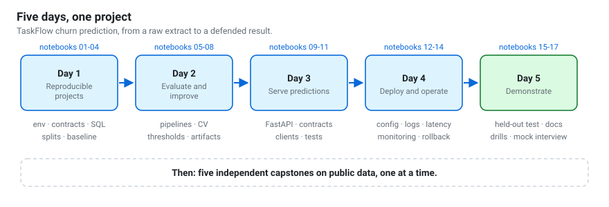
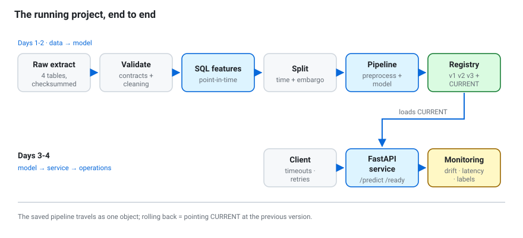

# Machine Learning Engineering Bootcamp

**MLBOOTCAMP** · Five days, about three hours a day · Runs in a free Google Colab CPU runtime

From "I can train a good model" to "I can ship, operate and defend one". One
small end-to-end project runs through all five days: data contracts and SQL,
leakage-safe evaluation, a FastAPI prediction service with tests, deployment
files, monitoring and rollback, and finally a held-out evaluation and a mock
interview. Five independent portfolio capstones on public data follow.

Who it is for: researchers and modelers moving into **ML Engineer**, **Applied
Scientist** and **Algorithm Engineer** roles. It assumes you already know
Python, scikit-learn and the basics of deep learning, and it concentrates on what
research rarely trains: reproducibility, SQL, modular code, tests, APIs,
deployment, monitoring and explaining your decisions under questioning.



---

## Quick start

**In Colab (nothing to install):** click any *Colab* badge in the table below,
then *Runtime → Run all*. The first cell clones this repository and installs
what is missing. Every notebook rebuilds what it needs from earlier ones, so
you can open any of them in a fresh runtime.

**Locally:**

```bash
git clone https://github.com/berdakh/MLBOOTCAMP.git
cd MLBOOTCAMP
python -m venv .venv && source .venv/bin/activate    # Windows: .venv\Scripts\activate
pip install -r requirements.txt
python -m pytest                                      # ~1 minute, no network needed
jupyter lab notebooks/00_diagnostic.ipynb
```

Start with **[notebook 00, the diagnostic](notebooks/00_diagnostic.ipynb)**. It
takes an hour and tells you which days need the most attention.

---

## The project: TaskFlow churn prediction

TaskFlow is a fictional subscription software company. Its database export
has four tables: `customers`, `usage_weekly`, `invoices` and `tickets`.
Every month the company wants to know which active accounts are likely to
cancel in the next 30 days, so the customer-success team can contact them.

The data is **synthetic**: it was generated once by
[`src/churnlab/data.py`](src/churnlab/data.py), committed, and checksummed.
That choice is deliberate. The data is available in Colab without an account,
trains on a CPU in seconds, and has planted defects you are expected to find:
a leaking status column, duplicate rows, a sentinel value, and a region code
that pandas silently reads as missing. Nothing learned on it is a fact about real
customers. The capstones are where you work with real public data.



## The notebooks

| # | Notebook | You learn to | Time | Colab |
|---|---|---|---|---|
| **Day 0 — Diagnostic** |||||
| 00 | [Skills diagnostic](notebooks/00_diagnostic.ipynb) | Measure your Python, pandas, SQL, testing and evaluation skills before you start | 60 min | [](https://colab.research.google.com/github/berdakh/MLBOOTCAMP/blob/main/notebooks/00_diagnostic.ipynb) |
| **Day 1 — Reproducible ML projects** |||||
| 01 | [A reproducible project](notebooks/01_reproducible_project.ipynb) | Repo layout, environments, seeds, config, run records, persisting work across Colab sessions | 40 min | [](https://colab.research.google.com/github/berdakh/MLBOOTCAMP/blob/main/notebooks/01_reproducible_project.ipynb) |
| 02 | [Data acquisition & validation](notebooks/02_data_acquisition_and_validation.ipynb) | Checksummed downloads, data contracts, finding and fixing planted defects | 45 min | [](https://colab.research.google.com/github/berdakh/MLBOOTCAMP/blob/main/notebooks/02_data_acquisition_and_validation.ipynb) |
| 03 | [SQL for ML](notebooks/03_sql_for_ml.ipynb) | Joins, window functions, and point-in-time features and labels in DuckDB | 55 min | [](https://colab.research.google.com/github/berdakh/MLBOOTCAMP/blob/main/notebooks/03_sql_for_ml.ipynb) |
| 04 | [Leakage-safe splits & a baseline](notebooks/04_leakage_safe_splits_and_baseline.ipynb) | Time, group and random splits; measuring leakage; honest baselines | 45 min | [](https://colab.research.google.com/github/berdakh/MLBOOTCAMP/blob/main/notebooks/04_leakage_safe_splits_and_baseline.ipynb) |
| **Day 2 — Evaluation & improvement** |||||
| 05 | [Pipelines & cross-validation](notebooks/05_pipelines_and_cross_validation.ipynb) | `Pipeline` and `ColumnTransformer`, rolling-origin CV, preprocessing leaks | 50 min | [](https://colab.research.google.com/github/berdakh/MLBOOTCAMP/blob/main/notebooks/05_pipelines_and_cross_validation.ipynb) |
| 06 | [Model selection](notebooks/06_model_selection.ipynb) | Compare models with confidence intervals; search on a budget; know when trees lose | 45 min | [](https://colab.research.google.com/github/berdakh/MLBOOTCAMP/blob/main/notebooks/06_model_selection.ipynb) |
| 07 | [Thresholds & calibration](notebooks/07_thresholds_and_calibration.ipynb) | PR curves, cost-based thresholds, calibration, capacity constraints | 40 min | [](https://colab.research.google.com/github/berdakh/MLBOOTCAMP/blob/main/notebooks/07_thresholds_and_calibration.ipynb) |
| 08 | [Error analysis & artifacts](notebooks/08_error_analysis_and_artifacts.ipynb) | Slice analysis, model bundles with metadata, a registry, a model card | 45 min | [](https://colab.research.google.com/github/berdakh/MLBOOTCAMP/blob/main/notebooks/08_error_analysis_and_artifacts.ipynb) |
| **Day 3 — Serving predictions** |||||
| 09 | [FastAPI & contracts](notebooks/09_fastapi_and_contracts.ipynb) | Pydantic schemas, an app factory, testing an API in-process | 55 min | [](https://colab.research.google.com/github/berdakh/MLBOOTCAMP/blob/main/notebooks/09_fastapi_and_contracts.ipynb) |
| 10 | [Consistent serving](notebooks/10_consistent_serving.ipynb) | Training/serving skew, loading models safely, versions in every response | 45 min | [](https://colab.research.google.com/github/berdakh/MLBOOTCAMP/blob/main/notebooks/10_consistent_serving.ipynb) |
| 11 | [API clients & tests](notebooks/11_api_clients_and_tests.ipynb) | Timeouts and retries, a local server, pytest suites that catch real bugs | 60 min | [](https://colab.research.google.com/github/berdakh/MLBOOTCAMP/blob/main/notebooks/11_api_clients_and_tests.ipynb) |
| **Day 4 — Deployment & operations** |||||
| 12 | [Packaging & configuration](notebooks/12_packaging_and_configuration.ipynb) | `pyproject`, environment config, a Dockerfile and CI workflow, written and explained | 45 min | [](https://colab.research.google.com/github/berdakh/MLBOOTCAMP/blob/main/notebooks/12_packaging_and_configuration.ipynb) |
| 13 | [Health, logs & latency](notebooks/13_health_logs_and_latency.ipynb) | Liveness vs readiness, structured logs, p95 latency, concurrency, batching | 55 min | [](https://colab.research.google.com/github/berdakh/MLBOOTCAMP/blob/main/notebooks/13_health_logs_and_latency.ipynb) |
| 14 | [Monitoring & rollback](notebooks/14_monitoring_and_rollback.ipynb) | Drift (PSI), delayed labels, alert rules, a bad deploy and a rollback | 60 min | [](https://colab.research.google.com/github/berdakh/MLBOOTCAMP/blob/main/notebooks/14_monitoring_and_rollback.ipynb) |
| **Day 5 — Interview demonstration** |||||
| 15 | [Final evaluation & documentation](notebooks/15_final_evaluation_and_docs.ipynb) | Touch the test set once, report with uncertainty, write the README and model card | 50 min | [](https://colab.research.google.com/github/berdakh/MLBOOTCAMP/blob/main/notebooks/15_final_evaluation_and_docs.ipynb) |
| 16 | [Python & SQL drills](notebooks/16_python_and_sql_drills.ipynb) | Timed, self-checking interview drills | 60 min | [](https://colab.research.google.com/github/berdakh/MLBOOTCAMP/blob/main/notebooks/16_python_and_sql_drills.ipynb) |
| 17 | [System design & mock interview](notebooks/17_system_design_and_mock_interview.ipynb) | An ML system design framework, a worked design, and a scored mock interview | 70 min | [](https://colab.research.google.com/github/berdakh/MLBOOTCAMP/blob/main/notebooks/17_system_design_and_mock_interview.ipynb) |

Every core cell runs on a CPU. GPU material is marked **optional**, and nothing
later depends on it. Docker and public hosting are taught by generating and
explaining the files. Actually building a container or deploying is marked as
an **optional external extension**, because Colab cannot run Docker.

**Daily plan, timings and what to pay attention to:** [docs/days/](docs/days/index.md)

## Five days is a start, not a finish

| Five days gets you | Needs the rest of the month (and beyond) |
|---|---|
| A working, tested, documented end-to-end project you can walk through | Fluency: writing the same things quickly, from a blank file, under time pressure |
| The vocabulary and the failure modes: leakage, skew, drift, rollback | SQL speed: window functions and joins without looking anything up |
| One worked system design and one scored mock interview | Many more system designs and mocks, with real feedback |
| A capstone order and briefs | The capstones themselves: about one every 4-5 days at 3 h/day |

The full four-week plan is in [docs/guides/study-plan.md](docs/guides/study-plan.md).
The readiness rubric is in [docs/guides/readiness-rubric.md](docs/guides/readiness-rubric.md).

## After the bootcamp: five capstones

Independent portfolio projects on public data, each with a manageable MVP and
optional extensions. They are **public-data demonstrations inspired by**
energy, retail and social-platform problems, not work done for any company.

| # | Capstone | Core skill it proves |
|---|---|---|
| 1 | [Texas electricity load forecasting (ERCOT)](docs/capstones/01-ercot-load-forecasting.md) | Time-series backtesting, seasonal baselines, peak-hour error |
| 2 | [Predictive maintenance (NASA C-MAPSS)](docs/capstones/02-cmapss-predictive-maintenance.md) | Entity-level splits, RUL evaluation, a compact temporal model |
| 3 | [Retail demand forecasting (UCI Online Retail)](docs/capstones/03-online-retail-forecasting.md) | Messy transactional data, intermittent demand, sales ≠ demand |
| 4 | [Recommendations (MovieLens)](docs/capstones/04-movielens-recommendations.md) | Time-aware ranking evaluation, Recall@10/NDCG@10, cold start |
| 5 | [Content moderation triage (Civil Comments)](docs/capstones/05-civil-comments-moderation.md) | PR-AUC, thresholds for human review, subgroup errors |

Recommended order and reasoning: [docs/capstones/](docs/capstones/index.md).
A repository template for each capstone is in [capstones/template/](capstones/template/README.md).

## Background reading and guides

| | |
|---|---|
| [Handbook](docs/handbook/index.md) | The ideas behind each day: no code, readable in an evening |
| [Before you start](docs/guides/before-you-start.md) | Ten-minute checklist |
| [Colab guide](docs/guides/colab.md) | Runtimes, Drive, saving and restoring artifacts |
| [Troubleshooting](docs/guides/troubleshooting.md) | When it breaks |
| [Interview question bank](docs/guides/interview-questions.md) | By topic, with what a strong answer contains |
| [Cheat sheet](docs/guides/cheatsheet.md) · [Glossary](docs/guides/glossary.md) | Reference |
| [Verification](docs/guides/verification.md) | Exactly what was executed, where, and what was not |
| [Solutions](solutions/README.md) | Exercise and checkpoint answers, kept separate from the notebooks |

---

## What is in this repository

```
notebooks/          18 teaching notebooks (generated, outputs cleared)
notebook_src/       their source, percent-format .py - edit these
src/churnlab/       the project as a small, readable package
    data.py           dataset generator, checksums, downloads
    validate.py       data contracts and cleaning decisions
    features.py       point-in-time SQL features (DuckDB)
    splits.py         time / group splits, rolling-origin CV, leakage asserts
    modeling.py       sklearn pipelines (preprocessing inside the model)
    evaluation.py     metrics, bootstrap CIs, thresholds, calibration, slices
    artifacts.py      model bundles with metadata and integrity checks
    registry.py       versions, CURRENT pointer, promote, rollback
    schemas.py        the API contract (Pydantic)
    api.py            FastAPI app factory: predict, health, ready, metrics
    client.py         timeout- and retry-aware client
    settings.py logs.py monitoring.py colab.py bootstrap.py checks.py
    grading/          self-checks for every coded exercise
data/raw/           the committed synthetic extract (4 gzipped CSVs, SHA-256 pinned)
solutions/          worked answers (markdown) + reference code that CI grades
deploy/             reference Dockerfile, serve.py and CI workflow (generated on Day 4)
capstones/template/ a starting repository layout for each capstone
docs/               handbook, daily plans, guides, capstone briefs, diagrams
tests/              unit tests for churnlab, graders and solutions
tools/              nbbuild, run_notebooks, check_notebooks, check_links, diagrams, dataset
```

## For maintainers

```bash
make test            # unit tests (no network)
make notebooks       # rebuild notebooks/*.ipynb from notebook_src/
make check           # everything CI runs: sync, structure, links, diagrams, tests
make run-notebooks   # execute every notebook in a fresh artifact dir (~10 min)
```

Notebooks are generated from `notebook_src/*.py` so that pull requests show
readable diffs. Edit the `.py`, run `make notebooks`, commit both. CI fails if
they drift. See [CONTRIBUTING.md](CONTRIBUTING.md) for the notebook anatomy and
the exercise → grader → solution convention.

The structure follows the author's
[ROBT407LLM workshop](https://github.com/berdakh/ROBT407LLM). The content is new.

## Licence

Code is [MIT](LICENSE). Prose and teaching materials are CC BY 4.0. The
synthetic dataset is released with the code under MIT. Capstone datasets carry
their **own** terms; each brief states them and links the source.
