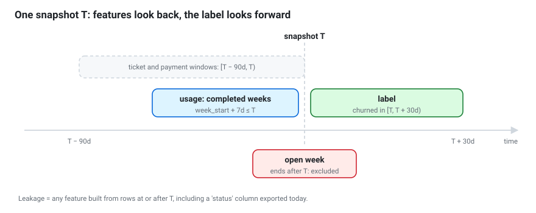
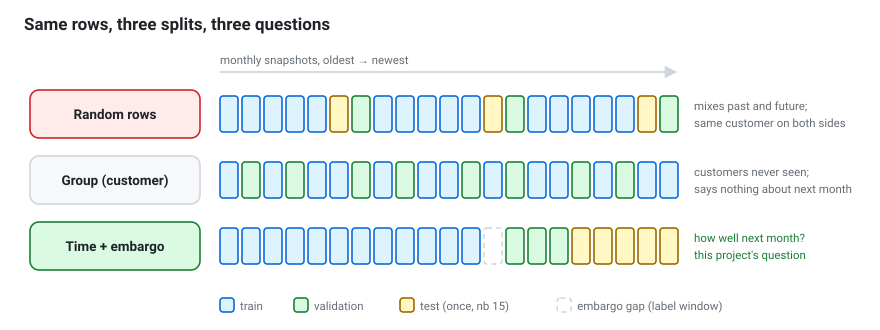

# Day 1 — Reproducible ML projects
{: .no_toc }

**Goal:** by the end of today you have a training table you can trust: data
that has been checked against a written contract, features computed in SQL
using only information available at prediction time, and a split that
measures what production will actually experience.

1. TOC
{:toc}

---

{: .warning }
> Did you do the [diagnostic](index.html#day-0) and the
> [before-you-start checklist](../guides/before-you-start.html)? The first
> notebook assumes the setup cell works for you.

## Schedule

| Time | Activity | Notebook |
|---|---|---|
| 0:00–0:40 | Repo layout, environments, seeds, config, run records | `01_reproducible_project` · [GitHub](https://github.com/berdakh/MLBOOTCAMP/blob/main/notebooks/01_reproducible_project.ipynb) · [Colab](https://colab.research.google.com/github/berdakh/MLBOOTCAMP/blob/main/notebooks/01_reproducible_project.ipynb) |
| 0:40–1:25 | Checksums, data contracts, the planted defects | `02_data_acquisition_and_validation` · [GitHub](https://github.com/berdakh/MLBOOTCAMP/blob/main/notebooks/02_data_acquisition_and_validation.ipynb) · [Colab](https://colab.research.google.com/github/berdakh/MLBOOTCAMP/blob/main/notebooks/02_data_acquisition_and_validation.ipynb) |
| 1:25–1:30 | *Break* | — |
| 1:30–2:25 | Joins, window functions, point-in-time features and labels | `03_sql_for_ml` · [GitHub](https://github.com/berdakh/MLBOOTCAMP/blob/main/notebooks/03_sql_for_ml.ipynb) · [Colab](https://colab.research.google.com/github/berdakh/MLBOOTCAMP/blob/main/notebooks/03_sql_for_ml.ipynb) |
| 2:25–3:10 | Time, group and random splits; a baseline | `04_leakage_safe_splits_and_baseline` · [GitHub](https://github.com/berdakh/MLBOOTCAMP/blob/main/notebooks/04_leakage_safe_splits_and_baseline.ipynb) · [Colab](https://colab.research.google.com/github/berdakh/MLBOOTCAMP/blob/main/notebooks/04_leakage_safe_splits_and_baseline.ipynb) |

## The one idea

> A feature for snapshot date T may use only data with a timestamp before T.
> The label for T uses only data from T to T + 30 days. Everything else on Day 1
> exists to make that rule true and to check that it is.

If you did cross-subject EEG work, you already know the shape of this problem:
a within-subject random split flatters the model because test windows are
neighbours of training windows. Today's version is the same mistake in time
and across customers.

## What to pay attention to

**In notebook 01**, the difference between "it ran" and "it can be re-run".
The run record (what code, what data, what config, what seed) is the thing you
will be asked for when a number is questioned in three weeks. Note also where
your artifact directory is: in Colab it disappears when the runtime does,
unless you use the `USE_DRIVE` switch or export a zip
([Colab guide](../guides/colab.html)).

**In notebook 02**, the defects are planted, at known rates, so you can check
that your validation finds them: a status column that describes the account
*as of the export date* (the future, relative to every snapshot), duplicate
usage rows, a `-1` sentinel meaning "unknown", inconsistent plan casing, and a
region code `NA` (North America) that pandas reads as missing unless you tell
it not to. Each fix in `churnlab/validate.py` is a *decision* with a stated
reason. Be ready to defend each one.

**In notebook 03**, the line `u.week_start + INTERVAL 7 DAY <= b.snapshot_date`.
Usage is recorded per week *starting* on `week_start`, so a week is only known
once it ends. Writing `week_start < snapshot_date` instead looks harmless and
leaks up to six days of the future into every usage feature. This is the most
common class of SQL leakage bug, and it does not raise an error.

**In notebook 04**, the gap between the random-split score and the time-split
score. Write both numbers down. The random split is not "a bit optimistic"; it
answers a different question from the one the business is asking. Notice also
the 30-day embargo: training rows whose label window overlaps the validation
period are dropped.

## End-of-day evidence

You are done with Day 1 when you can show:

| Evidence | Where it comes from |
|---|---|
| The files each notebook lists under **You will produce**, present in your artifact directory (at least `features.parquet`) | Notebooks 01–04 |
| A validation report that finds every planted defect, and one sentence per defect saying how you handled it and why | Notebook 02 |
| A SQL feature query you can read aloud and point to the line that prevents leakage | Notebook 03 |
| Two numbers: the baseline's score on a random split and on the time split, with the split named | Notebook 04 |
| Spoken answers to every checkpoint question in 01–04, without notes | Checkpoints |

Graded exercises should show ✅. Compare your written answers with
[the solutions](https://github.com/berdakh/MLBOOTCAMP/blob/main/solutions/README.md)
only after you have committed to your own.

## If you only have 90 minutes

| Time | Do |
|---|---|
| 0:00–0:50 | Notebook 03, all sections and exercises |
| 0:50–1:30 | Notebook 04, sections on random vs time split and the embargo |

Skim notebook 02's list of defects and read `src/churnlab/validate.py`
(`clean` is twenty lines). Come back to 01 when you build your first capstone;
you will need it then.

## Common Day 1 problems

| Symptom | Fix |
|---|---|
| `ModuleNotFoundError: churnlab` | Run the setup cell (the first code cell) |
| The `NA` region has vanished and "unknown" is huge | You read a CSV without `keep_default_na=False` — see [Troubleshooting](../guides/troubleshooting.html#the-na-region-became-missing) |
| DuckDB `Binder Error` comparing dates and strings | A date column was not parsed — see [Troubleshooting](../guides/troubleshooting.html#duckdb-type-errors) |
| Artifacts gone after a break | The runtime was recycled; re-run from the top, the catch-up cell rebuilds them |

## Optional reading

- [Handbook 2 · Reproducibility](../handbook/02-reproducibility.html)
- [Handbook 3 · Data, SQL and leakage](../handbook/03-data-sql-and-leakage.html)
