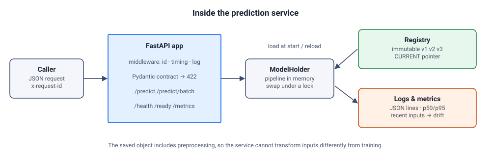

# Day 3 — Serving predictions

**Goal:** by the end of today the model from Day 2 sits behind a FastAPI
service with a written contract, returns the same scores the notebook did,
reports which model version produced each answer, and is covered by tests and
called by a client that knows how to fail.

---

## Schedule

| Time | Activity | Notebook |
|---|---|---|
| 0:00–0:55 | Pydantic schemas, the app factory, testing in-process | `09_fastapi_and_contracts` · [GitHub](https://github.com/berdakh/MLBOOTCAMP/blob/main/notebooks/09_fastapi_and_contracts.ipynb) · [Colab](https://colab.research.google.com/github/berdakh/MLBOOTCAMP/blob/main/notebooks/09_fastapi_and_contracts.ipynb) |
| 0:55–1:40 | Training/serving skew, loading models safely, versions in responses | `10_consistent_serving` · [GitHub](https://github.com/berdakh/MLBOOTCAMP/blob/main/notebooks/10_consistent_serving.ipynb) · [Colab](https://colab.research.google.com/github/berdakh/MLBOOTCAMP/blob/main/notebooks/10_consistent_serving.ipynb) |
| 1:40–1:45 | *Break* | — |
| 1:45–2:45 | Timeouts and retries, a local server, pytest suites | `11_api_clients_and_tests` · [GitHub](https://github.com/berdakh/MLBOOTCAMP/blob/main/notebooks/11_api_clients_and_tests.ipynb) · [Colab](https://colab.research.google.com/github/berdakh/MLBOOTCAMP/blob/main/notebooks/11_api_clients_and_tests.ipynb) |
| 2:45–3:00 | Review: read `src/churnlab/api.py` top to bottom and explain each endpoint aloud | — |

## The one idea

> The API is a promise. The schema says what callers may send; the response
> says what they get back and *which model* produced it; the tests check that
> the promise is kept, including when the input is wrong.

## What to pay attention to

**In notebook 09**, the 422 responses. Send a misspelled field, a negative
session count, a missing required field. The schema uses `extra="forbid"`, so
a typo is an error instead of a silently imputed missing value. Read the error
body: it names the field and the rule. Notice also that categorical fields are
plain strings, not enums, so an unseen region reaches the model (which ignores
unknown categories) rather than failing the request. That is a trade-off; be
ready to argue either side.

**In notebook 09**, the app factory. `create_app(settings)` builds a fresh app
from a settings object. Tests build one with a temporary registry; production
builds one from environment variables. There is no model loaded at import
time, so importing the module in a test never touches disk.

**In notebook 10**, the skew check: score the same rows through the notebook
and through the API and compare. They should agree to floating-point
precision. If they do not, something about preprocessing differs between
training and serving, and that difference will not raise an error in
production. Also note what happens when a bundle was saved with a different
scikit-learn minor version: a warning by default, an error in strict mode.

**In notebook 11**, which failures the client retries. Connection errors, 429
and 502/503/504 are retried with exponential backoff. A 422 is **never**
retried: it will fail identically every time, and retrying just multiplies
load. Then look at what the tests actually assert. A good API test fails when
the behaviour is wrong, not merely when the server is down.

## End-of-day evidence

| Evidence | Where it comes from |
|---|---|
| A `/predict` response that includes `model_version`, and a `/ready` response that returns 503 when no model is loaded | Notebook 09 |
| At least three distinct 422 errors you triggered on purpose, and why each is rejected | Notebook 09 |
| A skew check: notebook scores vs API scores for the same rows, maximum absolute difference printed | Notebook 10 |
| A pytest run that passes, and one test you wrote that fails when you deliberately break the service | Notebook 11 |
| The ability to say, without notes, which HTTP statuses the client retries and why | Checkpoint |

## If you only have 90 minutes

| Time | Do |
|---|---|
| 0:00–0:50 | Notebook 09 in full |
| 0:50–1:30 | Notebook 11: the retry rules and the test suite sections |

Read the skew-check cell of notebook 10 and run it; it takes a minute.

## Common Day 3 problems

| Symptom | Fix |
|---|---|
| `422 Unprocessable Entity` | Working as intended: read `detail[].loc` and `detail[].msg` — see [Troubleshooting](../guides/troubleshooting.md#422-unprocessable-entity) |
| `address already in use` when starting uvicorn | A server from an earlier cell is still running — see [Troubleshooting](../guides/troubleshooting.md#port-already-in-use) |
| Edited `api.py` but nothing changed | The module is cached — see [Troubleshooting](../guides/troubleshooting.md#code-changes-not-picked-up) |
| `InconsistentVersionWarning` / "model trained with sklearn …" | See [Troubleshooting](../guides/troubleshooting.md#scikit-learn-version-mismatch-when-loading-a-bundle) |

## Optional reading

- [Handbook 5 · Serving](../handbook/05-serving.md)
- [Cheat sheet: FastAPI and pytest](../guides/cheatsheet.md)
