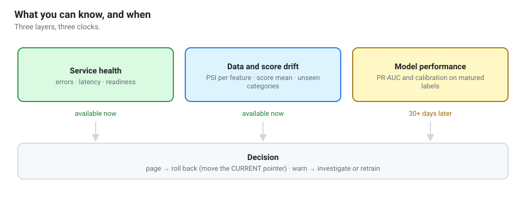

# Day 4 — Deployment & operations

**Goal:** by the end of today you can package the service, configure it
without editing code, tell whether it is alive and whether it is ready,
measure its latency honestly, notice when its inputs drift, and roll back a
bad model in one step.

---

> **Note:** Colab cannot run Docker or host a public server. Today you **write and
> explain** a Dockerfile and a CI workflow, and run the service locally inside
> the notebook. Building the image or deploying it publicly is an **optional
> external extension** on your own machine or a cloud account.

## Schedule

| Time | Activity | Notebook |
|---|---|---|
| 0:00–0:45 | `pyproject`, environment configuration, a Dockerfile and CI workflow | `12_packaging_and_configuration` · [GitHub](https://github.com/berdakh/MLBOOTCAMP/blob/main/notebooks/12_packaging_and_configuration.ipynb) · [Colab](https://colab.research.google.com/github/berdakh/MLBOOTCAMP/blob/main/notebooks/12_packaging_and_configuration.ipynb) |
| 0:45–1:40 | Liveness vs readiness, structured logs, p95 latency, batching | `13_health_logs_and_latency` · [GitHub](https://github.com/berdakh/MLBOOTCAMP/blob/main/notebooks/13_health_logs_and_latency.ipynb) · [Colab](https://colab.research.google.com/github/berdakh/MLBOOTCAMP/blob/main/notebooks/13_health_logs_and_latency.ipynb) |
| 1:40–1:45 | *Break* | — |
| 1:45–2:45 | Drift (PSI), delayed labels, alert rules, a bad deploy and a rollback | `14_monitoring_and_rollback` · [GitHub](https://github.com/berdakh/MLBOOTCAMP/blob/main/notebooks/14_monitoring_and_rollback.ipynb) · [Colab](https://colab.research.google.com/github/berdakh/MLBOOTCAMP/blob/main/notebooks/14_monitoring_and_rollback.ipynb) |
| 2:45–3:00 | Review: write a five-line runbook for "the model is producing nonsense" | — |

## The one idea

> You find out a model is wrong in production long before you find out *why*.
> Build the cheap signals first (errors, latency, input and score
> distributions), know that the expensive one (real accuracy) arrives late, and
> make undoing a deploy faster than diagnosing it.

## What to pay attention to

**In notebook 12**, which values are configuration and which are code. The
registry path, a pinned model version, batch limits, log level and a
threshold override all come from `CHURN_*` environment variables, read once at
start-up into a frozen `Settings` object. The same image then runs anywhere.
Read the generated Dockerfile line by line and say why each line is there.

**In notebook 13**, `/health` versus `/ready`. Liveness never touches the
model: if it did, a slow model load would get the process killed and
restarted in a loop. Readiness says "send me traffic". Then look at latency as
a distribution, not a mean. Record p50, p95 and p99 for single requests and
for batches, and note how much per-row cost batching saves.

**In notebook 14**, the difference between drift and damage. PSI tells you
inputs changed; it does not tell you predictions got worse. The course's
rule-of-thumb bands (below 0.1 stable, 0.1–0.25 moderate, above 0.25 large) are
conventions, not laws. The labels for this model arrive 30 days after each
prediction, so the performance check always lags. Then watch the rollback:
it rewrites a one-line `CURRENT` pointer and tells the service to reload.
Bundles are immutable, so there is nothing to rebuild.

## End-of-day evidence

| Evidence | Where it comes from |
|---|---|
| A Dockerfile, a `serve.py` and a CI workflow you can explain line by line (generated into `deploy/`) | Notebook 12 |
| A `Settings` object built from environment variables, and one invalid value that is rejected at start-up | Notebook 12 |
| A JSON log line for one request containing its request id, latency and model version | Notebook 13 |
| A latency table (p50/p95/p99) for single and batched requests, **with the machine named** (a Colab CPU is not a production server) | Notebook 13 |
| A drift report on the simulated new quarter, the alert rules that fired, and the registry `history.jsonl` showing a promotion and a rollback | Notebook 14 |
| A five-line runbook: what you check first, second, third, and when you roll back | Review block |

## If you only have 90 minutes

| Time | Do |
|---|---|
| 0:00–0:30 | Notebook 13: health vs readiness and the latency section |
| 0:30–1:30 | Notebook 14 in full |

Read the Dockerfile notebook 12 generates and `src/churnlab/settings.py`
(50 lines) afterwards.

## Optional reading

- [Handbook 6 · Operations and monitoring](../handbook/06-operations-and-monitoring.md)
- [Interview questions: operations](../guides/interview-questions.md#deployment-and-operations)
