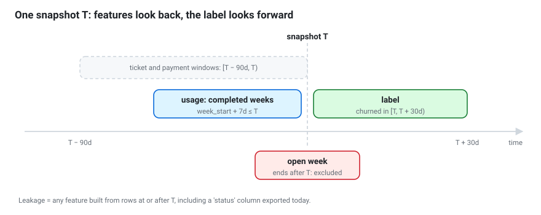
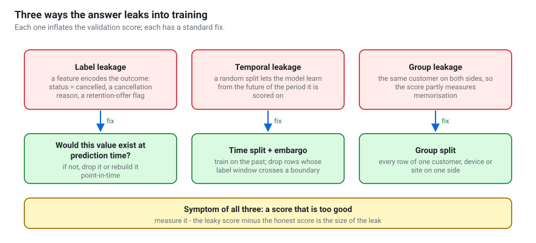
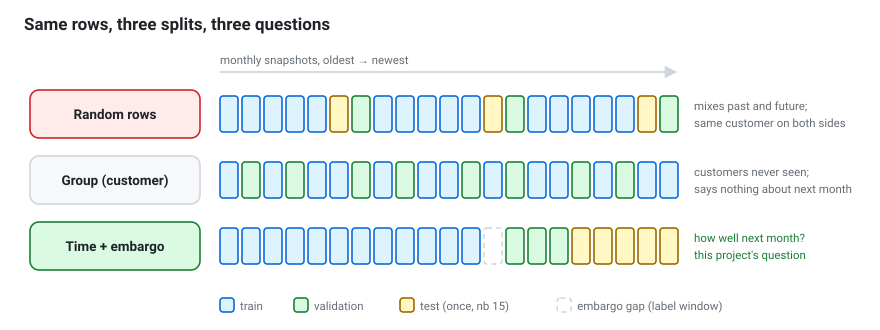

# Data, SQL and leakage

Most production models that disappoint were evaluated on information they
would not have had at prediction time. This chapter is about preventing that.

---

## Why SQL

In most companies the training data lives in a warehouse, and the people who
know it write SQL. You will be expected to read and write joins, aggregations
and window functions fluently, and interviews test it directly. SQL also has a
practical advantage for feature engineering: the feature definition is one
readable query that a colleague can review, run on the warehouse, and reuse.

This course uses **DuckDB**: an in-process SQL engine that queries pandas
DataFrames and Parquet files directly, with no server. The SQL you write is
close to what you would write on a cloud warehouse; dialects differ in date
functions and a few extensions.

## Data contracts

A data contract writes down what each column must look like: type, nullability,
allowed values, ranges, uniqueness. Checking it produces a report, not a crash,
so you can see every problem at once.

The TaskFlow extract has defects planted at known rates so you can check that
your validation finds them:

| Defect | What goes wrong if you miss it | Decision in `clean()` |
|---|---|---|
| Plan written as `Pro` and `pro` | Two categories for one plan | Lower-case it |
| Missing region | Silent `NaN` category | Keep as its own `unknown` category, rather than dropping rows and biasing the data |
| Region code `NA` (North America) | pandas reads it as missing by default | Read with `keep_default_na=False` so only empty fields are missing |
| Duplicate weekly usage rows | Inflated session counts | Keep the first row per (customer, week) |
| `sessions = -1` | A logging sentinel treated as a real count | Set to missing; let the pipeline impute |
| `status`, `churn_date`, `last_active_week` on the customer table | Leakage: they describe the account *as of the export date* | Kept for building the label, excluded from features |

The point is not the specific fixes. It is that every fix is a stated decision
someone can review and disagree with.

## Point-in-time correctness

Training data for a periodic prediction task is built as **snapshots**. For
each snapshot date T and each entity alive at T, compute:

- **features** from data with timestamps strictly *before* T;
- the **label** from data in the window *after* T (here, [T, T + 30 days)).

The rule is simple. Breaking it is easy, because the bug produces no error,
only a model that looks better than it is. Common ways it breaks:

| Bug | Example |
|---|---|
| Using a column that is updated in place | `customers.status` read today says "cancelled" for a snapshot taken a year ago |
| Period boundaries | Weekly usage stored by `week_start`; a week is only complete at `week_start + 7 days`. Comparing `week_start < T` leaks up to six days |
| `<=` instead of `<` | An event on the snapshot day itself, which may have been recorded after the prediction was made |
| Aggregates over the whole table | "Average tickets per customer" computed across all time, then joined to every snapshot |
| Late-arriving data | A record with an event time before T but an ingestion time after T. Strictly, you need the ingestion time to be before T as well |
| Joining to the latest version of a dimension | A customer's *current* plan joined to a historical snapshot |

The last two are the hardest. Warehouses that keep only current state cannot
answer "what did we know at T?". When you can, use tables with validity
intervals (sometimes called slowly changing dimensions or history tables), or
the event log itself.

*What to notice:* all three have the same symptom, a score that is too good, so the symptom alone does not tell you which one you have. The sections below take them one at a time.

## Label leakage

Label leakage is any feature that encodes the answer.

- **Direct**: a column derived from the label (`status = 'cancelled'`).
- **Proxy**: a column that only exists *because* of the outcome, such as a
  "cancellation reason" field or the number of days until last activity.
- **Process**: something downstream of the outcome in the business process.
  For example, a retention-offer flag that the support team sets after a
  customer has already announced they are leaving.

The test for any surprisingly strong feature: *at the moment the prediction is
made, in production, would this value exist and be this value?* On Day 1,
the `LEAKY_SQL` query in `churnlab/features.py` lets you measure what a
leaking feature does to the validation score. Keep that number in mind; it
is what overconfident results in papers look like.

## Temporal leakage

When rows are ordered in time, a random split lets the model learn from the
future of the period it is scored on. Production never gets to do that.

Use a **time split**: train on the past, validate on the next period, test on
the period after. Add an **embargo** when labels look ahead. In this project the
label for snapshot T covers the next 30 days, so a training row from just
before the boundary has a label window that overlaps the validation period.
Rows whose label window crosses a boundary are dropped from the earlier split.

For cross-validation inside the training period, use **rolling-origin** folds:
train on everything before a cut-off, validate on the next block, move the
cut-off forward.

## Group (entity) leakage

The same customer appears at many snapshots, and its rows are strongly
correlated. If a customer is in both training and test, part of the test score
measures memorisation of that customer.

Whether that matters depends on the question:

| The model will be used to… | Honest split |
|---|---|
| Score existing customers next month | Time split. Seeing the same customer in an earlier period is realistic |
| Score customers it has never seen | Group split by customer (often combined with time) |
| Generalise to a new site, device, hospital, or region | Group split by that unit |

Name the split you used next to every result you report.

## The cross-subject analogy

If you have done EEG or BCI work, you already know this chapter.

| EEG/BCI | TaskFlow churn |
|---|---|
| Subject | Customer |
| Trials or windows from one session | Monthly snapshots of one customer |
| Within-subject random split: high accuracy from shared noise, electrode placement and session effects | Random split: high scores from memorised customers and future periods |
| Leave-one-subject-out evaluation | Group split by customer |
| Session-to-session transfer (train on day 1, test on day 2) | Time split: train on past months, test on later months |
| Filters or normalisation fitted on all data before splitting | Scaler or imputer fitted before cross-validation |
| Overlapping windows across the train/test boundary | Label windows overlapping across the boundary (the embargo) |

The difference between a within-subject and a cross-subject score is a
measured size of the leakage. That makes it an excellent interview story: you
found the problem, you measured it, and you changed the evaluation to match how
the system would really be used.

## Interview angle

Expect a SQL question that is really a leakage question: "Write a query for
each customer's sessions in the 30 days before each snapshot date." The
interviewer is watching your date boundaries, your join conditions, and
whether you ask how the timestamps are recorded. Ask.
