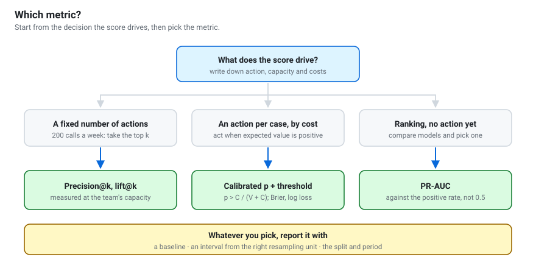
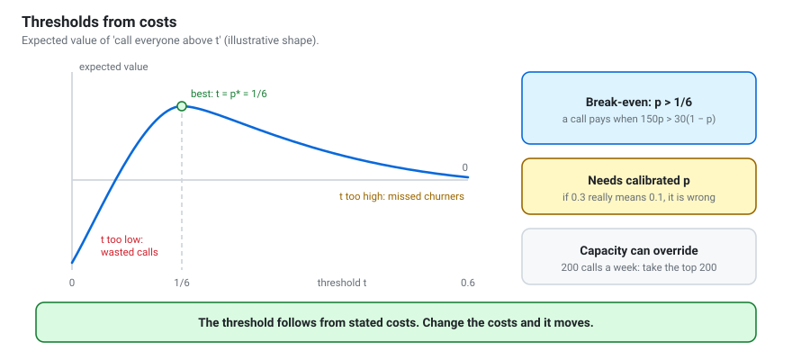

# Evaluation and decisions

A model produces scores. A business makes decisions. Evaluation connects the
two, and it has to be honest about uncertainty at every step.

---

## Start from the decision

Before choosing a metric, write down:

1. **What action** does a prediction trigger? (Here: a customer-success call.)
2. **How many** actions can be taken? (A team can make only so many calls a week.)
3. **What does each outcome cost or gain?** (A wasted call, a saved customer,
   a missed churner.)
4. **When is the truth known?** (Here: 30 days later.)

The metric should follow from these, not the other way round.

## Metrics for imbalanced problems

Churn, fraud, faults and moderation are all imbalanced: positives are a small
fraction. In TaskFlow the positive rate is roughly 5% (synthetic data;
notebook 04 prints it for each split). With few positives, accuracy is close
to useless: predicting "nobody churns" scores very high.

| Metric | What it answers | Watch out for |
|---|---|---|
| **ROC-AUC** | How well scores rank a random positive above a random negative | Can look strong while precision at useful thresholds is poor, because negatives dominate |
| **PR-AUC** (average precision) | Ranking quality focused on the positives | Its baseline is the positive rate, not 0.5; compare against that |
| **Precision@k / lift@k** | "If we act on the top k, how many are real?" | Matches a capacity-limited team directly |
| **Recall at a threshold** | "What share of churners do we reach?" | Meaningless without the threshold and the alert volume |
| **Brier score / log loss** | Quality of the probabilities themselves | Needed whenever probabilities feed a cost calculation |

Report a ranking metric (PR-AUC), a decision metric at the chosen threshold
(precision, recall, alert volume), and a probability metric (Brier) together.

*What to notice:* the tree starts from the action, not from the model. Two teams with the same model and different capacity should report different headline metrics.

## Uncertainty: confidence intervals

Every metric is an estimate from a finite sample. With a few hundred positives
in validation, a PR-AUC difference in the second decimal place can easily be
noise.

**The bootstrap** resamples the evaluation set with replacement many times,
recomputes the metric, and takes percentiles of the results as an interval.
It needs no distributional assumptions and works for any metric.

**Resample the right unit.** Rows of one customer are correlated: the same
customer at consecutive monthly snapshots. Resampling rows treats them as
independent and gives intervals that are too narrow. The **cluster (group)
bootstrap** resamples whole customers. This is the same reasoning as
reporting across-subject variability in EEG rather than across-trial
variability.

**Compare models on the same resamples.** To ask "is B better than A?", use a
*paired* bootstrap: on each resample compute `metric(B) - metric(A)`, and take
the interval of the difference. Two overlapping individual intervals do not
by themselves mean "no difference", and two non-overlapping ones are a
stricter test than you need. The paired interval answers the question directly.

`churnlab.evaluation` has `bootstrap_ci(..., groups=...)` and
`paired_bootstrap_diff(..., groups=...)`.

## Model selection on a budget

- Always include a **dummy baseline** (predicts the base rate) and a **simple
  model** (logistic regression with sensible preprocessing). Many tabular
  problems are not won by the complex model, and you need the simple one to
  know.
- Search hyperparameters with **rolling-origin cross-validation** inside the
  training period, not on the validation split you will report.
- Prefer a small random search with a fixed budget to a large grid.
- A bigger model is only worth it if its advantage survives the paired
  bootstrap *and* is worth its extra cost to serve, monitor and explain.

## Thresholds from costs

A score becomes a decision at a threshold. Choose it from stated costs, not
from habit (0.5) or from a metric that ignores costs (F1).

The course's cost model, stated as **assumptions for teaching**:

| Outcome | Value |
|---|---|
| Call a customer (any customer) | costs $30 |
| Reach a would-be churner | worth $600 margin × an assumed 25% success rate = **$150** in expectation |
| Miss a churner | no *additional* cost beyond the lost opportunity |

For a customer with a calibrated churn probability `p`, calling has positive
expected value when `p × 150 > (1 − p) × 30`, that is when
`p > 30 / (150 + 30) = 1/6 ≈ 0.167`.

Three things follow:

1. **The threshold depends on the assumptions.** Change the success rate or the
   call cost and the threshold must change. Say the assumptions out loud
   every time you report the threshold.
2. **The formula needs calibrated probabilities.** If the model's 0.3 really
   means 0.1, the break-even rule is wrong. In practice you either calibrate
   or choose the threshold empirically by maximising expected value on
   validation data (`best_threshold_by_value`).
3. **Capacity can override the threshold.** If the team can make 200 calls a
   week and 600 customers clear the threshold, rank and take the top 200. The
   relevant metric is then precision@200.

*What to notice:* the peak sits exactly at the break-even probability, but only if the scores are calibrated; and a capacity limit can move you to the right of it.

## Calibration

A model is calibrated if, among customers given 0.2, about 20% churn. Check it
with a reliability table: bin the scores, compare mean predicted with observed
rate per bin.

- Logistic regression is often reasonably calibrated out of the box. Boosted
  trees and models trained with class weights or resampling frequently are not.
- Calibrate (Platt scaling or isotonic regression) on data the model was not
  trained on.
- Ranking metrics (ROC-AUC, PR-AUC) do not change under monotone calibration.
  Decisions based on probability values do.

## Slice analysis

An aggregate metric can hide a slice where the model fails. Compute metrics per
plan, region, tenure band, acquisition channel.

- **Flag small slices rather than hiding them.** A recall of 0.0 on 12 rows is
  a reason to collect data, not a finding.
- **Put an interval on slice metrics** if you intend to act on them.
- **Ask why.** A slice with poor recall may have a different base rate, missing
  features (no usage data yet for new customers), or a genuinely different
  behaviour.
- The `unknown` region in TaskFlow is worth a look: it exists because of a
  cleaning decision on Day 1.

## Report it honestly

A result is reportable when it states: the metric, the value, an interval and
how it was computed (unit of resampling), the split and period, the number of
rows and positives, and the threshold with its assumptions. Anything less
invites the question, and in an interview the question is the test.

The **test period is touched once**, after all choices are fixed on
validation. If it disagrees with validation, report both and explain; do not
re-tune.

## Key equations

The handful of formulas this chapter rests on. Each is taught, with a worked
example and a code check, in the notebook named; all of them are collected in
the [equation sheet](../guides/equations.md).

**Precision, recall and the PR-AUC floor** (notebooks 04 and 07):

$$
P = \frac{TP}{TP + FP}, \qquad R = \frac{TP}{TP + FN}, \qquad \text{PR-AUC}_{\text{constant score}} = \pi
$$

*In words:* how pure the flagged set is, how much of the target it reaches; a
model that knows nothing scores the positive rate $\pi$ on PR-AUC, not 0.5.

**Precision at capacity and lift** (notebooks 07 and 15):

$$
\operatorname{precision@}k = \frac{1}{k} \sum_{i \in \text{top-}k} y_i, \qquad \operatorname{lift@}k = \frac{\operatorname{precision@}k}{\pi}
$$

*In words:* of the $k$ customers the team can call, the share who would churn,
and how many times better that is than calling at random.

**Break-even probability** (notebook 07):

$$
\text{call} \iff p\,V > (1 - p)\,C \iff p > p^{*} = \frac{C}{V + C} = \frac{30}{150 + 30} = \frac{1}{6}
$$

*In words:* act when the expected gain beats the expected cost. Valid only for
calibrated $p$.

**Probability quality** (notebook 07):

$$
\text{Brier} = \frac{1}{N}\sum_{i=1}^{N} (p_i - y_i)^2, \qquad \text{LogLoss} = -\frac{1}{N}\sum_{i=1}^{N}\Big[y_i \ln p_i + (1 - y_i)\ln(1 - p_i)\Big]
$$

*In words:* the squared and the logarithmic penalty for the gap between the
predicted probability and what happened. The base-rate constant has Brier
$\pi(1 - \pi)$.

**Bootstrap interval and paired difference** (notebook 06):

$$
\text{CI}_{95\%} = \Big[\, Q_{0.025}(\hat\theta^{*}_{b}),\; Q_{0.975}(\hat\theta^{*}_{b}) \,\Big], \qquad \Delta^{*}_{b} = m_B(\text{resample}_b) - m_A(\text{resample}_b)
$$

*In words:* recompute the metric on many resamples of customers (not rows) and
take the middle 95%; to compare two models, take the interval of their
difference on the *same* resamples. "B is better" needs that interval above 0.

## Interview angle

"Your model has 0.85 AUC. Is it good?" The strong answer asks: compared with
what baseline, on which split, with what interval, and what decision does it
support at what threshold? Then it moves to precision and alert volume at the
operating point, because that is what the business experiences.
