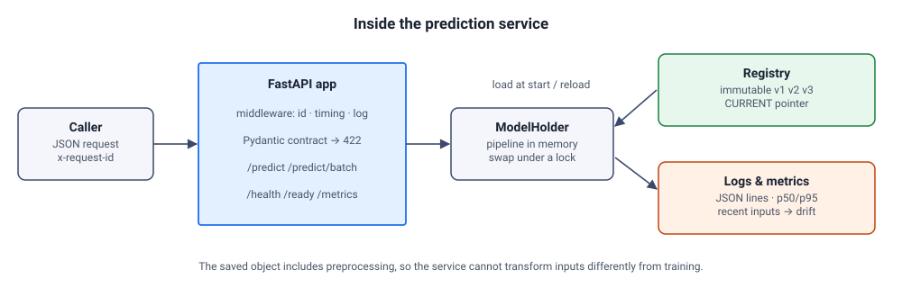
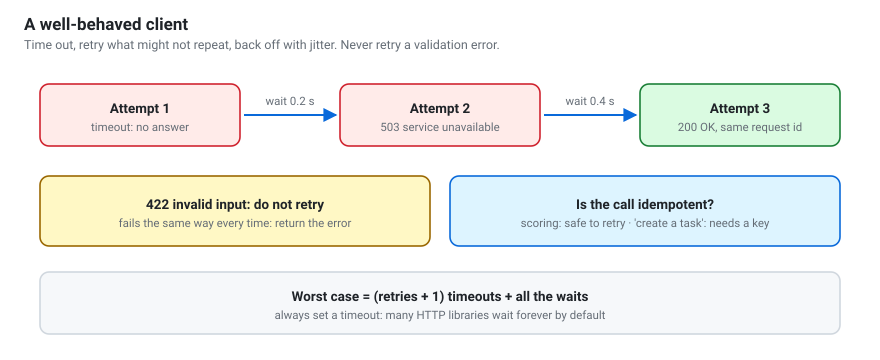

# Serving

Putting a model behind an interface other software can call, so that it
returns the same answer it gave in your notebook, fails clearly when the input
is wrong, and tells you which model answered.

---

## Online, batch, or neither

Not every model needs an API.

| Pattern | When | Example |
|---|---|---|
| **Batch scoring** | Predictions are needed on a schedule; latency does not matter | Score every active customer on the 1st of the month, write to a table the CRM reads |
| **Online (request/response)** | A caller needs an answer now, for one or a few items | Score a customer when an account manager opens their page |
| **Streaming** | Events arrive continuously and must be scored as they come | Fraud scoring on each transaction |
| **Embedded** | The model runs inside another application or device | On-device keyword spotting, a BCI decoder on the acquisition machine |

TaskFlow churn is naturally a batch problem: snapshots are monthly. The course
builds an online API anyway because it is what most interviews ask about and
it teaches contracts, testing and operations. Say so if asked: choosing batch
when batch is enough is a good engineering decision.

## The contract

The **contract** is the promise the service makes to callers: what they may
send, what they get back, and what errors mean. Writing it as types
(Pydantic models in FastAPI) gives three things at once: request validation
with readable errors, generated documentation at `/docs`, and one place to
review when the model's inputs change.

Decisions in this course's contract (`churnlab/schemas.py`), each worth
defending:

| Decision | Why | Trade-off |
|---|---|---|
| `extra="forbid"` | A misspelled field becomes a 422 error, not a silently imputed missing value | Callers must update in lockstep when fields are removed |
| Numeric bounds (`ge=0`, `le=…`) | Impossible values are rejected at the door | Bounds must be maintained; too tight a bound rejects legitimate rare values |
| Categoricals as plain strings, not enums | An unseen region reaches the model (which ignores unknown categories) and is counted by monitoring | Typos in categories are not caught by validation |
| Some numeric fields optional | They are legitimately missing (no usage yet, no tickets); the pipeline imputes | Callers might omit values they actually have |
| `model_version` in every response | Any prediction can be traced to the exact model | Slightly larger responses |

HTTP status codes carry meaning: **422** the request is invalid (do not
retry), **413** the batch is too large, **503** the service is not ready
(retry later, or elsewhere), **500** a bug.

## Training/serving skew

Skew is any difference between how features are computed in training and how
they are computed when serving. It does not raise errors. It quietly makes
predictions worse.

| Source | Prevention |
|---|---|
| Preprocessing re-implemented in the service | Keep preprocessing inside the saved `Pipeline`; serve the same object you trained |
| Feature computed differently online (different window, different source table) | One feature definition, shared; or compute features in the same SQL for both |
| Column order or name differences | Store the feature list in model metadata; check it at load time |
| Missing values encoded differently (`None`, `""`, `-1`, `NaN`) | Normalise at the boundary; test it |
| Library version differences | Record versions in metadata; warn or fail on mismatch |
| Time: features computed at a different moment than in training | Point-in-time logic shared between training and serving |

**Test for it directly:** score the same rows through the notebook and through
the API, and assert the maximum absolute difference is tiny. Day 3 does this.

## The app factory

`create_app(settings)` builds a new FastAPI app from a settings object instead
of creating one at import time.

- Tests create an app pointing at a temporary registry, with no global state.
- Production creates one from environment variables.
- Importing the module never loads a model, so imports are cheap and safe.
- Two apps with different settings can exist in one process (useful in tests).

## Loading models safely

- Load from an **immutable, versioned bundle** with metadata, never from
  "the latest file in a folder".
- **Verify** what you load: a hash of the model file, the feature list against
  the contract, library versions.
- **Fail to not-ready, not to crashed.** If the model cannot load, the service
  stays up, `/ready` returns 503 with the reason, and `/health` stays OK. If a
  *reload* fails, keep serving the old model.
- **Swap atomically.** Replace the model reference in one assignment under a
  lock, so a request never sees half of an old and half of a new model.
- Remember that pickle files execute code when loaded.

## Idempotence and retries

A request is **idempotent** if sending it twice has the same effect as sending
it once. Scoring is naturally idempotent: it reads, it does not change state.
That is what makes it safe for a client to retry.

Retry rules for a well-behaved client:

- Always set a **timeout**. Many HTTP libraries default to waiting forever.
- Retry only **retryable** failures: connection errors, timeouts, 429, 502,
  503, 504. Use exponential backoff (with jitter in real systems).
- **Never retry 4xx validation errors.** They will fail identically every time.
- Send a **request id** so a failure can be found in the server logs.

*What to notice:* the waits double, the request id stays the same, and the 422 box has no arrow: a validation error is the caller's bug, not a transient failure.

If an endpoint *does* change state (for example, "create a retention task"),
retries can create duplicates. The usual fix is an idempotency key: the client
sends a unique key and the server ignores repeats.

## Batching

Per-request overhead (HTTP, validation, Python function calls, DataFrame
construction) often dominates the actual model computation for small tabular
models. Scoring 500 rows in one call costs far less than 500 calls.

- Offer a batch endpoint, with a **maximum batch size** (here, a 413 above the
  limit) so one caller cannot exhaust memory.
- On the client, chunk large inputs below the limit.
- Measure: the per-row latency of batched versus single requests is one of
  the clearest numbers you can produce in Day 4.

## Latency

- Report **percentiles** (p50, p95, p99), not the mean. Users experience the
  tail.
- Measure on the hardware you will serve on, or say clearly that you did not.
  Latency numbers from a Colab CPU describe a Colab CPU.
- Separate model time from overhead before optimising the model.
- Common levers, roughly in order of effort: batch, avoid per-request
  DataFrame construction, load the model once, simplify features, use a
  smaller model, cache frequent inputs, compile or export the model.

## Testing a service

| Test | Asserts |
|---|---|
| Contract | Valid input returns 200 with the documented fields; each invalid input returns 422 |
| Consistency | API scores equal pipeline scores for the same rows |
| Readiness | No model → `/ready` is 503 and `/health` is 200 |
| Limits | Oversized batch → 413 |
| Versioning | `model_version` in the body and the `x-model-version` header match the registry |
| Client | Retries on 503, does not retry on 422, raises with the request id |

FastAPI's `TestClient` runs the app in-process, so these tests need no server
and no network.

## Interview angle

"How would you deploy this model?" Start with *batch or online, and why*, then
the contract, then how you prevent skew, then how you know it is healthy.
Mentioning a container and a cloud service is the least interesting part of
the answer.
