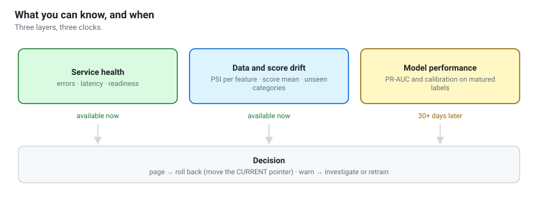

# Operations and monitoring
{: .no_toc }

A model is not finished when it ships. It is starting. This chapter is about
knowing whether it still works, and what to do when it does not.

1. TOC
{:toc}

---

## Health versus readiness

Orchestrators (Kubernetes, cloud run-times, load balancers) ask a service two
different questions:

| Probe | Question | What it should check | If it fails |
|---|---|---|---|
| **Liveness** (`/health`) | Is the process alive? | Almost nothing: the process can answer HTTP | The process is restarted |
| **Readiness** (`/ready`) | Should I send it traffic? | A model is loaded and can predict | Traffic is routed elsewhere; the process is left alone |

The classic mistake is checking the model in the liveness probe. A slow model
load then fails liveness, the process is killed, restarts, loads slowly
again, and is killed again: a restart loop caused by the health check.

## Configuration

Settings come from the environment (`CHURN_REGISTRY_DIR`, `CHURN_MODEL_VERSION`,
`CHURN_LOG_LEVEL`, …), read once at start-up and validated. The same image
runs in development, staging and production with different variables. Secrets
come the same way, from a secret store, never from the repository.

## Logs

**Structured logs** write one JSON object per line. Log platforms can then
filter and aggregate fields (`model_version`, `latency_ms`, `status`) without
regular expressions.

Each request log should carry: a request id (also returned to the caller), the
path, status, latency, and model version. Log **identifiers and aggregates,
not raw personal data**. Feature values for individual customers belong in a
controlled store with access rules, if anywhere.

## Metrics and SLOs

Three families, in the order they become available:

| Layer | Examples | Available |
|---|---|---|
| **Service** | Request rate, error rate, p50/p95/p99 latency, saturation | Immediately |
| **Data and predictions** | Missing-value rates, unseen categories, feature PSI, score distribution, share flagged | Immediately |
| **Model performance** | Precision, recall, PR-AUC against real outcomes | After the labels arrive (here: 30 days) |

A **service level objective (SLO)** is a target for a service metric over a
window, for example "99.5% of prediction requests succeed and 95% complete in
under 200 ms, measured over 28 days". The numbers depend entirely on who calls
the service and what they need; the examples in this course
(`DEFAULT_RULES` in `churnlab/monitoring.py`) are teaching values, not
recommendations. The difference between the target and 100% is the **error
budget**: how much unreliability you can spend on changes before you must slow
down.

## Drift versus performance

**Drift** means the inputs (or the scores) no longer look like the training
reference. It is a symptom, not a verdict:

- Inputs can shift without hurting accuracy (a feature the model barely uses
  changes).
- Accuracy can drop with no visible input shift (the relationship between
  features and outcome changes: *concept drift*).

So drift alerts should open an investigation, not trigger an automatic
retrain.

### PSI

The **Population Stability Index** compares a current sample with a reference
sample over bins defined by the reference's quantiles:
`PSI = Σ (cur% − ref%) × ln(cur% / ref%)`. Common rule-of-thumb bands are
below 0.1 stable, 0.1–0.25 moderate, above 0.25 large. They are conventions.
PSI depends on the number of bins and the sample size, and a small current
sample produces noisy values. Always look at the two distributions, not just
the number.

For categorical features, also track the **unseen-category rate**. In this
course's contract, unseen categories reach the model by design; monitoring is
where they are counted.

### Delayed labels

For this model the label is known 30 days after the prediction. Until then:

- Watch **leading indicators**: input drift, score distribution, share
  flagged, missing rates.
- Join outcomes back to predictions when they arrive, by customer and
  snapshot, and compute performance on the **matured cohort**.
- Remember that **acting on predictions changes outcomes.** If the team calls
  flagged customers and some are retained, those customers' labels are no
  longer what they would have been. Measuring the model honestly then
  requires a holdout group that is not contacted.

## Alerting

Alerts should be actionable and few.

| Severity | Meaning | Example |
|---|---|---|
| **Page** | Someone must act now | Error rate above target, p95 latency far above target, readiness failing |
| **Ticket / warn** | Look at it during working hours | Large PSI on an input, score mean shifted, matured-cohort PR-AUC dropped |

An alert that fires every day and is always ignored is worse than no alert: it
trains people to ignore the channel.

## Rollback

Undoing a deploy should be faster than understanding what went wrong.

The registry in this course makes that cheap:

- Bundles are **immutable**: v3 never changes after it is written.
- Deploying is writing a version into a one-line `CURRENT` pointer with an
  atomic file replace. Rolling back writes the previous one.
- Every promotion and rollback is appended to `history.jsonl` with a reason:
  an audit log you can show.
- The service re-reads the pointer on `/admin/reload` (which in production
  would sit behind authentication), and if loading fails it keeps serving the
  old model.

Roll back first, then investigate.

## Safer releases: shadow and canary

| Strategy | How | What it tells you | Cost |
|---|---|---|---|
| **Shadow** | The new model scores live traffic alongside the old one; only the old one's answers are used | Real-input behaviour, latency, score differences, without risk to users | Double compute; no outcome feedback, because nobody acted on the shadow's decisions |
| **Canary** | A small share of traffic goes to the new model; the share grows if metrics hold | Real behaviour under real use, including errors | Some users get the new model's mistakes |
| **A/B test** | Traffic is split for long enough to measure business outcomes | Causal effect on the outcome you care about | Time, and enough traffic for statistical power |
| **Blue/green** | Two full environments; switch traffic at once | Fast cut-over and fast rollback | Two environments |

For a monthly batch model like TaskFlow churn, the analogue of a shadow
deployment is scoring a month with both models and comparing their flagged
lists before choosing which one the team acts on.

## Retraining

Retraining on a schedule is simple and often enough. Retraining on a trigger
(drift, a performance drop on matured labels) needs care: a drift alert caused
by a broken upstream pipeline should be fixed, not learned. Every retrained
model goes through the same evaluation, registration and promotion path as the
first one.

## A minimal runbook

For "the model is producing nonsense":

1. Check `/ready`, the error rate and the current `model_version`. Did a deploy
   just happen? If yes, roll back.
2. Check input data: missing-value rates, unseen categories, PSI. A broken
   upstream feed is far more common than a broken model.
3. Check the score distribution and share flagged against last week.
4. Check matured-cohort performance if labels are available.
5. Write down what you found, and what alert would have caught it earlier.

## Interview angle

"How would you monitor this model?" A strong answer separates the three
layers, says which are available when, mentions the delayed label and the
feedback effect, names concrete alerts with severities, and ends with
rollback. Mentioning a dashboard tool by name is optional.
