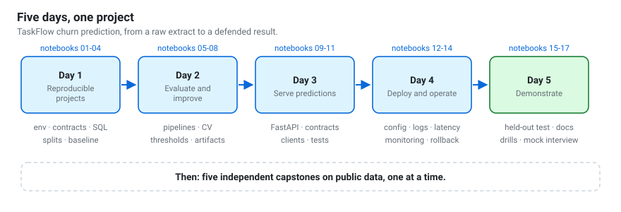
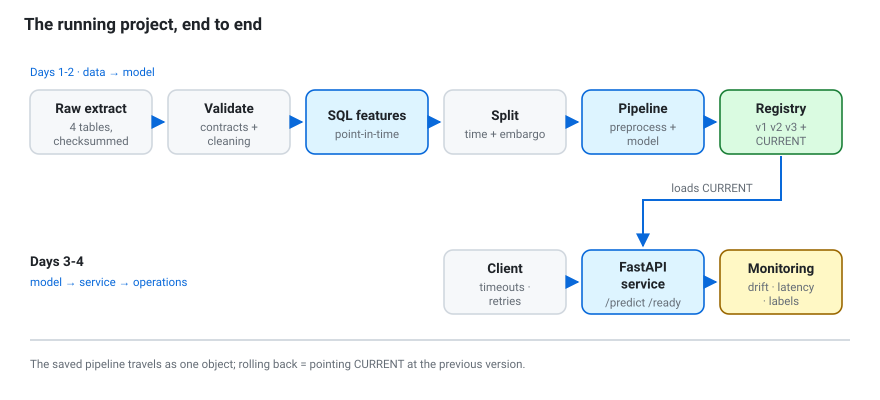

# ML Engineering Bootcamp

Five days, about three hours a day, in a free Google Colab CPU runtime. From
"I can train a good model" to "I can ship, operate and defend one".

- [Start with the plan](days/index.md)
- [Take the diagnostic](https://colab.research.google.com/github/berdakh/MLBOOTCAMP/blob/main/notebooks/00_diagnostic.ipynb)
- [Get the code](https://github.com/berdakh/MLBOOTCAMP)

---

## Who this is for

Researchers and modelers moving into **ML Engineer**, **Applied Scientist** and
**Algorithm Engineer** roles. You already know Python, scikit-learn and the
basics of deep learning. You have probably trained models that worked well in a
paper. What research rarely trains is the rest: reproducible experiments, SQL,
modular code, tests, APIs, deployment, monitoring, and explaining your decisions
to someone who is trying to find the hole in them.

That is what this course concentrates on.

## How it is organised

| Day | Theme | Notebooks | You finish with |
|---|---|---|---|
| 0 | [Diagnostic](days/index.md#day-0) | 00 | A score per skill area and a list of days to prioritise |
| 1 | [Reproducible ML projects](days/day-1.md) | 01–04 | Validated data, point-in-time SQL features, a leakage-safe split, a baseline |
| 2 | [Evaluation & improvement](days/day-2.md) | 05–08 | A chosen model with confidence intervals, a cost-based threshold, a registry |
| 3 | [Serving predictions](days/day-3.md) | 09–11 | A tested FastAPI service and a retrying client |
| 4 | [Deployment & operations](days/day-4.md) | 12–14 | Deployment files, health checks, latency numbers, a drift report, a rollback |
| 5 | [Interview demonstration](days/day-5.md) | 15–17 | A one-time test evaluation, a README and model card, a scored mock interview |

One small project runs through all five days: **TaskFlow churn prediction**, on
a synthetic subscription-software dataset with four tables (`customers`,
`usage_weekly`, `invoices`, `tickets`). Every month, predict which active
accounts will cancel in the next 30 days.

> **Note:** The data is **synthetic** and was generated by the course's own code, with
> planted defects you are meant to find. Every number you compute on it is a
> fact about this teaching dataset, not about real customers or any real
> business. The [capstones](capstones/index.md) are where you work with real public data.

## Where things live

| You want to… | Go to |
|---|---|
| Know what to do today | [Daily plan](days/index.md) |
| Understand the ideas behind a day | [Handbook](handbook/index.md) |
| Set up, fix something, or work in Colab | [Guides](guides/index.md) |
| Run the notebooks | [GitHub](https://github.com/berdakh/MLBOOTCAMP/tree/main/notebooks) or the Colab links on each day page |
| Check your exercise answers | [Solutions on GitHub](https://github.com/berdakh/MLBOOTCAMP/blob/main/solutions/README.md) |
| Know whether you are ready to interview | [Readiness rubric](guides/readiness-rubric.md) |
| Plan the rest of the month | [Four-week study plan](guides/study-plan.md) |
| Build portfolio projects | [Capstones](capstones/index.md) |

Each day page links to its notebooks on GitHub
(to read) and in Colab (to run).

## Five days is a start, not a finish

Five days gives you a working, tested, documented end-to-end project, the
vocabulary of the job, and an honest picture of where you are weak. It does
not give you fluency: writing SQL window functions without looking them up,
building a FastAPI service from a blank file in twenty minutes, or holding up
in your tenth system design interview. That takes the rest of the month and
beyond. The [study plan](guides/study-plan.md) is explicit about which is which.
