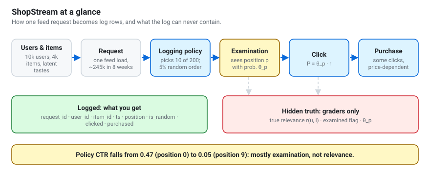

# Level 2 · Applied ML at Scale

**Ten days, about three hours a day · 20 notebooks · Colab CPU runtime (a GPU only speeds up optional parts)**

Level 1 taught you to build, ship and defend *one* model. Level 2 is about
the kind of systems big-tech ML engineers spend most of their time on:
**ranking and recommendation over large logs**. You will work with
event-level data in the millions of rows, build features that are correct at
the moment of prediction, learn to rank from biased clicks, retrieve
candidates with embeddings, run experiments that would survive an analyst's
review, and sit the two kinds of coding interview: classic data structures and
algorithms, and "implement this ML method from scratch".

**Prerequisite:** Level 1, or equivalent fluency with pandas, SQL,
scikit-learn, pytest and FastAPI. Take the Level 1 diagnostic (notebook 00);
if any area scores below "solid", do that Level 1 day first.

## The project: ShopStream

ShopStream is a synthetic marketplace: 10,000 users, 4,000 items, eight
weeks of feed requests (about 2.4 million impressions at the default scale,
tens of millions at the "large" scale used on Day 1). Every request shows 10
items chosen by a production *logging policy*; users examine top positions
far more often than lower ones, click what they examine with a hidden true
probability, and sometimes buy.

The data is generated by [`src/shoprank/data.py`](../src/shoprank/data.py)
because it keeps what real click logs never give you: **the truth**. The
hidden relevance of every (user, item) pair is available, so you can check
whether a position-bias correction actually recovers relevance, and whether
your offline metric agrees with what users really prefer. On the logged data,
the production policy's own ordering scores *higher* NDCG on clicks than a
ranking by true relevance does. Position bias is not a footnote; it decides
which model looks best. Day 3 is about that.



Nothing in ShopStream describes a real company or real people. Time split:
train on weeks 1–6, validate on week 7, test on week 8 (touched once, in
notebook 20).

## The notebooks

| # | Notebook | You learn to | Time |
|---|---|---|---|
| **Day 1 — Data at scale** ||||
| 01 | [Event logs & columnar data](notebooks/01_event_logs_and_columnar_data.ipynb) | Design event logs; Parquet, partitioning and predicate pushdown; out-of-core queries; sampling without bias | 90 min |
| 02 | [Aggregation & joins at scale](notebooks/02_aggregation_and_joins_at_scale.ipynb) | The map-shuffle-reduce mental model; skew; as-of joins; approximate distinct counts and quantiles; dedup | 90 min |
| **Day 2 — Features that are right at serving time** ||||
| 03 | [Feature pipelines & feature stores](notebooks/03_feature_pipelines_and_feature_stores.ipynb) | Offline vs online stores, point-in-time training sets, TTL, backfills, freshness | 90 min |
| 04 | [Streaming features](notebooks/04_streaming_features.ipynb) | Event time vs processing time, windows, watermarks, late data, online/offline parity tests | 90 min |
| **Day 3 — Learning from clicks** ||||
| 05 | [Implicit feedback & position bias](notebooks/05_implicit_feedback_and_position_bias.ipynb) | Click models, estimating position bias from exploration traffic, inverse propensity weighting, unbiased offline evaluation | 90 min |
| 06 | [Learning to rank](notebooks/06_learning_to_rank.ipynb) | Pointwise, pairwise, listwise; LightGBM LambdaMART; NDCG/MRR; request-grouped splits | 90 min |
| **Day 4 — Retrieval** ||||
| 07 | [Candidate generation](notebooks/07_candidate_generation.ipynb) | Popularity, co-visitation, matrix factorisation; recall@K; coverage; cold start | 90 min |
| 08 | [Two-tower retrieval & ANN](notebooks/08_two_tower_retrieval_and_ann.ipynb) | A two-tower model in PyTorch, in-batch negatives and their bias, FAISS indexes, the recall–latency trade-off | 90 min |
| **Day 5 — Deep learning engineering** ||||
| 09 | [PyTorch training done right](notebooks/09_pytorch_training_done_right.ipynb) | Datasets and loaders, the loop, checkpoint and resume, determinism, schedules, debugging a model that won't learn | 90 min |
| 10 | [Sequence models for user behaviour](notebooks/10_sequence_models_for_user_behavior.ipynb) | Next-item prediction from histories with a small self-attention model; masking; time-respecting evaluation | 90 min |
| **Day 6 — Experimentation** ||||
| 11 | [A/B testing fundamentals](notebooks/11_ab_testing_fundamentals.ipynb) | Randomisation units, power and sample size, sample-ratio mismatch, peeking, multiple testing | 90 min |
| 12 | [Advanced experimentation](notebooks/12_advanced_experimentation.ipynb) | CUPED, ratio metrics and the delta method, interleaving for rankers, the offline–online gap | 90 min |
| **Day 7 — ML coding interviews** ||||
| 13 | [ML from scratch I](notebooks/13_ml_from_scratch_1.ipynb) | Logistic and softmax regression with gradient descent, k-means, kNN, AUC and NDCG, all in NumPy | 90 min |
| 14 | [ML from scratch II](notebooks/14_ml_from_scratch_2.ipynb) | Decision-tree splits, gradient boosting, backprop for an MLP, attention, batch norm and dropout | 90 min |
| **Day 8 — Coding interviews** ||||
| 15 | [Coding patterns I](notebooks/15_coding_patterns_1.ipynb) | Hash maps, two pointers, sliding windows, heaps, intervals, stacks, with complexity stated and tested | 90 min |
| 16 | [Coding patterns II](notebooks/16_coding_patterns_2.ipynb) | Graphs (BFS, DFS, topological sort), binary search on the answer, dynamic programming, tries, union-find | 90 min |
| **Day 9 — Serving ranking at scale** ||||
| 17 | [Serving a ranking cascade](notebooks/17_serving_a_ranking_cascade.ipynb) | Retrieval → features → ranker as one service; per-stage latency budgets; caching; graceful degradation | 90 min |
| 18 | [Model optimisation for inference](notebooks/18_model_optimization_for_inference.ipynb) | ONNX export, ONNX Runtime, dynamic quantisation, distilling a ranker; accuracy vs latency | 90 min |
| **Day 10 — Design and the loop** ||||
| 19 | [Recommendation & search system design](notebooks/19_recsys_and_search_system_design.ipynb) | Worked designs for a home feed and product search: metrics, cascade, logging, experimentation | 90 min |
| 20 | [Final evaluation & mock loop](notebooks/20_final_evaluation_and_mock_loop.ipynb) | Test-week evaluation of your best ranker; a timed mock loop of coding, ML coding and ML design | 90 min |

Every notebook opens in Colab from its badge, runs on a CPU runtime, and
rebuilds the data it needs on its own (about 30 seconds the first time).

## What Level 2 adds for big-tech interviews

| Interview round | Where Level 2 trains it |
|---|---|
| Coding (data structures and algorithms) | 15, 16; daily drills afterwards |
| ML coding ("implement X") | 13, 14 |
| ML system design (feeds, search, ads-lite) | 05–08, 17, 19 |
| ML breadth and depth | 05, 06, 09–12 checkpoints |
| Experimentation / product sense | 11, 12 |
| Behavioural, project deep-dive | 20, with Level 1's STAR material |

**Ten days does not make you fluent** in coding interviews. Notebooks 15 and
16 teach the patterns and a way of talking through them. Fluency takes
4–8 weeks of daily practice afterwards (see
[the study plan](../docs/guides/study-plan.md)).

## Layout

```
level2/
  notebook_src/   percent-format sources (edit these)
  notebooks/      generated .ipynb (outputs cleared)
  solutions/      written answers + code/ reference solutions graded in CI
  requirements.txt
src/shoprank/     the Level 2 package (data, metrics, topic modules, grading/)
```
