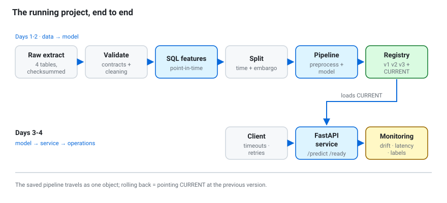

# Part I · Foundations of ML Engineering

*Chapters 1–18 · about one week at three hours a day · Google Colab CPU runtime*

Part I follows a single small project from raw data to a monitored service.
The model is deliberately simple; the subject is everything around it. By the
end of the part, the reader has built, tested, documented and evaluated an
end-to-end system and can explain each design decision in it.

*Figure I.1 — The system built in Part I. Chapters 2–9 cover the path from
raw data to a registered model; Chapters 10–15 cover the service and its
operation; Chapters 16–18 cover evaluation, documentation and interviews.*

## The project

The running example is *churn prediction*: estimating which customers of a
subscription business are likely to cancel soon, so that a retention team can
contact them first. Chapter 2 introduces the problem for readers who have not
met it: what churn is, why businesses measure it, who uses a churn model and
what the model's real objective is. The data comes from *TaskFlow*, a
synthetic software company with four tables (customers, weekly usage,
invoices and support tickets) and about 5,000 accounts over two years.

## Organisation

| Chapters | Theme | What the reader learns |
|---|---|---|
| 1 | Diagnostic | A self-assessment of Python, pandas, SQL, testing, evaluation and API skills |
| 2–5 | Reproducible projects and data | Pinning code, data, environment and randomness; data contracts; point-in-time features in SQL; leakage-safe splits and baselines |
| 6–9 | Evaluation and model artefacts | Pipelines and time-ordered cross-validation; model comparison with confidence intervals; thresholds from costs; calibration; error analysis; model bundles and registries |
| 10–12 | Serving predictions | API contracts with FastAPI and Pydantic; training/serving consistency; clients with timeouts and retries; test suites |
| 13–15 | Deployment and operations | Packaging and configuration; health checks, logs and latency; drift monitoring, canary releases and rollback |
| 16–18 | Demonstration | A single held-out evaluation; documentation; Python and SQL drills; system design and a mock interview |

## Prerequisites

Python, NumPy, pandas and scikit-learn at the level of a research project.
No prior SQL, testing, web-service or deployment experience is assumed.

## Chapters

<!-- toc:start -->
| Ch. | Chapter | Lab | Time |
|---:|---|---|---|
| 1 | Skills diagnostic | [notebook](ch01-diagnostic/notebook.ipynb) ·  | 60 min |
| 2 | A reproducible ML project | [notebook](ch02-reproducible-project/notebook.ipynb) ·  | 40 min |
| 3 | Data acquisition & validation | [notebook](ch03-data-acquisition-and-validation/notebook.ipynb) ·  | 45 min |
| 4 | SQL for ML | [notebook](ch04-sql-for-ml/notebook.ipynb) ·  | 55 min |
| 5 | Leakage-safe splits & a baseline | [notebook](ch05-leakage-safe-splits-and-baseline/notebook.ipynb) ·  | 45 min |
| 6 | Pipelines & cross-validation | [notebook](ch06-pipelines-and-cross-validation/notebook.ipynb) ·  | 50 min |
| 7 | Model selection | [notebook](ch07-model-selection/notebook.ipynb) ·  | 45 min |
| 8 | Thresholds & calibration | [notebook](ch08-thresholds-and-calibration/notebook.ipynb) ·  | 40 min |
| 9 | Error analysis & artifacts | [notebook](ch09-error-analysis-and-artifacts/notebook.ipynb) ·  | 45 min |
| 10 | FastAPI & contracts | [notebook](ch10-fastapi-and-contracts/notebook.ipynb) ·  | 55 min |
| 11 | Consistent serving | [notebook](ch11-consistent-serving/notebook.ipynb) ·  | 45 min |
| 12 | API clients & tests | [notebook](ch12-api-clients-and-tests/notebook.ipynb) ·  | 60 min |
| 13 | Packaging & configuration | [notebook](ch13-packaging-and-configuration/notebook.ipynb) ·  | 45 min |
| 14 | Health, logs & latency | [notebook](ch14-health-logs-and-latency/notebook.ipynb) ·  | 55 min |
| 15 | Monitoring & rollback | [notebook](ch15-monitoring-and-rollback/notebook.ipynb) ·  | 60 min |
| 16 | Final evaluation & documentation | [notebook](ch16-final-evaluation-and-docs/notebook.ipynb) ·  | 50 min |
| 17 | Python & SQL drills | [notebook](ch17-python-and-sql-drills/notebook.ipynb) ·  | 60 min |
| 18 | System design & mock interview | [notebook](ch18-system-design-and-mock-interview/notebook.ipynb) ·  | 70 min |
<!-- toc:end -->

**Next:** [Part II · Machine Learning at Scale](../part2-ml-at-scale/README.md)
