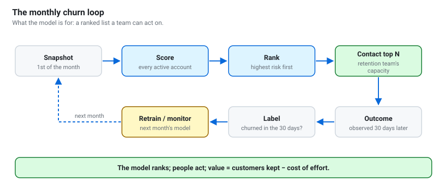

# The problem: predicting churn

*Read this before notebook 01. No code, about ten minutes.*

Level 1 is built around one problem from start to finish: predicting which
customers of a subscription business are about to leave. This page explains
that problem for someone who has never met it: what it is, why companies
spend money on it, who uses the answer, and what "success" actually means.
The rest of the course is about building it properly; this page is about why
it is worth building at all.

---

## 1. What is churn?

A **subscription business** sells access, not things: software, streaming,
phone plans, gyms, insurance, cloud storage. Customers pay every month (or
year) for as long as they stay.

**Churn** is a customer leaving: cancelling the subscription, or simply not
renewing. The **churn rate** is the share of customers who leave in a period:

$$
\text{monthly churn rate} = \frac{\text{customers who left during the month}}{\text{customers at the start of the month}}
$$

Two kinds matter, because they need different fixes:

| Kind | What happens | Typical cause | Typical fix |
|---|---|---|---|
| **Voluntary** | The customer decides to cancel | stopped getting value, found a cheaper rival, had a bad support experience | talk to them, fix the product, offer help or a better plan |
| **Involuntary** | The customer "leaves" without deciding to | a card expired, a payment failed | retry the payment, ask them to update their card |

The course's data contains both: falling usage and support tickets (voluntary
signals) and failed payments (an involuntary one).

## 2. Why does anyone care?

Because churn compounds. A business that loses a fixed share of its customers
every month loses a surprising amount in a year:

$$
\text{share still with you after } n \text{ months} = (1 - c)^n
$$

| Monthly churn $c$ | Customers left after 12 months |
|---|---|
| 1% | 89% |
| 3% | 69% |
| 5% | 54% |
| 8% | 37% |

At 5% a month, the business must replace almost half its customers every year
just to stand still. Every customer who leaves takes their future payments
with them, and winning a new customer (advertising, sales, free trials) is
usually expensive. So keeping a customer who would otherwise have left is
often one of the cheapest ways a subscription business can grow.

That is why churn appears in board meetings, in investor reports, and in
most ML engineering interview loops for consumer and SaaS companies.

## 3. Who cares, and what do they do with a prediction?



A churn model is only useful if someone acts on it. Different people use it
differently:

| Who | Their question | What they do with the model |
|---|---|---|
| **Customer-success / retention team** | "Who should we call this month?" | Work through a ranked list of at-risk accounts: a call, a training session, a discount, a fix |
| **Finance** | "How much revenue will we have next quarter?" | Use predicted churn to forecast recurring revenue |
| **Product team** | "Why do people leave?" | Study which signals drive risk (e.g. a feature nobody adopts) and fix the product |
| **Billing / payments** | "Which failed payments will turn into lost customers?" | Prioritise payment retries and card-update reminders |
| **Leadership** | "Is the business healthy?" | Track churn and retention as headline numbers |

**In this course, the user is the retention team.** That choice shapes every
technical decision: the team can only make so many calls per month, so the
model's job is to put the right accounts at the top of their list.

## 4. The prediction task, precisely

Vague goals make bad models, so the course pins the task down:

> **On the first day of each month, for every account that is still active,
> estimate the probability that it cancels within the next 30 days.**

Every word in that sentence is a decision:

- **"First day of each month"**: the *snapshot date*. Predictions are made in
  a monthly batch, because the team plans its calls monthly.
- **"Still active"**: accounts that have already cancelled are not scored.
- **"Within the next 30 days"**: the *label window*. A 7-day window leaves no
  time to act; a 1-year window is too vague to act on.
- **"Probability"**, not yes/no: so accounts can be *ranked*, and so a
  threshold can be chosen from costs (notebook 07).

And the most important rule, which notebook 03 is built around:

> **A prediction made on day T may only use information available before day T.**

It sounds obvious. It is the most common way real churn models are broken,
and in research it has a familiar name: leakage.

## 5. What is the ultimate goal? (Hint: not a high AUC)

It is tempting to think the goal is "predict churn accurately". It is not.
The goal is:

> **Keep more customers, for less effort, than the team could without the model.**

A model with excellent accuracy can still be useless:

- **It finds customers nobody can save.** Someone who has already moved all
  their work to a competitor will churn whatever you do. Predicting them
  correctly changes nothing.
- **It finds customers who were never at risk.** Calling happy customers
  wastes the team's limited time.
- **It tells the team too late.** A warning on day 29 of a 30-day window is
  right and useless.

So the honest chain of value is:

```
accurate ranking -> the right accounts get attention -> some of them stay
-> retained revenue is greater than the cost of the calls
```

The course measures the first link carefully (PR-AUC, precision at the team's
capacity, calibration) and puts a price on the rest with explicitly stated
assumptions (notebook 07: a call costs $30; a saved customer is worth about
$150 in expectation). Those assumptions are made up for teaching, and the
notebooks say so every time. In a real company, the only way to know whether
the model *causes* customers to stay is an experiment: call a random half of
the high-risk list and compare (Level 2, Day 6).

> **Intuition.** A churn model is a smoke detector, not a firefighter. It
> tells you where to look. Whether the house is saved depends on what you do
> next, and a detector that rings for burnt toast all day gets switched off.

## 6. What makes churn hard (and therefore good for learning)

| Difficulty | Why | Where the course deals with it |
|---|---|---|
| **Rare event** | only ~5% of active accounts cancel in a given month, so accuracy is meaningless (95% for "nobody churns") | notebooks 04–07: PR-AUC, precision@k, thresholds |
| **Time matters** | features must be computed as of the snapshot; customers appear in many months | notebooks 03–04: point-in-time SQL, time splits with an embargo |
| **Data comes from many tables** | usage, invoices, tickets and customer records live separately | notebook 03: joins and window functions |
| **Labels arrive late** | you only learn whether a prediction was right 30 days later | notebook 14: monitoring with delayed labels |
| **Some churn is unpredictable** | people leave for reasons no log records | notebook 08: error analysis finds the "sudden churners" |
| **Acting changes the data** | once the team intervenes, saved customers look like false alarms | notebook 15: limitations; Level 2: experiments |

## 7. The same shape, in other domains

Learn churn once and you will recognise it everywhere: *"which of the
entities I track will have an important event soon, given their history up
to now?"*

| Domain | Entity | Event to predict |
|---|---|---|
| Subscriptions (this course) | account | cancels in 30 days |
| Banking | borrower | defaults on a loan |
| Healthcare | patient | readmitted or drops out of treatment |
| HR | employee | resigns |
| Industry | machine | fails (capstone 2: predictive maintenance) |
| Education | student | drops a course |

> **Research bridge.** If you have done cross-subject evaluation on EEG,
> you already know the hardest part: the *unit* (subject there, customer here)
> appears many times, so a random split of rows lets the model memorise the
> unit instead of learning the pattern. Churn adds time on top: you must also
> never train on the future.

## 8. TaskFlow, the company in this course

TaskFlow is a fictional project-management software company with about 5,000
business customers over two years. Its database export has four tables:

| Table | One row per | Example signal |
|---|---|---|
| `customers` | account | plan, seats, region, signup date |
| `usage_weekly` | account per week | sessions, active users, features used |
| `invoices` | monthly invoice | amount, paid or **failed** |
| `tickets` | support ticket | category (including "cancellation"), time to resolve |

The data is synthetic: generated once, committed to the repository, and
checksummed. That lets the course plant realistic defects for you to find,
and know the truth behind the data. No real customer is described anywhere.

**Ready?** Start with the [skills diagnostic](https://github.com/berdakh/MLBOOTCAMP/blob/main/part1-foundations/ch01-diagnostic/notebook.ipynb),
then [notebook 01](https://github.com/berdakh/MLBOOTCAMP/blob/main/part1-foundations/ch02-reproducible-project/notebook.ipynb).
