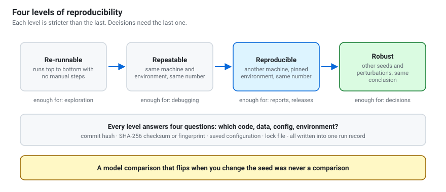

# Reproducibility

A result is reproducible when someone else, on another machine, months later,
can get the same number from the same inputs, and can tell you exactly what
those inputs were.

---

## Four questions every result must answer

When a number is questioned, and in a team every important number is, you
need to answer four questions quickly:

| Question | What answers it | In this course |
|---|---|---|
| Which **code**? | A commit hash, plus a clean working tree | The git repository; `churnlab` as an installable package |
| Which **data**? | A checksum or fingerprint of the exact input | SHA-256 of each raw file; a fingerprint of the training table in model metadata |
| Which **configuration**? | A config object or file, saved with the result | Explicit parameters in a run record; `Settings` from environment variables |
| Which **environment**? | Pinned library versions, Python version | `requirements.txt` (lower bounds) and `requirements-lock.txt` (exact pins); versions recorded in model metadata |

If you cannot answer one of these, the number is an anecdote.

## Layers of reproducibility

It helps to separate how strict you need to be:

| Level | Meaning | Usually enough for |
|---|---|---|
| **Re-runnable** | The code runs again from the top without manual steps | Exploration |
| **Repeatable** | Same machine, same environment, same number | Debugging, comparing models |
| **Reproducible** | Different machine, same pinned environment, same number (or within a stated tolerance) | Reports, model releases |
| **Robust** | Different seeds and reasonable perturbations give a similar conclusion | Decisions |

*What to notice:* the first three are about getting the *same number*; only the last is about getting the same *conclusion*, which is what a decision needs.

The last one is the one that matters for decisions. A model comparison that
flips when you change the random seed was never a comparison. Day 2 measures
that with bootstrap intervals.

## Environments

- **Lower bounds versus locks.** `requirements.txt` lists minimum versions so
  the Colab setup cell installs quickly (Colab already has most packages). A
  lock file pins every package exactly, for when you need byte-identical
  environments, such as a release or a bug you are trying to reproduce.
- **Record what actually ran.** Whatever the requirement files say, the
  versions that ran are the truth. Model metadata in this course records the
  Python, scikit-learn and pandas versions at training time.
- **Pickles are version-sensitive.** A scikit-learn model saved with one minor
  version is not guaranteed to load correctly with another. The loader here
  warns on a mismatch and can be made strict. The safe options are to load
  with the same version, or retrain.
- **Pickles execute code.** Never load a `joblib` or `pickle` file you did not
  create or obtain from a source you trust.

## Randomness

Seeds make a single run repeatable. They do not make a result *true*.

- Set seeds explicitly and record them (`random_state=0`, `np.random.default_rng(seed)`).
- Prefer passing a generator or seed into functions over global seeding: it
  makes each function testable and avoids hidden coupling.
- Report variation across seeds or resamples for anything you will act on.
- Some sources of nondeterminism are outside your control: thread scheduling,
  some GPU kernels, library version changes. State a tolerance rather than
  promising bit-identical output where you cannot guarantee it.

## Configuration

Hard-coded paths and magic numbers inside functions are the most common reason
research code cannot be reused.

- Put parameters in one place (a dataclass, a YAML file, environment
  variables) and pass them in.
- Validate configuration at start-up and fail loudly. The `Settings` class in
  `churnlab/settings.py` rejects a threshold outside (0, 1) before the service
  starts, not after the first request.
- Keep secrets out of the repository. They come from the environment or a
  secret store.

## Data versions

Data changes more often than code, and more quietly.

- **Checksum raw inputs.** The course pins the SHA-256 of each raw file, and a
  download is verified before it replaces the old file, so an interrupted
  download never looks like a finished one.
- **Fingerprint derived tables.** A short hash of the training table's contents
  goes into each model's metadata. "Which data was v3 trained on?" then has an
  exact answer.
- **Never overwrite in place.** Write new versions next to old ones. The model
  registry in this course treats bundles as immutable for the same reason.

## Run records

A run record is a small file written at the end of every experiment that
matters: timestamp, commit, data fingerprint, config, seed, metrics with their
split, and where the artifacts went. It costs a few lines of code and saves the
afternoon you would otherwise spend trying to remember which notebook cell
produced a number. Experiment trackers (MLflow, Weights & Biases and others)
are this idea with a UI and a database.

## Notebooks versus modules

Notebooks are excellent for exploration and teaching, and poor as the only
home for code that matters:

| Belongs in a notebook | Belongs in a module (`.py`) |
|---|---|
| Exploration, plots, narrative | Anything reused twice |
| Calling functions and showing results | Anything tested |
| One-off analysis | Anything deployed |

The bootcamp's notebooks call `churnlab` functions and show what they do; the
logic lives in short, readable modules with tests. Notice also that the
notebooks themselves are generated from plain `.py` files so that changes are
reviewable as diffs.

## Colab specifically

A Colab runtime is temporary: when it disconnects, everything under `/content`
is deleted. Treat that as a feature. If your project only works in the session
where you built it, it is not reproducible. The course offers three safety
nets (Drive, zip export, and deterministic rebuild); see the
[Colab guide](../../appendices/colab.md).

## Interview angle

"How do you make your experiments reproducible?" is a common question. A
strong answer names the four questions above, mentions data versioning (not
just seeds), and gives an example of a time a result did not reproduce and
what the cause was. If you have ever chased a result that depended on an
unrecorded preprocessing parameter, that is your example.
