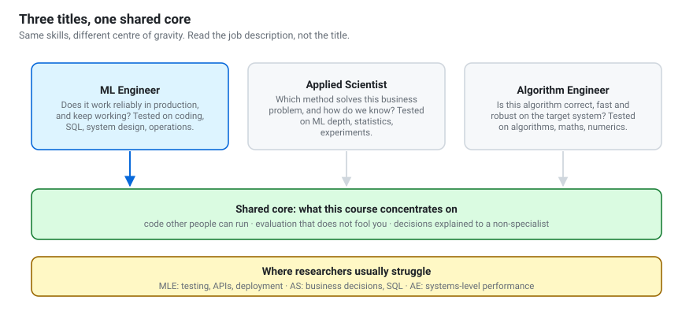
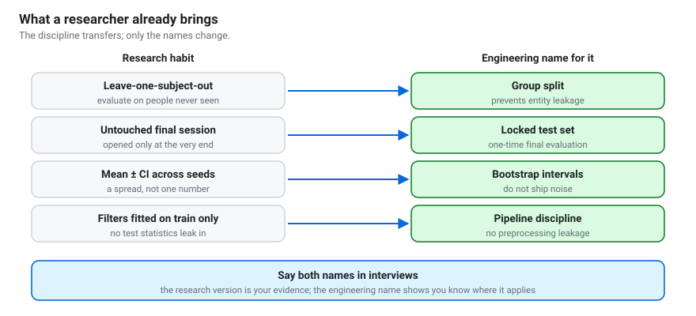
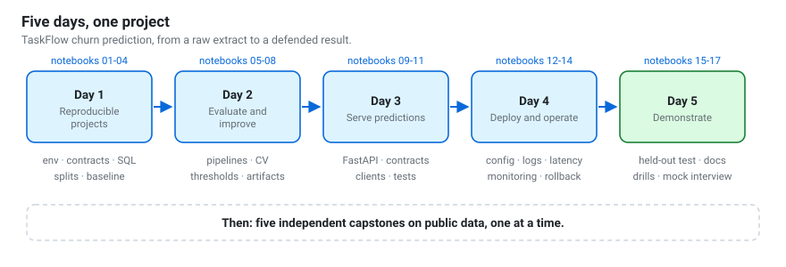

# Chapter 1 · Skills diagnostic

*Part I · Prerequisites: none (the [before-you-start checklist](../../appendices/before-you-start.md) is recommended) · Estimated time: reading ~20 min, lab ~60 min · Compute: CPU*

[](https://colab.research.google.com/github/berdakh/MLBOOTCAMP/blob/main/part1-foundations/ch01-diagnostic/notebook.ipynb) · [Lab: notebook.ipynb](notebook.ipynb) · [Solutions](solutions.md)

## Learning objectives

After this chapter you should be able to:

1. Describe the roles the book prepares for, and name the research habits that already transfer to them.
2. State which engineering skills the book assumes and which it teaches, and why modelling ability is not measured here.
3. Take a short, timed skills test under conditions that make the result informative.
4. Explain how each exercise is scored and how the scores are combined into a status per area.
5. Translate your profile into a reading plan: which chapters to study slowly, which to read quickly.
6. Plan a valid re-measurement and name the main threat to its validity.

## 1.1 Introduction

Most readers of this book already train models. Many have published work on
classification or regression with scikit-learn or PyTorch, and know the
theory of the methods they use. What they have usually practised less are the
skills that surround a model in industry: writing small, correct functions
under time pressure, querying a database, writing a test that actually
catches a bug, choosing an evaluation that matches how a model will be used,
and validating inputs at the boundary of a service.

These skills are unevenly distributed. A signal-processing researcher may be
an excellent Python programmer and have never written a SQL window function;
a data analyst may write SQL fluently and never have written a unit test.
Part I covers all of them, but not every reader needs every chapter at the
same depth. The purpose of the diagnostic is to find out, before Chapter 2,
where your time is best spent.

The chapter proceeds as follows. Section 1.2 describes the roles the book
prepares for and the research habits that already transfer to them.
Section 1.3 states what the diagnostic measures and what it deliberately
leaves out, and Section 1.4 describes the items. Section 1.5 gives the rules
under which the test must be taken, and the reason for each. Section 1.6
explains the scoring, and Sections 1.7 and 1.8 explain how to read the result
and turn it into a plan. Section 1.9 treats a retake
as a small experiment and discusses its validity.

## 1.2 The roles, and what a researcher already brings

Industry job titles are not standardised: the same title means different work
at different companies, and sometimes in different teams of one company. The
job description is a better guide than the title. With that caution, the
usual emphasis of the three roles this book prepares for is:

| | ML Engineer | Applied Scientist | Algorithm Engineer |
|---|---|---|---|
| Core question | Does the model work reliably in production, and keep working? | Which method solves this problem, and how do we know? | Is this algorithm correct, fast and robust on the target system? |
| Typical output | pipelines, services, training and evaluation infrastructure, monitoring | experiments, analyses, prototypes, design documents | optimised implementations, often for constrained or real-time systems |
| Interviews usually test | coding, SQL, ML fundamentals, ML system design, operations | ML depth, experimental design, statistics, coding, a research deep dive | algorithms, mathematics, numerical methods, domain depth, coding |
| Where researchers often struggle | testing, APIs, deployment, operational thinking | turning results into business decisions; SQL | systems-level performance; production C++ |

The overlap is large. All three roles expect code that other people can run,
evaluation that does not deceive its author, and decisions that can be
explained to a non-specialist. Part I concentrates on that overlap, plus the
production skills that the ML Engineer role adds.



*Figure 1.1 — Three roles and their shared core. Whichever title one applies for, the shared core is examined; the role determines what is added.*

Many research habits transfer directly, under a different name:

| Research habit | Engineering name | Where in Part I |
|---|---|---|
| leave-one-subject-out evaluation | group-aware splitting; preventing entity leakage | Chapter 5 |
| not touching the held-out session until the end | a locked test set, evaluated once | Chapters 5, 16 |
| reporting means with intervals or across seeds | uncertainty in offline metrics | Chapters 2, 7 |
| fitting filters, ICA or normalisation on training data only | preventing preprocessing leakage; pipeline discipline | Chapter 6 |
| artefact rejection and channel quality checks | data validation and data contracts | Chapter 3 |
| building a baseline before a deep model | baselines | Chapter 5 |



*Figure 1.2 — Research habits and their engineering names. Little on the right is new to a careful researcher; what is new is the vocabulary and the surrounding engineering, which the diagnostic measures.*

## 1.3 What is measured, and what is not

The diagnostic measures whether you can produce **small, correct pieces of
code, unaided and within a fixed time**, in six areas, and asks you to rate
yourself in three more. This is close to what a technical screening interview
measures, and close to what a colleague expects of you in the first weeks of
an industry role.

It does **not** measure:

- research ability, mathematical depth or knowledge of learning theory;
- how good your models are (Part I assumes you can train one);
- breadth of library knowledge. Looking up the name of a function in the
  official documentation is allowed, because that is normal working practice.

A low score in an area you were never trained in (for most researchers, SQL
and testing) is the expected starting point. It is a measurement, not a
judgement.

| Area | How it is measured | What a pass shows |
|---|---|---|
| Python | Exercise 1, auto-graded | a correct function with a composite sort key and edge cases |
| pandas | Exercise 2, auto-graded | cleaning and aggregation without double counting |
| SQL | Exercise 3, auto-graded | a `LEFT JOIN`, a top-1-per-group query and an aggregate without fan-out |
| Testing | Exercise 4, auto-graded | a test that fails on three hidden buggy implementations |
| Evaluation | Exercise 5, six multiple-choice scenarios | judgement on leakage, splits, metrics, thresholds, comparisons and skew |
| APIs | Exercise 6, auto-graded | a Pydantic schema that rejects every invalid request |
| Deployment, monitoring, communication | self-rating, 1 to 4 | what you have actually done before |
| (written) | Exercise 7, not graded | how you describe a rigorous evaluation to an interviewer |

## 1.4 The items

Each graded item is built around one or two traps that are common in real
work. Knowing what the trap is helps you interpret a failure; the lab does not
tell you the answer.

**Exercise 1 · Python.** `top_k_frequent(items, k)` returns the `k` most
frequent items, with ties broken by the item's own order. The trap is the tie
rule: the convenient `Counter.most_common` breaks ties by first appearance,
not by value. Edge cases (`k = 0`, an empty list, `k` larger than the number
of distinct items) test whether you read the specification to the end.

**Exercise 2 · pandas.** `weekly_active(usage)` counts distinct active
customers per week on a log that contains a duplicated row, a `-1` that
stands for "unknown", a missing value, and a week with no activity at all.
Each defect in the fixture corresponds to one way to get the count wrong:
counting rows instead of distinct customers, treating `-1` as activity, and
losing the empty week when filtering before grouping.

**Exercise 3 · SQL.** One row per customer with the amount of their latest
invoice and the number of failed invoices. The traps are those of almost
every feature query: customers without invoices must survive (`LEFT JOIN`),
"latest" needs an ordering (`ROW_NUMBER` or an equivalent), and joining two
one-to-many relations before aggregating multiplies counts. Chapter 4 treats
all three in detail.

**Exercise 4 · Testing.** Here the function is given and correct; you write
the test. The grader runs your test against the correct function, where it
must pass, and against three hidden faulty versions, where it must fail. This
is the only fair way to grade a test: a test is good exactly to the extent
that it detects incorrect code.

**Exercise 5 · Evaluation judgement.** Six short scenarios on a churn
problem: a suspicious feature, the choice of split, the choice of metric at a
5% positive rate, a threshold from costs, a small difference between two
models, and a change in the score distribution on the first day after
deployment. The grader reports how many answers are correct and which
question numbers to revisit, but not the correct letters. Chapters 5 to 8 and
11 teach each scenario properly.

**Exercise 6 · APIs.** A Pydantic model `Order` with constraints on every
field and no unknown fields allowed. The grader sends eight invalid payloads
and requires all of them to be rejected. Chapter 10 develops request
validation for the churn service.

**Self-rating (section 1.7 of the lab).** Nine statements about deployment,
monitoring and communication, each rated 1 (never done) to 4 (could teach
it). These skills are learned by doing real work and cannot be tested fairly
in ten minutes.

**Exercise 7 (written).** Three sentences, two minutes: the most rigorous
evaluation you have done (in a course, thesis, research or work project), and
its main threat to validity. It is not graded;
the solutions describe what a strong answer contains.

## 1.5 The rules, and why they matter

A measurement is only useful if it is taken under known conditions. The lab
asks for four things.

1. **A timebox of 8 to 10 minutes per exercise.** Interviews and daily work
   are timed. Finishing an item in 25 minutes that is meant to take 8 is a
   real result, and you should record it as such.
2. **No solutions, no AI assistant, no searching for the answer.** Looking
   up a function name in the official documentation is allowed. Pasting the
   task into a chatbot measures the chatbot.
3. **Honest self-ratings.** "Done it" means you did it yourself, not that you
   followed a tutorial. A flattering profile sends you to the wrong chapters.
4. **Note every lookup you were tempted to make.** The skills you avoid are
   the ones you most need to practise, and the temptation to look something
   up is the clearest sign of which ones they are.

Every check prints a result and never stops the notebook, so an unfinished
exercise costs nothing except the information that it was unfinished.

## 1.6 How the scoring works

### Graded exercises

Each graded exercise is run by a checker in `src/grading/ch01.py`. The
checker calls your function on a fixture, compares the result with the
expected one, and prints one of three outcomes:

| Printed result | Meaning |
|---|---|
| `[verified]` | every assertion passed |
| a hint | at least one assertion failed; the message names the case that failed |
| `[TODO]` | the function still raises `NotImplementedError` |

For Exercise 5, the checker also records how many of the six answers are
correct. The answer key is stored as hashes, so reading the source does not
reveal it.

### From results to a status per area

The profile cell (`grade.summary`) combines the newest result of each
exercise into a status for the corresponding area. For the auto-graded areas
the rule is:

| Status | Condition |
|---|---|
| **strong** | the exercise passed |
| **review** | the exercise failed but was close (for Exercise 5: at least 4 of 6 correct) |
| **priority** | the exercise failed or raised an error |
| **not attempted** | the exercise was not started |

For the self-rated areas, the profile averages the ratings $r_1, \dots, r_m$
of the statements in that area:

```math
\bar r = \frac{1}{m} \sum_{j=1}^{m} r_j , \qquad
\text{status} =
\begin{cases}
\text{strong} & \bar r \ge 3 \\
\text{review} & 2 \le \bar r < 3 \\
\text{priority} & \bar r < 2
\end{cases}
\qquad (1.1)
```

where $m = 3$ statements per area and each $`r_j \in \{1, 2, 3, 4\}`$. For
example, ratings 3, 2 and 2 for Deployment give $\bar r = 2.33$, so
Deployment is marked **review**. A rating outside 1 to 4 is ignored with a
message.

### Time as part of the score

The checker cannot see the clock, so time is your responsibility. When you
convert the result into a level (Section 1.7), count an item that passed but
took longer than the timebox as half a pass. If $p$ items in an area passed
within time and $q$ passed over time, out of $n$ items, the share used below
is

```math
s = \frac{p + 0.5\,q}{n} . \qquad (1.2)
```

With one item per graded area, $s$ is 1, 0.5 or 0; across the six graded
areas together it gives a single overall figure. For example, four items
passed within time, one passed over time and one failed gives
$s = (4 + 0.5)/6 = 0.75$.

## 1.7 Interpreting your result

The status per area is coarse on purpose: one item per area cannot support a
fine-grained score. The [diagnostic guide](../../appendices/diagnostic.md)
uses three levels, which combine the status with how you got there.

| Level | Share passed, unaided (Equation 1.2) | Time and lookups | What it means for your reading |
|---|---|---|---|
| **Strong** | 80% or more | within the suggested time | read the area's chapters at a normal pace; spend spare time elsewhere |
| **Partial** | 50–79% | or over time, or with lookups | read the area's chapters carefully and do every exercise; add the area to daily practice |
| **Gap** | below 50% | (any) | read the area's chapters first and slowly; begin daily drills early (see the [study plan](../../appendices/study-plan.md)) |

Three cautions apply when you read your profile.

- **One item is a small sample.** A failure on one exercise may come from a
  misread specification rather than a missing skill. Read the hint, decide
  which it was, and record both.
- **A pass is not an explanation.** `[verified]` means the mechanics are
  right. The checkpoint questions at the end of each chapter test whether you
  can explain them, which interviews require.
- **The self-ratings are biased in both directions.** Experienced engineers
  often under-rate themselves; people who have followed tutorials often
  over-rate. The anchor "done it on my own" is meant to reduce this.

## 1.8 From a profile to a reading plan

The profile prints, for each area, the chapters to prioritise. The table
below repeats that mapping and adds a form of extra practice for each area.

| Area | Chapters to prioritise | Extra practice |
|---|---|---|
| Python | 2, 6, 12, 17 | rebuild one `churnlab` module from a blank file each week |
| pandas | 3, 4, 17 | translate each SQL drill into pandas as well |
| SQL | 3, 4, 17 | daily 20–30 minute SQL drills (Chapter 17) |
| Testing | 2, 6, 12, 17 | write the tests first for each capstone module |
| Evaluation | 5, 6, 7, 8 | explain one result per week aloud, with its interval |
| APIs | 10, 11, 12 | — |
| Deployment | 13, 14, 15 | — |
| Monitoring | 13, 14, 15 | — |
| Communication | 16, 18 | every checkpoint, answered aloud |



*Figure 1.3 — The order of Part I. Every lab can rebuild what it needs from earlier chapters, so a priority area can be studied out of order.*

Some patterns recur often enough to be worth describing.

| Profile | Common pattern | Suggested emphasis |
|---|---|---|
| Strong modeller, new to engineering | evaluation strong; SQL and testing gaps | Chapter 4 slowly; Chapters 10–12 in full; SQL drills from week 2 |
| Strong programmer, light ML | Python and testing strong; evaluation partial | Chapters 5–9 in full, reading each chapter text before its lab |
| Data analyst background | SQL and pandas strong; testing and modules partial | Chapters 10–15; build the capstones as packages with tests |
| Even across the board | partial everywhere | follow the chapters in order; the largest gains usually come from Chapters 2–5 and 10–12 |

Two areas are not covered by graded items but matter for almost every
researcher moving into industry: **deployment** (Chapters 13–15) and
**communication** (Chapter 16, Chapter 18 and every checkpoint). Unless you
have operated a service before, assume you need both.

The profile is saved as `artifacts/diagnostic.json`, with the status of every
area and the ordered list of labs to prioritise. Keep the file: the retake
compares against it. In Colab the artifact directory is deleted when the
runtime is recycled, so either set `USE_DRIVE = True` in the setup cell or
download the file (see the [Colab guide](../../appendices/colab.md)).

## 1.9 Re-measuring: the diagnostic as a small experiment

The lab suggests retaking the diagnostic at the end of week 4 of the
[study plan](../../appendices/study-plan.md), and comparing the two
`diagnostic.json` files. This is a pre-test / post-test design with a single
subject, and it has the threats to validity of any such design.

- **Practice (testing) effect.** You will have seen these exact items. A
  higher score on the retake partly measures memory of the items, not
  improved skill.
- **Maturation and history.** Other things change in four weeks: you may
  have practised similar problems elsewhere.
- **Instrument change.** If you relax the rules on the retake (a longer
  timebox, a quick search), the two measurements are not comparable.

The mitigations are those you would use in a study. Keep the conditions
identical. Judge the retake mainly on **speed** (do you now finish within
the timebox?) and on the **written answers** (Exercise 7 and the checkpoint
questions), which cannot be memorised. For a broader measure, use the
[readiness rubric](../../appendices/readiness-rubric.md); the diagnostic is
the quick one.

> **What a strong answer contains.** Exercise 7 asks for the most rigorous
> evaluation you have done and its main threat to validity. For a study with
> many measurements per person, such as a clinical or wearable-sensor study,
> a strong answer names the split (for example leave-one-subject-out over 20
> participants), how the spread was reported (an interval over participants,
> not over individual measurements), and one specific threat with its
> consequence for the claim (for example, a single device and site, which
> limits what can be said about a new site). The same structure is expected
> for every result in this book.

## Key terms

| Term | Definition |
|---|---|
| Diagnostic | A short, timed test of engineering skills taken before Part I, used to plan the reading order. |
| Timebox | A fixed time allowed for one exercise (8–10 minutes here); exceeding it is recorded, not hidden. |
| Auto-graded check | A function in `src/grading/ch01.py` that runs your code on a fixture and prints a result. |
| Fixture | A small, fixed input built to contain specific traps (duplicates, sentinels, empty groups). |
| Sentinel value | A special value that stands for "unknown", such as `sessions = -1`. |
| Status | The per-area outcome of the profile: strong, review, priority, not attempted or not rated. |
| Self-rating | A rating from 1 (never done) to 4 (could teach it) of a skill that cannot be auto-graded. |
| Profile | The table of areas, statuses and labs to prioritise, saved as `artifacts/diagnostic.json`. |
| Practice effect | The improvement on a retake that comes from having seen the items before. |
| Pre-test / post-test design | Measuring the same subject before and after an intervention and comparing the two. |

## Summary

1. The ML Engineer, Applied Scientist and Algorithm Engineer roles share a core of runnable code, careful evaluation and explained decisions; many research habits already belong to it.
2. The diagnostic measures small, unaided, timed engineering tasks in six areas, and asks for self-ratings in three more. It does not measure modelling ability.
3. The rules (timebox, no lookups beyond documentation, honest ratings) make the result a measurement rather than a performance.
4. Each graded exercise contains specific traps; a failure message names the case that failed.
5. The profile turns results into a status per area (table in Section 1.6, Equation 1.1 for self-ratings).
6. Time counts: an item passed over time is half a pass (Equation 1.2).
7. The profile names the chapters to prioritise for each weak area.
8. Low scores in SQL and testing are typical for researchers and are what Part I is designed to address.
9. A retake is a pre-test / post-test comparison; judge it on speed and on written answers to limit the practice effect.

## Exercises

All exercises are in the [lab](notebook.ipynb); worked answers are in [solutions.md](solutions.md). Do the exercises before reading the solutions: reading first measures nothing.

1. **Python.** `top_k_frequent(items, k)` with a defined tie rule and edge cases.
2. **pandas.** `weekly_active(usage)` on a log with a duplicate, a sentinel, a missing value and an empty week.
3. **SQL.** `customer_summary_sql()`: one row per customer with the latest invoice amount and the failed-invoice count, customers without invoices included.
4. **Testing.** `test_rolling_mean(fn)`: a test that passes the correct implementation and fails three hidden faulty ones.
5. **Evaluation judgement.** Six multiple-choice scenarios.
6. **APIs.** `make_model()`: a Pydantic `Order` model that rejects every invalid payload.
7. **Written.** The most rigorous evaluation you have done and its main threat to validity, in three sentences.

The lab ends with the self-ratings, the profile, and five checkpoint questions on testing, joins, metrics at a low positive rate, API validation, and your own weakest area.

## Further reading

- Python Software Foundation. *The Python Standard Library: `collections.Counter`* and *Sorting HOW TO*. https://docs.python.org/3/howto/sorting.html
- pandas development team. *pandas User Guide: Group by: split-apply-combine*. https://pandas.pydata.org/docs/user_guide/groupby.html
- DuckDB. *SQL Introduction* and *Window Functions*. https://duckdb.org/docs/sql/introduction
- pytest. *How to write and report assertions in tests*. https://docs.pytest.org/en/stable/how-to/assert.html
- Pydantic. *Models* and *Fields*. https://docs.pydantic.dev/latest/concepts/models/
- Shadish, W. R., Cook, T. D. & Campbell, D. T. (2002). *Experimental and Quasi-Experimental Designs for Generalized Causal Inference*. Houghton Mifflin. (Threats to validity of pre-test / post-test designs.)

**Next:** [Chapter 2 · A reproducible ML project](../ch02-reproducible-project/README.md)
