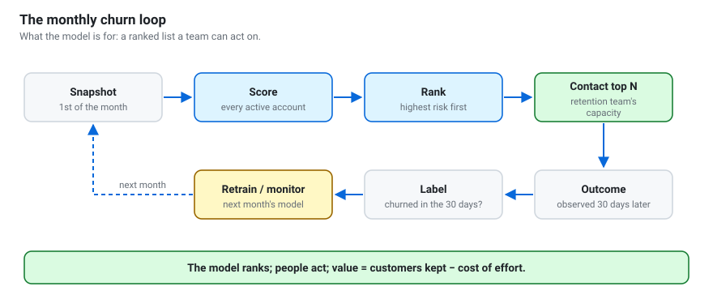
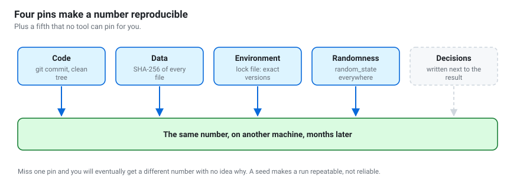
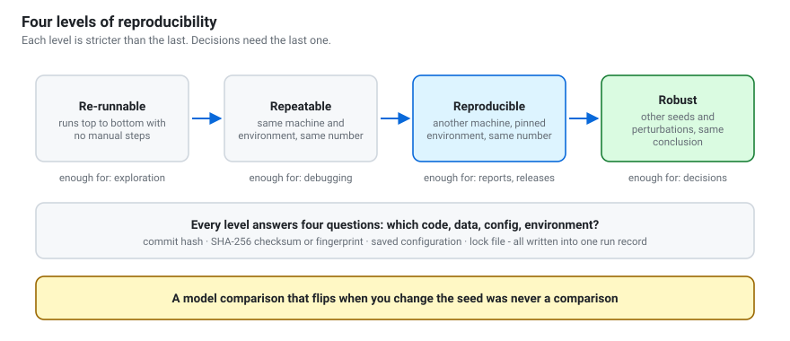
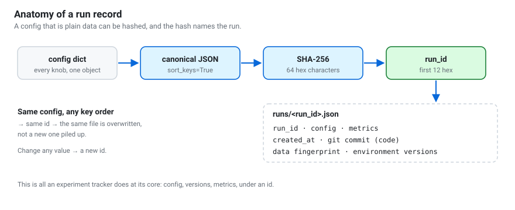
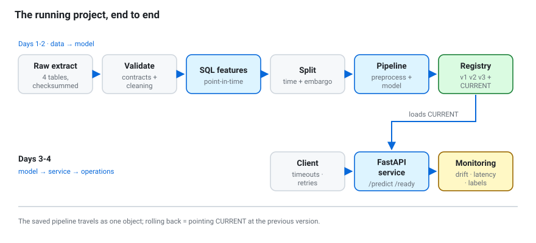

# Chapter 2 · A reproducible ML project

*Part I · Prerequisites: Chapter 1 (recommended) · Estimated time: reading ~40 min, lab ~40 min · Compute: CPU*

[](https://colab.research.google.com/github/berdakh/MLBOOTCAMP/blob/main/part1-foundations/ch02-reproducible-project/notebook.ipynb) · [Lab: notebook.ipynb](notebook.ipynb) · [Solutions](solutions.md)

## Learning objectives

After this chapter you should be able to:

1. Define churn, compute how a constant churn rate compounds, and state the precise prediction task used throughout Part I.
2. Explain why the goal of a churn model is a better decision, not a high score, and name the difficulties that make churn a good teaching problem.
3. Name the four things that must be pinned for a number to reproduce (code, data, environment, randomness) and how each is pinned in this project.
4. Distinguish re-runnable, repeatable, reproducible and robust results, and say which one a decision needs.
5. Give a configuration a deterministic identity and write a run record that a colleague could use to reproduce a number.
6. Explain why reusable code belongs in a package rather than in notebooks, and why the *src layout* is used.

## 2.1 Introduction: the problem this part solves

Part I follows one problem from raw data to a monitored service: predicting
which customers of a subscription business are about to leave. This section
and the next explain the problem for a reader who has never met it. The rest
of the chapter starts the project in a way that makes every later number
reproducible.

### What is churn?

A **subscription business** sells access rather than goods: software,
streaming, phone plans, gyms, insurance, cloud storage. Customers pay every
month (or year) for as long as they stay. **Churn** is a customer leaving,
either by cancelling or by not renewing. The **churn rate** is the share of
customers who leave in a period:

$$
\text{monthly churn rate} = \frac{\text{customers who left during the month}}{\text{customers at the start of the month}} . \qquad (2.1)
$$

Two kinds of churn are distinguished, because they need different responses:

| Kind | What happens | Typical cause | Typical response |
|---|---|---|---|
| **Voluntary** | the customer decides to cancel | stopped getting value, found a cheaper alternative, had a poor support experience | contact them, fix the product, offer help or a better plan |
| **Involuntary** | the customer "leaves" without deciding to | a card expired, a payment failed | retry the payment, ask them to update their card |

The course data contains both: falling usage and support tickets (voluntary
signals) and failed payments (an involuntary one).

### Why churn matters: it compounds

If a constant share $c$ of the remaining customers leaves every month, the
share still present after $n$ months is

$$
\text{retained}(n) = (1 - c)^n , \qquad (2.2)
$$

where $c$ is the monthly churn rate and $n$ the number of months. Each month
keeps a fraction $1 - c$ of whoever is left, so the fractions multiply.

| Monthly churn $c$ | Customers left after 12 months |
|---|---|
| 1% | 89% |
| 3% | 69% |
| 5% | 54% |
| 8% | 37% |

At 5% a month, $0.95^{12} \approx 0.54$: the business must replace almost
half its customers every year to keep the same size. Every customer who
leaves takes their future payments with them, and acquiring a new customer
(advertising, sales, free trials) is usually expensive. Retaining a customer
who would otherwise have left is therefore often one of the cheapest ways for
a subscription business to grow, which is why churn is a standard topic in
industry interviews for consumer and software-as-a-service companies.

### Who uses a churn prediction

A churn model is only useful if someone acts on its output. Different groups
use it differently:

| Who | Their question | What they do with the model |
|---|---|---|
| Customer-success / retention team | "Whom should we contact this month?" | work through a ranked list of at-risk accounts: a call, a training session, an offer, a fix |
| Finance | "What will recurring revenue be next quarter?" | use predicted churn in the revenue forecast |
| Product team | "Why do people leave?" | study which signals drive risk and change the product |
| Billing / payments | "Which failed payments will become lost customers?" | prioritise payment retries and card-update reminders |
| Leadership | "Is the business healthy?" | track churn and retention as headline figures |

**In this book, the user is the retention team.** That choice shapes the
technical decisions that follow: the team can make only a limited number of
calls per month, so the model's job is to put the right accounts at the top
of their list.



*Figure 2.1 — The monthly decision loop. The model only produces the ranked list; the value is created by the calls, and this month's label exists only 30 days later.*

## 2.2 The problem this part solves: task, goal and data

### The prediction task, precisely

A vague goal produces a poorly specified model, so the task is fixed in one
sentence:

> **On the first day of each month, for every account that is still active,
> estimate the probability that it cancels within the next 30 days.**

Each part of the sentence is a design decision.

- **"First day of each month"** is the *snapshot date*, written $T$.
  Predictions are made in a monthly batch because the team plans its calls
  monthly.
- **"Still active"**: accounts that have already cancelled are not scored.
- **"Within the next 30 days"** is the *label window* $[T, T + 30\ \text{days})$.
  A 7-day window leaves no time to act; a one-year window is too vague to act on.
- **"Probability"**, not yes or no, so that accounts can be ranked and a
  threshold can be derived from costs (Chapter 8).

One rule follows from the task and governs Chapters 3 to 5:

> **A prediction made on day $T$ may use only information available before day $T$.**

The rule sounds obvious. Breaking it, usually without noticing, is the most
common way churn models fail in practice. In research the same failure is
called *leakage*.

### The goal is not a high score

It is tempting to state the goal as "predict churn accurately". The goal is
rather:

> **Keep more customers, for less effort, than the team could without the model.**

A model with good accuracy can still be of no use:

- **It finds customers nobody can retain.** A customer who has already moved
  all their work to a competitor will leave whatever is done. Predicting this
  correctly changes nothing.
- **It finds customers who were never at risk.** Calling satisfied customers
  uses the team's limited time.
- **It warns too late.** A warning on day 29 of a 30-day window is correct
  and useless.

The chain from model to value has several links:

```
accurate ranking -> the right accounts receive attention -> some of them stay
-> retained revenue exceeds the cost of the calls
```

Part I measures the first link carefully (PR-AUC, precision at the team's
capacity, calibration; Chapters 5–8) and puts a price on the rest with
explicitly stated assumptions (Chapter 8: a call costs \$30 and reaching a
would-be churner is worth about \$150 in expectation). Those assumptions are
invented for teaching, and the book says so every time it uses them. In a
real company, the only way to learn whether the model *causes* customers to
stay is an experiment: contact a random half of the high-risk list and
compare (Chapters 29–30).

> **Intuition.** A churn model is a smoke detector, not a firefighter. It
> indicates where to look. Whether the house is saved depends on what is done
> next, and a detector that sounds for burnt toast all day is soon switched
> off. *Where the analogy breaks down:* a smoke detector does not change the
> fire, whereas acting on a churn prediction changes the outcome it predicts
> (see the last row of the next table).

### What makes churn hard, and therefore useful for learning

| Difficulty | Why | Where Part I deals with it |
|---|---|---|
| Rare event | only about 5% of active accounts cancel in a given month, so accuracy is meaningless (95% for "nobody churns") | Chapters 5–8: PR-AUC, precision@k, thresholds |
| Time matters | features must be computed as of the snapshot; customers appear in many months | Chapters 4–5: point-in-time SQL, time splits with an embargo |
| Many source tables | usage, invoices, tickets and customer records are stored separately | Chapter 4: joins and window functions |
| Labels arrive late | whether a prediction was right is known only 30 days later | Chapter 15: monitoring with delayed labels |
| Some churn is unpredictable | people leave for reasons no log records | Chapter 9: error analysis finds the "sudden churners" |
| Acting changes the data | once the team intervenes, retained customers look like false alarms | Chapter 16 (limitations); Chapters 29–30 (experiments) |

### The same structure in other domains

The question *"which of the entities I track will have an important event
soon, given their history up to now?"* recurs in many fields:

| Domain | Entity | Event to predict |
|---|---|---|
| Subscriptions (this book) | account | cancels within 30 days |
| Banking | borrower | defaults on a loan |
| Healthcare | patient | is readmitted, or drops out of treatment |
| Human resources | employee | resigns |
| Industry | machine | fails (capstone 1: predictive maintenance) |
| Education | student | drops a course |

> **Connection to other fields.** Studies with repeated measurements per
> person, such as clinical or sensor studies, face the same difficulty: the
> *unit* (a patient or participant there, a customer here) appears many
> times, so a random split of rows lets the model memorise the unit instead of
> learning the pattern. Churn adds time: the model must also never be trained
> on the future.

### TaskFlow, the company in this book

TaskFlow is a fictional project-management software company with about 5,000
business customers over two years. Its database export has four tables:

| Table | One row per | Example signal |
|---|---|---|
| `customers` | account | plan, seats, region, sign-up date |
| `usage_weekly` | account and week | sessions, active users, features used |
| `invoices` | monthly invoice | amount, paid or **failed** |
| `tickets` | support ticket | category (including "cancellation"), time to resolve |

The data is synthetic: generated once, committed to the repository and
checksummed. This allows the book to plant realistic defects at known rates
(Chapter 3) and to know the truth behind the data. No real customer is
described anywhere. All numbers quoted in Part I come from this synthetic
data, computed on a CPU.

## 2.3 What must be pinned for a number to reproduce

In research, a result is usually reproduced by the person who produced it, on
the same machine, soon afterwards. In industry it has to be reproduced by
someone else, on another machine, months later, often while something is
broken. A result is **reproducible** when that is possible, and when the
person can also tell exactly what the inputs were.

When a number is questioned (and in a team every important number is), four
questions must be answerable quickly:

| Question | What answers it | In this project | What goes wrong without it |
|---|---|---|---|
| Which **code**? | a commit hash and a clean working tree | the git repository; `churnlab` as an importable package | "it worked last week" |
| Which **data**? | a checksum or fingerprint of the exact input | SHA-256 of each raw file; a fingerprint of the training table in the model metadata | silently different rows after a re-export |
| Which **environment**? | pinned library versions and Python version | `requirements.txt` (lower bounds) and `requirements-lock.txt` (exact pins); versions recorded in model metadata | a library default changes between versions |
| Which **randomness**? | explicit seeds | `random_state=0`, `np.random.default_rng(seed)` | a "better" model that was a fortunate seed |

If one of the four cannot be answered, the number is an anecdote. A fifth
item cannot be fixed by any tool: **the decisions** (why this split, why this
threshold). Those are written down next to the result, in the model card
(Chapter 9) and the project documentation (Chapter 16).



*Figure 2.2 — The four pins. Each is mechanical (a hash, a file, a seed); the fifth, the decisions, exists only if someone writes it down.*

## 2.4 Levels of reproducibility

It helps to separate how strict a result needs to be:

| Level | Meaning | Usually sufficient for |
|---|---|---|
| **Re-runnable** | the code runs again from the top without manual steps | exploration |
| **Repeatable** | same machine, same environment, same number | debugging, comparing models |
| **Reproducible** | different machine, same pinned environment, same number (or within a stated tolerance) | reports, model releases |
| **Robust** | different seeds and reasonable perturbations give a similar *conclusion* | decisions |



*Figure 2.3 — Levels of reproducibility. The first three concern the same number; only the last concerns the same conclusion, which is what a decision requires.*

A model comparison that reverses when the random seed changes was never a
comparison. Robustness is measured with resampling and confidence intervals,
which is the subject of Chapter 7.

## 2.5 The environment is part of the result

Two requirement files serve two purposes:

- `requirements.txt` lists **lower bounds**. It installs quickly anywhere,
  including Colab, which already has most packages.
- `requirements-lock.txt` lists the **exact versions** the labs were executed
  with. It is used when the same numbers are needed, not only working code:
  for a release, or to reproduce a bug.

Whatever the files say, **the versions that actually ran are the truth**, so
they are recorded at run time (the lab's `environment_record()` cell). Model
metadata in this book records the Python, scikit-learn and pandas versions
at training time.

Two properties of saved models deserve particular care.

- **Pickles are version-sensitive.** A scikit-learn model saved with one
  minor version is not guaranteed to load correctly with another, and the
  failure can be silent. The loader in this book warns on a mismatch and can
  be made strict. The safe options are to load with the same version or to
  retrain.
- **Pickles execute code when loaded.** Never load a `joblib` or `pickle`
  file that you did not create or obtain from a trusted source.

The code version is the git commit. A `-dirty` suffix (uncommitted changes)
means the commit alone no longer describes the code that ran: acceptable
while exploring, not acceptable for a number that is reported.

## 2.6 Randomness: repeatable is not reliable

A seed makes a single run **repeatable**. It does not make a result
**reliable**. The lab demonstrates this with a random forest evaluated three
times without a seed, three times with the same seed, and once each with five
different seeds. The unseeded runs differ in the third or fourth decimal; the
seeded runs are identical; and the spread across seeds is often as large as
the "improvements" people report.

To quantify that spread, run the same experiment with $k$ seeds and report
the mean and the sample standard deviation:

$$
\bar{x} = \frac{1}{k}\sum_{i=1}^{k} x_i, \qquad
s = \sqrt{\frac{1}{k-1}\sum_{i=1}^{k} (x_i - \bar{x})^2} , \qquad (2.3)
$$

where $x_i$ is the metric obtained with seed $i$ and $k$ the number of seeds.
$s$ is the typical distance of one seed's score from the average. For
example, scores 0.80, 0.82 and 0.81 give $\bar{x} = 0.81$ and $s = 0.01$; a
"gain" of 0.005 from a new feature is then half a seed's worth of noise.

Practical rules:

- Set seeds explicitly and record them.
- Prefer passing a generator or seed into functions over setting a global
  seed. Each function is then testable, and there is no hidden coupling.
- Report variation across seeds or resamples for anything that will be acted on.
- Some nondeterminism is outside your control (thread scheduling, some GPU
  kernels, library changes). State a tolerance rather than promising
  bit-identical output.

> **Intuition.** A seed is like filming one roll of the dice so that it can
> be replayed. Replaying the film never shows whether the dice are loaded; for
> that, many rolls are needed (many seeds, folds or bootstrap resamples).
> *Where the analogy breaks down:* in machine learning the "dice" include the
> data order, the initialisation and the split, so each must be pinned
> separately.

> **Connection to other fields.** This is the discipline, common in
> experimental science, of reporting a result as a mean and spread over
> subjects or repetitions rather than as one favourable split.

## 2.7 Configuration as data, and a run identity

Hard-coded paths and constants inside functions are the most common reason
research code cannot be reused. The remedy has three parts.

1. **One configuration object.** Every parameter that changes a result goes
   into one place (a dictionary, a dataclass, a YAML file or environment
   variables) and is passed in.
2. **Validation at start-up.** Configuration is checked when the program
   starts and fails loudly if it is invalid. The `Settings` class in
   `churnlab/settings.py` rejects a threshold outside $(0, 1)$ before the
   service starts, not after the first request (Chapter 13).
3. **No secrets in the repository.** Keys come from the environment or a
   secret store.

A configuration that is plain data can be saved, compared and hashed, and the
hash becomes the run's name. The identity used in this book is

$$
\text{run\_id} = \operatorname{hex}_{12}\Big(\operatorname{SHA256}\big(\operatorname{json}_{\text{sorted}}(\text{config})\big)\Big) , \qquad (2.4)
$$

where $\operatorname{json}_{\text{sorted}}$ serialises the configuration with
keys sorted at every level and $\operatorname{hex}_{12}$ keeps the first 12
hexadecimal characters (48 bits). Sorting the keys matters: `{"a": 1, "b": 2}`
and `{"b": 2, "a": 1}` are the same configuration and must receive the same
identity. Python's built-in `hash()` is not suitable, because string hashing
is salted per process.



*Figure 2.4 — From configuration to run identity. The identity is computed from the configuration, not assigned, so one experiment cannot be filed under two names.*

How likely is a collision between two different configurations? For $N$
runs and a $b$-bit identity, the birthday approximation gives

$$
P(\text{collision}) \approx \frac{N^2}{2^{\,b+1}} , \qquad (2.5)
$$

so for $N = 10{,}000$ runs and $b = 48$, $P \approx 10^8 / 5.6 \times 10^{14} \approx 2 \times 10^{-7}$.
The risk is negligible, but it can be detected cheaply by storing the full
configuration next to the identity and comparing on write.

## 2.8 Data versions

Data changes more often than code, and more quietly.

- **Checksum raw inputs.** The SHA-256 of each raw file is pinned in code, and
  a download is verified before it replaces the old file, so an interrupted
  download never looks like a finished one (Chapter 3).
- **Fingerprint derived tables.** A short hash of the training table's
  contents goes into each model's metadata, so "which data was version 3
  trained on?" has an exact answer (Chapter 9).
- **Never overwrite in place.** New versions are written next to old ones.
  The model registry in Chapter 9 treats bundles as immutable for the same
  reason.

## 2.9 Run records

A **run record** is a small file written at the end of every experiment that
matters: timestamp, code version, data fingerprint, configuration, seed,
metrics with the split they were computed on, and where the artifacts were
written. In the lab, a logistic regression on three raw features is trained
on the time split and scored on validation (PR-AUC around 0.1 against a
positive rate near 0.05; a random ranking would score about the positive
rate). The number is then saved with its record in
`artifacts/runs/<run_id>.json`.

The record costs a few lines of code and saves the afternoon otherwise spent
trying to remember which notebook cell produced a number. Two details in the
lab are worth noting: the timestamp is ISO-8601 in UTC, because local times
from machines in different time zones are a common source of confusion, and
the environment is captured at run time rather than copied from a
requirements file. Experiment trackers (MLflow, Weights & Biases and others)
implement exactly this idea, with a database and a user interface. Writing
one record by hand makes those tools easy to understand.

## 2.10 Notebooks versus modules

Notebooks are well suited to explanation and exploration and poorly suited to
holding code that matters: cells run out of order, functions cannot be
imported by a service or a test, and the file format is JSON, which makes
review difficult.

| Belongs in a notebook | Belongs in a module (`.py`) |
|---|---|
| exploration, plots, narrative | anything used twice |
| calling functions and showing results | anything tested |
| one-off analysis | anything deployed |

The book keeps the real code in `src/churnlab/` (about 16 short modules,
each beginning with a one-line summary) and the labs import it. The layout
follows a common convention:

```
src/churnlab/    importable code
tests/           pytest tests for that code, run in CI on every push
partN-*/chNN-*/  chapter text, lab source (notebook.py) and generated notebook
data/raw/        immutable inputs, checksummed
artifacts/       everything the code produces (ignored by git)
```

The **src layout** places the package one directory below the repository
root. A test can then import the package only if it has been installed or
added to the path explicitly; it cannot pass by accidentally importing files
from the current working directory. Labs are themselves generated from
plain `.py` sources so that changes can be reviewed as text differences.

Trained models are **not** committed to git: they are large, reproducible
from code, data and environment, and a pickle executes code when loaded.
They are distributed through a registry with metadata and hashes (Chapter 9).



*Figure 2.5 — The whole project that the pins protect, from raw extract to monitored service. Chapters 3–9 build the left half; Chapters 10–15 the right half.*

## 2.11 Working in temporary environments

A Colab runtime is temporary: after a disconnect, everything under
`/content`, including `artifacts/`, is deleted. This is a useful constraint:
a project that works only in the session where it was built is not
reproducible. Three safeguards are used throughout the book.

1. **Google Drive.** Setting `USE_DRIVE = True` in the setup cell writes
   artifacts to Drive, where they survive a disconnect.
2. **Zip and download.** `export_artifacts` writes a zip archive;
   `restore_artifacts` restores it in the next session. It refuses archive
   members that would be written outside the target folder (a "zip slip"),
   because an archive is untrusted input like any other.
3. **Deterministic rebuild.** Every lab calls `churnlab.bootstrap` to
   regenerate what earlier chapters produced. It is deterministic and takes
   seconds, so a lost session never blocks progress.

See the [Colab guide](../../appendices/colab.md) for details.

> **Interview note.** "How do you make your experiments reproducible?" is a
> common question. A strong answer names the four pins, mentions data
> versioning (not only seeds), and describes a real occasion when a result
> did not reproduce and what the cause was. An unrecorded preprocessing
> parameter is a typical example.

## Key terms

| Term | Definition |
|---|---|
| Churn | A customer ending a subscription, by cancelling or not renewing. |
| Churn rate | The share of customers present at the start of a period who leave during it (Equation 2.1). |
| Snapshot date ($T$) | The day a prediction is made; only data from before $T$ may be used. |
| Label window | The period after $T$ in which a cancellation counts as churn, here $[T, T + 30\ \text{days})$. |
| Retention team | The people who act on the predictions, with a fixed monthly capacity. |
| Reproducible | Another person, on another machine, obtains the same number from the same pinned inputs. |
| Robust | Reasonable perturbations (seeds, resamples) lead to the same conclusion. |
| Pin | A record of the exact version of something a result depends on: commit, checksum, lock file, seed. |
| Checksum (SHA-256) | A fingerprint of a file's bytes; any change produces a different value. |
| Lock file | A list of the exact package versions a result was produced with. |
| Seed | The starting value of a pseudo-random number generator; it makes a run repeatable. |
| Run identity | A short name computed from the configuration itself (Equation 2.4). |
| Run record | A file holding everything needed to reproduce one number. |
| src layout | A package placed under `src/`, so it must be installed or added to the path to be imported. |

## Summary

1. Churn is a customer leaving; at a constant monthly rate $c$ the retained share after $n$ months is $(1-c)^n$ (Equation 2.2), which is why small rates matter.
2. The task: on the first of each month, for every active account, estimate the probability of cancelling within 30 days, using only data from before that day.
3. The goal is a better decision for a capacity-limited retention team, not a high score; the cost assumptions used later are stated as assumptions.
4. A number reproduces only if code, data, environment and randomness are pinned; the decisions behind it must be written down.
5. Seeds make runs repeatable; only variation across seeds or resamples (Equation 2.3) shows whether a difference is real.
6. A configuration hashed with sorted keys gives a deterministic run identity (Equation 2.4); collisions are negligible at 48 bits (Equation 2.5).
7. A run record (identity, code, data fingerprint, environment, metrics with their split) is the core of every experiment tracker.
8. Reusable code lives in a package with tests; notebooks call it. Models travel through a registry, not git.
9. Temporary environments are handled with Drive, zip export and deterministic rebuilds.

## Exercises

The exercises are in the [lab](notebook.ipynb); worked answers are in [solutions.md](solutions.md).

1. **`config_hash(config)`** — return the first 12 hexadecimal characters of the SHA-256 of a configuration, identical for dictionaries that differ only in key order (including nested dictionaries) and different when any value changes.
2. **`record_run(directory, config, metrics)`** — write a run record named by the configuration hash, with the run identity, configuration, metrics, a UTC timestamp and the environment; re-running the same configuration overwrites the same file.
3. **Written.** For a project you have worked on (or a published study you know well), name three ways a colleague re-running it a year later could obtain a different number, and the pin that would have prevented each.

The checkpoint questions cover the four pins, diagnosing a small difference between two runs, why seeds do not make a comparison trustworthy, the src layout, and why models are kept out of git.

## Further reading

- Sculley, D. et al. (2015). Hidden technical debt in machine learning systems. *Advances in Neural Information Processing Systems 28*.
- Pineau, J. et al. (2021). Improving reproducibility in machine learning research (a report from the NeurIPS 2019 Reproducibility Program). *Journal of Machine Learning Research*, 22(164), 1–20.
- Huyen, C. (2022). *Designing Machine Learning Systems*. O'Reilly. (Chapters on data engineering and on experiment tracking and versioning.)
- Python Packaging Authority. *src layout vs flat layout*. https://packaging.python.org/en/latest/discussions/src-layout-vs-flat-layout/
- NumPy. *Random Generator* (`numpy.random.default_rng`). https://numpy.org/doc/stable/reference/random/generator.html
- MLflow. *MLflow Tracking*. https://mlflow.org/docs/latest/tracking.html

**Next:** [Chapter 3 · Data acquisition & validation](../ch03-data-acquisition-and-validation/README.md)
