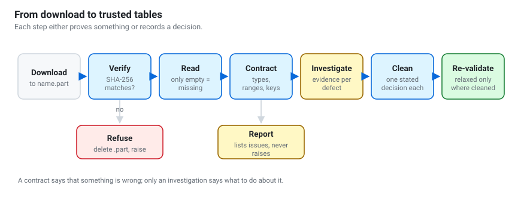
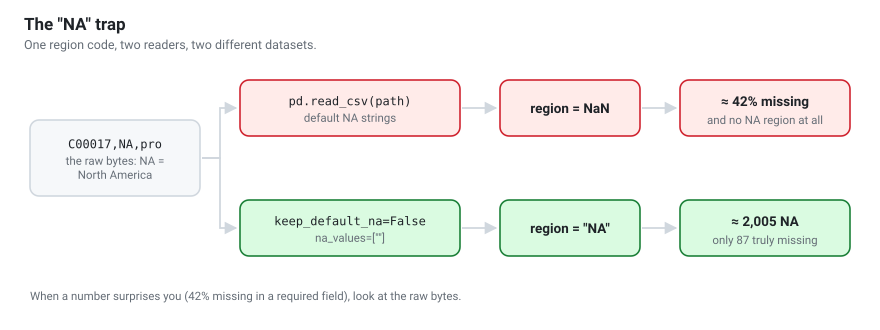

# Chapter 3 · Data acquisition & validation

*Part I · Prerequisites: Chapter 2 · Estimated time: reading ~35 min, lab ~45 min · Compute: CPU*

[](https://colab.research.google.com/github/berdakh/MLBOOTCAMP/blob/main/part1-foundations/ch03-data-acquisition-and-validation/notebook.ipynb) · [Lab: notebook.ipynb](notebook.ipynb) · [Solutions](solutions.md)

## Learning objectives

After this chapter you should be able to:

1. Verify a downloaded file with a cryptographic checksum and explain why downloads must be atomic.
2. Recognise when a file parser silently changes the data, and correct it at read time.
3. Express expectations about a table as a data contract, run it, and interpret the report.
4. Investigate each defect with evidence from the data before deciding how to handle it.
5. Record cleaning decisions so that a reviewer can see and dispute them.
6. Identify columns that describe the export date rather than the prediction date, and explain why they must not be used as features.

## 3.1 Introduction

Many failures of production models start upstream of the model: a file that
was only partly downloaded, a re-export that contains different rows, a code
value that a parser quietly turned into "missing". None of these raise an
error. The model trains, the metrics look plausible, and the problem is
discovered weeks later, if at all.

This chapter treats the data as an input that must be **verified** before it
is used. It proceeds in the order of the lab and of Figure 3.1: obtain the
raw extract and prove that it is the expected one (Section 3.2); read it
without letting the parser change it (Section 3.3); state what the data must
look like and check it (Section 3.4); investigate each violation with
evidence (Section 3.5); clean the data with stated decisions and re-validate
(Section 3.6). Section 3.7 introduces a class of column that passes every
check and is still wrong to use, which leads into Chapters 4 and 5.



*Figure 3.1 — The validation flow. The first three steps establish that the right bytes were read in the right way; the last four turn defects into written decisions.*

## 3.2 Acquiring data: checksums and atomic downloads

### The raw extract is immutable

The TaskFlow extract consists of four gzipped CSV files in `data/raw/`
(`customers`, `usage_weekly`, `invoices`, `tickets`), from about 57 KB to
about 1 MB. These files are treated as **raw**: they are never edited by
hand, and every correction is made in code that runs after them. If a
correction is wrong, the raw data is still there to start again.

### Proving that the bytes are the expected bytes

"I downloaded it" is not evidence that the right bytes are on disk. A
**cryptographic hash** is. SHA-256 maps a file of any length to a 256-bit
value (64 hexadecimal characters) such that any change to the file (one
flipped bit, a truncated download, a re-export) produces a completely
different value. The expected hashes are pinned in `churnlab/data.py`, next
to the code that uses the data; `verify_raw` recomputes each file's hash and
compares.

Two properties make the check practical:

- **It is cheap.** `sha256_file` reads the file in 1 MB chunks, so it works
  on a 50 GB file without loading it into memory.
- **Accidental collisions are not a concern.** For a 256-bit hash, the
  probability that a corrupted file happens to have the pinned hash is about
  $2^{-256}$, which is zero for all practical purposes.

In the lab, one byte in the middle of `invoices.csv.gz` (about 350,000 bytes)
is altered in a copy of the directory, and `verify_raw` reports
`invoices: False` while the other three tables remain `True`. Without the
check, the best case would have been a decompression error; the worst case,
a file that parses correctly and contains wrong values.

> **Intuition.** A checksum is a tamper-evident seal on a jar: one does not
> need to taste the contents to know nobody has opened it. *Where the analogy
> breaks down:* the seal proves the bytes are the ones that were pinned, not
> that those bytes were correct in the first place. That is the role of the
> data contract in Section 3.4.

### Atomic downloads

In Colab, `bootstrap.ensure_raw()` downloads any missing file with
`churnlab.data.fetch`. Two details make the download safe:

1. The file is written to `<name>.part` and **renamed only when it is
   complete and verified**, so an interrupted download never looks like a
   finished file.
2. The hash is checked **before** the rename; on a mismatch the `.part`
   file is deleted and an error is raised.

A rename within one file system is atomic: other processes see either the
old state or the new one, never a half-written file. The lab demonstrates
the behaviour with a `file://` URL, so no network is needed: a fetch with the
correct hash succeeds, a fetch with a wrong hash raises `checksum mismatch`
and leaves no file behind.

If a pinned hash no longer matches, the correct reaction is to find out which
file is right. Changing the pinned value so that the check passes defeats the
purpose of having it.

## 3.3 Reading data without changing it

The first trap appears on the first read. Reading `customers.csv.gz` with
pandas' defaults and counting regions with missing values included
(`value_counts(dropna=False)`; without it, pandas hides missing values) shows
about 2,092 missing regions, about 42% of accounts, and **no** `NA` region,
although the company sells in North America.

A field required by the sign-up form is unlikely to be 42% missing. When a
number is surprising, the next step is to look at the raw bytes. The file
contains the string `NA`, the region code for North America. `pd.read_csv`
treats `"NA"`, `"N/A"`, `"null"`, `"nan"` and about a dozen other strings as
missing **by default**. The correction is made at read time:

```python
pd.read_csv(path, keep_default_na=False, na_values=[""])
```

so that only empty fields are missing. The counts then become about 2,005
customers in `NA` and only **87** truly missing regions.
`churnlab.data.load_raw` reads every table this way and parses the date
columns, and every later chapter uses it.



*Figure 3.2 — The NA trap. Nothing fails in the top row; the loader produces a different dataset, which is why the correction belongs at read time.*

The general lesson is that **a loader can change the data without failing**.
The defence is to compare summary statistics with facts that are known to be
true (the company sells in North America; the field is required) before any
analysis.

> **Connection to other fields.** This is the tabular counterpart of a
> wrong sampling rate or wrong unit in the header of a sensor or instrument
> recording file. The loader does not
> fail; it returns different data. The defence is the same: check summary
> statistics against what must be true before analysing anything.

## 3.4 Data contracts

A **data contract** writes down what each column must look like, so that
checking the data is a function call rather than an impression. The rules
typically cover:

| Rule | Example in TaskFlow |
|---|---|
| type | `invoice_date` is a timestamp |
| nullability | `customer_id` is never missing |
| allowed values | `plan` is one of `basic`, `pro`, `team` |
| range | `sessions` is at least 0 |
| uniqueness | (`customer_id`, `week_start`) identifies one row of `usage_weekly` |
| referential integrity | every `customer_id` in `tickets` exists in `customers` |

`churnlab.validate` is a deliberately small version of what libraries such as
pandera or Great Expectations provide. Its `validate` function **never
raises**: it returns a report listing every violated rule with the number of
rows affected. A report rather than an exception has two advantages: all
problems are visible at once, and the same report can be printed, saved, or
asserted on in a test.

On the raw extract the contracts report:

| Table | Issues |
|---|---|
| `customers` | 55 `plan` values outside the allowed set (for example `Basic`); 87 null `region` values |
| `usage_weekly` | 199 `sessions` values below 0; 630 duplicate (`customer_id`, `week_start`) keys |
| `invoices` | none (PASS) |
| `tickets` | none (PASS) |

A contract states **that** something is wrong. It does not say **what to do
about it**; that requires an investigation of each defect.

Contracts are run at three points in a pipeline: when data enters (after
extraction), after cleaning (with the relaxations that cleaning introduces),
and on every prediction request. At serving time the request schema is the
contract (Chapter 10).

> **Intuition.** A data contract is a smoke alarm for a table: cheap, always
> on, and it indicates which room, not what is burning. *Where the analogy
> breaks down:* it checks only what someone thought to write down.
> Export-time columns (Section 3.7) pass every contract and are still wrong to
> use.

## 3.5 Investigating defects with evidence

Each defect in the extract was planted at a known rate, so that one can check
that the validation finds it. The point of this section is the method: for
every defect, look at the rows involved and at other columns in the same
rows before deciding anything.

### Duplicated keys

The unique key of `usage_weekly` is (`customer_id`, `week_start`). To decide
which copy to keep, all copies must be visible side by side, which is what
Exercise 1 (`find_duplicate_keys`, using `duplicated(keep=False)`) returns.
The evidence: 1,260 rows involved in duplicated keys, 630 extra copies, 629
of them exact duplicates of another row, and **one** key whose two copies
disagree (one says `sessions = -1`, the other gives a real count). Exact
copies are a pipeline artefact (a retried batch or a double export) and
dropping them loses nothing. The single disagreement links two defects and
shows that "drop duplicates" is a decision about *which* copy is kept.

### The `-1` sentinel

`sessions` is a count, so `-1` cannot be a real value. It might mean "no
activity" or "unknown". Other columns in the same rows settle the question.
There are 199 rows with `-1`, **no** rows with 0 (inactive weeks are simply
not logged), and the `-1` rows have a median of about 2 active users and 2
features used. A week with active users and zero sessions is impossible, so
`-1` means **"the session count is unknown"**.

> **Intuition.** A sentinel is a blank on a form that someone filled with
> "-1" because the field would not accept an empty value. Reading it as 0 is
> like reading "did not answer" as "answered no". *Where the analogy breaks
> down:* some systems do use 0 for "unknown"; only evidence from other
> columns shows which convention applies.

### Inconsistent casing

55 customers have `Basic`, `Pro` or `Team`. A different product, or the same
plan written differently? Their invoices answer it: `Basic` and `basic` both
have a median invoice of \$29, `Pro` and `pro` \$79. The price list is the
same, so this is a formatting error.

### Truly missing values

After the read-time correction, 87 regions are genuinely empty. Dropping
those customers would bias the data towards complete records, and the same
customers would have to be dropped at prediction time. Keeping them as an
explicit `"unknown"` category lets the model learn whether missingness
itself carries information.

### Referential integrity and freshness

Two checks every new table deserves (Exercises 2 and 3):

- **Orphans.** Every foreign key should point at a row that exists. In SQL
  this is an anti-join (`LEFT JOIN ... WHERE right.key IS NULL`). Here every
  set of orphan identifiers is empty, which is a finding to record (and to
  turn into a test), not a non-result.
- **Freshness.** The earliest and latest timestamp in each table. Sign-ups
  run from 2022-05-16 to 2024-10-31; usage, invoices and tickets from around
  1 January 2023 to the end of December 2024. The latest timestamps reveal
  the **export date**, which matters in Section 3.7. Run daily in production,
  the same check is the cheapest data-freshness alert available.

## 3.6 Cleaning as a set of stated decisions

`churnlab.validate.clean` applies one reviewable decision per defect, and its
docstring states each one. The point is not the specific corrections; it is
that each correction is a stated decision that someone can review and
disagree with.

| Defect | What goes wrong if it is missed | Decision in `clean()` |
|---|---|---|
| Plan written as `Pro` and `pro` | two categories for one plan | lower-case the value |
| Missing region | a silent `NaN` category | keep as an explicit `unknown` category rather than dropping rows |
| Region code `NA` (North America) | pandas reads it as missing by default | read with `keep_default_na=False` so only empty fields are missing |
| Duplicate weekly usage rows | inflated session counts | keep the first row per (`customer_id`, `week_start`) |
| `sessions = -1` | a logging sentinel treated as a real count | set to missing; impute inside the model pipeline (Chapter 6) |
| `status`, `churn_date`, `last_active_week` on the customer table | leakage: they describe the account *as of the export date* | keep for building the label; exclude from features (Section 3.7) |

After cleaning, `validate_clean` re-runs the same contracts, relaxed **only**
where cleaning chose to relax them (`sessions` may be missing; `region` may
be `"unknown"`). A relaxation is a decision too, so it is written in code
where a reviewer can see it. All four tables then pass: `usage_weekly` has
209,995 rows (630 fewer), 199 session counts are missing, and 87 regions are
`"unknown"`.

Passing contracts do not mean every decision was the best possible one. For
the one disagreeing duplicate, "keep the first copy" kept the `-1` copy and
discarded a real count of 3. One row does not change any result here, but a
better rule would prefer the non-sentinel copy. This is the kind of
observation a review should produce.

Why not replace `-1` with 0? Because 0 asserts that the account was inactive.
A model trained on that data learns that "zero sessions" signals churn
partly from logging failures, and every later logging outage would raise the
churn scores of unaffected customers. Keeping `-1` as a number is worse
still: it would be read as "less than no activity". Exercise 4 asks for this
argument as a short memo.

The lab writes the evidence to `artifacts/data_quality.json`: the raw
checksums, the verification result, row counts before and after cleaning,
the issues found, the decisions taken, and the post-cleaning contract
results. Whoever trains a model on these tables can then see what was done
to them.

## 3.7 Columns that describe the export date

Three columns in `customers` appear very useful: `status`, `churn_date` and
`last_active_week`. They describe each account **as of the export** (the end
of December 2024), not as of any earlier date. Consider one monthly snapshot,
$T$ = 2024-01-01, and the roughly 2,173 accounts still active on that day:

- about half of them already have `status = "cancelled"`;
- over 99% have a `last_active_week` after $T$;
- every one of the roughly 121 accounts that churn in $[T, T + 30\ \text{days})$
  has `status = "cancelled"`.

On $T$, none of this could have been known. A model given `status` would
appear excellent in validation and be useless in production, where every
account it scores is, by definition, still active. The rules that Part I
follows are therefore:

- `churn_date` is used **only to build the label** (Chapter 4);
- `status` and `last_active_week` are **never** features;
- features for snapshot $T$ use only rows timestamped **before** $T$.

Chapter 5 measures how much these columns inflate validation scores (from a
PR-AUC of about 0.12 to about 0.99).

> **Interview note.** "A column is 42% missing in a field the form requires.
> How do you investigate?" A strong answer distrusts the number, counts with
> missing values included, inspects raw bytes of affected rows, finds the
> parser default, corrects it at read time and re-counts.

## Key terms

| Term | Definition |
|---|---|
| Raw extract | The files exactly as exported from the source system, never edited by hand. |
| Checksum (SHA-256) | A 256-bit fingerprint of a file's bytes; one changed byte changes it completely. |
| Atomic download | Writing to a temporary name and renaming only when the file is complete and verified. |
| Default NA strings | Strings that pandas converts to missing values unless told otherwise, such as `"NA"` and `"null"`. |
| Data contract | A written, machine-checkable statement of what each column must look like. |
| Sentinel | A placeholder value that stands for "unknown", such as `sessions = -1`. |
| Unique key | The columns that should identify exactly one row of a table. |
| Referential integrity | Every foreign key points at a row that exists in the referenced table. |
| Anti-join | A query that returns rows of one table with no match in another. |
| Freshness | The time span a table actually covers, in particular its latest timestamp. |
| Export-time column | A value describing the account on the day of the export rather than on an earlier date. |

## Summary

1. Raw data is immutable; every correction is made in code that runs after it.
2. A SHA-256 checksum pinned in code proves that the bytes on disk are the expected ones; downloads go to a `.part` file and are renamed only after verification.
3. Parsers can change data silently: pandas reads the region code `NA` as missing unless `keep_default_na=False` is used.
4. A data contract turns expectations (types, allowed values, ranges, uniqueness, keys) into a report that lists every violation.
5. Each defect is investigated with evidence from other columns before a decision is made; `-1` means "unknown", not "inactive".
6. Cleaning is a set of stated, reviewable decisions, followed by re-validation with explicit relaxations.
7. Columns that describe the export date pass every contract and still leak the future; they may be used for labels only.

## Exercises

The exercises are in the [lab](notebook.ipynb); worked answers are in [solutions.md](solutions.md).

1. **`find_duplicate_keys(df, key)`** — return every row whose key appears more than once (all copies), sorted by the key, without modifying the input.
2. **`orphan_ids(tables)`** — for `usage_weekly`, `invoices` and `tickets`, the set of `customer_id` values absent from `customers`.
3. **`freshness(tables)`** — the earliest and latest timestamp of each table, ignoring missing values.
4. **Written.** A decision memo of four to six sentences on what to do with `sessions = -1`, and why it should not be replaced by 0.

The checkpoint questions cover proving a download, investigating an implausible missing rate, where contracts run, sentinels, and columns that are valid label inputs but not features.

## Further reading

- Breck, E., Polyzotis, N., Roy, S., Whang, S. E. & Zinkevich, M. (2019). Data validation for machine learning. *Proceedings of Machine Learning and Systems (MLSys) 1*.
- National Institute of Standards and Technology (2015). *Secure Hash Standard (SHS)*, FIPS PUB 180-4.
- pandas. *`pandas.read_csv`* (parameters `na_values` and `keep_default_na`). https://pandas.pydata.org/docs/reference/api/pandas.read_csv.html
- pandera. *Documentation*. https://pandera.readthedocs.io/
- Kleppmann, M. (2017). *Designing Data-Intensive Applications*. O'Reilly. (Chapter 4 on encoding and schema evolution.)

**Next:** [Chapter 4 · SQL for ML](../ch04-sql-for-ml/README.md)
