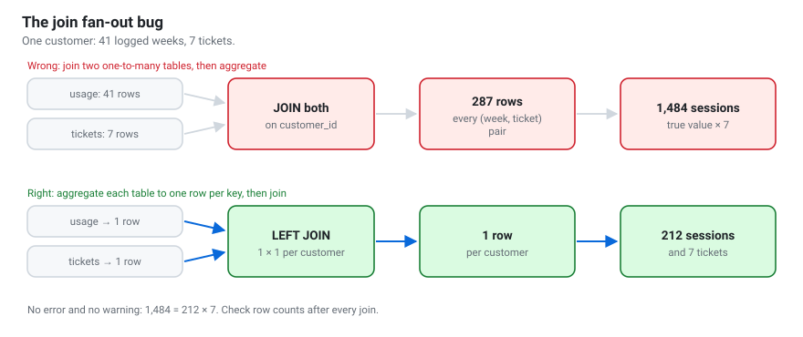
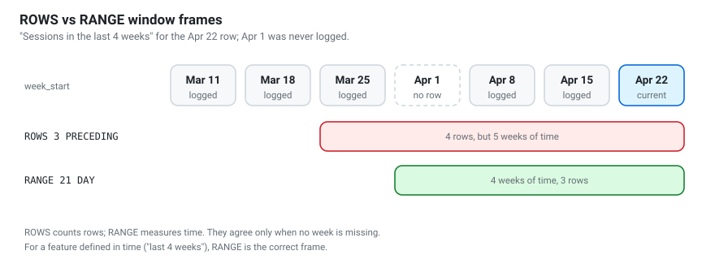
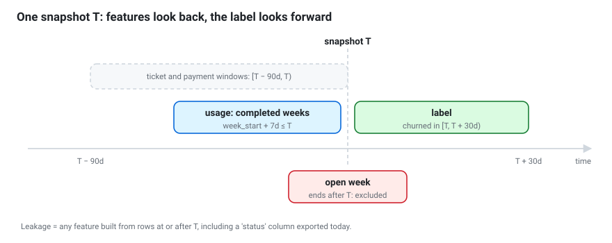

# Chapter 4 · SQL for ML

*Part I · Prerequisites: Chapters 2, 3 · Estimated time: reading ~45 min, lab ~55 min · Compute: CPU*

 · [Lab: notebook.ipynb](notebook.ipynb) · [Solutions](solutions.md)

## Learning objectives

After this chapter you should be able to:

1. Query pandas DataFrames with SQL using DuckDB.
2. Aggregate with `GROUP BY` and `FILTER`, and choose between inner and left joins for feature tables.
3. Explain, detect and prevent the join fan-out error.
4. Use window functions (`LAG`, `ROW_NUMBER` with `QUALIFY`, and `ROWS` and `RANGE` frames) and say when the two frame types differ.
5. Build point-in-time features and a label for a snapshot date $T$, and justify every inequality in the query.
6. Test a feature query against an independent implementation.

## 4.1 Introduction

In most companies the training table does not exist until someone writes the
SQL that builds it, and most silent leakage is introduced at that step: one
join on the wrong date, one week counted before it had ended. This chapter
builds the churn project's features and labels in SQL, one step at a time,
and checks the result against the package's implementation for exact
equality.

The chapter first explains why SQL is the language of feature engineering in
industry (Section 4.2), then reviews aggregation and joins with the error
they most often produce (Sections 4.3–4.4), and window functions
(Section 4.5). Sections 4.6–4.8 develop point-in-time correctness: the rule,
a step-by-step construction for one snapshot, and the ways the rule is
broken in practice. Section 4.9 discusses how to test SQL.

## 4.2 Why SQL, and why DuckDB

In most organisations the training data lives in a data warehouse, and the
people who know it best write SQL. An ML engineer is expected to read and
write joins, aggregations and window functions fluently, and interviews test
this directly. SQL also has a practical advantage for feature engineering: a
feature definition is a single readable query that a colleague can review,
run on the warehouse, and reuse.

The book uses **DuckDB**, an analytical SQL engine that runs inside the
Python process. It queries pandas DataFrames and Parquet files directly,
without a server: `con.register(name, df)` exposes a DataFrame as a table
(without copying it) and `con.execute(sql).df()` returns a DataFrame. The SQL
is close to what one would write on PostgreSQL, BigQuery or Snowflake;
dialects differ mainly in date functions and a few extensions such as
`QUALIFY`.

## 4.3 Aggregation and joins

### Aggregates and `FILTER`

`COUNT(*) FILTER (WHERE condition)` counts only rows that satisfy a
condition, inside an ordinary `GROUP BY`. It replaces the older idiom
`SUM(CASE WHEN condition THEN 1 ELSE 0 END)`. In the lab, a monthly summary
of invoices for early 2023 shows about 1,550–1,900 invoices a month, of which
60–90 failed.

### Inner and left joins

An **inner join** keeps only pairs of rows that match; a **left join** keeps
every row of the left table, with NULLs where there is no match. The
difference matters for features. Joining `customers` to `tickets` gives
22,354 rows with an inner join (one per ticket) and 22,888 with a left join:
the 534 customers who never filed a ticket survive only in the left join.
For a feature such as "number of tickets", zero is information, and an inner
join deletes exactly the customers for whom it is zero.

Two details make a left join behave as intended:

- **Conditions on the right-hand table go in `ON`, not `WHERE`.** A
  `WHERE t.created_at >= ...` after a `LEFT JOIN` removes the NULL-extended
  rows and silently turns the query back into an inner join.
- **Count a column of the right-hand table, not `*`.** For a customer without
  tickets the left join still produces one row (with NULLs), so `COUNT(*)`
  returns 1; `COUNT(t.ticket_id)` returns 0. `COALESCE(x, 0)` converts a
  remaining NULL into 0 where "no rows" means zero.

## 4.4 The fan-out error

The most common silent SQL error in feature pipelines arises when a table is
joined to **two one-to-many tables on the same key** before aggregating. For
customer `C00002`, a query that joins `usage_weekly` and `tickets` to the
customer and then sums sessions and counts tickets returns 1,484 sessions and
287 tickets. Computed separately, the true values are 212 sessions over 41
logged weeks, and 7 tickets: $1{,}484 = 212 \times 7$ and $287 = 41 \times 7$.

The join produced every (week, ticket) pair. In general, if customer $c$ has
$n_U(c)$ rows in table $U$ and $n_K(c)$ rows in table $K$,

$$
\text{rows after join} = \sum_{c} n_U(c)\, n_K(c) ,
\qquad
\text{SUM}_{\text{joined}}(x) = \sum_{c} n_K(c) \sum_{u \in U_c} x_u , \qquad (4.1)
$$

where $U_c$ is the set of $U$-rows of customer $c$ and $x_u$ a value in $U$.
Every value from $U$ is counted once per matching row of $K$. Over the whole
table, the true total of about 1.70 million sessions becomes about 11.0
million, an inflation of about 6.5 that differs from customer to customer (it
scales with each customer's ticket count), so it does not cancel out in a
model. There is no error message and the numbers look plausible.

*Figure 4.1 — The fan-out error. The fault is in the order of operations: the same tables and the same `SUM` give the right answer once each table is reduced to one row per key before joining.*

**Prevention.** Aggregate each source table to one row per key in its own
common table expression (CTE), then join the aggregates. `churnlab.features`
builds every feature group this way. Further safeguards: assert that the key
is unique on the "one" side of each join (a data contract or a test), and
compare row counts before and after each join. `COUNT(DISTINCT id)` repairs
counts but not sums, so it hides the problem rather than fixing it.

> **Intuition.** Fan-out is a multiplication table: 41 weeks along one side,
> 7 tickets along the other, and the join fills all 287 cells. Any sum over
> that table counts each week 7 times. *Where the analogy breaks down:* with
> a one-to-one or many-to-one join there is no table to fill, which is why
> the error appears only when two one-to-many relations meet.

## 4.5 Window functions

A **window function** computes a value for each row from a set of related
rows (its *window*) without collapsing them, as `GROUP BY` would.
`PARTITION BY` defines which rows are related; `ORDER BY` orders them within
the partition.

**`LAG`** returns a value from the previous row of the partition. With
`PARTITION BY customer_id ORDER BY week_start`, the first week of each
customer has no previous row and receives NULL. Without `PARTITION BY`,
customer B's first week would be compared with customer A's last week.
Arithmetic with NULL gives NULL, which is the correct answer when the
previous count is unknown. Note that `LAG` returns the previous **logged**
week: inactive weeks are not in the table, so the previous row may be two or
more weeks earlier. Whether that is the intended meaning is a modelling
decision.

**`ROW_NUMBER` and `QUALIFY`** solve top-1-per-group problems such as "the
latest invoice per customer": number the rows within each customer by date,
newest first, and keep number 1. `QUALIFY` filters on a window function as
`HAVING` filters on an aggregate. On databases without `QUALIFY`, the
numbered query is wrapped in a subquery and filtered with `WHERE rn = 1`. For
a feature, "latest" must mean "latest **before the snapshot date**", and the
date filter must be applied in `WHERE`, which runs *before* the window
function. Filtering after ranking would discard every customer whose overall
latest invoice falls after the snapshot.

**Frames: `ROWS` and `RANGE`.** "Sessions in the last four weeks" can be
written two ways:

- `ROWS BETWEEN 3 PRECEDING AND CURRENT ROW`: this row and the three rows
  before it;
- `RANGE BETWEEN INTERVAL 21 DAY PRECEDING AND CURRENT ROW`: rows whose
  `week_start` lies within 21 days before this row's.

They agree only when no week is missing. For a customer who skipped a week,
`ROWS` reaches back more than 28 days to collect four rows, while `RANGE`
stays within 28 days. For a time window, `RANGE` (or an explicit date filter)
is the correct definition.

*Figure 4.2 — `ROWS` versus `RANGE` frames. They differ only when a week is missing, which is the case that casual testing usually does not cover.*

## 4.6 Snapshots and point-in-time correctness

Training data for a periodic prediction task is built as **snapshots**. For
each snapshot date $T$ and each entity active at $T$:

- **features** are computed from data with timestamps strictly *before* $T$;
- the **label** is computed from data in the window *after* $T$, here
  $[T, T + 30\ \text{days})$.

*Figure 4.3 — Point-in-time correctness. Features look back from the snapshot date; the label looks forward 30 days. Nothing else may look forward.*

The rule is simple to state. It is easy to break, because a violation
produces no error, only a model that appears better than it is.

**Half-open intervals.** Every time window in this book is written as a
half-open interval $[a, b)$, which includes $a$ and excludes $b$. Consecutive
windows $[a, b)$ and $[b, c)$ then neither overlap nor leave a gap, and the
rule "strictly before $T$" becomes "in $[\,\cdot\,, T)$". An event dated
exactly at $T$ belongs to the future of snapshot $T$: it may have been
recorded after the prediction was made.

**The completed-week rule.** A row of `usage_weekly` describes the week
*starting* on `week_start`; its numbers are known only once the week has
ended. A usage week starting on day $w$ is therefore usable at snapshot $T$
only if

$$
w + 7\ \text{days} \le T . \qquad (4.2)
$$

The obvious condition $w < T$ is wrong. For $T$ = Friday 2024-03-01, the week
starting Monday 2024-02-26 ends on 2024-03-04: Equation (4.2) excludes it,
whereas $w < T$ includes it and leaks three days of the future (1–3 March)
into every usage feature of every account. When $T$ falls on a Monday the two
conditions agree, which is why the error survives casual testing.

**The label.** For an account $i$ active at $T$,

$$
y_i(T) = \mathbb{1}\left[\, T \le \text{churn\_date}_i < T + 30\ \text{days} \,\right] , \qquad (4.3)
$$

where $\mathbb{1}[\cdot]$ equals 1 if the condition holds and 0 otherwise.
For $T$ = 2024-03-01, a cancellation on 2024-03-20 gives $y = 1$; one on
2024-04-02 gives $y = 0$ and counts for the April snapshot instead. This is
the only legitimate use of `churn_date`: it is the one column allowed to look
past $T$, only by 30 days, and only for the label.

**The positive rate** of a snapshot is $\hat{\pi} = \frac{1}{N}\sum_i y_i$,
the share of active accounts that churn in the window.

> **Intuition.** A snapshot is a photograph taken at midnight on day $T$. A
> feature may use only what is in the photograph; the label is what one
> learns by returning 30 days later. *Where the analogy breaks down:* a
> photograph is instantaneous, but a usage week is a seven-day recording: it
> is "in the photograph" only once it has finished (Equation 4.2).

## 4.7 Building one snapshot, step by step

The lab builds the features for one snapshot, $T$ = 2024-03-01, in four steps
and then compares the result with the package.

1. **Population.** Accounts that signed up before $T$ and had not churned
   before $T$: `signup_date < T AND (churn_date IS NULL OR churn_date >= T)`.
   Accounts that churned earlier are not scored (nobody remains to call);
   accounts that signed up after $T$ did not yet exist. There are 2,246
   accounts in the population. Tenure is computed here as the number of days
   from sign-up to $T$.
2. **Which weeks count.** Only completed weeks (Equation 4.2).
3. **Features.** Each feature group is aggregated to one row per customer
   *first* (no fan-out), then left-joined to the population, with `COALESCE`
   turning "no rows" into 0. Sessions in the last four weeks use weeks that
   ended in $(T - 28\ \text{days}, T]$; failed payments in the last 90 days
   use invoices in $[T - 90\ \text{days}, T)$.
4. **Label.** Equation (4.3). The snapshot has 2,246 rows, 129 positives and
   a positive rate of $129 / 2246 \approx 0.057$.

The step-by-step table is then compared with
`churnlab.features.build_features` for the same snapshot. The comparison is
for **identical** values, not approximately equal ones: 2,246 rows on both
sides, and every one of tenure, sessions in four weeks, failed payments and
the label identical.

The package's SQL (`SNAPSHOT_SQL`, `TICKETS_SQL` and companions) applies the
same logic to many snapshots at once: a `snapshots` table holds one row per
$T$, and each feature group joins to it with the window conditions in the
`ON` clause. `TICKETS_SQL`, for example, restricts tickets to
$[T - 90\ \text{days}, T)$ in the join and then uses `FILTER` to count the
30-day subset. The full feature table has 44,361 rows over 21 monthly
snapshots, with a positive rate of about 0.055.

> **Connection to other fields.** The completed-week rule is the same idea
> as a causal filter in real-time signal processing: the features computed
> at a decision time may use only samples up to that time. A zero-phase (forward-backward) filter
> applied offline uses future samples, exactly as counting an unfinished week
> does.

## 4.8 How point-in-time correctness is broken in practice

| Error | Example |
|---|---|
| Using a column that is updated in place | `customers.status` read today says "cancelled" for a snapshot taken a year ago |
| Period boundaries | weekly usage stored by `week_start`; comparing `week_start < T` leaks up to six days |
| `<=` instead of `<` | an event on the snapshot day itself, which may have been recorded after the prediction |
| Aggregates over the whole table | "average tickets per customer" computed over all time, then joined to every snapshot |
| Late-arriving data | a record with an event time before $T$ but an ingestion time after $T$; strictly, the ingestion time must also precede $T$ |
| Joining the latest version of a dimension | a customer's *current* plan joined to a historical snapshot |

The last two are the hardest to avoid. A warehouse that keeps only the
current state of each entity cannot answer the question "what was known at
$T$?". Where possible, use tables with validity intervals (often called
*slowly changing dimensions* or history tables) or the event log itself.

The lab ends with the first error in the table. Joining `customers.status` to
the population at $T$ = 2024-03-01 shows that 990 of the 2,246 active
accounts (44%) are `cancelled` by export time, and **all** 129 churners are
among them. The query is syntactically correct and the resulting "feature"
is the future. No SQL engine will warn about it; only the rule that every
feature uses rows from before $T$ will. Chapter 5 measures its effect.

## 4.9 Testing feature SQL

The most useful test of a feature pipeline compares it with an independent,
slower, obviously correct implementation on one case, for exact equality.
Inspecting a few rows by eye misses boundary errors that affect 1–2% of rows;
an exact comparison does not. The graders for Exercises 2 and 3 work this way
(against `mrr_usd` and `tickets_30d` from `build_features`), and so do the
repository's tests.

A short checklist for reviewing a feature query:

1. Does every time condition use a half-open interval, with `<` at the
   snapshot?
2. Does every period-stamped row (a week, a month) count only once it has
   ended?
3. Is every source aggregated to one row per key before joining?
4. Does the population survive (left joins, conditions in `ON`, `COALESCE`)?
5. Does any column describe the state of an entity at export time rather than
   at $T$?

> **Interview note.** A common SQL question is really a leakage question:
> "Write a query for each customer's sessions in the 30 days before each
> snapshot date." The interviewer watches the date boundaries, the join
> conditions, and whether the candidate asks how timestamps are recorded.
> Ask.

## Key terms

| Term | Definition |
|---|---|
| DuckDB | An analytical SQL database that runs inside the Python process, without a server. |
| Inner join | A join that keeps only pairs of matching rows. |
| Left join | A join that keeps every row of the left table, with NULLs where there is no match. |
| One-to-many | A relation in which one row on one side matches many rows on the other. |
| Fan-out | Row multiplication caused by joining two one-to-many relations on one key, which inflates sums and counts (Equation 4.1). |
| CTE | A common table expression (`WITH name AS (...)`), a named subquery. |
| Window function | A value computed from related rows without collapsing them, such as `LAG(sessions)`. |
| `QUALIFY` | A clause that filters on a window function, as `HAVING` filters on an aggregate. |
| Frame (`ROWS` / `RANGE`) | The rows a window includes: a count of rows, or a span of ordering values such as dates. |
| Snapshot date $T$ | The day on which a prediction is made. |
| Point-in-time feature | A feature built only from rows that existed before $T$. |
| Half-open interval $[a, b)$ | An interval that includes $a$ and excludes $b$. |
| `COALESCE` | Returns its first non-NULL argument; turns "no rows" into 0 after a left join. |
| Slowly changing dimension | A table that records each version of an entity with its validity interval. |

## Summary

1. SQL is the usual language of feature engineering because a feature definition becomes one reviewable query; DuckDB runs it on DataFrames without a server.
2. Left joins keep entities with no events; conditions on the right-hand table belong in `ON`, and counts should count a right-hand column.
3. Joining two one-to-many tables before aggregating multiplies values (Equation 4.1); aggregate each source per key first.
4. Window functions (`LAG`, `ROW_NUMBER` with `QUALIFY`) compute per-row values from related rows; `ROWS` and `RANGE` frames differ when rows are missing.
5. Features use data strictly before $T$; the label uses $[T, T + 30\ \text{days})$ (Equation 4.3); a week counts only when it has ended (Equation 4.2).
6. Point-in-time errors produce no error message; the common ones are in-place updated columns, period boundaries, `<=`, global aggregates, late data and current dimensions.
7. Test feature SQL against an independent implementation for exact equality.

## Exercises

The exercises are in the [lab](notebook.ipynb); worked answers are in [solutions.md](solutions.md).

1. **`weekly_change_sql()`** — previous logged week's sessions and the change, per customer and week, with `LAG`.
2. **`latest_invoice_sql(as_of)`** — the latest invoice strictly before a date for every customer who has one; checked against `mrr_usd`.
3. **`tickets_30d_sql(snapshot)`** — tickets in $[T - 30\ \text{days}, T)$ for every account active at $T$, zero included; checked against `build_features` for two snapshots.
4. **Written.** What causes the fan-out error, how to detect it in review, and two ways to prevent it.

The checkpoint questions cover fan-out, left joins with `WHERE` conditions, `ROWS` versus `RANGE`, the completed-week rule, the label definition, and how the SQL was tested.

## Further reading

- DuckDB. *Window Functions* and *QUALIFY Clause*. https://duckdb.org/docs/sql/functions/window_functions
- Kimball, R. & Ross, M. (2013). *The Data Warehouse Toolkit* (3rd ed.). Wiley. (Fact and dimension tables; slowly changing dimensions.)
- Kleppmann, M. (2017). *Designing Data-Intensive Applications*. O'Reilly. (Chapters 2–3 on data models, query languages and storage.)
- Kaufman, S., Rosset, S., Perlich, C. & Stitelman, O. (2012). Leakage in data mining: formulation, detection, and avoidance. *ACM Transactions on Knowledge Discovery from Data*, 6(4).
- Huyen, C. (2022). *Designing Machine Learning Systems*. O'Reilly. (Chapter 5 on feature engineering and data leakage.)

**Next:** [Chapter 5 · Leakage-safe splits & a baseline](../ch05-leakage-safe-splits-and-baseline/README.md)
