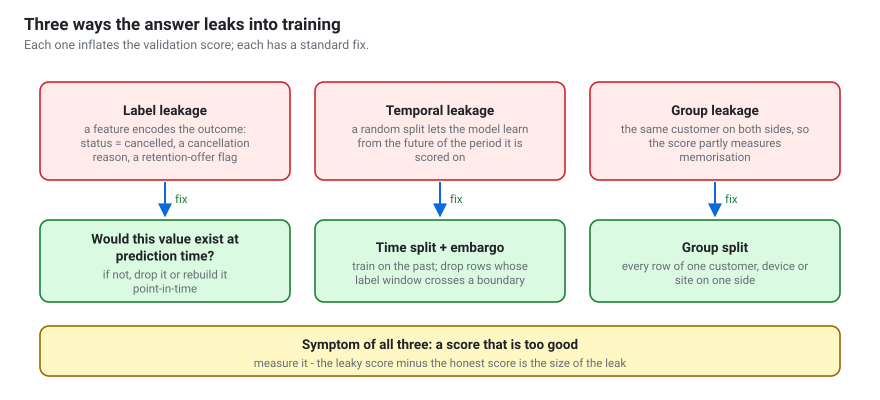
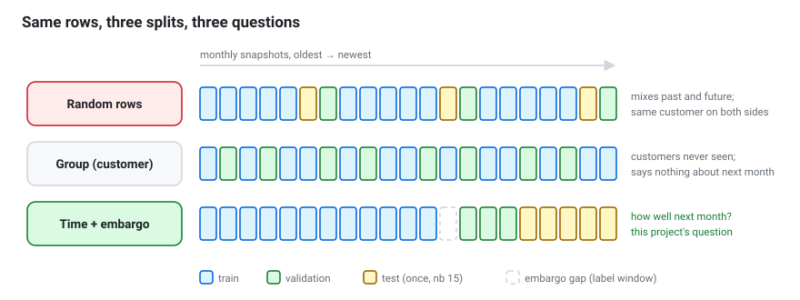
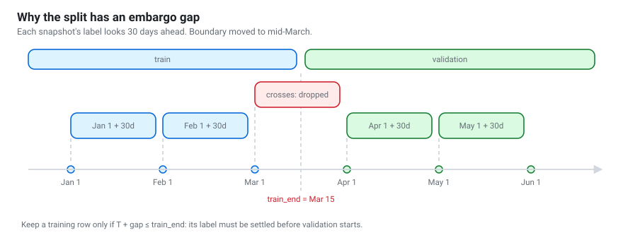
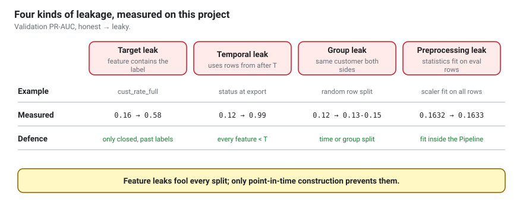

# Chapter 5 · Leakage-safe splits & a baseline

*Part I · Prerequisites: Chapters 3, 4 · Estimated time: reading ~45 min, lab ~45 min · Compute: CPU*

 · [Lab: notebook.ipynb](notebook.ipynb) · [Solutions](solutions.md)

## Learning objectives

After this chapter you should be able to:

1. Name the three kinds of leakage (label, temporal and group), how each enters a pipeline, and its defence.
2. Build a time split with an embargo gap and derive the gap from the label horizon.
3. Check a split for time and group leakage automatically.
4. Define ROC-AUC and average precision, compute both by hand on a small example, and state the value each takes for an uninformative score.
5. Measure the effect of leakage empirically, on validation only, and report it with the split named.
6. Report baselines (a prior, a hand-written rule and a small linear model) that later models must beat.

## 5.1 Introduction

A validation score is an answer to a question, and the split determines the
question. A random split of rows asks "how well does the model score a random
month it has partly seen?". A time split asks "how well will it score next
month?". Only one of these is the question the retention team is asking.

This chapter chooses the split that matches how the churn model will be used,
measures what different kinds of leakage do to the score, and sets the
baselines every later model must exceed. Section 5.2 classifies leakage.
Sections 5.3 and 5.4 build and check the time split. Section 5.5 introduces
the two ranking metrics used throughout Part I. Section 5.6 reports the
measured effect of leakage, including a result that differs from the usual
textbook account, and Section 5.7 relates the splits to cross-subject
evaluation in EEG research. Section 5.8 sets the baselines and Section 5.9
states the rule for the test period.

One rule holds for the whole of Part I: the **test** period (July to
November 2024) is used **once**, in Chapter 16. Everything in this chapter
is measured on **validation**.

## 5.2 Three kinds of leakage

**Leakage** is information available at training or evaluation time that
would not be available when the model makes a prediction. All kinds of
leakage share a symptom (a score that is too good), so the symptom alone does
not identify the cause.

*Figure 5.1 — Three kinds of leakage, how each enters, and the corresponding defence.*

### Label leakage

Label leakage is any feature that encodes the answer.

- **Direct**: a column derived from the label (`status = 'cancelled'`).
- **Proxy**: a column that exists only *because* of the outcome, such as a
  "cancellation reason" field or the number of days until last activity.
- **Process**: a value set downstream of the outcome in a business process,
  for example a retention-offer flag that the support team sets after a
  customer has already announced they are leaving.

The test for any surprisingly strong feature is a single question: *at the
moment the prediction is made, in production, would this value exist and
have this value?* `build_features(include_leaky=True)` adds two such columns
so that their effect can be measured (Section 5.6).

### Temporal leakage

When rows are ordered in time, a random split lets the model learn from the
future of the period on which it is scored. Production never has that
advantage. The defence is a **time split**: train on the past, validate on
the next period, test on the period after. When the label looks ahead, an
**embargo** is also needed (Section 5.3).

### Group (entity) leakage

The same customer appears at many snapshots, and their rows are strongly
correlated. If a customer is in both training and evaluation, part of the
score measures memorisation of that customer. Whether this matters depends on
the question:

| The model will be used to... | Appropriate split |
|---|---|
| score existing customers next month | time split; seeing the same customer in an earlier period is realistic |
| score customers it has never seen | group split by customer (often combined with time) |
| generalise to a new site, device, hospital or region | group split by that unit |

Whichever split is used, it is named next to every reported result.

## 5.3 The time split and the embargo

The churn model runs on the first of each month and scores the accounts
active that day. The faithful rehearsal is to train on earlier months and
validate on later months. `churnlab.splits.time_split` produces three
periods:

| Period | Snapshots | Rows | Positive rate |
|---|---|---|---|
| train | 2023-03-01 to 2024-03-01 | 25,278 | ≈ 0.055 |
| validation | 2024-04-01 to 2024-06-01 | 6,956 | ≈ 0.052 |
| test | 2024-07-01 to 2024-11-01 | 12,127 | ≈ 0.059 |

(These and all other numbers in Part I come from the course's synthetic data.)

*Figure 5.2 — Random, group and time splits. Only the time split, with an embargo gap, rehearses scoring next month.*

**Why a gap is needed.** The label of a row at snapshot $T$ depends on events
in $[T, T + h)$, where $h$ is the label horizon (30 days here). If $T$ lies
less than $h$ before the end of training, that label is decided by events
**inside the validation period**: the training set then contains part of what
validation is supposed to test. A row with snapshot $T$ may therefore train a
model that is validated from $t_v$ onwards only if

$$
T + h \le t_v , \qquad (5.1)
$$

that is, only if its label is settled before the evaluation period begins.
`time_split` keeps a training row only if `snapshot_date + gap_days <= train_end`.
The gap is applied to the *earlier* period: moving the start of the later
period instead removes the right amount of time from the wrong side, and the
training rows still carry labels from inside validation.

*Figure 5.3 — The embargo. The dropped row has a valid snapshot date; it is its label window that reaches into the validation period.*

With snapshots and boundaries on the first of the month, the March snapshot's
window ends on 31 March, just before 1 April, so the gap removes nothing. With
the boundary moved to 2024-03-15 and no gap, the 2024-03-01 snapshot would
stay in training although its labels run to 31 March; with a 30-day gap it is
dropped (23,032 rows instead of 25,278, that is 2,246 fewer). The rule costs
nothing when it is not needed. One edge case: with `gap_days = 0` and a
boundary that is itself a snapshot date, the boundary snapshot satisfies both
`T + 0 <= train_end` and `T >= train_end` and lands in both periods, so the
gap should be at least one day.

> **Intuition.** The embargo is the rule that an examination question may not
> be marked with an answer that is revealed only during next week's
> examination. *Where the analogy breaks down:* nothing is revealed to the
> model directly; the leak is that training rows and validation rows share
> the same future events, so validation is no longer an independent test.

## 5.4 Checking a split automatically

A rule that is only remembered will eventually be forgotten. `assert_no_leakage`
turns it into a check that can sit in a test or at the top of a training
script. It fails when the last training snapshot plus the label horizon
reaches past the first evaluation snapshot, and, if asked, when any group
(customer) appears on both sides. The time split passes; a random split fails
with *train label windows overlap the validation period*. Exercise 2 asks for
a version that returns a list of readable problems rather than raising, so
that a reviewer sees all problems at once.

Note what such a check cannot see: it inspects which rows are in which
period, not what a column encodes. Leakage through **features** (Section 5.6)
is invisible to every split check.

## 5.5 Two ranking metrics

The churn model is used to rank accounts, so its headline metrics measure
ranking quality. Both are threshold-free; Chapter 8 introduces metrics at a
chosen threshold.

**ROC-AUC** is the probability that a randomly chosen positive is scored
above a randomly chosen negative, with ties counted as one half:

$$
\text{ROC-AUC} = P\left(s^{+} > s^{-}\right) + \tfrac{1}{2}\, P\left(s^{+} = s^{-}\right) , \qquad (5.2)
$$

where $s^{+}$ and $s^{-}$ are the scores of a random positive and a random
negative row. An uninformative (constant or random) score has ROC-AUC 0.5.

**Average precision (AP)**, used in this book as the estimate of the area
under the precision-recall curve (**PR-AUC**), averages the precision at the
rank of each positive:

$$
\text{AP} = \sum_{n} (R_n - R_{n-1})\, P_n = \frac{1}{N_{+}} \sum_{k:\ y_{(k)} = 1} \text{precision@}k , \qquad (5.3)
$$

where $P_n$ and $R_n$ are the precision and recall at the $n$-th threshold,
$N_{+}$ is the number of positives, $y_{(k)}$ is the label of the $k$-th
highest score, and precision@$k$ is the share of positives among the top $k$.
A constant score has AP equal to the positive rate $\pi$, not 0.5.

**Worked example.** Five accounts with scores, highest first: 0.9 (churner),
0.8, 0.7, 0.6 (churner), 0.2. Of the $2 \times 3 = 6$ (churner, non-churner)
pairs, the churner at 0.9 is above all three non-churners and the churner at
0.6 above one, so ROC-AUC $= 4/6 = 0.667$. The churners are at ranks 1 and 4,
with precision $1/1$ and $2/4$, so AP $= (1 + 0.5)/2 = 0.75$. A constant score
gives AP $= 2/5 = 0.40$, the positive rate. The lab verifies all three values
against scikit-learn.

Which metric is the headline? At a positive rate of about 5%, most
(churner, non-churner) pairs are easy to order, so ROC-AUC looks favourable
even when the top of the list is poor. AP concentrates on the top of the
ranking, where the retention team works, and is therefore the headline metric
in this book. Because AP's floor is the positive rate, an AP must always be
read against $\pi$: on validation, $\pi = 0.052$, so an AP of 0.12 is about
2.3 times the floor. ROC-AUC, in contrast, is comparable across periods and
slices with different positive rates.

> **Intuition.** ROC-AUC asks: "pick one churner and one loyal customer at
> random; who is ranked higher?" With 95% loyal customers, most such pairs are
> easy. PR-AUC asks: "walking down the list from the top, what share of calls
> reach a churner?", which is the retention team's question. *Where the
> analogy breaks down:* PR-AUC depends on the positive rate, so it cannot be
> compared directly across periods or slices with different rates.

## 5.6 Measuring leakage

Arguments about leakage are settled by measurement. The lab uses one small
model throughout, so that only the split or the features change: a
standardised logistic regression on five point-in-time features
(`sessions_4w`, `tenure_days`, `failed_payments_90d`,
`weeks_since_last_active`, `tickets_30d`). On the time split it scores a
validation PR-AUC of about 0.12 and a ROC-AUC of about 0.72, against a
positive rate of 0.052.

**(a) Leaky features.** Adding the two export-time columns from Chapter 3
(`status_cancelled` and `days_until_last_active`) to the same model and the
same split raises the validation PR-AUC from about 0.12 to about 0.99 and the
ROC-AUC to about 0.999. No real churn model performs like that. A number of
this kind is a **symptom**, and the right response is to look for the leak.
The split was correctly time-ordered: leakage through features passes every
split check.

**(b) Random rows against the time split.** The same five features and the
same model on a random 60/20/20 split of rows, repeated with three seeds,
give PR-AUC of about 0.13–0.15: a little above the time split's 0.12, but by
less than the random split's own seed-to-seed spread. Group splits by
customer give about 0.14–0.16. ROC-AUC is about 0.72–0.74 everywhere. Each
split's validation set is a different population (different months,
different positive rates), so even these numbers are not strictly
comparable.

This is smaller than the inflation textbooks warn about, and it should be
reported as found. Three properties of this project explain it:

1. The largest leak was already removed **in SQL** (Chapter 4): every feature
   is point-in-time, so a random split cannot bring future feature values into
   a row.
2. A five-feature linear model has almost no capacity to memorise individual
   customers, which is how a random split usually inflates a score.
3. The synthetic business is fairly stationary over two years, so a random
   past month and the next months look similar.

The random split is nevertheless wrong for this project. It answers a
question nobody asked, it fails `assert_no_leakage`, and it would hide drift
that a time split exposes. A higher-capacity model, entity-specific features
or a changing business would widen the gap, and the habit must be in place
before one learns which case applies.

*Figure 5.4 — Measured effects on this project. Leaks in the features (target, temporal) are large and invisible to split checks; leaks in the procedure (random split, preprocessing fitted on all rows) are small on this data. Chapter 6 measures the preprocessing and target-encoding leaks.*

**(c) Two honest splits, two questions.** A time split answers "how well will
we score our existing customers next month?", which is this project's use. A
group split answers "how well will we score customers we have never seen?",
for example in a new market; it mixes periods, so it says nothing about the
future. Neither is more correct in general. The split is chosen to match the
deployment and named next to every number.

## 5.7 The cross-subject analogy

Readers with EEG or BCI experience already know this chapter in another
vocabulary.

| EEG / BCI | TaskFlow churn |
|---|---|
| subject | customer |
| trials or windows from one session | monthly snapshots of one customer |
| within-subject random split: high accuracy from shared noise, electrode placement and session effects | random split: high scores from memorised customers and future periods |
| leave-one-subject-out evaluation | group split by customer |
| session-to-session transfer (train on day 1, test on day 2) | time split: train on past months, test on later months |
| filters or normalisation fitted on all data before splitting | scaler or imputer fitted before cross-validation (Chapter 6) |
| overlapping windows across the train/test boundary | label windows overlapping across the boundary (the embargo) |

The difference between a within-subject and a cross-subject score is a
measured size of the leakage. In an interview this makes a good account:
the problem was found, measured, and the evaluation was changed to match how
the system would be used. Exercise 4 asks for this translation in writing.

## 5.8 Baselines

A model is good only relative to something simpler. Three baselines are
trained on the training period and measured on validation:

| Baseline | Validation PR-AUC | Validation ROC-AUC | Note |
|---|---|---|---|
| prior (`DummyClassifier`) | 0.052 | 0.5 | equal to the positive rate: the floor |
| hand rule: no sessions in 4 weeks or a failed payment in 90 days | ≈ 0.06 | — | flags about 12% of accounts |
| logistic regression, five features | ≈ 0.12 | ≈ 0.72 | — |

**Why the prior's PR-AUC equals the positive rate.** A constant score puts
every row at the same rank, so every precision equals the overall positive
rate, and so does their average (Equation 5.3).

**Why the hand rule is barely above the floor.** A yes/no rule produces one
operating point rather than a ranking, and "zero sessions" is rare among
active accounts. The lesson is not that rules are poor: Exercise 3 asks for a
*continuous* hand-written score, and the reference solution, a weighted sum
of the log of the session trend and three ticket and payment counts chosen by
reasoning, reaches a validation PR-AUC of 0.118, close to the logistic
regression, with no fitting at all. The weights must not be tuned on
validation; doing so would make validation part of training.

The lab saves the baselines to `artifacts/baselines.json`, with the split
definition, the evaluation period, the number of validation rows, the
positive rate, the feature list, and the result of the leakage measurement.

## 5.9 The test period is used once

The **test period is used once**, after all choices are fixed on
validation. Every look at test performance that influences a choice (a
feature, a threshold, a model) turns the test set into a second validation
set, and the final estimate is then biased upwards. If test and validation
disagree, both are reported with an explanation; the model is not re-tuned.
Chapter 16 performs that single evaluation.

> **Interview note.** "A colleague reports a validation PR-AUC of 0.97 on this
> data. What do you check first?" The feature list, for export-time columns
> or anything derived from them, and the timestamps of every feature against
> the snapshot. Split checks cannot catch it: the leaky columns produced 0.99
> with a correctly time-ordered split.

## Key terms

| Term | Definition |
|---|---|
| Leakage | Information used in training or evaluation that would not exist at prediction time. |
| Label leakage | A feature that encodes the outcome directly, by proxy, or through a downstream process. |
| Temporal leakage | Learning from the future of the period being evaluated. |
| Group leakage | The same entity on both sides of a split, so the score partly measures memorisation. |
| Time split | Training on earlier periods and evaluating on later ones. |
| Embargo gap | A buffer that ensures no training label is decided inside the evaluation period (Equation 5.1). |
| Group split | A split that keeps all rows of one entity on the same side. |
| Validation set | Data used to choose and check models. |
| Test set | Data used once, at the end, to estimate performance of the final choice. |
| ROC-AUC | The probability that a random positive outscores a random negative (Equation 5.2); 0.5 for an uninformative score. |
| Average precision (PR-AUC) | The mean precision at the rank of each positive (Equation 5.3); equal to the positive rate for an uninformative score. |
| Baseline | The simplest model a candidate must beat. |
| Prior (dummy) model | A model that gives every row the same score. |
| Hand rule | A rule written by a person, without fitting. |

## Summary

1. Leakage has three forms (label, temporal, group) with one shared symptom: a score that is too good.
2. A time split rehearses the deployment; an embargo of at least the label horizon (Equation 5.1) keeps training labels out of the evaluation period.
3. Split checks can be automated, but they see row membership only; leakage through features is invisible to them.
4. ROC-AUC (Equation 5.2) has floor 0.5; average precision (Equation 5.3) has floor equal to the positive rate and is the headline metric for a capacity-limited team.
5. Two export-time columns raised PR-AUC from about 0.12 to about 0.99 on a correctly ordered split.
6. On this data a random split inflated the score only slightly, for identifiable reasons; it remains the wrong split.
7. Time and group splits answer different questions; the split is named next to every number.
8. Baselines (prior 0.052, yes/no rule about 0.06, logistic regression about 0.12) set the bar; a continuous hand rule reaches about 0.118.
9. The test period is used once, in Chapter 16.

## Exercises

The exercises are in the [lab](notebook.ipynb); worked answers are in [solutions.md](solutions.md).

1. **`time_split_with_embargo(df, train_end, valid_end, gap_days)`** — return train, validation and test frames with the embargo applied to the earlier periods; compared with `time_split` for four boundary and gap settings.
2. **`leakage_problems(train, test, label_horizon_days, group_col=None)`** — a list of readable time and (optionally) group problems, empty when the split is clean.
3. **`rule_scores(df)`** — a hand-written continuous score, without fitting, that exceeds 1.5 times the positive rate in validation PR-AUC.
4. **Written.** Map the time, group and random splits to EEG/BCI evaluation designs, give a situation where each of the first two is right, and name the EEG equivalent of the embargo.

The checkpoint questions cover the choice of split, the embargo, a suspicious PR-AUC of 0.97, why the random split inflated the score so little here, and the role of the prior and the hand rule.

## Further reading

- Kaufman, S., Rosset, S., Perlich, C. & Stitelman, O. (2012). Leakage in data mining: formulation, detection, and avoidance. *ACM Transactions on Knowledge Discovery from Data*, 6(4).
- Roberts, D. R. et al. (2017). Cross-validation strategies for data with temporal, spatial, hierarchical, or phylogenetic structure. *Ecography*, 40(8), 913–929.
- Fawcett, T. (2006). An introduction to ROC analysis. *Pattern Recognition Letters*, 27(8), 861–874.
- Saito, T. & Rehmsmeier, M. (2015). The precision-recall plot is more informative than the ROC plot when evaluating binary classifiers on imbalanced datasets. *PLoS ONE*, 10(3), e0118432.
- Hastie, T., Tibshirani, R. & Friedman, J. (2009). *The Elements of Statistical Learning* (2nd ed.). Springer. (Section 7.10 on cross-validation, including "the wrong and the right way".)
- scikit-learn. *Metrics and scoring: `average_precision_score`, `roc_auc_score`*. https://scikit-learn.org/stable/modules/model_evaluation.html

**Next:** [Chapter 6 · Pipelines & cross-validation](../ch06-pipelines-and-cross-validation/README.md)
