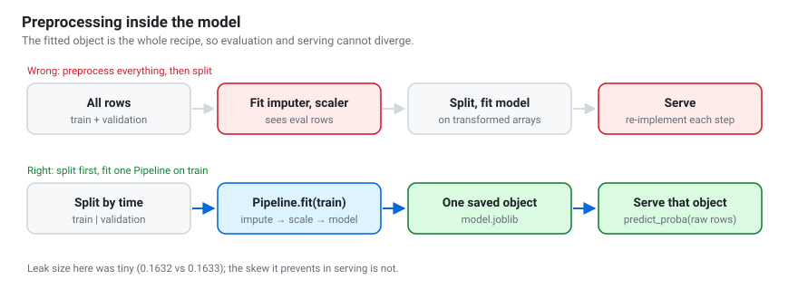
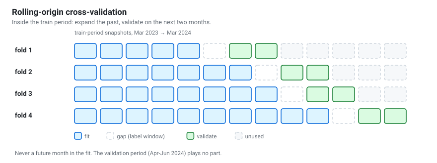

# Chapter 6 · Pipelines & cross-validation

*Part I · Prerequisites: Chapters 4, 5 · Estimated time: reading ~40 min, lab ~50 min · Compute: CPU*

 · [Lab: notebook.ipynb](notebook.ipynb) · [Solutions](solutions.md)

## Learning objectives

After this chapter you should be able to:

1. Explain why imputers, scalers and encoders belong inside the model object, in terms of both leakage and training/serving skew.
2. Measure a preprocessing leak and a target-encoding leak instead of assuming their size, and explain why the two differ by orders of magnitude.
3. Read a `ColumnTransformer`: which columns go to which branch, what comes out, and what happens to an unseen category.
4. Write down the standardisation, `log1p` and logistic-regression equations and say what each does to a feature.
5. Cross-validate inside the training period with rolling-origin folds, and compare that estimate with shuffled k-fold and with the later validation score.

## 6.1 Introduction

A model that is evaluated with one preprocessing path and served with
another is two different models, and only one of them was measured. In
research code the usual pattern is to clean the whole array, scale it, and
only then split and fit. This chapter replaces that pattern with a single
fitted object that contains every learned transformation, measures what the
two classic leaks actually cost on this data (one is negligible, one is very
large), and replaces shuffled k-fold cross-validation with a scheme that
respects time.

Section 6.2 states the principle. Sections 6.3 and 6.4 measure two leaks.
Section 6.5 examines the preprocessor used in the rest of Part I and the
equations behind it. Sections 6.6 and 6.7 develop rolling-origin
cross-validation and interpret its estimates. All work uses the training and
validation periods only.

## 6.2 One object from raw columns to probability

Two things go wrong when preprocessing is fitted outside the model.

1. **Leakage.** Anything *learned* from data (a median, a mean and standard
   deviation, the list of categories, a target rate) that is learned on rows
   later used for evaluation has seen those rows.
2. **Skew.** The serving code must repeat every step exactly, from memory.
   One forgotten `log1p` and the service scores a different model from the one
   that was validated. Chapter 11 demonstrates this failure.

The remedy for both is the same: the fitted object *is* the whole procedure.
A scikit-learn `Pipeline` chains the preprocessing steps and the classifier;
`fit` learns every parameter on the training rows only, and `predict_proba`
applies them all. The object that is saved is the object that is served.

*Figure 6.1 — Preprocessing outside and inside the model. In the lower row no step is re-implemented by hand, so nothing can differ between evaluation and serving.*

`churnlab.modeling.make_model("logreg")` returns such a pipeline. Fitted on
the training period, it scores a validation PR-AUC of about 0.163 and a
ROC-AUC of about 0.733 (the positive rate, which a random ranking would
score on PR-AUC, is about 0.052). This is the reference number for the
chapter. It is higher than the 0.12 of Chapter 5 because the pipeline uses all
19 features rather than five.

> **Intuition.** A pipeline is a sealed recipe card on which the
> measurements have been filled in from the training kitchen (this median,
> this mean, these categories). Whoever cooks later follows the card without
> re-measuring. *Where the analogy breaks down:* the card is only as sound as
> the kitchen it was filled in. If it is fitted on rows that include the
> evaluation period, the card itself has leaked.

## 6.3 A preprocessing leak, measured

The textbook leak is to fit the imputer and scaler on the training **and**
validation rows, then fit the classifier on training rows only. Measured on
this data, the two validation PR-AUCs agree to about three decimals (0.1633
against 0.1632 in the course's run). The leak is **negligible** here.

This is worth stating plainly, because it contradicts a common claim. A
median and a standard deviation estimated on about 25,000 rows barely change
when 7,000 rows from a similar distribution are added, so the classifier sees
almost the same inputs. The leak grows when:

- the data are small;
- the distribution changes between periods;
- the fitted preprocessing has many parameters estimated from the label or
  from many features: feature selection on all rows, PCA, target encoding.

The reasons to use a pipeline anyway are that one does not want to
re-measure this every time, and that the same object protects serving.

## 6.4 Target leakage through a feature

A feature that *uses the label* is a different matter. A plausible candidate
is "this customer's historical churn rate", a form of **target encoding**:
replacing a category (here, the customer) with the mean label of its rows,

$$
\text{TE}(c) = \frac{1}{n_c} \sum_{i \in c} y_i , \tag{6.1}
$$

where $c$ is a category level, $n_c$ the number of rows in that level and
$y_i$ their labels. The lab builds three versions:

| Version | Computed from | Leaks? |
|---|---|---|
| `cust_rate_full` | mean label per customer over the whole train and validation table, current row included | yes: contains the current label and the future |
| `cust_rate_train` | the same, from training labels only, current row included | yes inside training; appears harmless for validation |
| `past_churn_labels` | the customer's **earlier** labels whose 30-day window had **closed** before this snapshot | no |

Each is added to the reference pipeline and scored two ways: shuffled 5-fold
cross-validation inside the training period (how such a leak is usually
"validated"), and the validation period.

- `cust_rate_full` scores about 0.58 in shuffled CV **and** about 0.58 on
  validation, more than three times the reference 0.163. Both numbers are
  false: the feature contains the label of the row being scored. When the
  leak is in the feature table itself, **no split can detect it**.
- `cust_rate_train` scores about 0.59 in shuffled CV and then about 0.11 on
  validation, **below** the reference. This is the characteristic signature
  of target leakage: a cross-validation score that collapses on a later
  period. The model learned to rely on a feature that, for validation rows,
  no longer contains their label.
- `past_churn_labels` gives exactly the reference score, because the feature
  is **zero for every row**. Churn is terminal: a customer with an earlier
  positive label has left the table by the time that label's window closes.
  Only 3 customers have two positive labels at all, from snapshots less than
  30 days apart.

The "per-customer historical churn rate" is therefore not a feature on this
data: its entire apparent value was the current row's label. Target encoding
is legitimate when computed out-of-fold from past, closed labels; the leak is
the inclusion of the current or future labels, not the technique.

> **Intuition.** A target encoding that includes the current row is an
> examination in which each answer sheet already shows the student's own
> mark. The score is perfect and measures nothing. *Where the analogy breaks
> down:* for a category with thousands of rows (a plan, a region) the
> current row's contribution is diluted and the leak is small; it is
> catastrophic for high-cardinality keys such as a customer identifier.

> **Research bridge.** Normalising EEG epochs with statistics computed over
> all subjects is a small leak; selecting channels or frequency bands by
> their correlation with the label on the full dataset before
> cross-validation is a large one. The second kind can turn a 60% decoder
> into an apparent 90% one.

## 6.5 Anatomy of the preprocessor

The logistic-regression pipeline uses `make_preprocessor("linear")` from
`src/churnlab/modeling.py`, a `ColumnTransformer` with three branches, each a
small pipeline over a named list of columns:

| Branch | Columns | Steps |
|---|---|---|
| `log` | heavy-tailed counts (`seats`, `mrr_usd`, `sessions_4w`, ...) | median imputation (+ missing indicator) → `log1p` → standardisation |
| `num` | the other numeric columns | median imputation (+ missing indicator) → standardisation |
| `cat` | `plan`, `region`, `acquisition_channel`, `company_size` | one-hot encoding, unknown categories ignored, levels with fewer than 20 rows pooled |

Fitted on the training period, it maps 19 input columns to 33 output
columns: the 15 numeric columns, two missing-indicator columns for features
that had missing values in training (`avg_resolution_hours_90d`, empty for
customers without tickets, and `features_used_4w`, empty without recent
usage), and one column per categorical level (for example the regions APAC,
EU, LATAM, NA and unknown). Output names carry the branch prefix (`log__`,
`num__`, `cat__`), so every output can be traced to its source.

**Standardisation.** Each numeric column is transformed with the training
mean and standard deviation:

$$
z = \frac{x - \mu_{\text{train}}}{\sigma_{\text{train}}} , \tag{6.2}
$$

where $\mu_{\text{train}}$ and $\sigma_{\text{train}}$ are the mean and
(population) standard deviation of the column on training rows. $z$ is the
number of training standard deviations a value lies from the training mean.
For training values 2, 4, 4, 4, 6, $\mu = 4$ and $\sigma = 1.265$, so a new
value 7 becomes $z = 3/1.265 = 2.37$.

**The `log1p` transform.** Counts such as `sessions_4w` and `mrr_usd` are
strongly right-skewed (raw skewness about 1.7 to 2.7 here). In a linear model
a few very large accounts would then dominate the coefficient. The transform

$$
\tilde{x} = \ln(1 + x) \tag{6.3}
$$

maps 0 to 0 and turns an effect "per unit" into an effect roughly "per
doubling": 0, 1, 9 and 99 sessions become 0, 0.69, 2.30 and 4.61. After the
transform the skewness lies between about −0.9 and 0.5 (`sessions_4w` becomes
left-skewed because of its many zeros, but is still far better behaved).

**Missing indicators.** `SimpleImputer(add_indicator=True)` adds a 0/1
column recording that a value was missing. Missingness is often informative
(no tickets means no resolution time), and the indicator lets the model use
that information instead of treating the imputed median as an observation.

**Unseen categories.** In production a new region or plan will eventually
arrive. With `handle_unknown="ignore"`, an unseen level becomes all zeros in
its one-hot block, meaning "none of the known levels", instead of an
exception. The output width stays the same and the row is still scored.
Whether that is the right behaviour is a product decision: it keeps the
service available, and monitoring (Chapter 15) should count how often it
happens, because a sudden increase means an upstream change that the model is
silently ignoring.

**The classifier.** Logistic regression models the log-odds of churn as a
linear function of the standardised features:

$$
\log\frac{p}{1-p} = \beta_0 + \sum_j \beta_j z_j ,
\qquad
p = \sigma(\eta) = \frac{1}{1 + e^{-\eta}} , \tag{6.4}
$$

where $p$ is the churn probability, $\eta = \beta_0 + \sum_j \beta_j z_j$ the
linear score (scikit-learn's `decision_function`) and $\beta_j$ the
coefficients. Each standardised feature adds $\beta_j z_j$ to the log-odds.
For example, $\eta = -2.9$ gives $p = 1/(1 + e^{2.9}) = 0.052$, about the base
rate; adding $\beta z = 1.0$ ($\eta = -1.9$) gives $p = 0.130$, the odds
multiplied by $e \approx 2.7$. The lab checks Equations (6.2) and (6.4)
numerically against scikit-learn.

## 6.6 Cross-validation that respects time

Shuffled k-fold cross-validation assumes that rows are exchangeable. Here
they are not: a training fold contains March 2024 while a test fold contains
April 2023, and the same customer appears on both sides. The time-series
analogue is **rolling-origin** (expanding-window) cross-validation:

1. choose a cut-off inside the training period;
2. train on all snapshots before the cut-off, leaving an embargo gap for the
   label window;
3. validate on the next two months;
4. move the cut-off forward and repeat.

*Figure 6.2 — Rolling-origin folds. The fitting window grows from fold to fold and never contains a month later than the one being validated; the gap is the embargo of Chapter 5 applied inside cross-validation.*

`churnlab.splits.rolling_origin_folds` yields four `(train_idx, valid_idx)`
pairs with training windows growing from about 10,000 to about 21,000 rows,
every index inside the training period. These are **positions**, which is
what scikit-learn's `cv=` argument accepts, so the frame passed to
`cross_validate` must be exactly the frame (same rows, same order) from
which the folds were computed, and subsets must be taken with `.iloc`.

> **Intuition.** Rolling-origin cross-validation is a weather forecaster
> replaying history: "using only what I knew on 1 March, how good was my
> forecast for March and April?", then again from 1 May. *Where the analogy
> breaks down:* early folds train on less data than the final model will, so
> their scores are slightly pessimistic; they are for comparing models, not
> for forecasting the exact next-period number.

## 6.7 What the cross-validation estimates mean

The lab compares three estimates of the same models' quality:

| Model | Shuffled 5-fold (train) | Rolling-origin (train) | Validation period |
|---|---|---|---|
| logistic regression | ≈ 0.196 | ≈ 0.186 | 0.163 |
| boosted trees | ≈ 0.159 | ≈ 0.156 | 0.135 |

The fold-to-fold standard deviation is about 0.02. These results support four
observations.

1. **Both cross-validation estimates exceed the validation score.**
   Validation is a later period with a slightly lower positive rate, and three
   months of positives (about 360) form a noisy sample. Cross-validation
   inside training is a tool for *choosing*, not a forecast of the next
   period.
2. **The rolling estimate is closer** to what happened next, and its
   fold-to-fold spread shows how much one period's score varies by itself.
3. **The gap between shuffled and rolling is modest here** (about 0.01). This
   should not be generalised: with drifting features or strong per-customer
   effects, shuffled cross-validation can be far more optimistic. The rolling
   scheme matches how the model is used, so it is the default whatever the
   gap turns out to be.
4. **Both schemes rank the models the same way.** Whether the difference
   between them exceeds the noise is the question of Chapter 7.

A gap of 0.186 in cross-validation against 0.163 on the next period does not
by itself mean the model is broken. It should be compared with the
fold-to-fold spread and with the bootstrap interval on validation (about
±0.03, Chapter 7), and accompanied by a check of the positive rate and of
drift in the main features. A gap much larger than the noise, or one that
grows month by month, is the signal to investigate.

Shuffled k-fold remains acceptable when rows really are exchangeable: no
time order in deployment and no repeated entities (or a group k-fold when
entities repeat). The lab saves the three estimates to
`artifacts/cv_comparison.csv`.

## Key terms

| Term | Definition |
|---|---|
| Pipeline | One object that chains preprocessing steps and a model; `fit` and `predict` run them all. |
| `ColumnTransformer` | Applies a different small pipeline to each named group of columns. |
| Imputer | Fills missing values with a statistic learned on training data, such as the median. |
| Missing indicator | A 0/1 column recording that a value was missing before imputation. |
| Standardisation | Subtracting the training mean and dividing by the training standard deviation (Equation 6.2). |
| `log1p` | The transform $\ln(1 + x)$, which compresses heavy right tails and maps 0 to 0. |
| One-hot encoding | One 0/1 column per category level. |
| `handle_unknown="ignore"` | Encodes an unseen category as all zeros instead of raising an error. |
| Target encoding | Replacing a category with the mean label of its rows (Equation 6.1). |
| Shuffled k-fold | Splitting rows at random into $k$ folds, each used once for validation. |
| Rolling-origin CV | Training on all data before a cut-off and validating on the next period, for several cut-offs. |
| Training/serving skew | A difference between the transformation applied in serving and the one that was evaluated. |

## Summary

1. Every learned transformation belongs inside the fitted model object; this prevents preprocessing leaks and training/serving skew with one mechanism.
2. Fitting the imputer and scaler on all rows changed validation PR-AUC by about 0.0001 here; preprocessing leaks are small for simple statistics on large, stable data and larger otherwise.
3. A target encoding that includes the current label raised PR-AUC from 0.163 to about 0.58 and fooled validation too; its honest version is zero on this data because churn is terminal.
4. A shuffled-CV score that collapses on a later period is the signature of target leakage.
5. The linear preprocessor imputes, adds missing indicators, applies `log1p` to heavy-tailed counts, standardises, and one-hot encodes with unknown levels ignored.
6. Logistic regression is linear in the log-odds (Equation 6.4).
7. Rolling-origin cross-validation trains on the past and validates on the next period inside the training data; it is the default for time-ordered problems.
8. Cross-validation estimates are for choosing between models; their gap to the next period must be judged against the noise.

## Exercises

The exercises are in the [lab](notebook.ipynb); worked answers are in [solutions.md](solutions.md).

1. **`build_preprocessor(numeric, categorical)`** — an unfitted `ColumnTransformer` that median-imputes and standardises numeric columns and one-hot encodes categorical ones, ignoring unseen categories.
2. **`rolling_cv_scores(make_model_fn, df, n_folds)`** — one validation PR-AUC per rolling-origin fold, using positions rather than labels.
3. **Written.** Find every leak or evaluation mistake (at least four) in a colleague's code that reports PR-AUC 0.41, say which is largest, and describe the corrected procedure.

The checkpoint questions cover why the scaler belongs in the pipeline even when its leak is small, the per-customer churn-rate feature, rolling-origin cross-validation, a gap between CV and the next period, and `handle_unknown="ignore"`.

## Further reading

- scikit-learn. *Pipelines and composite estimators* and *Cross-validation: evaluating estimator performance* (including `TimeSeriesSplit`). https://scikit-learn.org/stable/modules/compose.html
- Hastie, T., Tibshirani, R. & Friedman, J. (2009). *The Elements of Statistical Learning* (2nd ed.). Springer. (Section 4.4 on logistic regression; Section 7.10 on cross-validation.)
- Hyndman, R. J. & Athanasopoulos, G. (2021). *Forecasting: Principles and Practice* (3rd ed.). OTexts. (The section on time series cross-validation.)
- Bergmeir, C. & Benítez, J. M. (2012). On the use of cross-validation for time series predictor evaluation. *Information Sciences*, 191, 192–213.
- Micci-Barreca, D. (2001). A preprocessing scheme for high-cardinality categorical attributes in classification and prediction problems. *ACM SIGKDD Explorations Newsletter*, 3(1), 27–32.

**Next:** [Chapter 7 · Model selection](../ch07-model-selection/README.md)
