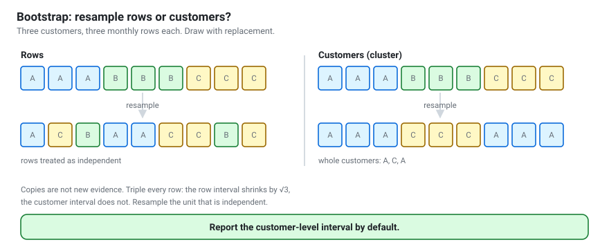

# Chapter 7 · Model selection

*Part I · Prerequisites: Chapters 5, 6 · Estimated time: reading ~45 min, lab ~45 min · Compute: CPU (an optional extension uses PyTorch on a T4 GPU or, more slowly, on CPU)*

 · [Lab: notebook.ipynb](notebook.ipynb) · [Solutions](solutions.md)

## Learning objectives

After this chapter you should be able to:

1. Compare candidate models with rolling-origin cross-validation on the training period and then once on validation.
2. Estimate the sampling uncertainty of a metric with the bootstrap and with the standard error of a proportion.
3. Choose the resampling unit (rows or customers) for a stated reason, and explain why copies of rows are not new evidence.
4. Decide between two models with a paired bootstrap of the difference rather than by comparing two intervals.
5. Run a hyperparameter search on a fixed budget, record every trial, and explain why the best trial is optimistic.
6. Explain why gradient-boosted trees do not outperform logistic regression on this data, and which properties of a dataset would reverse that.

## 7.1 Introduction

"Model B scores 0.14 and model A scores 0.16" is not a finding until one
knows how much those numbers move when the sample moves. Every metric is an
estimate computed from a finite sample: with a few hundred positives in
validation, a difference in the second decimal place of PR-AUC can easily be
noise.

This chapter compares a baseline, a linear model and two configurations of
boosted trees (Section 7.2); quantifies the uncertainty of a validation
metric (Sections 7.3–7.5); answers the comparison question directly with a
paired bootstrap (Section 7.6); runs a budgeted hyperparameter search
(Section 7.7); explains the outcome (Section 7.8); and records the decision in
a short memo (Section 7.9). As before, only the training and validation
periods are used.

## 7.2 Candidates and two estimates for each

Model selection on a limited budget follows a few principles.

- Always include a **dummy baseline** (it predicts the base rate) and a
  **simple model** (logistic regression with sensible preprocessing). Many
  tabular problems are not won by the complex model, and only the simple one
  shows this.
- Choose with **rolling-origin cross-validation** inside the training
  period (Chapter 6), not on the validation split that will be reported.
- Check the choice **once** on validation.
- A larger model is worth it only if its advantage survives the paired
  bootstrap (Section 7.6) *and* is worth its extra cost to serve, monitor and
  explain.

The four candidates are:

| Candidate | Description |
|---|---|
| `dummy` | predicts the base rate for everyone; its PR-AUC is the positive rate |
| `logreg` | the logistic-regression pipeline of Chapter 6 |
| `hgb` | `HistGradientBoostingClassifier` with conservative settings: 8 leaves, at least 200 rows per leaf, learning rate 0.03 |
| `hgb_deeper` | a more typical default: 31 leaves, 50 rows per leaf, faster learning, no L2 penalty |

In the course's run, the rolling-origin and validation PR-AUCs are about
0.054 / 0.052 for `dummy`, 0.186 / 0.163 for `logreg`, 0.156 / 0.135 for
`hgb`, and 0.145 / 0.11–0.12 for `hgb_deeper` (tree results vary in the third
decimal across scikit-learn versions). The linear model is ahead on **every**
rolling fold, and the deeper trees are worse than the regularised ones, which
is what overfitting looks like with about 1,400 positive training rows.

The validation set has about 360 positives among 6,956 rows. Every
validation metric below is driven by those few hundred rows.

## 7.3 How uncertain is a rate? The standard error

For a metric that is a proportion (precision, a churn rate), classical
sampling theory gives the uncertainty directly. If $\hat p$ is an observed
proportion over $n$ independent trials,

$$
\operatorname{SE}(\hat p) = \sqrt{\frac{\hat p\,(1 - \hat p)}{n}} , \qquad (7.1)
$$

and an approximate 95% interval is $\hat p \pm 1.96\,\operatorname{SE}$.
Inverting the formula gives the sample size needed for a margin $\pm m$:

$$
n \approx \frac{1.96^2\, p\,(1-p)}{m^2} . \qquad (7.2)
$$

For example, a precision of 0.27 over $n = 192$ calls has
$\operatorname{SE} = \sqrt{0.27 \times 0.73 / 192} = 0.032$, so the precision
is roughly $0.27 \pm 0.063$. To pin a 5% churn rate to $\pm 0.02$ requires
$n \approx 3.84 \times 0.0475 / 0.0004 \approx 456$ rows. The noise shrinks
only with $\sqrt{n}$: four times the data halves the interval.

The lab checks Equation (7.1) against a bootstrap of the same 192 calls; the
two agree within a few thousandths. Equation (7.1) does not apply to ranking
metrics such as PR-AUC, which are not simple proportions; for those, the
bootstrap is used.

## 7.4 The bootstrap

The **bootstrap** estimates the sampling distribution of any statistic by
treating the observed sample as if it were the population. Draw $B$
resamples of the evaluation set, each of the same size and drawn **with
replacement**; recompute the metric $\hat\theta^{*}_b$ on each; and take the
middle 95% of the results:

$$
\text{CI}_{95\%} = \left[\, Q_{0.025}\big(\hat\theta^{*}_{1}, \dots, \hat\theta^{*}_{B}\big),\; Q_{0.975}\big(\hat\theta^{*}_{1}, \dots, \hat\theta^{*}_{B}\big) \,\right] , \qquad (7.3)
$$

where $Q_q$ is the $q$-quantile. With $B = 500$, if the sorted resampled
PR-AUCs have 0.137 at position 13 and 0.197 at position 488, the interval is
$[0.137, 0.197]$. This *percentile* interval needs no distributional
assumption and works for any metric, which is why it is the standard tool for
ranking metrics.

`churnlab.evaluation.bootstrap_ci` implements it. For the two main models,
with customers as the resampling unit (Section 7.5):

| Model | Validation PR-AUC | 95% customer-bootstrap interval |
|---|---|---|
| `logreg` | 0.163 | ≈ [0.137, 0.197] |
| `hgb` | 0.135 | ≈ [0.115, 0.164] |

The intervals are about 0.05–0.07 wide, roughly a third of the metric itself.

> **Intuition.** The bootstrap asks: "if a different validation set of the
> same size had been collected from the same world, how much would the number
> move?", and answers by pretending that the sample *is* the world. *Where the
> analogy breaks down:* the bootstrap sees only variation that is present in
> the sample. It cannot say how the score will move next quarter, when the
> world changes.

Two practical limits: a slice with only a handful of positives produces many
resamples with no positives at all, and the bootstrap then fails or becomes
meaningless (Chapter 9 flags such slices instead); and the interval describes
sampling noise in the evaluation set only, not the variation from retraining
with a different seed or training sample.

## 7.5 Choosing the resampling unit

The bootstrap assumes that the resampled units are independent. Two choices
are available here:

- **rows**: treat the 6,956 validation rows as independent;
- **customers** (a *cluster* bootstrap, `groups=customer_id`): resample whole
  customers with all their rows.

If a customer's rows are correlated, the customer is the honest unit: rows of
one customer at consecutive monthly snapshots are not independent pieces of
evidence, and treating them as such gives intervals that are too narrow.

*Figure 7.1 — Row and cluster bootstrap. In the customer bootstrap a resample can contain customer A twice and B not at all, as a new sample of customers would; in the row bootstrap, A's three similar rows count as three independent observations.*

On **this** validation set, the customer interval is not noticeably wider
than the row interval (in the course's run they differed by a few
thousandths, in both directions across seeds). The reason is the structure
of the data: each customer has at most three validation rows (three monthly
snapshots), and no customer has more than one positive, because churn is
terminal. The positives, which drive PR-AUC, are already one per customer, so
little within-customer correlation remains.

The mechanism becomes visible when each customer contributes many correlated
rows. The lab duplicates every validation row three times, as if weekly
snapshots of nearly identical customers had been taken. The row interval
then shrinks by about $\sqrt{3} \approx 1.73$ (to about 0.04 wide); the
cluster interval stays at about 0.06–0.07. In general, repeating every row
$k$ times divides the row-bootstrap standard error by $\sqrt{k}$, a spurious
gain, and leaves the cluster-bootstrap standard error unchanged. Copies are
not new evidence, and only the cluster bootstrap knows it.

On the training period (13 snapshots per customer) or with weekly snapshots,
this is the difference between "clearly better" and "cannot tell". The book
therefore **reports the customer-level interval by default**: it is never the
wrong unit here, and it removes the need to argue each time about whether the
correlation happens to be small.

> **Research bridge.** Rows are trials and customers are subjects. A
> cross-subject EEG result is not reported with an interval that resamples
> trials, for exactly this reason: across-subject variability is the relevant
> spread, not across-trial variability.

## 7.6 Paired comparisons

The two intervals in Section 7.4 overlap. That does **not** imply that there
is no difference. Both models are scored on the *same* rows, so most of the
sampling noise (an easy month, a fortunate set of churners) is shared and
cancels in the difference. Two overlapping marginal intervals do not by
themselves mean "no difference", and two non-overlapping ones are a stricter
test than needed. The question "is B better than A?" is answered directly by
a **paired bootstrap**: on each resample $b$ compute

$$
\Delta^{*}_b = m_B(\text{resample}_b) - m_A(\text{resample}_b) , \qquad (7.4)
$$

where $m_A$ and $m_B$ are the metric values of the two models on the same
resample, and take the percentile interval of $\Delta^{*}$ (Equation 7.3).
"B is better" requires that interval to lie entirely above 0.

`paired_bootstrap_diff` returns metric(B) − metric(A). For `logreg` − `hgb`
the result is about +0.028 PR-AUC (+0.029 with scikit-learn 1.6), with a 95%
customer-bootstrap interval of roughly $[+0.004, +0.052]$; about 1% of
customer resamples (2% of row resamples) have the trees ahead or level. The
interval excludes zero, but its lower end is close to it. A careful wording
is:

> On validation, logistic regression ranks better than the boosted trees by
> about 0.03 PR-AUC (customer-bootstrap 95% CI 0.004 to 0.05); it was also
> ahead on all four rolling-origin folds on the training period.

Two independent pieces of evidence pointing the same way are worth more than
either alone. Note what pairing cannot do: it removes noise that both models
share, but if both share a bias (for example the same leaky feature), the
paired comparison cannot see it.

> **Intuition.** Two students sit the same examination. Whether the paper was
> easy moves both marks; the *difference* between them hardly depends on it.
> Comparing their marks on the same paper is the paired question. *Where the
> analogy breaks down:* a single paper is still one sample of questions; the
> paired bootstrap estimates how the difference would vary over other
> papers drawn the same way.

## 7.7 Hyperparameter search on a budget

Hyperparameter search is where most compute is wasted and most
self-deception occurs. If 200 configurations are tried and the best is
reported, the "improvement" is partly the maximum of 200 noisy numbers. This
**winner's curse** is a selection bias: the expected maximum of noisy
estimates exceeds the true value of the configuration that produced it.

Two disciplines limit it:

1. **A fixed budget**, decided before looking at results: here 8
   configurations per model family, under a minute in total.
2. **Every trial recorded** (parameters, fold scores, time), not only the
   best. That table is experiment tracking; MLflow stores the same
   information.

The search samples configurations at random rather than on a grid. At a
fixed budget, random search usually finds better configurations than grid
search when only a few hyperparameters matter, because a grid spends most of
its evaluations varying unimportant ones (Bergstra & Bengio, 2012). The
search is scored with rolling-origin cross-validation on the training period;
validation is not used.

Result: 16 trials in about 22 seconds. Every logistic-regression trial scores
between about 0.191 and 0.193 for `C` from 0.003 to 10: the linear model is
insensitive to regularisation here, a **plateau**. The best tree
configuration scores about 0.166, below every value of `C`. (These numbers
are higher than those of Section 7.2 because the three search folds cover
different months; trials are compared only with each other.) The fold-to-fold
standard deviation (about 0.02) is larger than most of the differences
between configurations.

On a plateau, picking the top trial is harmless; *claiming* that it is better
than its neighbours is not. The selection therefore keeps `C = 1.0`: a change
smaller than the noise does not justify a new model version.

> **Intuition.** The best of 16 noisy scores is like the highest of 16 dice
> rolls: it is high partly because there were 16 rolls. Expect the winner to
> score somewhat lower on fresh data. *Where the analogy breaks down:* if one
> configuration really is better by more than the noise, it will still be
> better on fresh data; the optimism shrinks the gap, it does not create it.

## 7.8 Why the trees lose here, and when they would not

Gradient-boosted trees, the usual best performer on tabular benchmarks, lose
to logistic regression on this data, on every rolling fold and on validation.
The reasons are structural:

1. **The signal is smooth and roughly monotone.** Churn risk rises steadily
   as usage falls, tickets increase and payments fail. A linear model on
   well-chosen transforms (`log1p`, ratios such as `sessions_trend` and
   `seat_utilization_4w`) already has the right shape; trees approximate a
   smooth slope with steps and need data to place each step.
2. **Few positives.** About 1,400 positive rows in training. Each tree leaf
   estimates a rate from the rows that reach it; with rare positives those
   estimates are noisy, and deeper trees overfit (`hgb` against `hgb_deeper`).
3. **The features are already engineered.** The non-linearity a tree would
   discover (trends, utilisation, recency) was built into the SQL in Chapter 4.
   What remains is mostly additive.
4. **The data is synthetic.** It was generated from a smooth risk score, the
   most favourable setting for a linear model. Real churn data usually has
   more interactions.

Trees would become the better choice with **interactions** that matter (a
usage drop meaning something different on the enterprise plan),
**thresholds** in the response (a sharp change at contract renewal), many raw
unengineered features, informative missing values, and **more data**,
especially more positives. In those conditions the comparison should be run
again rather than its result assumed.

In a tie, the linear model also has practical advantages: coefficients a
product team can read, monotone behaviour that is easy to test, small
artifacts, very low latency, and probabilities that are usually close to
calibrated (Chapter 8 checks this).

## 7.9 The selection memo

A decision that nobody wrote down is re-argued every month. The lab saves a
short memo, `artifacts/selection.json`, next to the trials table
(`artifacts/trials.csv`). It records the selected model (`logreg`, `C = 1.0`),
the cross-validation and validation evidence, the paired comparison, the
reason for keeping `C` at 1.0, and `test_set_used: false`, which records that
the test period remains untouched for Chapter 16. Every number in the memo can
be traced to a cell of the lab.

An optional extension trains a two-layer PyTorch multilayer perceptron on the
same preprocessed features. It runs on CPU in about a minute or on a GPU. It
was not executed in the course's verification runs, so no result is claimed;
if it is run, it should be compared with `logreg` using the paired bootstrap
of Section 7.6. For the reasons in Section 7.8, a tie is the most likely
outcome.

> **Interview note.** "Why didn't you use XGBoost?" A strong answer states
> that the family *was* tried (histogram gradient boosting is the same
> algorithm family), gives the comparison with its uncertainty, offers a
> mechanism (few positives, engineered features, smooth risk), and names the
> condition that would change the decision.

## Key terms

| Term | Definition |
|---|---|
| Candidate | One model configuration being compared. |
| Standard error | The standard deviation of an estimate's sampling distribution (Equation 7.1 for a proportion). |
| Bootstrap | Resampling the evaluation set with replacement many times and recomputing the metric. |
| Percentile interval | The interval between the 2.5% and 97.5% quantiles of the bootstrap distribution (Equation 7.3). |
| Resampling unit | What the bootstrap draws: rows, or whole groups such as customers. |
| Cluster bootstrap | A bootstrap that draws whole groups with all their rows. |
| Paired comparison | Scoring both models on the same resample and taking the difference (Equation 7.4). |
| Hyperparameter | A setting chosen before fitting, not learned from data, such as `C` or `max_leaf_nodes`. |
| Search budget | The number of configurations allowed, fixed in advance. |
| Winner's curse | The upward bias of the best of several noisy estimates. |
| Plateau | A region where many settings score the same within noise. |
| Selection memo | The written decision with the evidence that supports it. |

## Summary

1. Choose with rolling-origin cross-validation on training data, check once on validation, and always include a dummy and a simple model.
2. The standard error of a proportion (Equation 7.1) shrinks with $\sqrt{n}$; Equation (7.2) gives the sample size for a desired margin.
3. The percentile bootstrap (Equation 7.3) puts an interval on any metric; here validation PR-AUC intervals are 0.05–0.07 wide.
4. The resampling unit must be independent; the customer is the default unit. Copies of rows narrow the row interval by $\sqrt{k}$ without adding evidence.
5. Overlapping intervals do not imply no difference; the paired bootstrap of the difference (Equation 7.4) answers the comparison directly. Here logistic regression leads by about 0.03 (CI ≈ 0.004 to 0.05).
6. A fixed search budget and a complete trial record limit the winner's curse; on a plateau the simpler or existing setting is kept.
7. Trees lose here because the risk is smooth, positives are few and features are engineered; interactions, thresholds and more data would change that.
8. The decision is recorded in a selection memo that states the test set was not used.

## Exercises

The exercises are in the [lab](notebook.ipynb); worked answers are in [solutions.md](solutions.md).

1. **`decide(y, scores_a, scores_b, groups)`** — return `"A"`, `"B"` or `"no clear winner"` from a paired, cluster bootstrap 95% interval of PR-AUC(B) − PR-AUC(A).
2. **`budgeted_search(param_grid_list, evaluate_fn, budget)`** — evaluate at most `budget` configurations drawn without replacement with a fixed seed, and return the best configuration and a table of all trials.
3. **Written.** A 60-second answer to "Why didn't you use XGBoost?", using numbers from the lab, stating what was tried and what would change the decision.

The checkpoint questions cover what is needed before calling a 0.03 difference real, the choice of resampling unit, overlapping intervals, why the linear model won here, and why the best of 16 trials is optimistic.

## Further reading

- Efron, B. & Tibshirani, R. J. (1993). *An Introduction to the Bootstrap*. Chapman & Hall.
- Bergstra, J. & Bengio, Y. (2012). Random search for hyper-parameter optimization. *Journal of Machine Learning Research*, 13, 281–305.
- Cawley, G. C. & Talbot, N. L. C. (2010). On over-fitting in model selection and subsequent selection bias in performance evaluation. *Journal of Machine Learning Research*, 11, 2079–2107.
- Grinsztajn, L., Oyallon, E. & Varoquaux, G. (2022). Why do tree-based models still outperform deep learning on typical tabular data? *Advances in Neural Information Processing Systems 35* (Datasets and Benchmarks Track).
- Hastie, T., Tibshirani, R. & Friedman, J. (2009). *The Elements of Statistical Learning* (2nd ed.). Springer. (Chapter 7 on model assessment and selection; Chapter 10 on boosting.)
- scikit-learn. *Tuning the hyper-parameters of an estimator*. https://scikit-learn.org/stable/modules/grid_search.html

**Next:** [Chapter 8 · Thresholds & calibration](../ch08-thresholds-and-calibration/README.md)
