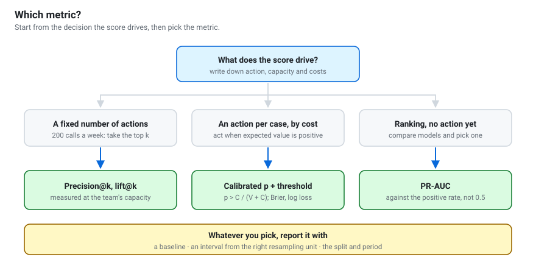
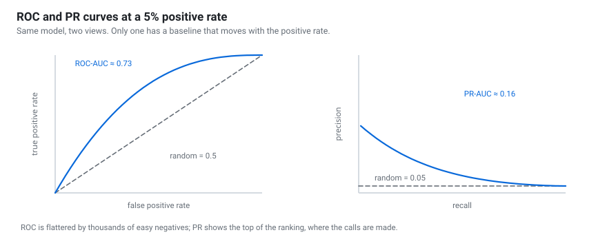
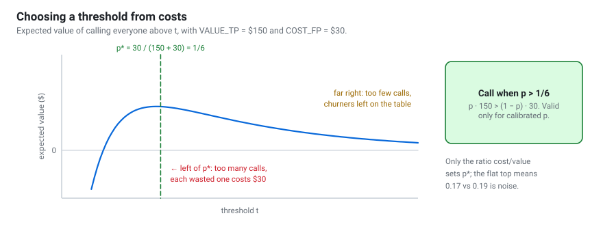
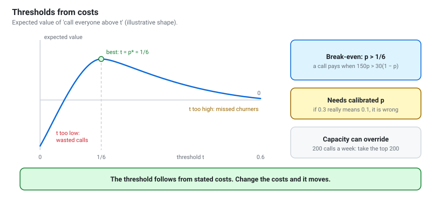
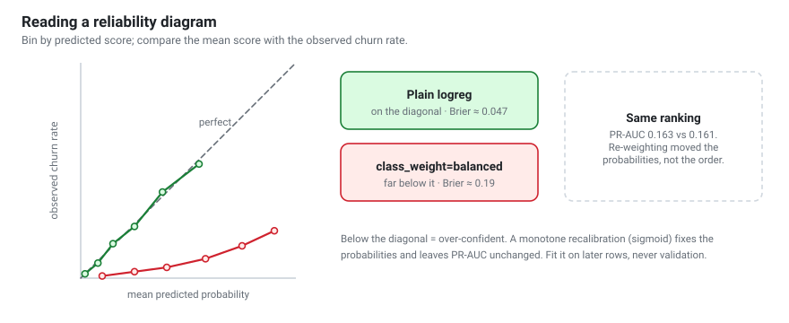

# Chapter 8 · Thresholds & calibration

*Part I · Prerequisites: Chapters 5, 7 · Estimated time: reading ~50 min, lab ~40 min · Compute: CPU*

 · [Lab: notebook.ipynb](notebook.ipynb) · [Solutions](solutions.md)

## Learning objectives

After this chapter you should be able to:

1. Start an evaluation from the decision the model supports, and choose metrics for an imbalanced problem accordingly.
2. Read a precision-recall curve and a threshold table in terms of calls made and churners reached.
3. Derive a decision threshold from an explicit cost model, and state how it moves when an assumption changes.
4. Turn a fixed call capacity into a top-k rule per period, and evaluate it with precision@k and lift.
5. Measure calibration with a reliability table, the Brier score and log loss, and recalibrate without leaking.
6. Explain why monotone recalibration leaves PR-AUC and ROC-AUC unchanged but moves the optimal probability threshold.

## 8.1 Introduction

A model produces scores; an organisation makes decisions. A churn model does
not call customers: a person does, when a score crosses a line that someone
chose. Evaluation connects the two, and it has to state its assumptions and
its uncertainty at every step.

This chapter starts from the decision (Section 8.2) and the metrics that
follow from it (Section 8.3). It then reads the precision-recall curve as a
set of options (Section 8.4), derives a threshold from stated costs
(Section 8.5), tests how fragile that threshold is (Section 8.6), and adapts it
to a fixed capacity (Section 8.7). Sections 8.8 and 8.9 ask whether the scores
can be read as probabilities at all, which the cost-based threshold assumes,
and how to correct them if not. Section 8.10 records the resulting policy.
Models are fitted on the training period; scores and decisions are
evaluated on validation.

## 8.2 Start from the decision

Before choosing a metric, four questions should be answered in writing:

1. **What action does a prediction trigger?** Here, a call from the
   customer-success team.
2. **How many actions can be taken?** The team can make only so many calls a
   month.
3. **What does each outcome cost or gain?** A wasted call, a retained
   customer, a missed churner.
4. **When is the truth known?** Here, 30 days later.

The metric follows from these answers, not the other way round. Two teams
with the same model and different capacities should report different
headline metrics.

## 8.3 Metrics for imbalanced problems

Churn, fraud, equipment faults and content moderation are all imbalanced:
positives are a small fraction of rows. In TaskFlow the positive rate is
about 5%. With so few positives, accuracy is close to useless: predicting
"nobody churns" scores about 95%.

At a threshold $t$, each row is a true positive (TP, flagged churner), false
positive (FP, flagged non-churner), false negative (FN, missed churner) or
true negative (TN). The basic decision metrics are

$$
P = \frac{TP}{TP + FP}, \qquad R = \frac{TP}{TP + FN}, \qquad F_1 = \frac{2PR}{P + R} , \qquad (8.1)
$$

where precision $P$ is how pure the flagged set is (the share of calls that
reach a would-be churner), recall $R$ is how much of the target it covers
(the share of churners reached) and $F_1$ is their harmonic mean. $F_1$
weighs a missed churner and a wasted call equally, which is rarely the
organisation's view; this chapter uses costs instead.

| Metric | What it answers | Caution |
|---|---|---|
| ROC-AUC | how well scores rank a random positive above a random negative | can look strong while precision at useful thresholds is poor, because negatives dominate |
| PR-AUC (average precision) | ranking quality concentrated on the positives | its floor is the positive rate, not 0.5 |
| Precision@k, lift@k | "if we act on the top $k$, how many are real?" | matches a capacity-limited team directly |
| Recall at a threshold | "what share of churners do we reach?" | meaningless without the threshold and the alert volume |
| Brier score, log loss | quality of the probabilities themselves | needed whenever probabilities enter a cost calculation |

A complete report gives a ranking metric (PR-AUC), decision metrics at the
chosen threshold (precision, recall and alert volume), and a probability
metric (Brier score) together.

*Figure 8.1 — Choosing a headline metric. The tree starts from the action, not from the model.*

## 8.4 The precision-recall curve as a set of options

Each point of the precision-recall curve corresponds to a threshold: flag
every account above it, and obtain that precision and that recall. The
ROC curve plots the true-positive rate against the false-positive rate
instead; at a 5% positive rate it looks favourable (ROC-AUC about 0.73 here)
while the PR curve shows precision falling towards the 5% floor quickly. The
PR view is the one that answers "what share of our calls are useful?".

*Figure 8.2 — ROC and precision-recall curves for the same scores. The random baseline is 0.5 on the left and the positive rate on the right.*

The lab's threshold table translates the curve into operational quantities.
For the selected logistic regression on validation (PR-AUC about 0.163; 362
churners among 6,956 rows over three monthly snapshots), raising the
threshold from 0.05 to 0.30 reduces the flags from about 750 to about 17 a
month, raises precision from about 0.10 to about 0.34, and lowers recall from
about 0.63 to about 0.05. At 0.40 the precision is 0.52, but that is 12
churners among 23 flags, too few rows to mean much. High precision is not
available at any useful volume: this is a weak-signal problem, and the
business case must work with that.

> **Intuition.** The PR curve is a menu: every dish (threshold) has a price
> (calls made) and a portion (churners reached). One does not choose the
> "best" dish but the one that fits the budget. *Where the analogy breaks
> down:* a menu's prices are fixed; the precision at a given threshold varies
> from month to month.

## 8.5 A threshold from costs

A score becomes a decision at a threshold. The threshold should be derived
from stated costs, not from habit (0.5) or from a metric that ignores costs
(F1). The cost model used in this book is stated, every time, as a set of
**teaching assumptions**, not facts about any business:

| Outcome | Value |
|---|---|
| Call a customer (any customer) | costs \$30 (`COST_FP`) |
| Reach a would-be churner | worth a \$600 margin × an assumed 25% save rate = **\$150** in expectation (`VALUE_TP`) |
| Miss a churner | no *additional* cost relative to not having the model |

For a customer with probability $p$ of churning, a call has expected value
$pV - (1 - p)C$, where $V$ is the value of reaching a churner and $C$ the
cost of a call. Calling is worthwhile exactly when this is positive:

$$
pV > (1 - p)\,C
\iff
p > p^{*} = \frac{C}{V + C} = \frac{30}{150 + 30} = \frac{1}{6} \approx 0.167 . \qquad (8.2)
$$

$p^{*}$ is the **break-even probability**. Summed over the flagged accounts,
the expected value of a threshold $t$ is

$$
\text{EV}(t) = TP(t)\cdot V - FP(t)\cdot C . \qquad (8.3)
$$

Three consequences follow.

1. **The threshold depends on the assumptions.** If the save rate or the call
   cost changes, the threshold must change. The assumptions are therefore
   stated whenever the threshold is reported.
2. **Equation (8.2) requires calibrated probabilities.** If the model's 0.3
   really means 0.1, the break-even rule points at the wrong place. In
   practice one either calibrates (Section 8.9) or chooses the threshold
   empirically by maximising Equation (8.3) on validation data
   (`best_threshold_by_value`).
3. **Capacity can override the threshold.** If the team can make 200 calls a
   week and 600 customers clear the threshold, the accounts are ranked and the
   top 200 taken; the relevant metric is then precision@200 (Section 8.7).

In the course's run, the empirical optimum on validation is a threshold of
about 0.19, with an expected value of about \$3,400 over the three
validation months, about 64 calls a month, precision about 0.27 and recall
about 0.14. The empirical optimum lies close to the theoretical $1/6$, which
is itself evidence that the scores are roughly calibrated. Because the
threshold is chosen *on* validation, its expected value there is optimistic;
the rule is checked once on the test period in Chapter 16.

*Figure 8.3 — Expected value against threshold on this data. The curve is flat near its maximum, so the exact threshold matters less than the cost ratio that places the maximum there.*

*Figure 8.4 — The general shape. The peak lies at the break-even probability only if the scores are calibrated, and a capacity limit can move the operating point to its right.*

The flat top seen in the lab (roughly 0.15 to 0.25) is useful information: a
discussion of 0.17 against 0.19 is a discussion about noise.

> **Intuition.** Each call is a \$30 lottery ticket that pays \$150 with
> probability $p$. Buy the ticket when its expected payout exceeds its price.
> *Where the analogy breaks down:* $p$ must be a real probability
> (Section 8.8), and the \$150 contains a save rate that nobody has yet
> measured (Section 8.6).

## 8.6 How fragile is the threshold?

The save rate (25%) is the least reliable assumption: it has not been
measured. A sensitivity table varies it and the call cost:

| Scenario | Theoretical $p^{*}$ | Best threshold (course run) | Effect |
|---|---|---|---|
| baseline: $V = 150$, $C = 30$ | 0.167 | ≈ 0.19 | ≈ 64 calls a month, value ≈ \$3,420 |
| save rate halved: $V = 75$ | 0.286 | ≈ 0.45 | ≈ 6 calls a month, value ≈ \$615 |
| save rate doubled: $V = 300$ | 0.091 | ≈ 0.10 | ≈ 230 calls a month (≈ 3.6 times as many), value about five times larger |
| call cost doubled: $C = 60$ | 0.286 | same as save rate halved | different value |

Doubling the call cost and halving the save rate select the **same**
threshold, because only the ratio $C/V$ enters Equation (8.2)
($30/105 = 60/210 = 0.286$); the expected values differ. The decision is
**far more sensitive to the business assumptions than to anything done in
model selection** (Chapter 7 compared models differing by 0.03 PR-AUC). The
most valuable next step is therefore not a better model but a measurement of
the save rate: among flagged customers, call a randomly chosen half and
compare 30-day churn with the other half (Chapters 29–30).

## 8.7 Capacity: top-k per period

Suppose the team can call **40 accounts a month**, fewer than the roughly 64
that the cost-based threshold requests. Two rules respect the limit:

- a **global threshold** chosen so that 40 accounts a month are flagged *on
  average*: the volume then varies with the score distribution, and some
  months exceed the team's capacity;
- **top-k per snapshot**: each month, call the 40 highest scores. The volume
  is exact by construction. This is the usual production rule.

The quality of a top-k rule is measured by precision at $k$ and lift:

$$
\operatorname{precision@}k = \frac{1}{k} \sum_{i \in \text{top-}k} y_i ,
\qquad
\operatorname{lift@}k = \frac{\operatorname{precision@}k}{\pi} , \qquad (8.4)
$$

where $y_i$ is the label of account $i$ and $\pi$ the positive rate. Lift is
how many times better the selection is than calling at random. In the
course's run, precision@40 lies between 0.20 and 0.35 per month (8 to 14
would-be churners among 40 calls), with an average of about 0.275, a lift of
about $0.275 / 0.052 \approx 5.3$, and a positive expected value every month.
The average precision@40 is about the same as the precision at the cost-based
threshold (about 0.27): on this weak-signal data the very top of the ranking
is not much purer than the next 24 accounts. The capacity limit therefore
costs roughly the share of calls dropped, which gives a monetary value for a
larger team.

> **Intuition.** A threshold is "everyone taller than 1.90 m joins the team";
> top-k is "the 40 tallest join". With a fixed squad size, only the second
> fills it every season. *Where the analogy breaks down:* top-k fills the
> quota even in a month in which nobody is really at risk; combine it with a
> minimum score if a wasted call is expensive.

A third kind of constraint is a **quality floor**, such as "call only if at
least 30% of calls reach a would-be churner" (`threshold_for_precision`). On
this data it gives a threshold around 0.25 and roughly 30–40 calls a month.
"The lowest threshold that reaches 30%" is fragile on a noisy curve, because
precision is not monotone in the threshold and a few rows can move it.

## 8.8 Calibration: can the scores be read as probabilities?

A model is **calibrated** if, among accounts given a score of about $p$, a
share of about $p$ actually churns. Ranking quality and calibration are
separate properties: a model can rank well and still produce scores that are
systematically too high.

Calibration is checked with a **reliability table** (or diagram): sort the
validation rows into ten equal-sized score bins and compare, in each bin, the
mean predicted score with the observed churn rate. Two summary measures of
probability quality are used:

$$
\text{Brier} = \frac{1}{N}\sum_{i=1}^{N} (p_i - y_i)^2 , \qquad (8.5)
$$

$$
\text{LogLoss} = -\frac{1}{N}\sum_{i=1}^{N}\Big[y_i \ln p_i + (1 - y_i)\ln(1 - p_i)\Big] , \qquad (8.6)
$$

where $p_i$ is the predicted probability and $y_i \in \{0, 1\}$ the outcome
of row $i$. The Brier score is the mean squared error of the probabilities;
log loss is the average "surprise" of the true labels, and it penalises a
confident wrong prediction heavily. Lower is better for both. A constant
prediction equal to the base rate $\pi$ has Brier score $\pi(1 - \pi)$; at
$\pi = 0.052$ that is $0.052 \times 0.948 = 0.0493$, the reference any useful
model must beat.

*Worked example.* Five accounts with $y = (1, 0, 1, 0, 0)$ and
$p = (0.8, 0.6, 0.4, 0.2, 0.1)$:
log loss $= -\tfrac{1}{5}[\ln 0.8 + \ln 0.4 + \ln 0.4 + \ln 0.8 + \ln 0.9] = 2.384/5 = 0.477$;
Brier $= (0.04 + 0.36 + 0.36 + 0.04 + 0.01)/5 = 0.162$.
At $t = 0.5$: TP = 1, FP = 1, FN = 1, so $P = R = F_1 = 0.5$ and, with the
course's costs, $\text{EV} = 150 - 30 = \$120$. The lab verifies these values
against scikit-learn.

For the selected logistic regression, mean score and observed rate track each
other closely, from about 0.01 in the lowest bin to about 0.17–0.18 in the top
bin, and the Brier score (about 0.0467) is below the constant-base-rate value
(about 0.0494). Logistic regression trained on the natural class balance is
usually close to calibrated, because its training loss *is* the log loss of
Equation (8.6).

A common way to obtain an uncalibrated model is `class_weight="balanced"`,
often added because "the classes are imbalanced". Re-weighting changes the
*probabilities* and barely the *ranking*: the balanced model has a mean score
around 0.4 against a churn rate of 0.05, a much worse Brier score (about
0.19), almost the same PR-AUC (0.161 against 0.163), and a value-maximising
threshold of about 0.83, far above $1/6$. Anyone who applied the $1/6$ rule to
its scores would call almost every customer. More generally: logistic
regression is often reasonably calibrated as trained, whereas boosted trees
and models trained with class weights or resampling frequently are not.

*Figure 8.5 — Reliability diagram. The two models rank almost identically (PR-AUC 0.163 and 0.161), yet only one can be used with the break-even rule.*

> **Intuition.** Calibration is a weather forecaster's honesty: on the days
> the forecast says "20% rain", it should rain on about one day in five.
> Ranking is the forecaster's skill at telling wetter days from drier ones. A
> forecaster can be skilled and consistently overstate the chance of rain.
> *Where the analogy breaks down:* calibration is checked per bin, on
> average; a model can be calibrated overall and poorly calibrated for one
> group of customers.

## 8.9 Recalibration without leaking

A **recalibration** learns a monotone map from score to probability. Two
standard maps are available in scikit-learn's `CalibratedClassifierCV`:

- **Platt scaling** (`method="sigmoid"`) fits a logistic function of the
  score, $p = 1/(1 + e^{-(a s + b)})$, with two parameters $a$ and $b$;
- **isotonic regression** fits a non-decreasing step function.

The map must be learned on rows the model was **not** trained on, and, in a
time-ordered problem, on rows that come **after** the model's training rows.
In the lab the base model is fitted on training snapshots before 2024-01-01
and the calibration is learned on the last three training months (January to
March 2024); validation is used only to score the result. Fitting the
calibration on validation and then evaluating on validation would make the
reliability diagram look perfect by construction and would spend the
validation set on a fitted step.

Results in the course's run:

- **Balanced logistic regression:** sigmoid calibration lowers the Brier score
  from about 0.2 to about 0.047, the mean score from about 0.4 to about
  0.055, and brings the best threshold back near $1/6$. **PR-AUC does not
  change at all:** a strictly increasing map preserves the order of the
  scores, and PR-AUC and ROC-AUC depend only on that order.
- **Plain logistic regression:** calibration changes almost nothing (Brier
  0.0468 before and after). It was already calibrated.
- **Isotonic** regression is a step function: it merges nearby scores into
  ties, which *does* change PR-AUC (here downward by about 0.015), and it is
  noisy with about 6,600 calibration rows and a few hundred positives. At this
  scale the sigmoid is preferable.

Holding out three months for calibration has a cost: the early-train base
model sees less data (PR-AUC 0.162 against 0.163 for the model fitted on all
training data). For the plain logistic regression the appropriate decision is
**not to recalibrate**, and to keep monitoring calibration in production
(Chapter 15).

In summary: monotone calibration does not change ranking metrics (exactly so
for a strictly increasing map); it changes the probability values, and
therefore the optimal *probability* threshold and the expected value of any
rule written as a fixed probability such as $1/6$. The set of accounts
flagged at a *re-optimised* threshold can remain the same.

> **Connection to other fields.** A diagnostic or sensor classifier with
> good balanced accuracy can still produce confidence values without
> meaning, and a system that acts automatically on "p > 0.9" then
> misbehaves. Ranking quality and probability quality
> are separate properties and must be measured separately.

## 8.10 Writing the policy down

The lab saves the decision rule to `artifacts/threshold_policy.json`: the
threshold, the cost assumptions it came from (in words), the precision,
recall and volume it produces on validation, the capacity rule, the
sensitivity of the threshold to the save rate, and the note that the expected
value was measured on the data used to choose it and must be confirmed once
on test. A threshold reported without its assumptions cannot be reviewed.

> **Interview note.** "Your model has 0.85 AUC. Is it good?" A strong answer
> asks: compared with which baseline, on which split, with what interval, and
> what decision does it support at what threshold? It then moves to precision
> and alert volume at the operating point, because that is what the
> organisation experiences.

## Key terms

| Term | Definition |
|---|---|
| Threshold | The score above which an account is flagged for action. |
| TP / FP / FN / TN | Flagged churner / flagged non-churner / missed churner / correctly ignored account. |
| Precision | The share of flagged accounts that churn (Equation 8.1). |
| Recall | The share of all churners that are flagged (Equation 8.1). |
| Expected value (EV) | The value of a rule under stated costs, $TP \cdot V - FP \cdot C$ (Equation 8.3). |
| Break-even probability $p^{*}$ | The probability above which an action pays for itself, $C/(V + C)$ (Equation 8.2). |
| Capacity / top-k | A fixed number of actions per period, filled with the highest scores. |
| Precision@k, lift@k | The positive rate among the top $k$, and its ratio to the base rate (Equation 8.4). |
| Calibrated | Among accounts scored $p$, a share of about $p$ has the outcome. |
| Reliability diagram | A plot of mean predicted against observed rate per score bin. |
| Brier score | The mean squared error of predicted probabilities (Equation 8.5). |
| Log loss | The average negative log-likelihood of the true labels (Equation 8.6). |
| Platt scaling | Recalibration with a two-parameter logistic function of the score. |
| Isotonic regression | Recalibration with a non-decreasing step function. |

## Summary

1. Evaluation starts from the decision: the action, its volume, its costs and when the truth is known.
2. At a 5% positive rate accuracy is useless; report a ranking metric, decision metrics at the threshold, and a probability metric together.
3. The precision-recall curve is a set of options; on this data high precision is not available at any useful volume.
4. Under stated costs ($C = \$30$, $V = \$150$), calling pays when $p > 1/6$ (Equation 8.2); the empirical optimum here is about 0.19, with a flat maximum.
5. The threshold depends only on the ratio $C/V$, and it is far more sensitive to the unmeasured save rate than to model choice.
6. A fixed capacity is met exactly by a top-k rule per period; precision@40 is about 0.275 here, a lift of about 5.3.
7. Calibration and ranking are different properties; class weighting destroyed calibration while leaving PR-AUC almost unchanged.
8. Recalibration is fitted on later held-out training data, never on validation; monotone maps leave ranking metrics unchanged.
9. The policy is saved with its assumptions so that it can be reviewed.

## Exercises

The exercises are in the [lab](notebook.ipynb); worked answers are in [solutions.md](solutions.md).

1. **`top_k_per_snapshot(df, scores, k)`** — a boolean array, in the frame's row order, that is true for the $k$ highest scores within each snapshot date.
2. **`best_threshold(y, scores, value_tp, cost_fp)`** — an exhaustive search over distinct scores for the threshold that maximises expected value, using one sort and cumulative sums.
3. **Written.** A reply of five or six sentences, without technical vocabulary, to a manager asking why the threshold is 0.19 and what happens if the cost of a call doubles.

The checkpoint questions cover deriving the break-even probability, top-k against a fixed threshold, the most sensitive assumption and how to measure it, the effect of calibration on PR-AUC, ROC-AUC and the threshold, and where the calibration map must be fitted.

## Further reading

- Elkan, C. (2001). The foundations of cost-sensitive learning. *Proceedings of the 17th International Joint Conference on Artificial Intelligence (IJCAI)*, 973–978.
- Brier, G. W. (1950). Verification of forecasts expressed in terms of probability. *Monthly Weather Review*, 78(1), 1–3.
- Platt, J. (1999). Probabilistic outputs for support vector machines and comparisons to regularized likelihood methods. In *Advances in Large Margin Classifiers*, MIT Press.
- Zadrozny, B. & Elkan, C. (2002). Transforming classifier scores into accurate multiclass probability estimates. *Proceedings of the 8th ACM SIGKDD International Conference on Knowledge Discovery and Data Mining*.
- Niculescu-Mizil, A. & Caruana, R. (2005). Predicting good probabilities with supervised learning. *Proceedings of the 22nd International Conference on Machine Learning (ICML)*.
- Saito, T. & Rehmsmeier, M. (2015). The precision-recall plot is more informative than the ROC plot when evaluating binary classifiers on imbalanced datasets. *PLoS ONE*, 10(3), e0118432.
- scikit-learn. *Probability calibration*. https://scikit-learn.org/stable/modules/calibration.html

**Next:** [Chapter 9 · Error analysis & artifacts](../ch09-error-analysis-and-artifacts/README.md)
