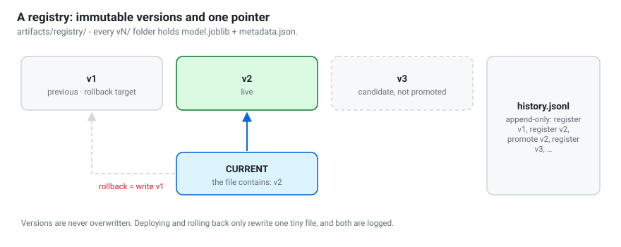

# Chapter 9 · Error analysis & artifacts

*Part I · Prerequisites: Chapters 7, 8 · Estimated time: reading ~40 min, lab ~45 min · Compute: CPU*

 · [Lab: notebook.ipynb](notebook.ipynb) · [Solutions](solutions.md)

## Learning objectives

After this chapter you should be able to:

1. Produce a slice report, flag slices that are too small to interpret, and put an interval on the weakest slice.
2. Compare slice metrics correctly when slices have different positive rates.
3. Compare the feature profiles of false negatives, false positives and true positives, and recognise error that no model on the available features can remove.
4. Save a model as an immutable bundle with metadata, and detect a corrupted or altered model file before loading it.
5. Register model versions, promote one, roll back, and read the audit history.
6. Write a model card that states intended use, evidence and limitations, and report a result with everything needed to assess it.

## 9.1 Introduction

A single PR-AUC hides where a model fails and for whom. A model that exists
only as a variable in a notebook cannot be served, audited or rolled back.
This chapter completes the model in both senses. Sections 9.2 to 9.4 analyse
its errors: by slice, by type of error, and in terms of what to do next.
Sections 9.5 to 9.7 package it: a bundle with metadata, a registry of
versions, and a model card. Section 9.8 states what a reportable result must
contain.

All numbers are on the validation period, for the logistic regression
selected in Chapter 7 with the threshold from Chapter 8 (about 0.19). Its
headline figures are PR-AUC about 0.163, ROC-AUC about 0.733, Brier score
about 0.047 and lift at 10% about 3.2.

## 9.2 Slice analysis

An aggregate metric can hide a subset of rows on which the model performs
poorly. **Slice analysis** computes the metrics separately for each value of
a grouping variable: plan, region, tenure band, acquisition channel, company
size. `evaluation.slice_report` returns one row per slice with its size,
number of positives, positive rate and metrics, and **flags** slices below a
minimum size rather than hiding them. Tenure is continuous, so it is first
bucketed into ordered bands (`0-30d`, `30-90d`, ..., `2y+`; Exercise 1).

In the course's run there are 20 slices. Positive rates differ by plan (about
0.07 on `basic` against about 0.04 on `pro` and `team`) and by company size
(about 0.03 for 200 or more employees). PR-AUC ranges from about 0.09 to
about 0.27. With a minimum of 300 rows (only about 15 positives at a 5% rate)
two slices are flagged: region `unknown` (130 rows; the truly missing regions
of Chapter 3) and tenure `2y+` (47 rows).

Three rules govern the interpretation.

**Read the number of positives before the metric.** A slice with 30 to 50
positives has a PR-AUC that can move by ±0.05 or more on resampling. The
width of a bootstrap interval scales roughly with the inverse square root of
the number of positives $N_{+}$:

$$
\text{CI width} \;\propto\; \frac{1}{\sqrt{N_{+}}} . \qquad (9.1)
$$

Going from the 360 positives of the whole validation set (interval width
about 0.06) to a slice with 40 positives multiplies the width by
$\sqrt{360/40} = 3$, to about 0.18. A recall of 0.0 on 12 rows is a reason to
collect data, not a finding.

**Put an interval on any slice that will be acted on.** In the course's run
the weakest readable slice is `company_size = 1-10`, with PR-AUC 0.113 and a
customer-bootstrap interval of about $[0.086, 0.154]$, which **overlaps** the
overall interval (about $[0.136, 0.197]$).

**Account for the slice's positive rate.** A random ranking has PR-AUC equal
to the slice's positive rate $\pi_s$, so a slice with fewer churners has a
lower floor. Slices are compared through the ratio

$$
\frac{\text{PR-AUC}_s}{\pi_s} \qquad (9.2)
$$

or through ROC-AUC, which does not depend on the positive rate. For
illustration: a slice with PR-AUC 0.113 at $\pi_s = 0.04$ is
$0.113 / 0.04 \approx 2.8$ times its floor, against $0.163 / 0.052 \approx 3.1$
overall. Most of the apparent gap between 0.113 and 0.163 is then the lower
base rate, not worse ranking.

The supported statement is usually *"we see no slice in which the model is
clearly worse, at this sample size"*, not an account of why one region is
difficult. When a slice does look worse, the question is why: a different
base rate, missing features (new customers have no usage history), a data
problem (the `NA` region read as missing), or a genuinely different
behaviour. The `unknown` region exists because of a cleaning decision in
Chapter 3, which is a reminder that slices inherit the history of the data.

> **Intuition.** A slice with 40 churners is an opinion poll with 40
> respondents: its PR-AUC can move several hundredths depending on who happened
> to answer. *Where the analogy breaks down:* a consistent gap across many
> months *is* evidence, even if each month's slice is small; pooling over time
> is the remedy.

## 9.3 Error analysis by type of error

At the chosen threshold every validation row is a true positive, false
positive, false negative or true negative. Comparing the median feature
values of the four groups asks, for each group: *could any model have
classified these rows correctly from these features?*

In the course's run:

- **True positives** look like churn: falling or zero sessions, more time
  since last activity, more tickets, short tenure (median score about 0.25).
- **False negatives** (about 300 missed churners) look much more like true
  negatives than like true positives: normal usage, no cancellation tickets,
  scores around 0.06 (true negatives about 0.03).
- **False positives** look like true positives (low and falling usage, more
  time since last activity, a failed payment). The model flags them for the
  right *visible* reasons; they simply did not churn, or not yet.

A direct count makes the point quantitative: 147 of the 311 missed churners
(47%) are "healthy" on every available signal, and the churn rate among all
healthy-looking rows is still 0.032, against 0.052 overall. These customers
leave for reasons not recorded in the data (a budget cut, an acquisition, an
offer from a competitor). **This error is irreducible with these features.**
No amount of tuning will reach it, and saying so is part of the analysis. The
remaining misses have weak signals and might be reached with better features
or more data.

This conclusion is established by comparing feature profiles, not by
assumption. It also guides what to add.

## 9.4 From errors to next steps

The error profile suggests features, each of which would need a
point-in-time definition and a leakage check as in Chapter 4:

- contract renewal date and days until renewal (churn concentrates at renewal);
- change in seat count, and activity of the account's administrator or main user;
- product-specific usage (which features rather than how many) and connected integrations;
- billing events: downgrade requests, plan changes, payment-method expiry;
- the text of support tickets (mentions of cancelling, exporting data, competitors).

A reasonable order of work follows from the evidence gathered so far:

1. measure the save rate, the assumption that moves the threshold most (Chapter 8);
2. add renewal-date features, the likeliest large gain given the error profile;
3. repeat the model comparison with the new features (trees may do better once interactions appear, Chapter 7);
4. set up monitoring of the score distribution and of flags per month (Chapter 15);
5. only then, further hyperparameter tuning.

## 9.5 Model bundles

`churnlab.artifacts` saves a model as a **bundle**: a directory containing
`model.joblib` and `metadata.json`. The metadata answers the questions that
are asked about any deployed model:

| Field | Question it answers |
|---|---|
| `features`, `categorical` | what input, in which order (the serving contract) |
| `training_data`: fingerprint, rows, period | trained on what? (here 25,278 training rows) |
| `libraries` | can it be loaded safely in this environment? |
| `threshold` | which decision rule comes with it? |
| `metrics.validation` | how good, on which period? |
| `trained_at`, `version`, `params`, `notes` | when, which version, how, and why |
| `model_sha256` | is this the same file that was evaluated? |

**Fingerprinting data.** The training-data fingerprint is a 16-character
hash of the table's *values*. Hashes of data can depend silently on how a
library stores it: pandas 3.0 stores text in a new `str` dtype that hashes
differently from pandas 2.2's `object` dtype, so `dataframe_fingerprint`
converts text columns to `object` first. With that, the same rows give the
same fingerprint under both versions (checked in the course's verification
runs). Whenever data is hashed, the hash should be tested across the
environments that are supported.

**Versions.** Loading a bundle warns if the installed scikit-learn version
differs from the one used for training; pickles are not guaranteed to load
correctly across versions, and the failure can be silent. A service should
load with `strict_versions=True`.

**Integrity before deserialisation.** In the lab, one byte of a copy of the
model file is changed, as a corrupted download or a deliberate edit would.
Loading is refused: *model.joblib does not match the hash in metadata.json*.
The check runs **before** unpickling, which matters because loading a pickle
executes code. The protection has a precise scope: a hash stored next to the
file guards against corruption, truncation and accidental replacement. It
does not guard against someone who can edit both files (they can recompute
the hash); that requires signed artifacts or a registry with access control.
Nor does it make a pickle from an untrusted source safe.

> **Intuition.** A bundle is a labelled medicine bottle rather than a loose
> tablet: the label states what is inside, the batch, the dose (threshold),
> the expiry (library versions), and the bottle carries a seal (the hash).
> *Where the analogy breaks down:* a seal stored next to the bottle can be
> remade by anyone who can open it; real tamper-proofing needs signatures or
> access control.

## 9.6 A registry: versions, a pointer and an audit log

`churnlab.registry.Registry` is a directory of immutable bundles (`v1/`,
`v2/`, ...), a `CURRENT` file naming the live version, and an append-only
`history.jsonl`. Three operations are defined:

- **register**: write a new bundle as the next version; existing versions are
  never overwritten (a retrained model becomes v3; v1 remains loadable);
- **promote**: write a version name to a temporary file and atomically replace
  `CURRENT` with it;
- **roll back**: read the history, find the version that was live before the
  current one, and write it to `CURRENT` in the same way.

Every operation appends an event, with a reason, to the history. Because the
bundles are immutable and the pointer change is a single atomic file
replacement, there is no state in which half of the model is one version and
half another: a rollback cannot half-succeed. The service reads `CURRENT`
when it starts or reloads (Chapter 10); Chapter 15 performs a rollback under
time pressure.

In the lab, the logistic regression is registered as v1 (PR-AUC about 0.163)
and the boosted trees as v2 (about 0.135); v1 is promoted, with its reason
recorded. The cell is idempotent: re-running it reuses existing versions
instead of creating v3, v4 and so on.

*Figure 9.1 — A model registry. Nothing in the version folders ever changes; the only mutable object is one small file, which is why a rollback takes seconds.*

This is a deliberately small version of what MLflow's Model Registry,
SageMaker or Vertex AI provide: immutable versions, a stage or alias pointer,
lineage and an audit trail, plus a user interface, access control and a
tracking server. Understanding these hundred lines makes those tools a matter
of configuration.

> **Intuition.** The registry is a shelf of numbered editions, and `CURRENT`
> is the bookmark saying which edition the service reads. Rolling back moves
> the bookmark; it does not reprint a book. *Where the analogy breaks down:* a
> rollback restores the model, not the world. If the input data has changed,
> the old model may be wrong too.

## 9.7 Model cards

A **model card** is the short document that accompanies a model: what it is
for, what it is **not** for, what data it was trained on, how good it is (with
uncertainty), how the threshold was chosen, and where it fails. The lab
generates it from the registry metadata, so the numbers cannot drift from the
artifact when the model is retrained. The prose sections (intended use,
limitations, ethical considerations) still require a person, and they are the
sections reviewers read most closely.

The card for the promoted model contains PR-AUC about 0.163 with its
customer-bootstrap interval, the threshold of about 0.19, the cost
assumptions in words, the three weakest readable slices, and explicit
exclusions. Every sentence should be either a number from the metadata or a
decision with which someone can disagree.

Two exclusions illustrate why the "not intended for" section matters:

- **Pricing or discount decisions.** The score was validated for choosing
  whom to call, where a wrong flag costs one \$30 call. A discount given to
  "risky" customers rewards exactly the behaviour the model reads as risk
  (lower usage, complaints, payment problems), so once customers learn it the
  features lose their meaning. The discount also changes the label: customers
  who would have left now stay, and future training data says that risky
  customers do not churn. The appropriate approach is a randomised test of the
  discount among high-risk accounts, and ideally a model of *uplift* (the
  effect of the action) rather than of risk.
- **Fully automated actions without a person.** At any useful threshold the
  precision is about 0.27, so most flags are wrong.

Scoring brand-new accounts with no history, or periods far from the training
data without re-validation, are further exclusions.

## 9.8 Reporting a result

A result is reportable when it states:

1. the metric and its value;
2. an interval and how it was computed (in particular the unit of resampling);
3. the split and the period;
4. the number of rows and of positives;
5. the threshold, with the assumptions it came from.

Anything less invites the question, and in an interview the question is the
test. The test period is used once, after all choices are fixed on
validation; if it disagrees with validation, both are reported with an
explanation and the model is not re-tuned (Chapter 16).

The main formulas of Chapters 5 to 9 are collected in the
[equation sheet](../../appendices/equations.md). The ones used most often in
a report are average precision and its floor $\pi$ (Equation 5.3), the
percentile bootstrap and the paired difference (Equations 7.3 and 7.4), the
break-even probability (Equation 8.2), precision@k and lift (Equation 8.4),
and the Brier score (Equation 8.5).

The lift at the top fraction $q$ of scores is the same ratio as in
Equation (8.4), expressed for a share rather than a count:

$$
\text{lift@}q = \frac{\text{churn rate among the top } q \text{ of scores}}{\pi} . \qquad (9.3)
$$

For $q = 10\%$ of 6,956 validation rows, 696 accounts of which about 116
churn: $116/696 = 0.167$ and $0.167/0.052 \approx 3.2$. The flagged group
churns about three times as often as the average account.

> **Interview note.** "The model's PR-AUC on one region is 0.08 against 0.16
> overall. Is that a fairness problem?" Before answering: check the slice's
> size and positives, its bootstrap interval and whether it overlaps the
> overall one, its positive rate (compare lift or ROC-AUC), and whether the
> slice has a data problem. Only then discuss a difference, and qualify it
> with "at this sample size".

## Key terms

| Term | Definition |
|---|---|
| Slice | A subset of rows sharing a value of a grouping variable, such as `plan = basic`. |
| Slice report | Per-slice size, positives, positive rate and metrics, with small slices flagged. |
| Lift | How many times the base rate a group churns at (Equation 9.3). |
| Irreducible error | Error that no model can remove with the available features. |
| Model bundle | A directory with the model file and the metadata needed to trust it. |
| Fingerprint | A hash of a table's values identifying the exact training data. |
| Pickle / joblib | Python serialisation formats; loading one can execute arbitrary code. |
| Registry | A store of immutable model versions with a pointer to the live one. |
| Promote / roll back | Point `CURRENT` at a new version / at the previously live version. |
| Atomic replace | A file operation that other processes observe as either complete or not done. |
| Audit log | An append-only record of who changed what, when and why. |
| Model card | A short document of intended use, evidence and limitations that accompanies a model. |
| Uplift | The effect of an action on an outcome, as opposed to the risk of the outcome. |

## Summary

1. Slice metrics must be read with their number of positives; interval width grows roughly as $1/\sqrt{N_{+}}$ (Equation 9.1).
2. Slices with different positive rates are compared by lift-normalised PR-AUC (Equation 9.2) or ROC-AUC; here no slice is clearly worse at this sample size.
3. About half of the missed churners look healthy on every signal; that error is irreducible with these features and points to new data (renewal dates, ticket text).
4. A bundle stores the model with metadata answering what, when, on which data, with which libraries, at which threshold and how well.
5. The model file's hash is checked before unpickling; it protects against corruption, not against an attacker who can edit the metadata.
6. A registry of immutable versions with an atomically replaced `CURRENT` pointer makes promotion and rollback safe and auditable.
7. A model card generated from metadata keeps the numbers correct; its "not intended for" section prevents misuse such as discount targeting.
8. A reportable result states metric, interval and unit, split and period, rows and positives, and threshold with assumptions.

## Exercises

The exercises are in the [lab](notebook.ipynb); worked answers are in [solutions.md](solutions.md).

1. **`tenure_bucket(tenure_days)`** — map tenure in days to an ordered categorical with six bands, intervals closed on the left.
2. **`worst_slices(report, metric, min_rows, n)`** — the $n$ slices with the lowest metric among those with at least `min_rows` rows.
3. **`write_model_card(meta, path)`** — a markdown model card with fixed headings, generated from registry metadata.
4. **Written.** A reply of five or six sentences to a sales director who wants to use the score to choose which customers receive a renewal discount.

The checkpoint questions cover a suspicious regional difference, the nature of the false negatives, the fields of `metadata.json`, what the bundle hash does and does not protect against, deploying and rolling back with the registry, and what the model must not be used for.

## Further reading

- Mitchell, M. et al. (2019). Model cards for model reporting. *Proceedings of the Conference on Fairness, Accountability, and Transparency (FAT\*)*, 220–229.
- Gebru, T. et al. (2021). Datasheets for datasets. *Communications of the ACM*, 64(12), 86–92.
- Sculley, D. et al. (2015). Hidden technical debt in machine learning systems. *Advances in Neural Information Processing Systems 28*.
- Huyen, C. (2022). *Designing Machine Learning Systems*. O'Reilly. (Chapter 6 on model development and offline evaluation, including slice-based evaluation.)
- Python Software Foundation. *`pickle` — Python object serialization* (security warning). https://docs.python.org/3/library/pickle.html
- MLflow. *MLflow Model Registry*. https://mlflow.org/docs/latest/model-registry.html

**Next:** [Chapter 10 · FastAPI & contracts](../ch10-fastapi-and-contracts/README.md)
