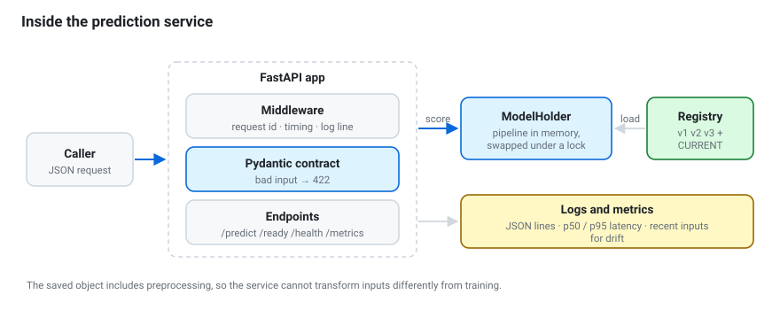
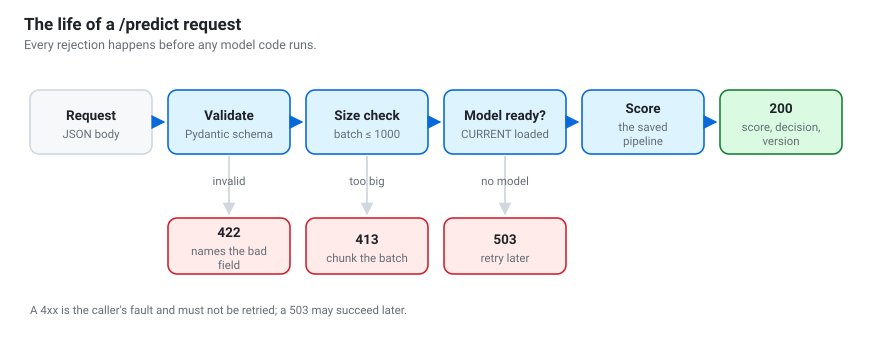

# Chapter 10 · FastAPI & contracts

*Part I · Prerequisites: Chapters 2, 6, 8 and 9 · Estimated time: reading ~40 min, lab ~55 min · Compute: CPU*

[](https://colab.research.google.com/github/berdakh/MLBOOTCAMP/blob/main/part1-foundations/ch10-fastapi-and-contracts/notebook.ipynb) · [Lab: notebook.ipynb](notebook.ipynb) · [Solutions](solutions.md)

## Learning objectives

After this chapter you should be able to:

1. Decide whether a model should be served in batch, online, as a stream, or embedded in another program, and justify the choice.
2. Describe the parts of an HTTP request and response that matter for a prediction service: method, path, headers, JSON body and status code.
3. Write a request and a response schema with Pydantic, using unknown-field rejection, numeric bounds and optional fields deliberately.
4. Read a 422 validation error (`loc`, `type`, `msg`) and explain why a 422 is preferable to a 500 for invalid input.
5. Explain the app-factory pattern and why a service should not load a model at import time.
6. Call every endpoint of the course's churn service and read its OpenAPI document.
7. Classify a proposed contract change as backwards compatible or breaking, and say how to release a breaking one.

## 10.1 Introduction

Chapters 2–9 produced a trained, evaluated churn model for the synthetic
TaskFlow subscription business, stored as an immutable bundle in a small
model registry. So far the model can be used only by someone who opens a
notebook, loads the bundle and calls `predict_proba`. In a company, the users
of a model are usually other programs: a customer-relationship tool that
shows a risk score on an account page, a nightly job that writes scores to a
table, a workflow that creates retention tasks. These programs need a stable
way to ask for a prediction and a stable description of what they will
receive.

The most common way to provide this is a small web service with an HTTP
interface. This chapter builds one with FastAPI. The framework itself is a
modest part of the work. The substantive part is the **contract**: a precise
statement of what callers may send, what they get back, and what each kind
of failure means. A clear contract lets other teams build on the service
without reading its source, lets the service reject bad input before it
reaches the model, and gives reviewers one place to inspect when the model's
inputs change.

The chapter proceeds as follows. Section 10.2 asks whether an online API is
needed at all. Section 10.3 reviews the parts of HTTP a prediction service
uses. Sections 10.4–10.6 treat the contract: request validation, the anatomy
of a validation error, strict schemas and response filtering. Section 10.7
introduces the app factory. Section 10.8 walks through the course's real
service, `churnlab.api`, and Section 10.9 discusses how a contract can change
without breaking its callers. Chapters 11 and 12 then check that the service
returns the same scores as the notebook and build a client and a test suite
around it.

## 10.2 Batch, online, streaming or embedded

Not every model needs an API. Before writing a service, decide how
predictions will be consumed. Four patterns cover most cases.

| Pattern | When it fits | Example |
|---|---|---|
| **Batch scoring** | Predictions are needed on a schedule; nobody waits for an individual answer | Score every active customer on the first of the month and write the scores to a table the CRM reads |
| **Online (request/response)** | A caller needs an answer now, for one or a few items | Score a customer when an account manager opens the customer's page |
| **Streaming** | Events arrive continuously and each must be scored as it arrives | Fraud scoring of each card transaction |
| **Embedded** | The model runs inside another application or device | On-device keyword spotting; a BCI decoder running on the acquisition computer |

The TaskFlow churn problem is naturally a batch problem: the features are
monthly snapshots and the retention team acts on a monthly list. The course
nevertheless builds an online API, for two reasons. First, the request/response
service is the pattern that interviews ask about most often. Second, it
exposes every engineering question in a compact form: contracts, validation,
versioning, testing, health checks, latency and rollback. If asked in an
interview, say this openly. Choosing batch scoring when batch is sufficient
is a sound engineering decision, not a lack of ambition: a batch job has no
latency budget, no availability requirement during the day, and far fewer
moving parts.

A useful way to decide is to ask three questions:

1. **When is the input known?** If all inputs are known in advance (a monthly
   snapshot), the predictions can be computed in advance.
2. **How fresh must the prediction be?** If a decision depends on something
   that happened seconds ago (a login, a transaction), the prediction must be
   computed at request time.
3. **Who waits for it?** If a person or another system is blocked until the
   answer arrives, latency becomes a requirement with a number attached.

## 10.3 What a prediction service is



*Figure 10.1 — The path of a prediction request: validation against the schema, scoring by the pipeline loaded from the registry, and a response that names the model version.*

An HTTP **request** consists of a method (`GET` to read, `POST` to send data
for processing), a path (`/predict`), headers (key–value metadata such as
`content-type: application/json` or a request identifier) and, for `POST`, a
body. A prediction service receives the customer's features as a JSON body.
The **response** consists of a status code, headers and a body. An
**endpoint** is the combination of a method and a path that the service
answers, for example `POST /predict`.

Status codes are grouped by their first digit. Codes `2xx` mean success;
`4xx` mean that the request was at fault and the client should change it;
`5xx` mean that the server failed. The codes that matter in this chapter are:

| Code | Name (RFC 9110) | Meaning in this service | Should a client retry? |
|---|---|---|---|
| 200 | OK | Prediction returned | — |
| 413 | Content Too Large | The batch exceeds the configured maximum size | No; split the batch |
| 422 | Unprocessable Content | The body was valid JSON but violated the schema | No; fix the request |
| 500 | Internal Server Error | A bug in the service | Possibly, but someone must investigate |
| 503 | Service Unavailable | The service cannot answer now (for example, no model loaded) | Yes, later or elsewhere |

FastAPI is a Python web framework that builds request parsing, validation and
documentation from Python type hints. An application written with FastAPI is
an **ASGI** application: a Python object that a server such as `uvicorn`
calls for each request. Because the application is just an object, it can
also be called directly from Python. FastAPI's `TestClient` does this: it
sends a complete HTTP request (method, headers, body) through the
application's ASGI interface without opening a network port. This is called
**in-process testing**, and it is how API tests run in continuous integration.
Chapter 12 starts a real server for the cases where the network matters.

A minimal service, of the kind built at the start of the lab, has a hand-written
"model" so that attention stays on the structure of the app:

$$
z = -1.0 - 0.05\, s + 0.8\, f, \qquad p = \sigma(z) = \frac{1}{1 + e^{-z}} \tag{10.1}
$$

where $s$ is the number of sessions in the last four weeks, $f$ is the number
of failed payments in the last 90 days, $z$ is a score on the log-odds scale
and $p \in (0, 1)$ is the reported churn probability. For $s = 2$ and $f = 2$,
$z = -1.0 - 0.1 + 1.6 = 0.5$ and $p = 1/(1 + e^{-0.5}) \approx 0.62$, which is
the value the lab's first request returns. Equation (10.1) has the same form
as the logistic regression models of earlier chapters; only the coefficients are invented.

Three things happen in such an app that the code does not state explicitly.
FastAPI reads the type annotation of the handler's argument and parses the
JSON body into that type (converting the integer `2` to the float `2.0`); the
returned dictionary is serialised to JSON; and every request and response
passes through the same machinery whether it comes from a real network
connection or from `TestClient`.

## 10.4 The contract and the anatomy of a validation error

The **contract** of a service is the set of promises it makes to callers:
which fields a request may contain and with which types and ranges, which
fields the response contains, and what every status code means. FastAPI lets
the contract be written as **Pydantic models**: Python classes whose
annotated fields declare types and constraints. Writing the contract as types
gives three things at once:

1. every request is validated before any model code runs, and a violation
   produces a structured error instead of a stack trace;
2. a machine-readable description of the interface (the OpenAPI document,
   Section 10.9) is generated automatically and rendered as documentation at
   `/docs`;
3. there is one file to review when the model's inputs change.

When a request violates the schema, FastAPI answers with **422** and a body
whose `detail` field is a list of errors. Each error has three parts:

- `loc` — *where* the problem is: the part of the request (`"body"`) followed
  by the path to the field, for example `["body", "sessions_4w"]`;
- `type` — *which rule* failed, as a machine-readable identifier, for example
  `missing`, `float_parsing`, `greater_than_equal` or `extra_forbidden`;
- `msg` — a human-readable sentence describing the failure.

Compare this with an endpoint that skips validation and reads a raw
dictionary. A missing field then raises a `KeyError` inside the handler, and
the caller receives a bare `500 Internal Server Error` with no detail. The
two outcomes differ in four respects:

| | 422 from the schema | 500 from a crash |
|---|---|---|
| Who appears to be at fault? | The caller, and the response says so | Unclear; it looks like a bug in the service |
| Can the caller fix the request? | Yes: `loc` names the field | No information is given |
| Should a client retry? | Never; the same request fails the same way | Possibly, which multiplies load |
| Does it alert the on-call engineer? | No; it is a 4xx | Often; 5xx rates are a standard alert |

The rule that follows is simple: **a 500 caused by invalid input is a bug in
the service**, even though the input was wrong. The service should recognise
invalid input and say so with a 4xx code.

A validation layer has a limit that should be stated just as clearly. It
checks the *form* of a request, not its *truth*. A well-formed request
containing plausible but wrong values (for example, last month's usage
figures) passes validation and is scored. Detecting that kind of problem is
the task of monitoring (Chapter 15).

## 10.5 Making the schema strict

A Pydantic model accepts a field it does not know about and silently ignores
it, unless told otherwise. This default is risky for a prediction service.
Suppose a caller misspells `features_used_4w` as `feature_used_4w`. The
misspelled field is ignored; the real field is optional and therefore
defaults to `None`; the pipeline imputes a typical value; and a prediction is
returned with status 200. The prediction is wrong, and nothing in the
response or the logs reveals it.

Four Pydantic features make a schema strict enough to prevent this kind of
silent error:

| Feature | Syntax | Effect |
|---|---|---|
| Forbid unknown fields | `model_config = ConfigDict(extra="forbid")` | A field that is not declared produces a 422 with type `extra_forbidden` |
| Bounds | `Field(ge=0, le=20)` | Values outside $[0, 20]$ produce `greater_than_equal` or `less_than_equal` |
| Optional fields | `x: float \| None = Field(default=None)` | The field may be absent or `null`; the pipeline must handle the missing value |
| Examples | `Field(examples=[12.0])` | No effect on validation; the example appears in the generated documentation |

Whether a field is optional is a **contract decision**, not a convenience. In
the churn schema (`src/churnlab/schemas.py`), `features_used_4w` and
`avg_resolution_hours_90d` are optional because they are legitimately missing
for some customers: a customer with no active weeks has no feature-usage
count, and a customer with no tickets in 90 days has no average resolution
time. The pipeline was trained with these values missing and imputes them in
the same way at serving time. Making `sessions_4w` optional, by contrast,
would invite callers to omit a value that always exists, and the model would
silently score an imputed one.

Bounds encode domain knowledge: a session count cannot be negative, and seat
utilisation (active seats divided by purchased seats) is a fraction, bounded
here at 1.5 to allow some over-use. A bound that is too tight rejects
legitimate rare customers, so bounds must be reviewed when the business
changes.

The complete set of decisions in the course's contract, with their reasons
and costs, is:

| Decision | Reason | Cost or alternative |
|---|---|---|
| `extra="forbid"` | A misspelled field becomes a 422, not a silently imputed value | Removing a field later breaks callers who still send it |
| Numeric bounds (`ge=0`, `le=…`) | Impossible values never reach the model | Bounds must be maintained; too tight a bound rejects valid rare values |
| Categorical fields as plain strings, not enumerations | An unseen category (a new region) still receives a prediction, because the one-hot encoder ignores unknown categories; monitoring counts unseen values | Typos in categories (`"Eu"` for `"EU"`) are not caught at the door |
| Two optional numeric fields | They are legitimately missing; the pipeline imputes them | Callers might omit values they actually have |
| Maximum batch size, 413 above it | Memory and latency per request are bounded | Callers must split large jobs (the client in Chapter 12 does this) |
| `model_version` in every response | Every prediction can be traced to the exact model | Slightly larger responses |

The choice between a string and an enumeration for categorical fields
deserves a moment's thought, because both answers are defensible. A string
accepts unseen values and leaves their detection to monitoring; an
enumeration rejects them at the door. An enumeration is the better choice
when an unknown value would make the prediction meaningless or dangerous,
when the set of values is genuinely closed (for example, a currency code in a
payments model), or when all callers are internal and typos should fail
loudly.

## 10.6 The response is part of the contract

The contract also covers what the service returns. Internal values tend to
leak into responses over time: a debugging field, a raw feature vector, a
customer's e-mail address. Declaring a `response_model` on an endpoint makes
FastAPI **filter** the returned object to exactly the declared fields and
**validate** it. In the lab, an endpoint that returns a dictionary with five
keys, including `owner_email`, is reduced to the three declared fields once
`response_model=ToyPrediction` is set.

The churn service declares four response models: `Prediction` for a single
customer, `BatchResponse` for a batch, `HealthResponse` for the health and
readiness probes, and `ModelInfo` for model metadata. `Prediction` also
declares $0 \le$ `churn_probability` $\le 1$, so a bug that produced a
percentage instead of a probability would be caught by the service itself
rather than by a confused caller.

## 10.7 The app factory

The toy apps in the lab are created at module level: the line
`app = FastAPI()` runs when the file is imported. Real services also load a
model, read settings and open connections. If all of this happens at import
time, three problems follow:

1. importing the module in a test (or in a documentation build) loads a model
   from a hard-coded path;
2. two tests cannot use two different configurations in the same process;
3. a missing model file makes the import itself fail, instead of producing a
   service that runs and reports "not ready".

An **app factory** solves these problems. It is a function that receives
configuration and returns a new, fully configured application:

```python
def create_app(settings: Settings | None = None, logger=None) -> FastAPI:
    settings = settings or Settings.from_env()
    holder = ModelHolder(settings)   # loads the model named by the registry
    holder.load()
    app = FastAPI(title="TaskFlow churn API")
    ...                               # endpoints defined here, closing over holder
    return app
```

Tests call `create_app(Settings(registry_dir=tmp_path))` with a temporary
registry; production calls `create_app()` and reads the settings from
environment variables (Chapter 13). There is one code path and no hidden
global state. If you have written `make_model(config)` to obtain a fresh
network for each experiment instead of mutating one global `model`, you have
already used the same idea.

The factory's benefit appears mostly in tests and in start-up error handling.
In production there is usually exactly one application per process.

## 10.8 The course's churn service

The real service lives in two short files: `src/churnlab/schemas.py` (the
contract) and `src/churnlab/api.py` (the app factory and endpoints). They are
worth reading in full. The endpoints are:

| Endpoint | Purpose | Notes |
|---|---|---|
| `GET /health` | Liveness: the process is running | Never touches the model |
| `GET /ready` | Readiness: a model is loaded and can predict | 503 with the reason if no model is loaded |
| `GET /model` | Metadata of the loaded model | Name, version, threshold, features, training time, validation metrics, library versions |
| `POST /predict` | Score one customer | Returns `Prediction` |
| `POST /predict/batch` | Score up to `max_batch_size` customers | 413 above the limit (default 1000) |
| `GET /metrics` | Request counts, error counts, latency percentiles | Per application instance |
| `POST /admin/reload` | Re-read the registry pointer | Used for rollback in Chapter 15; would require authentication in production |

The distinction between `/health` and `/ready` is introduced here and
developed in Chapter 14: liveness answers "is the process alive?", readiness
answers "should traffic be sent to it?".

Every prediction request follows the same path through the service, and
every rejection happens before any model code runs:



*Figure 10.2 — The life of a prediction request. The three exits are ordered from "the caller's fault" (422, 413) to "the service cannot answer now" (503); only the last is worth retrying.*

Inside the service, the request body is validated into `CustomerFeatures`,
converted into a one-row `pandas.DataFrame` with the columns in the order the
pipeline expects, and passed to the *same* scikit-learn `Pipeline` object
that was trained and saved in the registry (Chapter 9). Optional fields
arrive from Pydantic as `None` and are converted to `NaN`, which the
pipeline's imputer handles exactly as it did in training. The response
contains the probability, the binary decision `flagged`, the threshold used
and the model version. The threshold comes from the bundle's metadata, where
Chapter 8 stored the value chosen by expected cost.

A small piece of **middleware** (a function that runs around every request)
assigns each request an identifier, measures its latency, records counts for
`/metrics`, adds the headers `x-request-id` and `x-model-version` to every
response, and writes one structured log line. Chapter 11 uses the two headers
to trace predictions; Chapter 14 analyses the log lines.

In the lab, with the course's registry, `/model` reports the logistic
regression `v1` with a threshold near 0.19 and a validation PR-AUC near 0.163
(synthetic data, CPU run). A batch of 25 validation customers returns 25
predictions; the same batch sent to an app configured with
`max_batch_size=10` returns 413. Validation rows are used throughout: the
test period remains untouched until Chapter 16.

## 10.9 OpenAPI, versioning and backwards compatibility

FastAPI generates an **OpenAPI** document from the schemas and endpoints. It
is a JSON description of every path, method, request schema, response schema
and constraint. It is what `/docs` renders, and other teams can generate
client code from it. It is also a file that can be committed to the
repository and compared in code review: a changed contract appears as a
changed document. In the lab, the churn service's document lists seven
paths; the `CustomerFeatures` schema has 18 required fields and two optional
ones; `extra="forbid"` appears as `additionalProperties: false`; and the bound
on `sessions_4w` appears as `minimum: 0`.

Contracts change. A change is **backwards compatible** if every client
written against the old contract keeps working. This can be stated
precisely. Let $V_{\text{old}}$ and $V_{\text{new}}$ be the sets of requests
accepted by the old and new schemas, and let $R_{\text{old}}$ and
$R_{\text{new}}$ be the sets of response fields, with their meanings, that
the two versions guarantee. A change is backwards compatible if

$$
V_{\text{old}} \subseteq V_{\text{new}} \quad \text{and} \quad R_{\text{old}} \subseteq R_{\text{new}}, \tag{10.2}
$$

that is, every request that used to be accepted is still accepted, and every
response field a client may read is still present with the same meaning.
Equation (10.2) assumes that clients ignore response fields they do not know,
which well-behaved clients do. The consequences are:

| Change | Effect on $V$ or $R$ | Compatible? |
|---|---|---|
| Add an optional request field | $V$ grows | Yes |
| Add a response field | $R$ grows | Yes (for clients that ignore unknown keys) |
| Relax a bound | $V$ grows | Yes |
| Add an endpoint | Unchanged for existing endpoints | Yes |
| Add a required request field | Old requests now fail: $V_{\text{old}} \not\subseteq V_{\text{new}}$ | No |
| Remove or rename a request field (with `extra="forbid"`) | Callers who still send it now fail | No |
| Tighten a bound | Some old requests now fail | No |
| Rename or remove a response field | $R_{\text{old}} \not\subseteq R_{\text{new}}$ | No |
| Change a type, unit or meaning (probability → percentage) | Same name, different meaning | No |

The last row is the most dangerous, because neither side receives an error.

A breaking change is released by **versioning** the API: a path prefix
(`/v1/predict`, `/v2/predict`) or a version header. Both versions run during
a deprecation period, the number of calls to the old version is measured,
and the old version is removed only when it is no longer used. The churn
service has no version prefix yet. The usual advice is to add one before the
first breaking change, not after.

Finally, a contract change and a model change are separate releases. Adding
an optional `nps_score` field to the request (Exercise 2) is compatible, but
the current model was not trained with that feature. The field becomes useful
only after a model that uses it is trained, evaluated, registered and
promoted. Releasing the contract first has an advantage: monitoring can
record the new field's distribution before any model depends on it.

## Key terms

| Term | Definition |
|---|---|
| Endpoint | A combination of an HTTP method and a path that the service answers, such as `POST /predict`. |
| Contract | The request and response schemas of a service together with the meaning of each status code. |
| Pydantic model | A Python class whose annotated fields declare types and constraints, used to validate data. |
| Validation error (422) | The response to a request that parsed as JSON but violated the schema; it lists `loc`, `type` and `msg` for each violation. |
| `extra="forbid"` | A Pydantic setting that rejects fields the schema does not declare. |
| Optional field | A field that may be absent or `null`; the pipeline must handle the missing value. |
| `response_model` | The schema to which FastAPI filters and validates an endpoint's return value. |
| App factory | A function that builds a new, configured application from a settings object, so that nothing is loaded at import time. |
| In-process testing | Calling the application object directly with `TestClient`, with full HTTP semantics but no server or network. |
| Middleware | Code that runs around every request, used here for request ids, latency, metrics and logs. |
| OpenAPI document | A machine-readable description of an API's paths, schemas and constraints, generated by FastAPI. |
| Backwards-compatible change | A change after which every client written against the old contract still works (Equation 10.2). |
| API versioning | Running old and new contracts side by side under different paths or headers so that breaking changes can be released gradually. |

## Summary

1. An online API is one of four ways to deliver predictions. Batch scoring is often sufficient, and choosing it when it suffices is a sound decision.
2. The contract (request schema, response schema and status-code meanings) is the substantive part of a prediction service; the framework is secondary.
3. Pydantic schemas validate every request before any model code runs. A violation produces a 422 that tells the caller where and why the request failed.
4. A 500 caused by invalid input is a bug in the service. A 422 is never retried; a 503 may be.
5. `extra="forbid"`, numeric bounds and deliberate optional fields prevent silent errors such as a misspelled field turning into an imputed value.
6. `response_model` keeps internal values out of responses and validates what the service returns.
7. An app factory builds the application from configuration, so tests can create independent apps and a missing model produces "not ready" instead of a failed import.
8. Validation checks the form of a request, not the truth of its values; monitoring handles the latter.
9. A change is backwards compatible if every previously accepted request is still accepted and every guaranteed response field keeps its meaning. Breaking changes need a new API version.

## Exercises

The exercises are in the lab, [notebook.ipynb](notebook.ipynb); worked answers are in [solutions.md](solutions.md).

- **Exercise 1 (graded).** Write `make_app()`, a factory that returns a new FastAPI app with `GET /health` and `POST /double`. The request schema must reject a negative, missing, non-integer or extra field with a 422.
- **Exercise 2 (graded).** Write `make_schema_v2()`, which extends `CustomerFeatures` with an optional integer `nps_score` between 0 and 10, without changing any existing field or the `extra="forbid"` setting.
- **Exercise 3 (written).** Classify five proposed contract changes (a new required field, a new response field, a renamed response field, a tightened bound, and a free-string field turned into an enumeration) as breaking or compatible, with reasons.
- **Checkpoint.** Six questions to answer aloud: the effect of a misspelled field with and without `extra="forbid"`; reading a 422 error; strings versus enumerations; the app factory; `/health` versus `/ready` and 413 versus 422 versus 503; and examples of compatible and breaking changes.

## Further reading

- FastAPI documentation, especially the tutorial sections on request bodies, response models and testing: <https://fastapi.tiangolo.com/>
- Pydantic documentation, on models, fields and validation errors: <https://docs.pydantic.dev/>
- R. Fielding, M. Nottingham and J. Reschke (2022). *HTTP Semantics*. RFC 9110, IETF. The definitive description of methods and status codes.
- OpenAPI Initiative. *OpenAPI Specification*: <https://spec.openapis.org/oas/latest.html>
- M. Kleppmann (2017). *Designing Data-Intensive Applications*. O'Reilly. Chapter 4 ("Encoding and Evolution") treats backward and forward compatibility of schemas.
- C. Huyen (2022). *Designing Machine Learning Systems*. O'Reilly. Chapter 7 discusses batch versus online prediction and model deployment.

**Next:** [Chapter 11 · Consistent serving](../ch11-consistent-serving/README.md)
