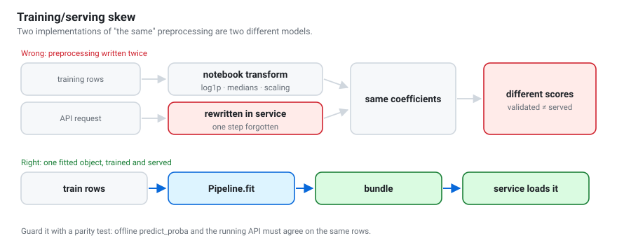
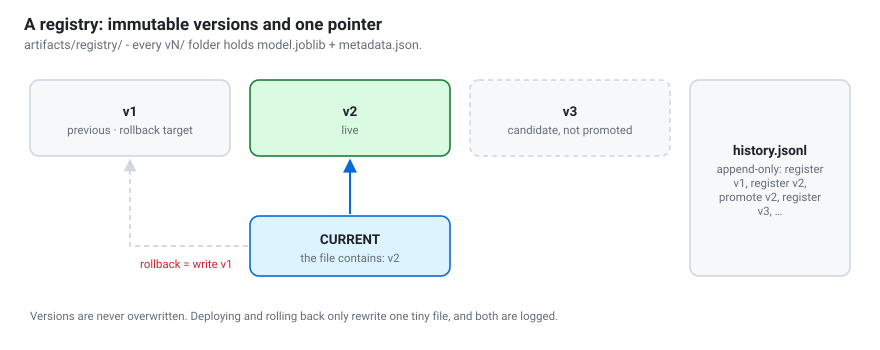

# Chapter 11 · Consistent serving

*Part I · Prerequisites: Chapters 6, 9 and 10 · Estimated time: reading ~35 min, lab ~45 min · Compute: CPU*

[](https://colab.research.google.com/github/berdakh/MLBOOTCAMP/blob/main/part1-foundations/ch11-consistent-serving/notebook.ipynb) · [Lab: notebook.ipynb](notebook.ipynb) · [Solutions](solutions.md)

## Learning objectives

After this chapter you should be able to:

1. Define training/serving skew, list its common sources, and explain why it does not produce errors.
2. Compute how an error in one feature changes a logistic-regression score, and why a small change in average performance can hide many changed decisions.
3. Explain why serving the fitted `Pipeline` object removes a whole class of skew, and which kinds of skew it cannot remove.
4. Write a parity test that compares offline and API scores on the same rows, and choose its tolerance from the contract.
5. Describe what a safe model load verifies (file hash, library versions, feature list) and what it does not.
6. Explain why a service that cannot load a model should report "not ready" rather than crash.
7. Trace any prediction to the model version that produced it and to its log line.

## 11.1 Introduction

Chapter 10 put the churn model behind an HTTP API. The API validates its
input, returns a probability, and states which model produced it. None of
this guarantees that the probability is the one the model would have produced
in the notebook where it was evaluated. If the service prepares the features
even slightly differently from the training code, it returns different
scores. The API still answers with status 200, the probabilities still look
plausible, and the evaluation of Chapters 6–9 no longer describes the model
that is actually in use.

This failure is called **training/serving skew**. It is one of the most
common and most costly problems in deployed machine learning, precisely
because it is silent. This chapter makes it visible on the TaskFlow data,
removes its main cause, and builds the test that detects most of what
remains. It then covers two further requirements of a trustworthy service:
loading a model safely, and being able to say, for any prediction, which
model produced it.

Section 11.2 defines skew and lists its sources. Section 11.3 quantifies the
effect of a skewed feature on a logistic-regression score. Section 11.4
presents the structural fix, and Section 11.5 the parity test. Section 11.6
covers inputs that a caller may legitimately vary. Section 11.7 treats safe
model loading, and Section 11.8 traceability.

## 11.2 Training/serving skew

**Training/serving skew** is any difference between how the model's input is
computed at training time and how it is computed at serving time. The model
itself may be identical in both places. What differs is the vector of numbers
it receives.

Skew usually originates in an organisational pattern. A data scientist
writes the preprocessing as a function in a notebook, trains a model on the
resulting array, and hands over the model (or just its coefficients). An
engineer then **re-implements** the preprocessing in the service, working
from a description of it. Two implementations of the same transformation,
written by different people at different times, almost always diverge.

The common sources, and how each is prevented, are:

| Source | Example | Prevention |
|---|---|---|
| Preprocessing re-implemented in the service | A `log1p` transform is forgotten | Keep preprocessing inside the saved `Pipeline` and serve that object |
| Fitted statistics recomputed or hard-coded | The service imputes with 0 instead of the training median | The statistics are part of the fitted object; never recompute them at serving time |
| Column order or names | Two columns are swapped before reaching a NumPy model | Select columns by name; store the feature list in metadata and check it at load time |
| Missing-value encoding | `None`, `""`, `-1` and `NaN` treated differently | Normalise missing values at the service boundary; test it |
| Feature computed from a different source or window | "Tickets in the last 30 days" counted in local time online, in UTC offline | One shared feature definition, or the same SQL for both paths |
| Library versions | A pickle loaded under a different scikit-learn version behaves differently | Record versions in metadata; warn or fail on mismatch |
| Time | Features computed at a different moment from the one used in training | Point-in-time logic shared between training and serving (Chapter 4) |

Skew does not raise errors because every step that produces it is valid
code operating on valid numbers. A swapped column is still a column of
floats; an imputed zero is still a number. The only symptom is that the
scores differ, and nobody compares them unless a test does so.

## 11.3 How a skewed feature moves a score

For a logistic-regression model, the effect of skew can be computed exactly.
The model computes the **log-odds** (also called the *logit* or *linear
predictor*)

$$
\eta = \beta_0 + \sum_{j=1}^{d} \beta_j z_j, \qquad p = \sigma(\eta) = \frac{1}{1 + e^{-\eta}}, \qquad (11.1)
$$

where $z_j$ is the $j$-th feature after preprocessing (imputation, log
transform, standardisation), $\beta_j$ its coefficient, $\beta_0$ the
intercept, $d$ the number of features and $p$ the predicted probability.
Suppose the service computes feature $j$ as $z_j + \delta_j$ instead of $z_j$,
where $\delta_j$ is the error after preprocessing. Then

$$
\Delta \eta = \beta_j\, \delta_j, \qquad p_{\text{served}} = \sigma\!\left(\eta + \beta_j \delta_j\right). \qquad (11.2)
$$

In words, the error in the feature, multiplied by its coefficient, is added
directly to the log-odds. A worked example: if a forgotten `log1p` on
`sessions_4w` turns a standardised value of 0.5 into 4.0, then
$\delta = 3.5$. With $\beta = -0.6$, the log-odds fall by $2.1$. A customer
whose correct probability is 0.20 has log-odds $\ln(0.2/0.8) = \ln 0.25
\approx -1.39$, and is served $\sigma(-1.39 - 2.1) \approx 0.03$. If the
decision threshold is near 0.19, as it is for the course's model, this
customer would have been flagged for a retention call and is now silently
dropped.

Equation (11.2) also explains why some skew bugs are more harmful than
others. Swapping two columns replaces $\beta_j z_j + \beta_k z_k$ by
$\beta_j z_k + \beta_k z_j$, which changes every row at once by an amount that
depends on two coefficients. Imputing zero instead of the median affects only
rows with missing values, and only in the columns that can be missing.

The lab reproduces these three bugs in a hand-written service function and
measures each one separately against the correct transform on the 6,956
validation rows (synthetic data, CPU run). The correctly preprocessed model
has a validation PR-AUC of about 0.158 and flags about 170 customers at its
threshold. With all three bugs together, the maximum score difference is
around 0.7 and several hundred decisions change. Individually:

- **Column order** is the most destructive (several hundred decision flips;
  PR-AUC falls to about 0.07). It is also the hardest to see in code review,
  because every line of the code looks correct.
- **Imputing zero** flips only a few dozen decisions, because only two columns
  have missing values, and only in some rows.
- **The forgotten `log1p`** flips about a hundred decisions while PR-AUC
  barely changes (0.158 to 0.157).

The last result deserves attention. An aggregate metric, computed on served
scores, would not reveal this bug at all. PR-AUC measures how well the
scores *rank* customers; a monotone distortion of one feature can leave the
ranking nearly intact while moving many individual customers across the
threshold. A **decision flip** is a row whose decision (flagged or not)
differs between two implementations. Counting flips, not only comparing
metrics, is therefore part of any skew check.

## 11.4 The structural fix: one object, trained and served

The lesson of Section 11.3 is not "be more careful when re-implementing".
Two implementations of the same transform will drift apart over time,
however careful their authors are. The fix is to have only **one**
implementation.



*Figure 11.1 — Two ways to serve a model. Above, preprocessing is written twice and the copies diverge, although the coefficients are identical. Below, one fitted pipeline is saved and served.*

The models in the course's registry are scikit-learn `Pipeline` objects
(Chapter 6). Imputation, log transforms, scaling and one-hot encoding are
*inside* the object that was fitted, saved and hashed. The fitted statistics
(medians, means, standard deviations, category lists) are attributes of that
object. The service does not re-implement anything. It builds a `DataFrame`
from the validated request and calls `predict_proba`:

```python
rows = [c.model_dump() for c in customers]           # validated request bodies
frame = pd.DataFrame(rows)[FEATURES]                 # columns selected by name
frame[NUMERIC] = frame[NUMERIC].astype(float)        # None -> NaN for sklearn
scores = model.predict_proba(frame)[:, 1]
```

Applied to the same rows offline, this path gives bit-for-bit identical
scores: the same object, the same inputs and the same arithmetic.

Two further safeguards in `churnlab.api` remove the column-order bug
entirely. The `ColumnTransformer` inside the pipeline selects columns **by
name**, so the order of keys in a JSON body cannot matter. And at start-up,
the service refuses a model whose stored feature list differs from the
API's contract.

Serving the pipeline removes skew that arises *between the request and the
model*. It cannot remove skew that arises *before the request*: if the caller
computes `tickets_30d` from a different source or over a different window
than the training SQL did, the pipeline receives a wrong value and processes
it faithfully. Preventing that kind of skew requires a shared feature
definition, which is the subject of feature stores in Chapter 21.

## 11.5 The parity test

A **parity test** scores the same rows offline and through the running
service, and requires the results to agree. It is the direct test for skew,
and it detects anything between the request and the model: type coercions in
the schema, missing-value handling, a stale model, a wrong threshold.

Let $p_i^{\text{offline}}$ be the probability computed by calling the model
directly on row $i$, and $p_i^{\text{API}}$ the probability returned by the
service for the same row. The parity criterion is

$$
\max_{i} \left\lvert p_i^{\text{offline}} - p_i^{\text{API}} \right\rvert \le \varepsilon
\quad \text{and} \quad
\sum_i \mathbb{1}\!\left[\, \mathbb{1}[p_i^{\text{offline}} \ge t] \ne f_i^{\text{API}} \right] = 0, \qquad (11.3)
$$

where $\varepsilon$ is the tolerance, $t$ is the threshold reported by the
service, $f_i^{\text{API}}$ is the service's `flagged` value for row $i$, and
$\mathbb{1}[\cdot]$ is 1 if its argument is true and 0 otherwise. The first
condition compares scores; the second counts decision flips.

The tolerance must be chosen from the contract, not from whatever value makes
the test pass. The churn service rounds probabilities to six decimal places
for readability, so differences up to $0.5 \times 10^{-6}$ are expected. The
lab observes a maximum difference of about $5 \times 10^{-7}$, and uses
$\varepsilon = 10^{-6}$ to leave a little slack for floating-point noise in
the rounding itself. The `flagged` decision is computed *before* rounding, so
decisions should match exactly. A parity test is only useful once the
expected differences, and their causes, are known.

Three practical points make a parity test effective:

1. **Read the threshold from the service** (`GET /model`), not from the
   registry file or a constant. The test should check what the service
   actually uses, which may differ if a threshold override is configured.
2. **Compare against the service's own decision**, not a re-thresholded
   rounded probability, so that the service's decision logic is tested too
   (for example, a `>` written where `>=` was intended).
3. **Choose rows deliberately.** A parity test checks only the rows it sends.
   Include rows with missing optional fields and rare categories, not only
   typical rows.

With `np.allclose`, beware the default relative tolerance of $10^{-5}$: for a
probability of 0.02 it allows a difference of $2 \times 10^{-7}$ in addition
to the absolute tolerance, and on small probabilities it can hide real
differences. Prefer an explicit absolute tolerance.

## 11.6 Inputs that must not change the answer

Some differences between requests are legitimate and must not change the
score or crash the service:

- **Field order.** JSON objects are unordered. A body with keys in a
  different order must give the same probability. Selecting columns by name
  guarantees this.
- **Missing optional fields.** An optional field may be sent as `null` or
  omitted. Both must give the same result as the offline row with `NaN`.
  Inside the service there is exactly one representation of a missing value
  (`NaN`), and the pipeline imputes it with the *training* median.
- **Unseen categories.** A region the model has never seen (the lab sends
  `"MARS"`) is accepted by the contract, which declares categories as plain
  strings (Chapter 10). The one-hot encoder, fitted with
  `handle_unknown="ignore"`, encodes it as all zeros, so the customer is
  scored as if the region effect were zero. The request succeeds, and the
  service counts the unseen value in its recent-input buffer. A sudden rise in
  that count after a deployment, or after a new market opens, is a reason to
  investigate (Chapter 15), not a reason for the service to fail.

## 11.7 Loading a model safely

A **bundle** (Chapter 9) is a directory holding `model.joblib` (the fitted
pipeline) and `metadata.json` (features, threshold, validation metrics,
training-data fingerprint, library versions and the SHA-256 hash of the model
file). Bundles live in a registry with a `CURRENT` pointer.



*Figure 11.2 — The model registry. Version folders are immutable; deploying and rolling back rewrite only the one-line `CURRENT` file.*

The function `load_bundle` checks two things before returning a model:

1. **Integrity.** The SHA-256 hash of `model.joblib` must equal the value
   stored in the metadata. A corrupted, partially copied or replaced file is
   refused with an `ArtifactError`.
2. **Library version.** The scikit-learn version recorded at training time
   must have the same major and minor version as the running one. A mismatch
   is a warning by default and an error with `strict_versions=True`. The
   reason for caution is that a pickled model can load without complaint
   under another version and still behave differently.

The service adds a third check: the feature list in the metadata must equal
the list the API contract supplies.

It is equally important to know what these checks do *not* cover. The hash
covers only `model.joblib`, not `metadata.json`. Someone could edit the
threshold in the metadata and the service would use it without complaint. A
stronger design would also hash, or cryptographically sign, the metadata.
Furthermore, `joblib` and `pickle` files execute code when they are loaded,
so a bundle should only ever be loaded from a source that is trusted. A hash
stored next to the file protects against accidents, not against an attacker
who can rewrite both.

What should the service do when loading fails? It should **not crash**. An
orchestrator such as Kubernetes or a load balancer sends traffic only to
instances whose readiness check passes. A process that crashes at start-up is
restarted, fails again, and is restarted again, and its logs are hard to
inspect. A process that starts, answers `/health` with 200, and answers
`/ready` and `/predict` with 503 and the reason, stays visible and begins
serving as soon as a valid model is loaded. In the lab, a registry with no
`CURRENT` pointer and a registry with a tampered file both produce exactly
this behaviour, while a registry whose bundle records a different
scikit-learn version is ready and logs one warning.

Two further rules apply when a running service *reloads* a model:

- **Swap atomically.** The service keeps the model and its metadata in one
  holder object and replaces both in a single assignment under a lock, so no
  request ever sees the new model with the old metadata.
- **Keep the old model if the new one fails.** A failed reload reports an
  error and leaves the previous model in service. Chapter 15 relies on this
  for rollback.

## 11.8 Traceability: versions and request identifiers

Every prediction should be traceable to the exact model that produced it,
and every request to its log line. The churn service provides both:

- the response body and the `x-model-version` header name the model version;
- the `x-request-id` header carries an identifier that the caller may supply
  (or the service generates), and the same identifier appears in the
  service's structured log line for that request, together with the path,
  status, latency and model version.

Suppose a customer-success manager asks why a particular account was flagged
on a particular day. The request identifier links the manager's record of
the call to the log line; the model version links the log line to the exact
bundle, and through its metadata to the training-data fingerprint, the
threshold and the validation metrics. Without these two identifiers the
question can only be answered by guessing.

## Key terms

| Term | Definition |
|---|---|
| Training/serving skew | Any difference between how model inputs are computed in training and at serving time. |
| Re-implementation | Writing the same transformation a second time from a description of it; the usual cause of skew. |
| Fitted statistics | Values learned from training data on which a transform depends, such as medians, means and standard deviations. |
| Log-odds (logit) | $\eta = \log\bigl(p/(1-p)\bigr)$; in logistic regression, a linear function of the features (Equation 11.1). |
| Decision flip | A row whose decision (flagged or not) differs between two implementations or two models. |
| Parity test | A test that scores the same rows offline and through the running service and requires agreement within a tolerance (Equation 11.3). |
| Tolerance | The largest difference a test accepts as equal; chosen from the contract (here, rounding to six decimals). |
| Unseen category | A categorical value that did not occur in the training data; encoded as all zeros by the one-hot encoder. |
| Bundle | A directory containing a fitted model and its metadata, including a hash of the model file. |
| Integrity check | Verifying that a file's hash matches a recorded value, to detect corruption or replacement. |
| Atomic swap | Replacing the live model and its metadata in one step, so that no request sees a mixture. |
| Request identifier | An identifier carried in a header and in the logs, so that one call can be traced. |

## Summary

1. Training/serving skew is a difference in how inputs are computed in training and serving. It raises no errors; it only changes scores.
2. For logistic regression, an error $\delta_j$ in feature $j$ shifts the log-odds by $\beta_j \delta_j$ (Equation 11.2).
3. Different bugs cause different damage. Column order changes every row; zero-imputation changes only rows with missing values; a forgotten transform may leave PR-AUC almost unchanged while changing about a hundred decisions.
4. Aggregate metrics can hide skew. Count decision flips as well as comparing scores.
5. The structural fix is a single implementation: serve the fitted `Pipeline` object, which carries its preprocessing and fitted statistics, and select columns by name.
6. A parity test compares offline and served scores on the same rows. Its tolerance follows from the contract (here, rounding to six decimals), and its rows should include missing values and rare categories.
7. Serving the pipeline cannot prevent skew that arises before the request, in how live features are computed.
8. A safe load verifies the model file's hash, the library version and the feature list; it does not verify the metadata, and pickles execute code when loaded.
9. A service that cannot load a model should stay up and report "not ready"; a failed reload should keep the previous model.
10. A model version and a request identifier in every response make every prediction traceable.

## Exercises

The exercises are in the lab, [notebook.ipynb](notebook.ipynb); worked answers are in [solutions.md](solutions.md).

- **Exercise 1 (graded).** Write `parity_check(model, http_client, rows_df)`, which reads the threshold from `/model`, scores the rows through `/predict/batch` in one request and offline, and returns the maximum absolute difference and the number of decision flips. The grader also passes a subtly wrong model, which your check must detect.
- **Exercise 2 (graded).** Write `fixed_serve_preprocess(customers, stats)`, which returns exactly what the training transform returns for a list of request dictionaries with arbitrary key order, missing optional fields and an unseen region. Consider why the shortest correct solution is also the right one.
- **Exercise 3 (written).** The parity test replays stored feature rows. List three sources of skew it cannot detect, and for each say how you would detect or prevent it.
- **Checkpoint.** Six questions to answer aloud: why skew is silent; three ways a re-implementation differs and which is hardest to see; what serving a pipeline does and does not prevent; whether a difference of $4 \times 10^{-7}$ passes; what `load_bundle` verifies; and what is needed to investigate a past prediction.

## Further reading

- D. Sculley, G. Holt, D. Golovin, E. Davydov, T. Phillips, D. Ebner, V. Chaudhary, M. Young, J.-F. Crespo and D. Dennison (2015). "Hidden Technical Debt in Machine Learning Systems." *Advances in Neural Information Processing Systems 28*.
- E. Breck, S. Cai, E. Nielsen, M. Salib and D. Sculley (2017). "The ML Test Score: A Rubric for ML Production Readiness and Technical Debt Reduction." *IEEE International Conference on Big Data*. Includes tests for training/serving skew.
- M. Zinkevich. *Rules of Machine Learning: Best Practices for ML Engineering.* Google. The rules on training–serving skew recommend reusing code between the training and serving pipelines.
- scikit-learn documentation: "Pipelines and composite estimators" and "Model persistence" (including the security and version-compatibility notes): <https://scikit-learn.org/stable/>
- C. Huyen (2022). *Designing Machine Learning Systems*. O'Reilly. Chapter 7 (deployment) and Chapter 8 (distribution shifts) discuss train–serving skew.

**Next:** [Chapter 12 · API clients & tests](../ch12-api-clients-and-tests/README.md)
