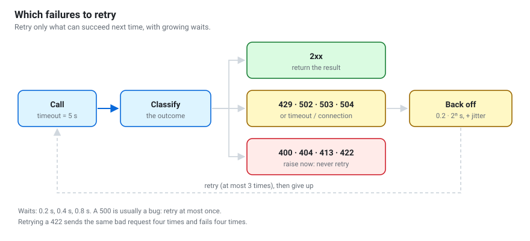
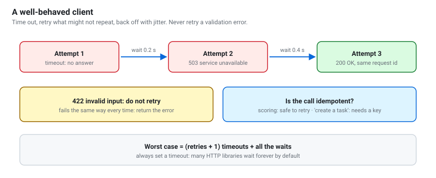

# Chapter 12 · API clients & tests

*Part I · Prerequisites: Chapters 10 and 11 · Estimated time: reading ~40 min, lab ~60 min · Compute: CPU*

[](https://colab.research.google.com/github/berdakh/MLBOOTCAMP/blob/main/part1-foundations/ch12-api-clients-and-tests/notebook.ipynb) · [Lab: notebook.ipynb](notebook.ipynb) · [Solutions](solutions.md)

## Learning objectives

After this chapter you should be able to:

1. Run a FastAPI application under a real HTTP server bound to the local machine, and stop it cleanly.
2. Explain why every network call needs a timeout, and how to choose its value.
3. Classify failures as retryable or not, and implement bounded retries with exponential backoff and jitter.
4. Compute the worst-case duration of a call with retries, and explain how retries amplify load.
5. Explain idempotency and why it decides whether a request may be retried.
6. Split large jobs into requests below a service's batch limit.
7. Write an API test suite in four categories (contract, behaviour, parity, operations) with pytest fixtures.
8. Use mutation testing to find out which bugs a test suite actually detects.

## 12.1 Introduction

Chapters 10 and 11 built a prediction service and checked, by inspection,
that it returns the right scores and rejects bad input. Two things are still
missing before the service can be relied on. The first is a **client**: the
code that other programs use to call the service. Networks are slow, servers
restart and deployments briefly make a service unavailable; a client must
handle these events without hanging and without making them worse. The
second is a **test suite**: a set of automated checks that run every time
anyone changes the code, so that the properties checked by eye in
Chapters 10 and 11 stay true.

This chapter treats both. Section 12.2 runs the service under a real server.
Sections 12.3–12.5 cover the client's three main duties: timeouts, retries
and chunking of large jobs. Section 12.6 builds a test suite, and Section
12.7 asks whether that suite would detect real bugs, using mutation testing.

## 12.2 A real server, on the local machine only

FastAPI's `TestClient` calls the application object directly, without a
network. That is ideal for tests of the application's logic, but a client
library has to be tried against a real socket, where timeouts and connection
errors actually occur. The lab therefore starts **uvicorn**, the ASGI server
on which FastAPI applications run in production, in a background thread of
the notebook.

Two safety rules apply whenever a server is started from a notebook:

- **Bind to `127.0.0.1`**, the loopback address, which accepts connections
  only from the same machine. Never bind to `0.0.0.0` (all interfaces) and
  never create a public URL or tunnel for a teaching service: it has no
  authentication.
- **Ask the operating system for a free port** (by binding to port 0), so
  that a server left over from an earlier run cannot collide with the new one.

Background threads outlive the cells that started them, so the lab also
stops its servers explicitly at the end: setting uvicorn's `should_exit` flag
lets it finish in-flight requests and return, and `join` waits for the
thread to end.

## 12.3 Timeouts

A **timeout** is the longest time a client waits for a response before giving
up. Many HTTP libraries wait indefinitely by default: the popular `requests`
library has no default timeout at all, while `httpx` defaults to five
seconds.

Without a timeout, a client waiting on a hung server holds a thread, a
network connection and often a user's request. If many callers do this at
once, the hang propagates to every service upstream of the hung one. A
timeout converts "hangs forever" into a prompt error that the caller can
handle, for example by showing a cached value or a message.

Two kinds of failure appear in the lab. A **read timeout** occurs when the
server accepted the connection but did not answer in time (the lab's
`/slow` endpoint with a 0.5-second timeout raises `ReadTimeout` after about
0.5 s). A **connection error** occurs when nothing is listening at the address;
a closed port refuses the connection almost immediately. The two are often
configured separately: a short connect timeout and a longer read timeout.

The value of a timeout should come from measurement, not from a guess. A
common starting point is a few times the 99th-percentile latency measured
under realistic load (Chapter 14), bounded above by the caller's own
deadline. A timeout below the typical latency causes needless failures; one
far above the caller's deadline is useless.

## 12.4 Retries

A **retry** sends the same request again after a failure. Retrying is useful
only for failures that might not happen the second time. The classification
used by the course's client is:

| Response | Meaning | Retry? |
|---|---|---|
| Connection error or timeout | The request may not have reached the server | Yes, if the request is idempotent |
| 429 Too Many Requests | The caller is being rate-limited | Yes, after backing off (respecting a `Retry-After` header if present) |
| 502, 503, 504 | A gateway or the service is temporarily unavailable | Yes |
| 500 Internal Server Error | A bug in the service, which usually recurs | No, or at most once |
| 400, 404, 413, 422 | The request itself is wrong | Never |



*Figure 12.1 — The retry decision. It depends only on the kind of failure, and the retry loop is bounded.*

A 422 deserves emphasis. The request is invalid, and sending it again
produces the same 422. A client that retried validation errors would send
four identical bad requests instead of one, add load to the service, and
still fail. In the lab, a request with a negative session count reaches the
server exactly once.

### Exponential backoff and jitter

Retries must be spaced out. If a service is struggling and every client
retries immediately, the extra load prevents it from recovering.
**Exponential backoff** makes the wait before retry $n$ grow geometrically:

```math
d_n = b \cdot 2^{n}, \qquad n = 0, 1, \dots, R - 1, \qquad (12.1)
```

where $b$ is the base delay and $R$ the maximum number of retries. With
$b = 0.2$ s and $R = 3$, the waits are 0.2, 0.4 and 0.8 s, 1.4 s in total.

When a service fails, all its clients see the failure at about the same
moment. With identical backoff schedules, they would also retry at the same
moments, producing synchronised bursts of load (sometimes called a
"thundering herd"). **Jitter** multiplies each delay by a random factor, for
example $d_n \cdot U$ with $U$ drawn uniformly from $[0.5, 1.5]$, so that the
retries spread out in time. The course's client omits jitter for
reproducibility; production clients should include it.

### The cost of retries

Retries make a call more reliable, but they also make it slower in the worst
case. With a per-attempt timeout $\tau$ and $R$ retries, every attempt may
wait until the timeout, so the worst-case duration of one logical call is

```math
T_{\max} = (R + 1)\,\tau + \sum_{n=0}^{R-1} b\, 2^{n} = (R + 1)\,\tau + b\,(2^{R} - 1). \qquad (12.2)
```

With $\tau = 5$ s, $R = 3$ and $b = 0.2$ s, $T_{\max} = 4 \times 5 + 0.2 \times 7
= 21.4$ s. A caller with a two-second budget cannot use this configuration;
the timeout and the number of retries must be chosen together, from the
caller's deadline.

Why do retries help at all? If each attempt fails independently with
probability $q$, all $R + 1$ attempts fail with probability

```math
P(\text{all attempts fail}) = q^{\,R+1}. \qquad (12.3)
```

For $q = 0.05$ and $R = 3$, this is $0.05^4 \approx 6 \times 10^{-6}$. The
assumption of independence is the weak point. During an outage, failures are
strongly correlated: if the server is down, every attempt fails, and the
retries only add load. For a 422, $q = 1$ and retrying changes nothing.

Retries also **amplify load**. If a service is completely unavailable, each
logical call produces $R + 1$ requests instead of one. In a chain of $k$
services, each of which retries $R$ times when the one below it fails, a
single failure at the bottom can produce up to

```math
(R + 1)^{k} \qquad (12.4)
```

requests at the failing service. With $R = 3$ and $k = 3$, that is 64 requests
for one user action. This is why retries are bounded, backed off and usually
performed at only one layer of a system.



*Figure 12.2 — A retried call on a timeline. The waits double, the request identifier stays the same across attempts, and a validation error (422) has no retry arrow.*

### Idempotency and request identifiers

A request is **idempotent** if sending it twice has the same effect as
sending it once. A prediction is idempotent: it reads a model and returns a
number, and changes nothing. This is what makes retrying it safe, even when a
timeout leaves the client unsure whether the server processed the first
attempt. A request that changes state is different. Retrying "create a
retention task" or "charge this card" after a timeout may create a duplicate
task or a second charge. The usual remedy is an **idempotency key**: the
client sends a unique key with each logical operation, the server stores the
result under that key, and a repeated key returns the stored result instead
of executing the operation again.

The course's client generates one `x-request-id` per *logical* call and sends
the same identifier with every retry. All attempts of one call can then be
found together in the server's logs (Chapter 14).

In the lab, a "flaky" endpoint returns 503 for its first two calls. The client
succeeds on the server's third call after waits of 0.05 s and 0.10 s; with the
endpoint set to fail more often, the client gives up with the 503 after
$1 + 3 = 4$ attempts.

## 12.5 Large jobs: chunking below the batch limit

The churn service refuses batches above `max_batch_size` (1,000 customers)
with a 413. The limit protects the service's memory and keeps the latency of
each request bounded. The client is responsible for respecting it: its
`predict_batch` method splits a large list into **chunks** of at most
`chunk_size` rows, sends one request per chunk, and concatenates the results
in order. In the lab, scoring 2,500 validation rows as one batch fails with a
413, and the same rows sent in chunks of 1,000 take three requests
(1,000 + 1,000 + 500) with the order of predictions preserved.

Chunking interacts with retries in a useful way: if one chunk fails
transiently, only that chunk is retried, not the whole job.

## 12.6 A test suite for the service

A **test suite** is a collection of automated checks that run in seconds, in
continuous integration (CI), on every change. The API tests in the lab fall
into four categories, each answering a different question:

| Category | Question | Examples from the lab's suite |
|---|---|---|
| **Contract** | Does the API accept and reject exactly what it promised? | Out-of-range values, an unknown field and a missing field each give 422; an oversized batch gives 413 |
| **Behaviour** | Are the answers sensible? | Probabilities lie in $[0, 1]$ and the order of a batch is preserved; `flagged` agrees with the threshold, *including at the exact threshold* |
| **Parity** | Is it the model that was validated? | API scores equal offline scores on the same rows (Chapter 11) |
| **Operations** | Does the service behave well when things go wrong? | Without a model, `/ready` is 503 and `/health` is 200; the version header and request identifier are present |

Tests are written for **pytest**, the standard Python test runner. A test is
a function whose name starts with `test_` and which uses `assert`
statements. A **fixture** is a function that pytest calls to prepare
something a test needs, and whose result it passes to the test as an
argument. The lab's fixtures create a temporary registry containing a
logistic regression trained on a quarter of the training rows (a test needs
*a* real model, not the best one), and a fresh application from the app
factory for each test. Tests therefore never touch the course's artifact
registry, and no test depends on another.

Some principles make a test useful rather than decorative:

- **Change one thing.** A contract test should start from a valid request
  and alter exactly one field. Otherwise the request may be rejected for a
  different reason, and the test passes even if the rule it was meant to
  check has disappeared.
- **Assert the exact outcome.** `assert r.status_code == 422`, not
  `assert r.status_code != 200`. A service that crashes with a 500 on bad
  input passes the second assertion, although that behaviour is a bug.
- **Test boundaries.** Rules of the form "flag if $p \ge t$" fail most often
  at $p = t$. A test that only uses typical scores cannot distinguish `>` from
  `>=`.
- **Write readable failure messages**, so that a failure in CI can be
  understood without re-running the test.

The lab writes the suite to a file and runs it as CI would: in a separate
Python process, from the repository root. The expected result is
`13 passed` (ten test functions, one of which is parametrised over four
cases).

## 12.7 Do the tests detect bugs? Mutation testing

A passing test suite carries no information until it is known that the suite
*can* fail. **Mutation testing** checks this. A small, realistic change is
made to the code under test (a **mutant**), the suite is run, and the result
is recorded: if some test fails, the mutant is **killed**; if every test
still passes, the mutant has **survived**, which means that no test checks
the behaviour that was changed. Tools such as `mutmut` generate mutants
automatically for every line; the lab writes five by hand, each a copy of
`api.py` with one edit.

The results in the lab are instructive:

- `>` written instead of `>=` in the decision is detected **only** by the
  test at the exact threshold. Real scores almost never fall exactly on the
  threshold, so a test that checks "`flagged` agrees with the threshold" on
  ordinary rows passes for both operators.
- Two swapped feature columns are detected **only** by the parity test. Every
  probability is still in $[0, 1]$ and every contract test passes. This is
  the column-order skew of Chapter 11.
- A dropped bound is detected by the contract test for that field, and a
  missing response header by the operations test.
- One mutant **survives**: 4xx responses are no longer counted in `/metrics`.
  No test checks the metrics endpoint, so a dashboard of client errors would
  silently show zero.

The surviving mutant points directly at a missing test. Mutation testing
thus turns the statement "we have tests" into the more useful statement
"these are the bugs our tests would detect".

The idea is familiar from experimental science: it is a **positive
control**. In a signal-analysis pipeline, for example, one injects a known
synthetic signal and checks that the detection method finds it. Here, one injects a known bug and
checks that the test suite finds it. A suite that has never been seen to
fail is like a method that has never been shown a positive case.

### What runs where

Not every check belongs in CI. CI runs on every push and must be fast,
deterministic and free of real infrastructure, so it uses small data,
temporary registries and in-process clients. A **staging** environment is a
production-like deployment (same container image, real network, real model
artifact, realistic data volume) used before a release; it catches problems
that appear only when the parts are connected, such as configuration errors,
real latency and the behaviour of real callers. Exercise 3 asks you to divide
a list of checks between the two.

## Key terms

| Term | Definition |
|---|---|
| Client | Code that calls a service and handles its responses and failures. |
| Loopback address | `127.0.0.1`; an address reachable only from the same machine. |
| Timeout | The longest time a client waits for a response before giving up. |
| Retry | Sending the same request again after a failure that may not recur. |
| Exponential backoff | Waiting $b \cdot 2^n$ before retry $n$ (Equation 12.1). |
| Jitter | A random factor applied to each backoff delay so that clients do not retry in synchrony. |
| Retry amplification | The multiplication of load at a failing service caused by retries at one or more layers (Equation 12.4). |
| Idempotent request | A request whose effect is the same whether it is sent once or several times. |
| Idempotency key | A unique key sent with a state-changing request so that the server can recognise and ignore repeats. |
| Chunking | Splitting a large job into requests below the service's batch limit. |
| Fixture | A function that pytest calls to prepare a resource that a test receives as an argument. |
| Contract test | A test that checks that the API accepts and rejects exactly what its contract states. |
| Mutation testing | Deliberately introducing small bugs (mutants) to check that the test suite detects them. |
| Killed / surviving mutant | A mutant that some test detects / a mutant that no test detects. |
| Staging environment | A production-like deployment used to test a release before it reaches production. |

## Summary

1. A client library must be tested against a real server; bind such servers to `127.0.0.1` and choose a free port.
2. Every network call needs a timeout, chosen from measured latency and the caller's deadline.
3. Retry only failures that may not recur (connection errors, timeouts, 429, 502, 503, 504), with bounded exponential backoff and jitter. Never retry a 4xx.
4. Retries raise reliability under independent failures (Equation 12.3) but lengthen the worst case (Equation 12.2) and amplify load during outages (Equation 12.4).
5. Only idempotent requests are safe to retry; state-changing requests need idempotency keys. One request identifier per logical call links all attempts in the logs.
6. Clients should split large jobs into chunks below the service's batch limit.
7. An API test suite covers four questions: contract, behaviour, parity and operations. Good tests change one thing, assert the exact outcome and test boundaries.
8. Mutation testing shows which bugs a suite detects; a surviving mutant identifies a missing test.
9. Fast, infrastructure-free checks belong in CI; checks that need real infrastructure, data volumes or callers belong in staging.

## Exercises

The exercises are in the lab, [notebook.ipynb](notebook.ipynb); worked answers are in [solutions.md](solutions.md).

- **Exercise 1 (graded).** Write `retrying_get(http, path, retries, backoff)`, which retries on 429, 502, 503, 504 and transport errors with exponential backoff, at most `retries` times, and raises immediately on any other error status.
- **Exercise 2 (graded).** Write the pytest test `test_rejects_negative_sessions(client)`, which must pass against the real service and fail against two broken services: one that accepts negative session counts and one that crashes on them.
- **Exercise 3 (written).** Decide which checks of a real deployment run in CI on every push and which run in a staging environment, with at least three of each and a reason for every placement.
- **Checkpoint.** Six questions to answer aloud: which failures to retry; backoff and jitter; choosing a timeout; the four test categories; what mutation testing reveals; and why a prediction may be retried but a payment may not.

## Further reading

- B. Beyer, C. Jones, J. Petoff and N. R. Murphy (eds.) (2016). *Site Reliability Engineering: How Google Runs Production Systems.* O'Reilly. Chapters 21 and 22 discuss overload, retries and cascading failures.
- HTTPX documentation, on timeouts and transports: <https://www.python-httpx.org/>
- pytest documentation, on fixtures and parametrisation: <https://docs.pytest.org/>
- FastAPI documentation, "Testing": <https://fastapi.tiangolo.com/tutorial/testing/>
- Y. Jia and M. Harman (2011). "An Analysis and Survey of the Development of Mutation Testing." *IEEE Transactions on Software Engineering* 37(5), 649–678.
- E. Breck, S. Cai, E. Nielsen, M. Salib and D. Sculley (2017). "The ML Test Score: A Rubric for ML Production Readiness and Technical Debt Reduction." *IEEE International Conference on Big Data*.

**Next:** [Chapter 13 · Packaging & configuration](../ch13-packaging-and-configuration/README.md)
