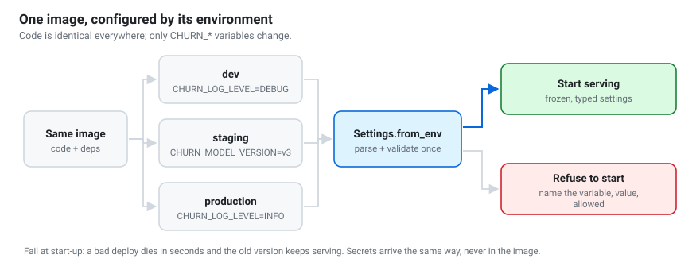

# Chapter 13 · Packaging & configuration

*Part I · Prerequisites: Chapters 2, 10 and 12 · Estimated time: reading ~40 min, lab ~45 min · Compute: CPU*

[](https://colab.research.google.com/github/berdakh/MLBOOTCAMP/blob/main/part1-foundations/ch13-packaging-and-configuration/notebook.ipynb) · [Lab: notebook.ipynb](notebook.ipynb) · [Solutions](solutions.md)

## Learning objectives

After this chapter you should be able to:

1. Read a `pyproject.toml` and explain what each of its blocks does, including the `src` layout.
2. Distinguish dependency *ranges* from a *lock file*, and say which a library and a deployed service each need.
3. Configure a service from environment variables, and make an invalid value stop the service at start-up with a message that names the variable.
4. Write a Dockerfile and explain every line, including the order of layers and what the file deliberately leaves out.
5. Explain what uvicorn's `--workers` option changes, and what it breaks for in-process state.
6. Choose between baking a model into the container image and loading it from a registry at start-up.
7. Describe what a continuous-integration workflow for an ML service should check.

## 13.1 Introduction

In Chapters 10–12 the churn service ran inside a notebook. The notebook put
the source directory on Python's import path, created the application with
settings written in a cell, and started a server in a background thread.
None of this is how a service runs in production. There, the service is a
process that someone else starts, often on a machine its author never logs
into, configured only through its environment, and replaced automatically
when a new version is released.

To run in that way, the project needs four things that a notebook does not:

1. **an installable package**, so that the code and its dependencies can be
   installed on any machine with one command;
2. **a record of exact versions**, so that the installed environment is the
   one that was tested;
3. **configuration from the environment**, so that the same code runs
   unchanged in development, staging and production;
4. **a container image and an automated check**, so that the whole runtime
   environment is built in a repeatable way and verified on every change.

This chapter treats each in turn (Sections 13.2–13.6). Section 13.7 then
discusses where the model itself should live, and Section 13.8 summarises
what a continuous-integration workflow checks. Colab cannot run Docker, so
the lab writes and explains the Dockerfile and the CI workflow but does not
build an image. It does start the service as a separate process, configured
only by environment variables, exactly as a container would.

## 13.2 `pyproject.toml`: an installable package

A **package** is a directory of Python modules that can be installed with
`pip`. The file `pyproject.toml` at the repository root declares how to build
it, what it is called, and what it depends on. The course's file has four
blocks:

| Block | What it states | Why it matters |
|---|---|---|
| `[build-system]` | *How* to build the package (here, setuptools ≥ 68) | `pip install .` reads this first; without it, pip has to guess |
| `[project]` | Name, version, supported Python versions, and **`dependencies`** | The package's statement of what it needs, for example "numpy ≥ 1.26, pandas ≥ 2.1" |
| `[project.optional-dependencies]` | Extras such as `dev`, installed with `pip install -e ".[dev]"` | Test and lint tools stay out of the production installation |
| `[tool.setuptools.packages.find] where = ["src"]` | The **src layout**: packages live under `src/` | The package can be imported only once it is installed, so tests cannot pass by accidentally importing the working directory |

During development, the usual command is `pip install -e .`. The `-e`
(*editable*) flag installs the dependencies and links the package to the
working copy, so that edits under `src/` take effect without reinstalling. A
container image uses a normal `pip install .`, because the code inside an
image never changes after it is built.

The notebooks of this course do not install the package. They put `src/` on
`sys.path` instead, which is quick but affects only the current Python
process. The consequence appears in Section 13.6: a server started as a
*separate* process does not see that path and must be given it explicitly
through `PYTHONPATH`, or the package must be installed.

## 13.3 Dependency ranges and lock files

There are two different questions one can ask about dependencies, and they
need two different files.

- **With which versions is this code compatible?** The answer is a set of
  **ranges**, such as `pandas>=2.1`, declared in `pyproject.toml` and
  `requirements.txt`. Ranges allow the package to be installed alongside
  other software, which may need slightly different versions.
- **With which exact versions was this environment built and tested?** The
  answer is a **lock file** (`requirements-lock.txt`), which records one
  exact version for each package, for example `pandas==2.2.2` in the course's lock.

Libraries publish ranges. Deployable services and reproducible results need a
lock, because a range admits versions that did not exist when the code was
tested. Chapter 2 made the same point about experiments: a result belongs to
the environment in which it was measured. A PR-AUC or a latency figure should
be reported together with the environment that produced it.

The course's lock file has two limitations that should be stated openly.
First, it pins only the top-level packages. A complete lock, produced by
tools such as `pip-compile`, `uv pip compile` or `poetry lock`, also pins every
*transitive* dependency (the dependencies of dependencies) and records a
cryptographic hash of each downloaded file. Second, it includes notebook
tools such as `matplotlib` and `pytest`, which a lean production image would
omit. Finally, a lock is not permanent: it also freezes out security fixes,
so it must be refreshed deliberately, with the tests re-run each time.

## 13.4 Configuration from the environment

A widely used set of guidelines for deployable services, the *Twelve-Factor
App*, states that anything that differs between deployments should be read
from **environment variables**: file paths, a pinned model version, limits,
the log level, and credentials. The code and the container image are then
identical in development, staging and production; only the environment
changes.



*Figure 13.1 — One image, three environments. Each environment sets a few `CHURN_*` variables; the settings are validated once at start-up, and the service either starts with typed, frozen settings or does not start at all.*

The churn service reads its configuration once, at start-up, into a frozen
(immutable) dataclass, `churnlab.settings.Settings`:

| Variable | Setting | Default |
|---|---|---|
| `CHURN_REGISTRY_DIR` | Path of the model registry | `artifacts/registry` |
| `CHURN_MODEL_VERSION` | A pinned model version; empty means "follow `CURRENT`" | none |
| `CHURN_MAX_BATCH_SIZE` | Largest accepted batch | 1000 |
| `CHURN_LOG_LEVEL` | One of `DEBUG`, `INFO`, `WARNING`, `ERROR` | `INFO` |
| `CHURN_THRESHOLD_OVERRIDE` | A decision threshold in $(0, 1)$ that replaces the bundle's | none |

Three design rules are visible in this class:

1. **Read once.** The settings are read when the application is created, not
   on every request. The behaviour of a running process therefore cannot
   change because someone altered a variable after start-up.
2. **Convert types explicitly.** Environment variables are always strings.
   The class converts each to its proper type (a `Path`, an `int`, a `float`)
   and normalises the log level to upper case.
3. **Fail fast.** An invalid value raises an error at start-up. The entry
   point `serve.py` catches it, prints a one-line message and exits with code 2.

The reason for failing fast is an asymmetry of costs. A service that starts
with a wrong threshold serves wrong decisions quietly, perhaps for weeks. A
service that refuses to start fails its deployment within seconds, and the
platform keeps the previous version running. In the lab, setting
`CHURN_THRESHOLD_OVERRIDE=1.5` (perhaps intended as 15%) stops the process
with `configuration error: CHURN_THRESHOLD_OVERRIDE must be in (0, 1), got 1.5`
before it ever listens on its port.

A good configuration error names three things: the **variable**, the **bad
value** and the **allowed values**. The lab shows that one of the course's
own errors falls short of this: a non-numeric batch size produces Python's
generic `invalid literal for int() with base 10: 'lots'`, which does not say
which of the variables was wrong. Exercise 2 asks for a validator that does
better.

**Secrets**, such as database passwords and API tokens, reach the service in
the same way: the platform's secret store injects them as environment
variables or mounted files at run time. They must never appear in the code,
the repository, the container image, a notebook or a log. The repository's
`.gitignore` excludes `.env` files and key files, and the `.dockerignore`
(Section 13.5) does the same for the image.

For a researcher, this is the familiar habit of keeping all experiment
settings in one configuration object, built once and recorded. The only
difference is the source: a configuration file that the author edits becomes
a set of environment variables that someone else sets.

## 13.5 The container image

A **container image** is a packaged file system together with a start
command. A **container** is a running instance of an image, isolated from
other processes on the host. The image is built from a **Dockerfile**, a
list of instructions executed in order. The course's Dockerfile is in
`deploy/Dockerfile`, and the lab generates it line by line:

| Instruction | What it does | Why |
|---|---|---|
| `FROM python:3.12-slim` | Starts from a minimal Debian image with Python 3.12 | A pinned tag, never `latest`, which changes without notice; a digest (`@sha256:…`) pins it completely |
| `ENV PYTHONDONTWRITEBYTECODE=1 PYTHONUNBUFFERED=1` | No `.pyc` files; unbuffered standard output | Log lines reach the platform immediately instead of waiting in a buffer that is lost if the process dies |
| `WORKDIR /app` | Sets the working directory | Relative paths are predictable |
| `COPY requirements-lock.txt .` and `RUN pip install --no-cache-dir -r …` | Installs the exact, tested versions | A separate, cacheable layer; `--no-cache-dir` keeps pip's download cache (often over 100 MB) out of the image |
| `COPY pyproject.toml README.md ./`, `COPY src/ src/`, `RUN pip install --no-deps .` | Installs the `churnlab` package itself | Code changes often, so it comes after the dependency layer |
| `COPY deploy/serve.py .` | Adds the entry point | It builds the app from environment variables |
| `RUN useradd … app` and `USER app` | Runs the service as an unprivileged user | If the service is compromised, the attacker is not root inside the container |
| `ENV CHURN_REGISTRY_DIR=… CHURN_LOG_LEVEL=…` | Documents default configuration | Overridden per deployment; never put secrets here, because `ENV` values are visible to anyone with the image |
| `EXPOSE 8000` | Documents the port | Documentation only; the port is published with `docker run -p 8000:8000` |
| `HEALTHCHECK … /health` | Docker marks the container unhealthy if `/health` stops answering | It probes liveness, not readiness (Chapter 14); it uses Python's standard library because the slim image has no `curl` |
| `CMD ["uvicorn", "serve:app", …, "--workers", "2"]` | Starts the server | The exec form (a JSON list) makes uvicorn process 1, so it receives the platform's stop signal directly |

### Layer order and build time

Each instruction produces a **layer**, and Docker reuses a cached layer when
neither the instruction nor its inputs have changed. Once one layer changes,
every later layer is rebuilt. If the layers are numbered $1, \dots, L$ with
build times $t_1, \dots, t_L$, and $\ell^{*}$ is the first layer whose inputs
changed, the build time is

```math
T_{\text{build}} = \sum_{\ell = \ell^{*}}^{L} t_{\ell}. \qquad (13.1)
```

Installing dependencies is slow (large $t_\ell$) and its input, the lock
file, rarely changes. Copying the source code is fast, and its input changes
on almost every commit. Placing the dependency layer *before* the code layer
therefore makes $\ell^{*}$ fall after the slow layer in the common case, and
an ordinary code change rebuilds in seconds rather than minutes. Reversing
the order would reinstall every dependency on every commit.

### The build context and `.dockerignore`

Everything in the **build context** (the directory passed to `docker build`)
is sent to the Docker daemon, and a careless `COPY` can put any of it into the
image. The `.dockerignore` file excludes what must never be shipped:
secrets (`.env`, key files), data, artifacts, caches, and the `.git` directory.
Docker reads this file from the root of the build context.

### What `--workers` means

Uvicorn's `--workers N` option starts $N$ separate processes. Each imports
`serve.py` and loads its own copy of the model. Two consequences follow.
First, memory grows with the number of workers. Approximately,

```math
M_{\text{total}} \approx N \left( M_{\text{runtime}} + M_{\text{model}} \right), \qquad (13.2)
```

where $M_{\text{runtime}}$ is the memory of one Python process with its
libraries imported and $M_{\text{model}}$ the memory of one loaded model. In
exchange, CPU-bound prediction gains real parallelism, because each process
has its own global interpreter lock (Chapter 14).

Second, any state held inside one process is now per worker. The `/metrics`
endpoint reports only what the worker that answered has seen, and
`POST /admin/reload` reloads only the worker that received the request.
After a rollback, some workers could therefore still serve the old model. The
remedies are to restart all workers, to run one worker per container and add
containers instead (the usual pattern on Kubernetes), or to export metrics to
an external system that aggregates across processes. On a single virtual
machine, roughly one worker per CPU core is a common starting point.

## 13.6 Starting the service as a container would

The final test of the configuration design is to start the service as a
separate process that sees nothing from the notebook except its environment.
The lab does this with `uvicorn serve:app`, passing three variables: the
absolute path of the registry, a port, and `PYTHONPATH` (because `churnlab`
is not installed). The child's standard output and error go to files, so
that a full output pipe can never block it.

The service becomes ready after a few seconds. Most of that time is spent
importing pandas and scikit-learn and loading the model; this delay is the
service's **cold start**, and it matters later when deciding how long a
readiness probe should wait. The service's standard output is its log: one
JSON object per line, beginning with a `model_loaded` event and followed by
one `request` event per call. When the lab stops the process with SIGTERM,
the exit code is $-15$ on Linux and macOS.

The repository's `deploy/` folder is meant to contain exactly the files the
lab generates. The lab's last step compares the two, which is a check that CI
could also run, so that nobody edits one copy and forgets the other.

## 13.7 Where should the model live?

There are two common ways to get the model into a running container.

| | Bake the model into the image | Load it from a registry at start-up |
|---|---|---|
| What is deployed | One immutable image containing code and model | A code image plus a pointer (`CURRENT`) |
| Rollback | Redeploy the previous image (minutes) | Rewrite the pointer and reload (seconds) |
| Reproducibility | The image digest identifies everything | Requires the registry to keep old bundles immutable |
| Start-up dependency | None | The registry must be reachable, or the instance is not ready |
| Image size and build time | Grow with the model; one build per model | Small; build only when code changes |
| Suitable when | Models are small, retraining is rare, audit is strict | Retraining is frequent, there are many models, rollback must be fast |

The course's Dockerfile loads from a registry mounted at run time; the
alternative is present as a commented-out `COPY` line. Neither is correct in
general. The decision depends on how often the model changes, how fast a
rollback must be, and what happens when the registry is unreachable. Exercise 3
asks you to make and justify this choice for the churn project.

## 13.8 Continuous integration

**Continuous integration (CI)** runs a fixed set of checks automatically, on
a clean machine, for every push and pull request. Its purpose is to replace
"it works on my laptop" with a reproducible verdict. The example workflow
(`deploy/ci-example.yml`) has three jobs:

1. **test** — lint the code and run the unit and API tests, on two Python
   versions;
2. **smoke** — install the package, start the real service, and probe
   `/ready` and `/health`;
3. **image** (optional) — build the container image, so that a broken
   Dockerfile fails the pull request rather than the release.

What belongs in CI and what belongs in a staging environment was discussed
in Chapter 12. Chapter 14 adds the probes and logs that the smoke job relies
on.

## Key terms

| Term | Definition |
|---|---|
| Package | A directory of Python modules that can be installed with `pip`, described by `pyproject.toml`. |
| src layout | Placing packages under `src/`, so that they are importable only after installation. |
| Editable install | `pip install -e .`; installs a package as a link to the working copy, so code edits take effect immediately. |
| Dependency range | The set of versions a package declares itself compatible with, such as `pandas>=2.1`. |
| Lock file | A record of the exact versions with which one environment was built and tested. |
| Transitive dependency | A dependency of a dependency. |
| Environment variable | A named string that the operating system passes to a process at start-up. |
| Twelve-factor configuration | The practice of reading everything that differs between deployments from the environment. |
| Fail fast | Refusing to start on invalid configuration rather than running with wrong settings. |
| Secret | A credential injected at run time and never stored in code, images or logs. |
| Container image | A packaged file system and start command, built from a Dockerfile. |
| Layer cache | Docker's reuse of unchanged build steps; every layer after the first changed one is rebuilt (Equation 13.1). |
| Build context | The directory sent to Docker when building an image; filtered by `.dockerignore`. |
| Worker | One server process; each worker holds its own copy of the model and its own in-process state. |
| Cold start | The time from process start until the service is ready to answer. |
| Continuous integration (CI) | Automated checks that run on every push or pull request on a clean machine. |

## Summary

1. `pyproject.toml` makes the project an installable package; the src layout ensures that tests run against the installed package, not the working directory.
2. Ranges state compatibility; a lock file states the exact tested versions. Libraries publish ranges; services and reproducible results need a lock, refreshed deliberately.
3. Everything that differs between deployments, including secrets, comes from the environment, so one image runs everywhere.
4. Configuration is read once, converted to typed values and validated at start-up. An invalid value stops the process with a message naming the variable, the value and the allowed values.
5. A Dockerfile should pin its base image, install from the lock in a layer placed before the code (Equation 13.1), run as a non-root user, keep secrets out, and start the server in exec form.
6. Multiple workers multiply memory (Equation 13.2) and make in-process state such as metrics and the loaded model per worker.
7. Baking the model into the image favours reproducibility and independence; loading from a registry favours fast rollback and frequent retraining.
8. CI runs tests, a smoke test of the real service and, where possible, an image build on every change.

## Exercises

The exercises are in the lab, [notebook.ipynb](notebook.ipynb); worked answers are in [solutions.md](solutions.md).

- **Exercise 1 (graded).** Write `dockerfile_problems(text)`, which parses a Dockerfile (ignoring comments and joining continuation lines) and reports any of five problems: an unpinned base image, a root user, a copied `.env` file, a missing health check, and `pip install` without `--no-cache-dir`.
- **Exercise 2 (graded).** Write `settings_from_env(env)`, which reads a port, a worker count and a log level from a dictionary of environment variables, applies defaults for missing or empty values, and raises a `ValueError` naming the variable for any invalid value.
- **Exercise 3 (written).** For the churn project, decide whether to bake the model into the image or load it from the registry, and justify the choice in four to six sentences covering rollback time, audit, an unreachable registry, and how you would cover the weakness of your choice.
- **Checkpoint.** Six questions to answer aloud: ranges versus the lock file; why configuration comes from the environment and fails at start-up; the Dockerfile's layer order and `USER` line; the effect of `--workers 4`; one argument for each model-placement option; and where secrets come from and where they must never appear.

## Further reading

- Python Packaging User Guide, "Writing your `pyproject.toml`": <https://packaging.python.org/>
- A. Wiggins. *The Twelve-Factor App*: <https://12factor.net/>, especially factor III, "Config".
- Docker documentation, "Dockerfile reference" and "Building best practices": <https://docs.docker.com/>
- Uvicorn documentation, on deployment and workers: <https://www.uvicorn.org/>
- C. Huyen (2022). *Designing Machine Learning Systems*. O'Reilly. Chapter 10 discusses infrastructure and tooling for ML, including containers.

**Next:** [Chapter 14 · Health, logs & latency](../ch14-health-logs-and-latency/README.md)
