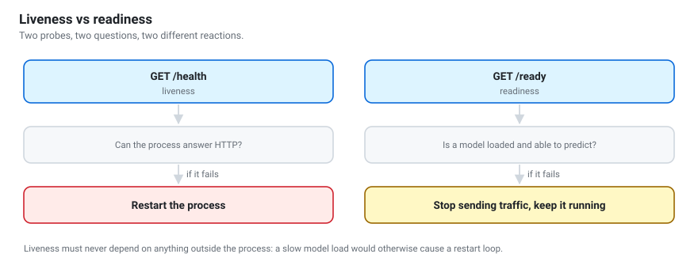
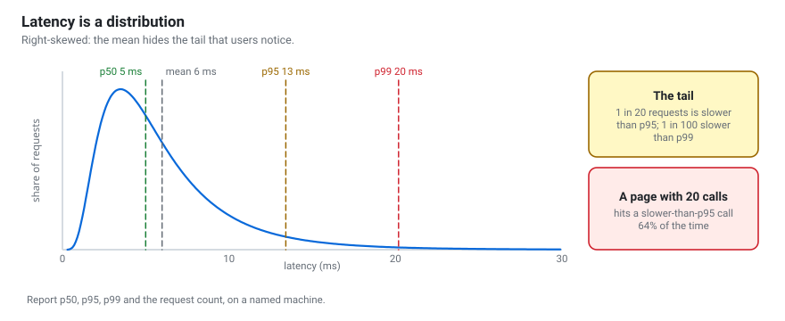

# Chapter 14 · Health, logs & latency

*Part I · Prerequisites: Chapters 10, 12 and 13 · Estimated time: reading ~45 min, lab ~55 min · Compute: CPU*

 · [Lab: notebook.ipynb](notebook.ipynb) · [Solutions](solutions.md)

## Learning objectives

After this chapter you should be able to:

1. Explain the difference between liveness and readiness probes, and why liveness must not depend on the model.
2. Design a structured request log, follow one request through it by its identifier, and state what must never be logged.
3. Define a service level objective (SLO), its error budget and its burn rate, and propose an alert on them.
4. Report latency as a distribution (p50, p95, p99) with the sample size and the machine, and compute a percentile by the nearest-rank rule.
5. Explain cold start, warm-up and the difference between server-side and client-side latency.
6. Model the per-row cost of batching and use it to decide when to batch.
7. Apply Little's law and the single-process throughput ceiling to explain why concurrency produces queueing in a CPU-bound Python service, and what `--workers` changes.

## 14.1 Introduction

Chapter 13 made the churn service deployable: installable, configured from
the environment, and described by a container image. Once it runs, the
people and machines around it need answers to three questions. **Is it
alive?** The platform must know when to restart a process. **What did it
just do?** An engineer investigating a complaint must be able to find the
relevant request. **How fast is it?** Callers must know what latency to
expect, and the team must know when the service is too slow.

Each question has a characteristic wrong answer. A health check that is too
ambitious makes the platform restart a healthy process in a loop. Logs that
are unstructured, or that lack request identifiers, turn a fifteen-minute
investigation into a day's work. And a latency reported as a mean describes a
request that users rarely experience, because the slow requests they
remember are in the tail of the distribution.

Section 14.2 treats health probes, Section 14.3 structured logs, and Section
14.4 service level objectives. Sections 14.5–14.7 treat latency: as a
distribution, under batching, and under concurrent load.

## 14.2 Liveness versus readiness

Orchestrators (Kubernetes, managed cloud run-times, load balancers) ask a
service two different questions, usually on two endpoints:

| Probe | Question | What it should check | If it fails, the platform… |
|---|---|---|---|
| **Liveness** (`/health`) | Is the process alive? | Almost nothing: that the process can answer HTTP | **Restarts** the process |
| **Readiness** (`/ready`) | Should this process receive traffic? | That a model is loaded and can predict | **Stops routing** traffic to it, and leaves it running |

*Figure 14.1 — The two probes. Their failures lead to opposite actions, so they must ask different questions: a restart cannot fix a missing model file.*

The classic mistake is to check the model in the liveness probe. Consider a
model that takes 40 seconds to load, and a liveness probe that gives up after
10 seconds. The platform declares the process dead at second 10, kills it,
starts a new one, kills that one too, and so on: a restart loop caused by the
health check itself. Worse, if the model registry becomes unreachable, every
replica fails liveness and is restarted at the same moment.

With the probes separated, the process stays alive while it loads, receives
no traffic until it is ready, and keeps serving the old model if a later
reload fails (`ModelHolder.load` replaces the model only on success). The
general rule is that **liveness must never depend on anything outside the
process**: not on model files, databases or other services. In the lab, an
application with an empty registry answers `/health` with 200 and `/ready`
and `/predict` with 503 and the reason, which is exactly the intended
behaviour.

The churn service's readiness check is simple: it reports whether a model is
loaded. A process can be loaded and still unable to predict, for example if
the model call deadlocks. A stronger readiness check would exercise the
model on a fixed example row and verify that a probability comes back.

## 14.3 Structured logs

A **structured log** writes one machine-readable record per event,
usually one JSON object per line. Log platforms can then filter and aggregate
on fields (`model_version`, `latency_ms`, `status`) without regular
expressions. The churn service writes one line per request from its
middleware, and separate events such as `model_loaded` and `model_reload`.
In production these lines go to standard output, where the container
platform collects them; in the lab, a list handler keeps them in memory.

Each request record should contain at least:

| Field | Purpose |
|---|---|
| Timestamp | When it happened |
| Request identifier | Links the record to the caller's report and to all retries of the same call |
| Method and path | Which endpoint |
| Status | Outcome (2xx, 4xx, 5xx) |
| Latency in milliseconds | How long the server spent |
| Model version (and service version) | Which model produced the answer |

The request identifier is what makes a log useful during an investigation.
When a colleague reports that "the request made at 10:42 was slow", the
identifier returned in the `x-request-id` header connects that report to one
line among millions. The lab sends a request with the identifier
`trace-me-123` and finds the same identifier in the response header and the
log record.

**What must never be logged.** Logs are copied widely (to log platforms,
support tickets and laptops) and kept for a long time. They should contain
**identifiers and aggregates**: request identifier, path, status, latency,
model version. They should not contain raw feature values, names, e-mail
addresses, IP addresses beyond what security requires, credentials, or
anything that a data-protection officer would consider personal data. If the
inputs are needed, for drift monitoring or debugging, they belong in a
separate store with access control and a retention limit. The churn service
keeps a window of recent inputs in memory for the drift checks of
Chapter 15; those inputs never reach the log. The lab includes a check,
suitable for a test, that no log record contains a sensitive key.

Logs and metrics serve different purposes. A **metric** is a number
aggregated over many requests (a count, a rate, a percentile), cheap to store
and suitable for dashboards and alerts. A **log** is a record of one event,
needed to explain a particular case. The churn service exposes its metrics at
`/metrics`; a production service would export them to a metrics system such
as Prometheus.

## 14.4 Service level objectives and error budgets

A **service level indicator (SLI)** is a measured quantity that describes
the service as its users experience it, such as the fraction of requests
that succeed or the fraction that complete within 200 ms. A **service level
objective (SLO)** is a target for an SLI over a time window, for example:

> 99.5% of `POST /predict` requests return a non-5xx response, and 95% of
> them complete in under 200 ms, measured at the load balancer over a rolling
> 28-day window.

A complete SLO names the metric, where it is measured (at the server or
closer to the client), the target, the window, and what counts as a "bad"
request. For a prediction service, a 4xx response is usually counted as
good: the service behaved correctly by rejecting an invalid request. The
appropriate numbers depend entirely on who calls the service and what they
need. The values in `DEFAULT_RULES` in `churnlab/monitoring.py` are teaching
values, not recommendations.

The complement of the target is the **error budget**: the amount of
unreliability the service may spend in the window. Over a window with $N$
requests and a success target $s$,

$$
B = (1 - s)\, N \qquad (14.1)
$$

failures are allowed. A 99.5% target over 10 million requests allows
$0.005 \times 10^7 = 50{,}000$ failures. The budget is a planning tool: while
it lasts, the team may take risks such as releasing new models; when it is
spent, releases slow down and reliability work takes priority.

Alerts are often defined on the **burn rate**, the speed at which the budget
is being consumed:

$$
\text{burn rate} = \frac{\text{observed error rate}}{1 - s}. \qquad (14.2)
$$

A burn rate of 1 spends exactly the budget over the window; a burn rate of
14.4 sustained for one hour spends 2% of a 30-day budget. A common pattern
pages a person when the burn rate is high over both a short and a longer
window (so that a brief spike does not page anyone), and opens a ticket when
a slower burn persists. Exercise 3 asks for an SLO and an alert of this kind
for the churn service.

## 14.5 Latency is a distribution

**Latency** is the time from sending a request to receiving its response.
Latencies of real services are right-skewed: most requests are fast, and a
few are much slower because of garbage collection, other processes, the
operating-system scheduler, or a slow dependency. A mean is pulled towards
the tail and describes almost no actual request. Latency is therefore
reported with **percentiles**.

*Figure 14.2 — A right-skewed latency distribution. The mean lies to the right of the median and far to the left of p95; neither average describes the slow requests users remember.*

For $N$ latencies sorted in increasing order, $x_{(1)} \le x_{(2)} \le \dots \le
x_{(N)}$, the $q$-th percentile by the **nearest-rank** rule is

$$
p_q = x_{(k)}, \qquad k = \left\lceil \frac{q\, N}{100} \right\rceil, \quad 0 < q \le 100. \qquad (14.3)
$$

The nearest-rank percentile is always a latency that actually occurred. For
the five latencies 15, 20, 35, 40 and 50 ms, $p_{50} = x_{(3)} = 35$ ms and
$p_{95} = x_{(5)} = 50$ ms. NumPy's default `np.percentile` instead
interpolates linearly between neighbouring values, so the two definitions
differ slightly on small samples; the lab's revision cell shows a $p_{95}$ of
14.0 ms by nearest rank and 14.85 ms by interpolation on the same twenty
values.

The usual summary is **p50** (the typical request), **p95** and **p99** (the
**tail**), together with the number of requests. The count matters: a p99
computed from 200 requests rests on the two slowest observations and moves
considerably from run to run. Tail percentiles need many observations.

Why does the tail matter so much? A page that makes $k$ independent calls is
slow whenever *any* of them is slow. If each call exceeds its $p_q$ with
probability $1 - q/100$, then

$$
P(\text{at least one of } k \text{ calls is slower than } p_q) = 1 - \left(\frac{q}{100}\right)^{k}. \qquad (14.4)
$$

For $q = 95$ and $k = 20$, this is $1 - 0.95^{20} \approx 0.64$. The
per-call p95 is exceeded on almost two thirds of page loads.

### Measuring honestly

Four practices make latency numbers meaningful.

1. **Name the machine.** Every latency belongs to the hardware and load on
   which it was measured. A Colab CPU is not a production server. The lab
   records the machine in a JSON file next to its latency tables.
2. **Separate cold start and warm-up.** Before its first request, a new
   process must start Python, import pandas, scikit-learn and FastAPI, and
   load the model. This **cold start** takes one to a few seconds in the lab,
   almost all of it imports. The first request after start-up is also slower
   than later ones (two to five times in the course's runs) because of
   one-time costs inside the libraries. Deployments therefore send a few
   **warm-up** requests before reporting ready, autoscaling cannot react
   faster than the cold start, and measurements discard the warm-up.
3. **Say where the clock runs.** The service's own middleware starts timing
   after the request has arrived and stops before the response is sent. It
   does not see connection handling, queueing before the application, network
   transfer or client-side parsing. Server-side percentiles are therefore
   lower than client-side ones, and users experience the client-side number.
   An SLO must state which it uses.
4. **Separate model time from overhead** before optimising the model. For a
   small tabular model, HTTP handling, validation and building a one-row
   `DataFrame` often cost more than `predict_proba` itself.

On the course's verification machine (a shared 4-vCPU Intel Xeon), a single
client calling the service over local HTTP saw a p95 of roughly 20–25 ms. These
numbers describe that machine under that load and nothing else.

## 14.6 Batching

Each request pays a fixed cost (HTTP handling, JSON parsing, validation,
constructing a `DataFrame`, one call into scikit-learn) and a cost per row. A
simple model of the time for a request with $n$ rows is

$$
t(n) \approx t_{\text{fixed}} + n\, t_{\text{row}}, \qquad \frac{t(n)}{n} \approx \frac{t_{\text{fixed}}}{n} + t_{\text{row}}, \qquad (14.5)
$$

where $t_{\text{fixed}}$ is the per-request overhead and $t_{\text{row}}$ the
marginal cost of one row. When $t_{\text{fixed}} \gg t_{\text{row}}$, as for a
small tabular model behind an HTTP API, the per-row cost falls almost in
proportion to $1/n$ until the batch is large enough for $t_{\text{row}}$ to
dominate. On the course's verification machine, the per-row cost fell from
about 13 ms at batch size 1 to about 0.05 ms at batch size 1,000.

Batching buys throughput at the price of latency. Every row in a batch
receives its answer only when the whole batch is finished, so batching suits
an offline job (score 5,000 customers overnight in five requests) but not a
person waiting for one score on a page. The batch limit of Chapter 10 bounds
the latency and memory of a single batch, and the client of Chapter 12
splits large jobs below it.

## 14.7 Concurrency, the GIL and workers

What happens when several clients call the service at once? Little's law,
which holds for any stable queueing system, relates the average number of
requests in the system $L$, the throughput $\lambda$ (requests completed per
second) and the average time a request spends in the system $W$:

$$
L = \lambda\, W. \qquad (14.6)
$$

If a single server process completes at most $\lambda_{\max}$ requests per
second and 16 clients keep a request outstanding at all times ($L = 16$),
then $W = 16/\lambda_{\max}$. With $\lambda_{\max} = 200$ requests per second,
each request spends 80 ms in the system, even if its own computation takes
only 5 ms. The remaining 75 ms is waiting in a queue.

What sets $\lambda_{\max}$? The `/predict` handler is an ordinary Python
function, so FastAPI runs it in a **thread pool** (40 threads by default) to
keep its event loop free. Threads allow requests to *wait* concurrently, for
example on a network call. But the work here is CPU-bound Python
(validation, a one-row `DataFrame`, `predict_proba`), and in CPython only one
thread at a time executes Python bytecode, because of the **global
interpreter lock (GIL)**. One process therefore has a throughput ceiling of
roughly

$$
\lambda_{\max} \approx \frac{1}{t_{\text{CPU}}}, \qquad (14.7)
$$

where $t_{\text{CPU}}$ is the CPU time per request, whatever the number of
threads. With 5 ms of CPU-bound Python per request, the ceiling is about 200
requests per second per process. The lab confirms the consequence: as the
number of concurrent clients grows from 1 to 16, throughput does not grow
(it even falls somewhat, because the client threads compete with the server
for the same CPUs), while p50 and p95 grow roughly in proportion to the number
of clients. Requests are not processed faster when more arrive at once; they
queue.

Running uvicorn with `--workers N` starts $N$ processes, each with its own
interpreter, GIL and copy of the model, so CPU-bound throughput can scale with
$N$ up to the number of free cores (and memory scales with $N$, Chapter 13).
In-process state becomes per worker. The lab does not benchmark multiple
workers, for a reason worth remembering: on the course's verification machine,
uvicorn's multi-process mode added about 40 ms to every request on a
kept-alive connection, so it was *slower* for a single client. A
configuration that should help can hurt; it must be measured on the target
machine.

Readers who use PyTorch will recognise the pattern: `DataLoader(num_workers=…)`
uses processes, not threads, for the same GIL reason, and inference
throughput comes mainly from batching.

### Levers for latency

When a CPU-bound service is too slow at peak load, the common levers,
roughly in order of effort, are:

1. add replicas or workers (costs money and memory; state becomes per process);
2. batch where the caller allows it (lower per-row cost, higher latency per batch);
3. make the request path cheaper: avoid building a `DataFrame` for one row,
   load the model once, simplify features (engineering time, and a risk of
   training/serving skew, Chapter 11);
4. use a smaller model, cache frequent inputs, or compile or export the model.

Autoscaling on CPU or p95 helps with gradual growth, but cannot react faster
than the cold start.

## Key terms

| Term | Definition |
|---|---|
| Liveness probe | A check of whether the process is alive; failure causes a restart. |
| Readiness probe | A check of whether the process should receive traffic; failure stops routing without a restart. |
| Restart loop | Repeated restarts caused by a liveness probe that fails for reasons a restart cannot fix. |
| Structured log | One machine-readable record (here JSON) per event, with named fields. |
| Request identifier | An identifier that ties all log records and retries of one logical request together. |
| Metric | A number aggregated over many events, such as a request count or a latency percentile. |
| Service level indicator (SLI) | A measured quantity describing the service as users experience it. |
| Service level objective (SLO) | A target for an SLI over a time window. |
| Error budget | The number of failures allowed by an SLO in its window (Equation 14.1). |
| Burn rate | The observed error rate divided by the error rate the SLO allows (Equation 14.2). |
| Latency | The time from sending a request to receiving its response. |
| Percentile ($p_q$) | The latency below or at which $q\%$ of requests fall; nearest-rank definition in Equation (14.3). |
| Tail latency | The slow end of the latency distribution, p95 and above. |
| Cold start | The time from process start until the service can answer. |
| Warm-up | Requests sent after start-up to pay one-time costs before real traffic or measurement. |
| Throughput | Requests completed per second. |
| Little's law | $L = \lambda W$: requests in the system equal throughput times time in the system (Equation 14.6). |
| Global interpreter lock (GIL) | The CPython lock that lets only one thread execute Python bytecode at a time in a process. |

## Summary

1. Liveness asks "is the process alive?" and must depend on nothing outside the process; readiness asks "should it receive traffic?" and checks the model. Checking the model in liveness causes restart loops.
2. A structured request log records a request identifier, path, status, latency and model version as JSON. It contains identifiers and aggregates, never personal data or raw features.
3. An SLO names a metric, a measurement point, a target, a window and a definition of a bad request. Its complement is the error budget (Equation 14.1); alerts are commonly defined on the burn rate (Equation 14.2).
4. Latency is reported as percentiles with the sample count and the machine; the mean describes few real requests. Tail latency dominates pages that make many calls (Equation 14.4).
5. Cold start and the first request are slow; deployments warm up before reporting ready, and measurements discard warm-up.
6. Server-side latency is lower than client-side latency; users experience the client-side number.
7. Batching divides the fixed per-request cost among the rows (Equation 14.5); it raises throughput and the latency of each answer.
8. In a CPU-bound Python process, threads do not add throughput because of the GIL (Equation 14.7); extra concurrency becomes queueing (Equation 14.6). Workers add throughput, memory and per-process state, and any configuration change should be measured.

## Exercises

The exercises are in the lab, [notebook.ipynb](notebook.ipynb); worked answers are in [solutions.md](solutions.md).

- **Exercise 1 (graded).** Write `percentiles(latencies, qs)` using the nearest-rank definition of Equation (14.3), raising `ValueError` for an empty input and taking care with floating-point rounding in the rank.
- **Exercise 2 (graded).** Write `summarize_logs(records)`, which turns parsed request log records into a table with one row per path and the request count, the server-error rate (5xx only) and the nearest-rank p95 latency.
- **Exercise 3 (written).** Propose an SLO and an alert for the churn API: metric, measurement point, target, window, definition of a bad request, and when to page versus open a ticket, justified by the latency you measured and the machine you measured it on.
- **Checkpoint.** Six questions to answer aloud: liveness versus readiness; what to ask for instead of an average latency; the content of a log line; why server-side latency is lower; three responses to a doubled p95 at peak; and the effect of `--workers 4`.

## Further reading

- B. Beyer, C. Jones, J. Petoff and N. R. Murphy (eds.) (2016). *Site Reliability Engineering: How Google Runs Production Systems.* O'Reilly. Chapter 4 ("Service Level Objectives") and Chapter 6 ("Monitoring Distributed Systems").
- B. Beyer, N. R. Murphy, D. K. Rensin, K. Kawahara and S. Thorne (eds.) (2018). *The Site Reliability Workbook.* O'Reilly. Chapter 5 ("Alerting on SLOs") develops burn-rate alerts.
- J. Dean and L. A. Barroso (2013). "The Tail at Scale." *Communications of the ACM* 56(2), 74–80.
- J. D. C. Little (1961). "A Proof for the Queuing Formula: $L = \lambda W$." *Operations Research* 9(3), 383–387.
- Kubernetes documentation, "Configure Liveness, Readiness and Startup Probes": <https://kubernetes.io/docs/>

**Next:** [Chapter 15 · Monitoring & rollback](../ch15-monitoring-and-rollback/README.md)
