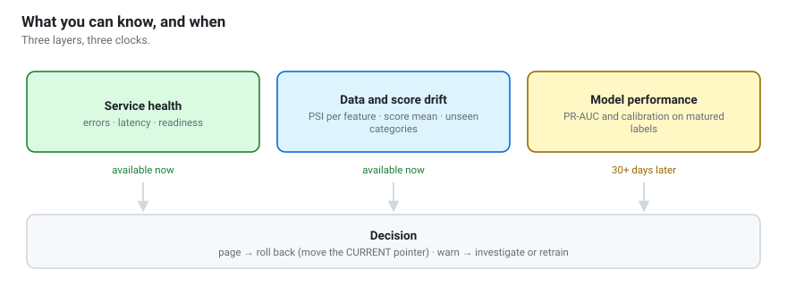
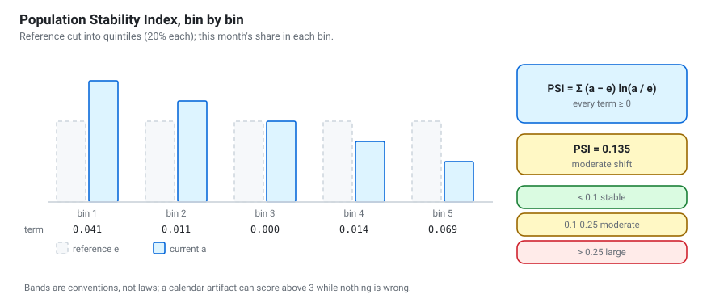
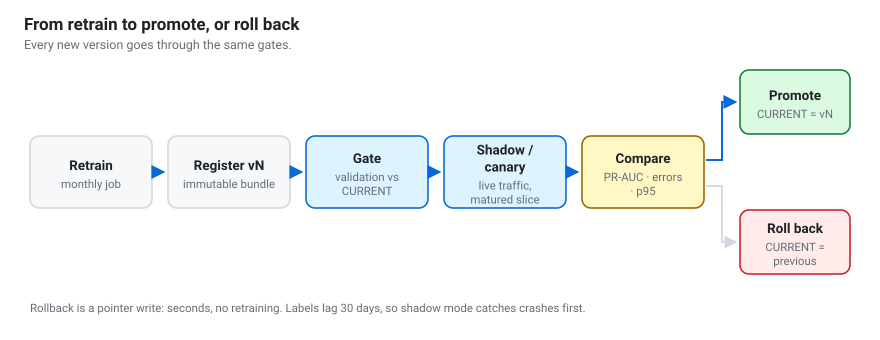
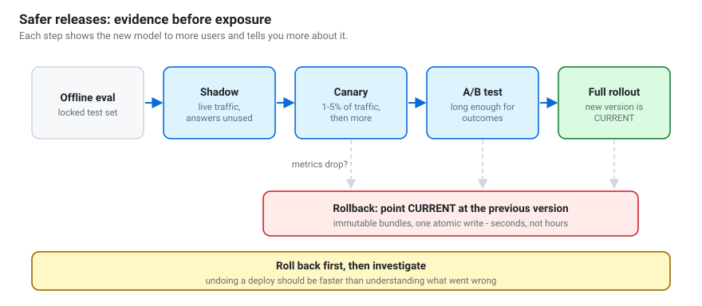

# Chapter 15 · Monitoring & rollback

*Part I · Prerequisites: Chapters 7, 8, 9, 11 and 14 · Estimated time: reading ~50 min, lab ~60 min · Compute: CPU*

 · [Lab: notebook.ipynb](notebook.ipynb) · [Solutions](solutions.md)

## Learning objectives

After this chapter you should be able to:

1. Name the three layers of model monitoring and state when each becomes available for a model with delayed labels.
2. Compute the Population Stability Index (PSI) for numeric and categorical features, and recognise when it is blind or misleading.
3. Distinguish data drift, prediction drift and concept drift, and explain why drift is a symptom rather than a verdict.
4. Evaluate a model on matured cohorts, using metrics that remain comparable when the positive rate changes.
5. Turn monitoring measurements into a small set of actionable alerts with severities.
6. Detect a bad deployment with a canary comparison, roll it back in one step, and show the audit trail.
7. Choose among shadow, canary, A/B and blue/green releases, and among retraining triggers.
8. Write a short runbook and a blameless postmortem.

## 15.1 Introduction

A model is not finished when it is deployed. From that moment it scores data
it has never seen, produced by a world that keeps changing, and its mistakes
become visible only when the outcomes arrive. For the TaskFlow churn model,
an outcome is known 30 days after each prediction, when the label window
closes. Until then, nobody can say whether a given prediction was right.

Monitoring is the practice of measuring a deployed system continuously so
that someone can act when it misbehaves. For a machine-learning service it
must answer three questions that become answerable at different times: does
the service work, have its inputs and outputs changed, and is the model
still right? The handbook phrase for this chapter's main idea is that one
learns *that* a model is wrong in production long before one learns *why*.
The cheap signals should therefore be built first, the expensive one
(measured accuracy) should be expected to arrive late, and undoing a
deployment should be faster than diagnosing it.

The lab simulates the next half-year of production data with a deliberate
shift, measures what each kind of monitoring can and cannot detect, deploys a
broken model on purpose, detects it with a canary check, and rolls it back.
Section 15.2 introduces the three layers of monitoring. Sections 15.3–15.5
treat drift: definitions, the Population Stability Index, and prediction
drift. Section 15.6 treats delayed labels and performance on matured
cohorts. Section 15.7 turns measurements into alerts. Sections 15.8–15.10
cover rollback, release strategies and retraining, and Section 15.11 the
written procedures that hold it all together.

## 15.2 Three layers, three clocks

*Figure 15.1 — The three layers of monitoring. Service health and drift are available immediately; performance arrives only after the 30-day label delay.*

| Layer | Examples | Available | What it says |
|---|---|---|---|
| **Service health** | Request rate, error rate, p50/p95/p99 latency, readiness | Within seconds | Whether the service works (Chapter 14) |
| **Data and prediction drift** | Missing-value rates, unseen categories, feature PSI, score distribution, share flagged | As soon as requests arrive | Whether the inputs or outputs changed: a symptom, not a verdict |
| **Model performance** | Precision, recall, PR-AUC, ROC-AUC and calibration against real outcomes | After the label delay (here 30 days) | Whether the model is still right |

The order matters. The signals that arrive first are cheap and can only say
"look here"; the signal that decides arrives last. A monitoring design that
waits for performance metrics reacts a month late. A design that acts on
drift alone retrains models that were working and misses failures that do
not change the inputs.

## 15.3 Kinds of drift

Let $X$ denote the model's inputs and $Y$ the outcome. The joint distribution
can be factorised as $P(X, Y) = P(X)\, P(Y \mid X)$. Different kinds of change
affect different factors:

- **Data drift**, also called **covariate shift**, is a change in $P(X)$: the
  distribution of a feature changes. In the lab, failed payments become 2.5
  times as frequent and engagement falls.
- **Prediction drift** is a change in the distribution of the model's scores
  $s(X)$. It is a one-dimensional summary of data drift, filtered through what
  the model actually uses.
- **Concept drift** is a change in $P(Y \mid X)$: the relationship between
  features and outcome changes. The same usage pattern now carries a
  different churn risk.
- **Label shift** (prior shift) is a change in $P(Y)$, the base rate of the
  outcome, often accompanying the others.

The distinction explains why drift is a symptom and not a verdict. Inputs
can shift without hurting accuracy, for instance when a feature the model
barely uses changes, or when the model already captures how the shifted
features relate to the outcome. Conversely, accuracy can fall with no
visible input shift, when $P(Y \mid X)$ changes. Only performance on real
outcomes can tell these cases apart. A drift alert should therefore open an
investigation, not trigger an automatic retrain.

Readers from EEG and BCI research know this situation as session-to-session
or subject-to-subject covariate shift: amplitude statistics move between
recordings, and one checks whether the decoder still works on the new
session. The same caution applies: a shift in the inputs is a reason to
*check* performance, not proof that it dropped.

## 15.4 The Population Stability Index

The **Population Stability Index (PSI)** summarises how far a current sample
of a feature has moved from a reference sample (usually the training or
validation data). The reference is cut into $B$ bins, here at its deciles, so
that each bin holds about a tenth of the reference. Let $e_b$ be the share of
the reference in bin $b$ (the *expected* share) and $a_b$ the share of the
current sample in the same bin (the *actual* share). Then

$$
\operatorname{PSI} = \sum_{b=1}^{B} (a_b - e_b)\, \ln\frac{a_b}{e_b}. \tag{15.1}
$$

Each term is non-negative, because $a_b - e_b$ and $\ln(a_b/e_b)$ always have
the same sign. Empty bins would make the logarithm infinite, so both shares
are clipped at a small minimum (the course uses $10^{-4}$). Expanding the
product shows that

$$
\operatorname{PSI} = \sum_b a_b \ln\frac{a_b}{e_b} + \sum_b e_b \ln\frac{e_b}{a_b} = D_{\mathrm{KL}}(a \,\Vert\, e) + D_{\mathrm{KL}}(e \,\Vert\, a),
$$

so PSI is the symmetrised Kullback–Leibler divergence (the Jeffreys
divergence) between the binned distributions.

**Worked example.** With five bins of equal reference share, $e_b = 0.2$, and
current shares $a = (0.30, 0.25, 0.20, 0.15, 0.10)$, the terms are
$0.041 + 0.011 + 0 + 0.014 + 0.069 = 0.135$. The outer bins, where the share
moved most in relative terms, contribute most.

*Figure 15.2 — PSI computed bin by bin for the worked example. Every term is non-negative, and the terms sum to 0.135.*

Common rule-of-thumb bands are: below 0.1 stable, 0.1 to 0.25 moderate,
above 0.25 large. These are **conventions**, not statistical thresholds. PSI
depends on the number of bins and on the sample size, and a small current
sample produces noisy values even with no shift at all.

For a categorical feature, the bins are the categories themselves, and the
same formula applies to category shares. Categorical monitoring should also
track the **unseen-category rate**: the share of requests carrying a value
absent from training. In the churn service's contract, unseen categories
reach the model by design (Chapter 10); monitoring is where they are counted.

### Where PSI fails

The lab provides two instructive failures, observed on simulated data in
which the generator was asked for a known shift, alongside a *control*
simulation of the same period with no shift.

1. **PSI can be blind.** The feature `failed_payments_90d` was multiplied by
   2.5, and the share of accounts with at least one failed payment rose from
   about 10% to about 24%. Yet its quantile-binned PSI is exactly 0. About 90%
   of the reference values are zero, so every decile edge except the maximum is
   zero, the bins collapse into one, and a single bin always gives PSI 0.
   Treated as categories (0, 1, 2, 3 or more), the same data gives a PSI of
   about 0.16: a moderate shift, and the only shift in the table that is real.
2. **PSI can raise an alarm about nothing.** The feature
   `weeks_since_last_active` has a PSI above 3 in production *and in the
   control world*, and a large one even on the validation period. It is
   computed as days since the last active week divided by 7, so its values sit
   on a few discrete points whose fractional part depends on the weekday of
   the snapshot date. Decile edges from 2023–24 snapshots do not line up with
   2025 ones. This is a calendar artifact, not drift.

Two further findings complete the picture. The tenure feature shows a large
PSI in production and control alike, because the simulated customer base is
older; this is real but not the injected shift. And the sessions features,
whose means fell by about a fifth, show a PSI of only about 0.09–0.10, which
the convention calls "stable".

The general lesson is that a monitoring number is only as good as its
assumptions. Quantile-binned PSI suits continuous features. Counts and
zero-inflated features need category shares or fixed bins. A control
comparison (here, a period with no injected shift) separates real changes
from artifacts. And the two distributions should always be inspected, not
only the number.

## 15.5 Prediction drift

The model's scores are available for every request, without labels. Two
simple summaries compare the current scores with those on a reference
period, here the validation period on which the threshold was chosen:

$$
r = \frac{\bar{s}_{\text{current}}}{\bar{s}_{\text{reference}}}, \qquad
\text{share flagged} = \frac{1}{n} \sum_{i=1}^{n} \mathbb{1}[s_i \ge t], \tag{15.2}
$$

where $\bar{s}$ is a mean score, $s_i$ the score of request $i$, $t$ the
decision threshold and $n$ the number of requests. A PSI on the scores
themselves adds a distributional view. In the lab, the mean-score ratio is
about 1.5, the share flagged rises from about 3% to about 8%, and the score
PSI is moderate (about 0.2) in production but near zero in the control world.
The model has noticed the riskier world: more customers look like churners to
it. This is a useful early warning, a month before any label arrives, but it
does not yet say whether the model is right.

Prediction drift is also the main label-free defence against a broken model.
A model that has learned nothing predicts nearly the base rate for everyone,
so the *spread* of its scores collapses even if their mean remains
plausible. Section 15.8 uses exactly this signal.

## 15.6 Delayed labels and performance on matured cohorts

A prediction made at snapshot $T$ can be judged only at $T + 30$ days, when its
label window closes. A **cohort** is the set of predictions made at one
snapshot; a cohort is **matured** when all its labels are known. Suppose the
current date is 15 June 2025 and snapshots are taken on the first of each
month from March to July. The March, April and May cohorts have matured; June
and July have not. The most recent, and most relevant, predictions are
exactly the ones that cannot yet be judged.

In many applications the delay is not a fixed window but a random time until
the outcome is reported (a chargeback, a complaint). If delays are
exponentially distributed with mean $\tau$, the fraction of eventual labels
visible $t$ days after a prediction is

$$
F(t) = 1 - e^{-t/\tau}. \tag{15.3}
$$

Performance computed on an immature cohort counts positives that have not
yet been observed as negatives, and therefore looks worse (or, for some
metrics, better) than it is. Chapter 55 returns to label maturity in the
design of an ML platform.

### Comparing performance when the base rate changes

When the matured cohorts are scored, a further difficulty appears. In the
simulation, the monthly churn rate in production is about 8–9%, against about
5.5% in training. PR-AUC depends on the positive rate $\pi$: a random ranking
has an expected PR-AUC (average precision) equal to $\pi$. So a rise in
PR-AUC may reflect only a rise in $\pi$. Three views are more comparable
across periods:

- **ROC-AUC**, which does not depend on the positive rate;
- **PR-AUC divided by the positive rate**, the improvement over random
  ranking:
  $$
  \text{lift}_{\text{PR}} = \frac{\text{PR-AUC}}{\pi}; \tag{15.4}
  $$
- **calibration on the matured cohort**, the ratio of mean predicted
  probability to observed rate:
  $$
  c = \frac{\bar{s}_{\text{matured}}}{\bar{y}_{\text{matured}}}, \tag{15.5}
  $$
  where $\bar{y}$ is the observed churn rate; $c = 1$ is perfect, and a band
  such as $[0.8, 1.25]$ is a reasonable alert range.

The lab's results (95% customer-level bootstrap intervals, synthetic data)
illustrate why these matter. Production PR-AUC is about 0.27 against about
0.16 on validation, a ratio of about 1.6: a naive "PR-AUC dropped" alert
would never fire, because the metric went *up*. But PR-AUC divided by the
positive rate is about 3.1 in both periods. ROC-AUC is about 0.73 on
validation and 0.76 in production, with overlapping intervals. The mean
score (about 0.079) is slightly below the observed rate (about 0.086).

The honest summary is that, on this simulated shift, the model did **not**
measurably degrade. Its ranking is as good as on validation, and its
probabilities are only slightly low. This is not luck: the simulation changed
$P(X)$ (more failed payments, less engagement) but not $P(Y \mid X)$, and the
model already knew that relationship. It is covariate shift without concept
drift. The input-drift alerts were loud; the damage was small. Had the
generator changed how failed payments drive cancellation, the drift report
would have looked similar while performance fell, and only the matured-cohort
evaluation could have told the two situations apart.

### The feedback effect

Acting on predictions changes outcomes. If the customer-success team calls
flagged customers and retains some of them, those customers' labels no
longer show what would have happened without the call, and the model appears
less accurate than it is (its true positives were prevented). Measuring the
model honestly then requires a small random **holdout**: a group of customers
who are scored but deliberately not contacted. Without a holdout, the ability
to measure the model is gradually lost.

## 15.7 From measurements to alerts

Monitoring is useful only if somebody acts on it. An **alert rule** has a
metric, a comparison, a threshold and a severity:

| Severity | Meaning | Examples |
|---|---|---|
| **Page** | Someone must act now, at any hour | Error rate above target, p95 latency far above target, readiness failing |
| **Warn (ticket)** | Look at it during working hours | Large PSI on an input, score mean shifted, matured-cohort PR-AUC dropped |

The course's rule set, `DEFAULT_RULES` in `churnlab/monitoring.py`, pages on
an error rate above 1% and a p95 latency above 200 ms, and warns on a maximum
feature PSI above 0.25, a score-mean ratio above 1.5 or below 0.5, and a
PR-AUC ratio below 0.8. These are teaching values. Replaying the latest
production snapshot through the service, the two page rules stay quiet, and
two warn rules fire: feature drift (from the calendar artifact) and score mean
shifted (the real shift). The PR-AUC rule stays quiet because PR-AUC rose
with the positive rate.

Read critically, this outcome suggests three improvements. One warning fired
for the wrong reason; the feature check should be fixed (exclude or re-bin
`weeks_since_last_active`) rather than tolerated, because an alert that fires
every month for a known artifact teaches people to ignore the channel, which
is worse than having no alert. The PR-AUC rule should be normalised by the
positive rate, or replaced by ROC-AUC or lift (Equation 15.4). And the rule
set lacks a calibration check (Equation 15.5).

Alerts should be **actionable and few**. Every alert should have an owner
and a documented first response.

## 15.8 A bad deployment, detected and rolled back

*Figure 15.3 — A safe release path: register, gate against the current model, run in shadow or canary mode, compare, then promote or roll back by moving `CURRENT`.*

The lab stages a realistic failure. Monthly retraining is automated. This
month the training job has a bug: a join misaligns rows and labels, imitated
by shuffling the label column. The new version `v3` has a recorded validation
PR-AUC near the positive rate (about 0.05, i.e. random ranking), against
about 0.16 for `v1`. A **promotion gate** comparing these two numbers would
have stopped it, but the gate has been disabled "temporarily", so the job
promotes `v3` and the service reloads it.

After the reload, every service-health signal is green: no errors, no change
in latency, readiness passing. Only a model-level check can see the problem.
The **canary check** compares the candidate with the model it replaced on the
most recent matured slice (June 2025, about 2,100 customers), plus label-free
checks on the score distribution. The candidate's PR-AUC is far below 0.9
times the incumbent's, its score standard deviation is well below half the
incumbent's, and its score PSI is large. Its mean score ratio is about 0.65,
so the rule "mean collapsed below 0.5" stays quiet: a broken model can keep a
plausible average. Spread and ranking are what reveal it.

A rollback decision can be written as a rule. With a relative tolerance
$\delta$ on PR-AUC and absolute limits on error rate and p95 latency, roll back
if

$$
\text{PR-AUC}_{\text{cand}} < (1 - \delta)\, \text{PR-AUC}_{\text{base}}
\;\;\text{or}\;\; \text{error rate}_{\text{cand}} > E_{\max}
\;\;\text{or}\;\; p95_{\text{cand}} > L_{\max}. \tag{15.6}
$$

With $\delta = 0.1$ and a baseline PR-AUC of 0.163, a candidate below 0.147 is
rolled back. The PR-AUC condition is skipped when the candidate's labels have
not matured. Exercise 2 implements this rule, returning the reasons as well as
the decision, because "rolled back" without a reason is of little use to the
person reading the incident channel.

### How rollback works in this design

Undoing a deployment should be faster than understanding what went wrong.
The registry of Chapter 9 makes rollback cheap:

- bundles are **immutable**: `v3` never changes after it is written;
- deploying writes a version into the one-line `CURRENT` file with an atomic
  file replace; rolling back writes the previous version;
- every registration, promotion and rollback is appended to `history.jsonl`
  with a timestamp and a reason, which is the audit trail;
- the service re-reads the pointer on `POST /admin/reload` and, if loading
  fails, keeps serving the old model.

In the lab, the rollback restores `v1`, the service reloads it, and the
predictions on a fixed slice are exactly those from before the deployment.
The history shows `register v3`, `promote v3` with reason "monthly retrain",
and `rollback v1` with the canary's reasons. The rule is: **roll back first,
then investigate**.

Two caveats from Chapters 13 and 14 apply. The teaching service's
`/admin/reload` has no authentication; in production it would sit behind
authentication or be replaced by a restart. And with several workers or
replicas, a reload reaches only the process that receives it, so a rollback
must reload or restart every one, and then verify that each serves the
expected version.

## 15.9 Release strategies

The canary in the lab ran after the promotion, on a slice chosen offline.
Real release strategies decide how much traffic a new model sees before it is
trusted:

| Strategy | How it works | What it reveals | Cost |
|---|---|---|---|
| **Shadow** | The candidate scores live traffic in parallel; only the old model's answers are used | Crashes, latency, score distribution, disagreement with the incumbent, with no effect on users | Double compute; no outcome feedback on the candidate's decisions |
| **Canary** | A small share (1–10%) of traffic goes to the candidate; the share grows if metrics hold | Real behaviour on a slice, including errors | Some users receive the candidate's mistakes |
| **A/B test** | Traffic is split long enough to measure the business outcome | The causal effect on the outcome of interest | Time, and enough traffic for statistical power (Chapters 29–30) |
| **Blue/green** | Two complete environments; traffic switches at once | Deployment mistakes (configuration, dependencies); rollback in seconds | Two environments during the switch; no gradual exposure |

*Figure 15.4 — The release ladder. User exposure grows from left to right, and every step that touches users has a one-step path back. Shadow has none because nobody acts on its answers.*

For a model whose labels arrive 30 days late, a live canary cannot measure
quality quickly. A practical combination is an **offline canary** on the
latest matured slice, which measures ranking quality, plus **shadow mode** for
a few days, which reveals crashes, latency and distribution collapse at no
risk to users, followed by a full switch with rollback by pointer. For a
monthly batch model, the analogue of shadow deployment is to score a month
with both models and compare their flagged lists before choosing which one
the team acts on.

## 15.10 When to retrain

| Trigger | Advantages | Disadvantages |
|---|---|---|
| **Schedule** (for example monthly) | Simple, predictable, easy to staff | Retrains when nothing changed; may wait too long when something did |
| **Drift** (PSI, score shift) | Reacts early; needs no labels | Drift is not damage; an artifact such as `weeks_since_last_active` would trigger it every month |
| **Performance** (matured PR-AUC, calibration) | Reacts to actual damage | Always at least one label horizon late |

A common policy is to retrain on a schedule, to *investigate* on drift
alerts, and to retrain early when matured performance or calibration crosses a
threshold. A drift alert caused by a broken upstream pipeline should be
fixed, not learned: retraining on corrupted data teaches the model the
corruption. Every retrained model passes through the same evaluation, gate,
registration and release path as the first one.

## 15.11 Runbooks and postmortems

A **runbook** is a short, written procedure for a recurring situation. For
"the model is producing nonsense", a minimal runbook is:

1. Check `/ready`, the error rate and the current `model_version`. Did a
   deployment just happen? If so, roll back.
2. Check the input data: missing-value rates, unseen categories, PSI. A broken
   upstream feed is far more common than a broken model.
3. Check the score distribution and the share flagged against last week.
4. Check matured-cohort performance and calibration, if labels are available.
5. Write down what was found, and what alert would have detected it earlier.

A **postmortem** is a written account of an incident, produced afterwards.
It covers the timeline, how the problem was detected (and which signals did
not detect it), the impact, the root cause (both the technical cause and the
gap in process that allowed it), the fix, and a concrete prevention step that
someone can own. A postmortem is **blameless**: it describes systems and
decisions, not people ("the gate was disabled", not "Alex disabled the gate"),
because the aim is to change the system so that the next person cannot make
the same mistake.

## Key terms

| Term | Definition |
|---|---|
| Monitoring | Continuous measurement of a deployed system so that someone can act on problems. |
| Data drift (covariate shift) | A change in the distribution of the inputs, $P(X)$. |
| Prediction drift | A change in the distribution of the model's scores. |
| Concept drift | A change in the relationship between inputs and outcome, $P(Y \mid X)$. |
| Population Stability Index (PSI) | A non-negative measure of how far a binned distribution moved from a reference (Equation 15.1). |
| Unseen-category rate | The share of requests with a categorical value absent from training. |
| Control comparison | A comparison with a period or simulation known to have no shift, used to separate real changes from artifacts. |
| Label delay | The time between a prediction and the availability of its outcome (here 30 days). |
| Matured cohort | The predictions of one snapshot whose labels are all known. |
| Calibration ratio | Mean predicted probability divided by observed rate on a matured cohort (Equation 15.5). |
| Holdout group | A random group deliberately not acted on, so that the model remains measurable. |
| Alert severity | *Page* (act now) or *warn* (a ticket for working hours). |
| Promotion gate | An automatic check that refuses to promote a candidate whose validation metrics are worse than the incumbent's. |
| Canary check | A comparison of a candidate with the incumbent on recent data or a small share of traffic. |
| Shadow deployment | Running a candidate on live traffic without using its answers. |
| Blue/green deployment | Two complete environments with an instant switch between them. |
| Rollback | Pointing `CURRENT` back at the previous version and reloading. |
| Runbook | A short written procedure for a recurring operational situation. |
| Blameless postmortem | A written account of an incident that focuses on systems and decisions, not individuals. |

## Summary

1. Monitoring has three layers that become available at different times: service health (seconds), drift (immediately) and performance (after the label delay).
2. Data drift changes $P(X)$, concept drift changes $P(Y \mid X)$. Drift is a symptom; only matured performance shows damage.
3. PSI (Equation 15.1) is the symmetrised KL divergence between binned distributions. Its bands are conventions. It is blind to zero-inflated features under quantile bins and can be inflated by discrete or calendar artifacts; control comparisons and category shares help.
4. Score summaries (Equation 15.2) give a label-free early warning; a collapse of score spread reveals a model that learned nothing.
5. With delayed labels, evaluate matured cohorts, and use ROC-AUC, PR-AUC divided by the positive rate and calibration, which remain comparable when the base rate changes.
6. Acting on predictions changes outcomes; a holdout keeps the model measurable.
7. Alerts should be few, actionable and owned; an alert that always fires for a known reason should be fixed.
8. Rollback by an atomic pointer change over immutable bundles is fast and auditable. Roll back first, then investigate, and verify every replica.
9. Shadow, canary, A/B and blue/green releases trade exposure, cost and information; with delayed labels, an offline canary plus shadow mode is practical.
10. Retrain on a schedule, investigate drift, retrain early on matured performance loss, and send every model through the same gate.

## Exercises

The exercises are in the lab, [notebook.ipynb](notebook.ipynb); worked answers are in [solutions.md](solutions.md).

- **Exercise 1 (graded).** Write `psi(reference, current, bins=10)`, matching `churnlab.monitoring.psi` to within $10^{-6}$: drop missing values, cut the reference at its quantiles, open the outer edges, clip shares at $10^{-4}$, and sum Equation (15.1).
- **Exercise 2 (graded).** Write `should_rollback(candidate, baseline, policy)`, which applies Equation (15.6), skips the PR-AUC check when labels have not matured, treats a value exactly at a limit as acceptable, and returns the decision with one reason per breached rule.
- **Exercise 3 (written).** Write a six-sentence blameless postmortem of the lab's bad deployment: timeline, detection, impact, root cause, fix and prevention.
- **Checkpoint.** Six questions to answer aloud: the three layers and their timing; what to check after a PSI of 0.4; two ways PSI misleads; whether a rise in PR-AUC from 0.16 to 0.26 means improvement; the steps of a rollback and its verification; and the choice of release strategy given the label delay.

## Further reading

- C. Huyen (2022). *Designing Machine Learning Systems*. O'Reilly. Chapter 8 ("Data Distribution Shifts and Monitoring") and Chapter 9 ("Continual Learning and Test in Production").
- J. Quiñonero-Candela, M. Sugiyama, A. Schwaighofer and N. D. Lawrence (eds.) (2009). *Dataset Shift in Machine Learning*. MIT Press.
- J. Gama, I. Žliobaitė, A. Bifet, M. Pechenizkiy and A. Bouchachia (2014). "A Survey on Concept Drift Adaptation." *ACM Computing Surveys* 46(4), article 44.
- S. Rabanser, S. Günnemann and Z. C. Lipton (2019). "Failing Loudly: An Empirical Study of Methods for Detecting Dataset Shift." *Advances in Neural Information Processing Systems 32*.
- B. Beyer, C. Jones, J. Petoff and N. R. Murphy (eds.) (2016). *Site Reliability Engineering*. O'Reilly. Chapter 15 ("Postmortem Culture: Learning from Failure").
- R. Kohavi, D. Tang and Y. Xu (2020). *Trustworthy Online Controlled Experiments*. Cambridge University Press. For A/B tests as a release strategy.

**Next:** [Chapter 16 · Final evaluation & documentation](../ch16-final-evaluation-and-docs/README.md)
