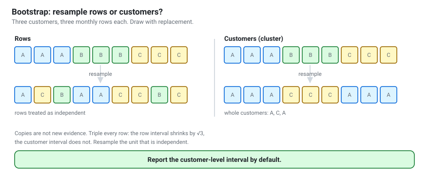

# Chapter 16 · Final evaluation & documentation

*Part I · Prerequisites: Chapters 5, 7, 8 and 9 · Estimated time: reading ~45 min, lab ~50 min · Compute: CPU*

 · [Lab: notebook.ipynb](notebook.ipynb) · [Solutions](solutions.md)

## Learning objectives

After this chapter you should be able to:

1. Explain why a held-out test set may be used only once, and quantify the optimism that repeated looks introduce.
2. Pre-register an evaluation: model version, threshold, metrics, baselines and decision rule, written before scoring.
3. Report a held-out result with a customer-level bootstrap interval and a paired comparison against baselines.
4. Report the operating point month by month, and state expected value with its assumptions.
5. Explain a difference between validation and test results without re-tuning, using base-rate-independent metrics.
6. Generate a README results section and a model card in which every number comes from code.
7. Give a 60-second summary and a five-minute walkthrough of the project, including its limitations.

## 16.1 Introduction

Since Chapter 5, one part of the TaskFlow data has been kept out of every
decision: the **test period**, July to November 2024. Features, split
boundaries and embargo, model family, hyperparameters and decision threshold
were all chosen on the training and validation periods. This chapter uses the
test period for the purpose it was reserved for: a single, final estimate of
how the chosen model performs on data from a later time.

"Single" is the important word. A test set provides an unbiased estimate only
if nothing about the model was chosen after looking at it. The first half of
this chapter is therefore about procedure: writing down the evaluation plan
before scoring (Section 16.3), quantifying uncertainty correctly (Section
16.4), reporting the decision rather than only the ranking metric (Section
16.5), and interpreting the result honestly when it differs from validation
(Section 16.7). The second half turns the result into the documents that
others will read, a results section and a model card (Section 16.8), and into
the short spoken explanations used in interviews (Section 16.9).

## 16.2 Why the test set is used once

Every time a test result is inspected and something is then changed (a
feature, the threshold, which model to report), the test set becomes a little
more like a validation set, and its number a little more optimistic. Nobody
needs to intend this. It happens through many small and individually
reasonable decisions, a phenomenon that the statisticians Gelman and Loken
called the *garden of forking paths*.

The size of the optimism can be estimated. Suppose $K$ variants of a model
are each evaluated on the same test set, and each estimate is unbiased with
standard error $\sigma$, so that the estimate for variant $j$ is
$\hat{\theta}_j = \theta_j + \sigma Z_j$ with $Z_j$ approximately standard
normal. If the variants are in truth equally good ($\theta_j = \theta$) and the
best-looking one is reported, the reported value is on average

$$
\mathbb{E}\Bigl[\max_{j} \hat{\theta}_j\Bigr] = \theta + \sigma\, \mathbb{E}\Bigl[\max_{j \le K} Z_j\Bigr], \qquad (16.1)
$$

which exceeds the true value. For independent $Z_j$ and $K = 20$, the expected
maximum of 20 standard normal variables is about 1.87. With a standard error
of 0.015 in PR-AUC, the reported number is then optimistic by roughly 0.03,
although no variant is better than another. (In practice the $Z_j$ are
correlated, which reduces the effect, but does not remove it.) Looking once
removes the maximum: with $K = 1$, the estimate is unbiased.

The same rule holds in any study with held-out subjects. Once a held-out
subject's accuracy has influenced a design choice, that subject is no longer
held out. Here the held-out "subject" is a later period of time.

What had been fixed before this chapter, and must not change now, is:

| Decision | Where it was fixed |
|---|---|
| Features and their point-in-time SQL | Chapter 4 (`churnlab/features.py`) |
| Split boundaries and the 30-day embargo | Chapter 5 (`churnlab/splits.py`) |
| Model family and hyperparameters, chosen by validation PR-AUC | Chapters 6–7 |
| Decision threshold, chosen by expected value on validation | Chapter 8, stored in the bundle metadata |

## 16.3 Pre-registration

The defence against forking paths is the one used in clinical trials:
**write down the analysis before seeing the data**, then carry out exactly
that analysis and report its result, whatever it is. This is called
**pre-registration**. Analyses decided after looking are still allowed, but
they are reported as **exploratory**, not as part of the headline claim.

The lab's plan, written to `preregistration.json` before any test row is
read, contains:

- the model version and the SHA-256 hash of its file, so that "which model?"
  can never be ambiguous;
- the threshold chosen on validation (about 0.19);
- the primary metric (PR-AUC) and secondary metrics (ROC-AUC, precision and
  recall at the threshold);
- the method for intervals (customer-level bootstrap, number of resamples,
  random seed);
- the baselines: a dummy model that predicts the training prior, a
  three-feature logistic regression, and the challenger `v2` (gradient-boosted
  trees);
- the **decision rule** for claiming that the model is better than a baseline
  (Equation 16.3 below);
- the analyses designated in advance as exploratory: calibration and slices.

The plan is hashed, and the final report quotes the hash. Test rows are read
through a single function that refuses to run without a plan and logs every
access. In a team, the plan would be committed or posted before anyone
scored the test set; the timestamp is the point.

Before writing the plan, the lab gathers the validation results it needs.
On validation (synthetic data), `v1`, the logistic regression, has a PR-AUC
of about 0.163 and a ROC-AUC of about 0.733; `v2` has a PR-AUC of about 0.135;
the three-feature baseline is lower still. The threshold of about 0.19 is the
expected-value optimum on validation; the theoretical break-even for a
perfectly calibrated score under the course's assumed costs is
$30/(150 + 30) = 1/6 \approx 0.167$ (Chapter 8).

## 16.4 Uncertainty: customer-level and paired bootstraps

A point estimate without an interval cannot be interpreted. The **bootstrap**
estimates the sampling variability of a metric by recomputing it on many
resamples of the data, drawn with replacement. The resampling unit must
match the unit of independence. In the TaskFlow data, one customer appears at
up to five monthly snapshots in the test period, and rows of one customer are
correlated. Resampling rows would treat these as independent observations,
overstate the evidence, and give intervals that are too narrow. The lab
therefore resamples **customers**, taking all of each sampled customer's rows
(a *cluster bootstrap*).

*Figure 16.1 — Row bootstrap versus cluster (customer-level) bootstrap. Only the second respects the dependence between rows of the same customer.*

A 95% percentile interval is formed from the 2.5th and 97.5th percentiles of
the $B$ bootstrap values $\hat{\theta}^{*}_1, \dots, \hat{\theta}^{*}_B$:

$$
\text{CI}_{95\%} = \left[\, Q_{0.025}\bigl(\hat{\theta}^{*}_{1..B}\bigr),\; Q_{0.975}\bigl(\hat{\theta}^{*}_{1..B}\bigr) \right]. \qquad (16.2)
$$

To compare two models, the **paired bootstrap** resamples the same customers
for both models in each replicate and records the difference
$\Delta^{*}_b = \text{PR-AUC}^{*}_{\text{model}, b} - \text{PR-AUC}^{*}_{\text{baseline}, b}$.
Because both models face the same resampled customers, customer-to-customer
variation in difficulty cancels in the difference, and a small but consistent
gain becomes detectable. Two separate intervals that overlap do *not* show
that there is no difference. The pre-registered decision rule is

$$
\text{report "better"} \iff Q_{0.025}\bigl(\Delta^{*}_{1..B}\bigr) > 0, \qquad (16.3)
$$

that is, the whole 95% interval of the difference lies above zero.

On the test period (12,127 rows, positive rate about 0.059, synthetic data),
the lab finds a PR-AUC of about 0.197 with a customer-level 95% interval of
roughly [0.17, 0.22], and a ROC-AUC of about 0.74 [0.72, 0.76]. The paired
PR-AUC difference against the three-feature baseline is about +0.07, and
against the challenger about +0.045; both intervals exclude zero. By the
pre-registered rule, the model is reported as better than all three baselines
*on this test period*. The dummy model's PR-AUC equals the positive rate and its
ROC-AUC is 0.5, as they should be; it serves as a sanity floor.

How precise is the result? The interval spans about ±0.03 from five months of
data on roughly 2,500 customers. Bootstrap intervals narrow approximately as
$1/\sqrt{n}$ in the number of independent units $n$, so halving the width
would require about four times as many customers (about 10,000). A future
"improvement" of 0.01 PR-AUC would be invisible without a paired comparison.

## 16.5 The operating point

A ranking metric is not a decision. The decision is to call the accounts
whose score is at or above the threshold, so the report should state what
that does: how many accounts are flagged, what fraction of them churn
(precision), and what fraction of churners are reached (recall), month by
month, using the **pre-registered** threshold. In the lab, about 60 accounts
are flagged per month (about 310 in total), with overall precision about 0.29
and recall about 0.13. Precision varies from month to month (0.2 one month and
0.35 the next is normal at these volumes, since 60 calls is a small sample).

When the team's capacity is fixed at $k$ calls per month, the relevant metric
is **precision at $k$**:

$$
\text{precision@}k_m = \frac{\#\{\text{churners among the } k \text{ highest scores in month } m\}}{k}, \qquad
\text{lift}_m = \frac{\text{precision@}k_m}{\pi_m}, \qquad (16.4)
$$

where $\pi_m$ is the churn rate in month $m$. For example, 11 churners among 40
calls give a precision of 0.275.

Expected value converts the operating point into the language of costs. Under
the course's assumptions, a true positive reached is worth \$150 and a call
that was not needed costs \$30, so

$$
\text{EV} = 150 \cdot \text{TP} - 30 \cdot \text{FP}. \qquad (16.5)
$$

On the test period this is positive (a few thousand dollars over five months,
from about 90 true positives and about 220 unneeded calls); calling everyone
is strongly negative; calling no one is zero. Equation (16.5) rests entirely on
assumptions: the \$150 itself assumes a 25% probability that a call saves a
customer, and nobody was actually called. The correct statement is therefore
"under assumed costs of \$150 and \$30, which the business would have to
confirm, the policy has positive expected value". It is never "the model
made \$X".

## 16.6 Calibration and slices (exploratory)

Two analyses were listed in the plan as exploratory.

**Calibration.** On the test period, the reliability curve lies close to the
diagonal at low scores and mostly above it in the upper-middle deciles: the
model under-predicts slightly (mean predicted probability about 0.05 against
an observed rate of about 0.059). This is the signature of a base rate that
rose after training, not of a broken model. It matters because the threshold
was derived from calibrated probabilities. If the shift persists, the remedy
is to recalibrate on recent labelled months (Chapter 8), using a *new*
validation window, never this test set.

**Slices.** Churn and flag rates differ strongly by plan (basic accounts churn
most and receive most of the flags), and recall is low in every slice. The
weakest slice is `region=unknown`, about 200 rows whose region is genuinely
missing, with lower PR-AUC and almost nobody flagged. With real data, this
would be the first thing to investigate: is a missing region a sign of a
different kind of account? On synthetic data, it reveals how the generator was
written, so it serves as practice in the method.

## 16.7 Validation versus test

On this data, test PR-AUC (about 0.197) is *higher* than validation PR-AUC
(about 0.163). It is tempting to conclude that the model is better than
expected. Lining up the two periods shows otherwise:

| Quantity | Validation | Test |
|---|---|---|
| Positive rate $\pi$ | ≈ 0.052 | ≈ 0.059 |
| PR-AUC (95% CI) | ≈ 0.163 [0.13, 0.20] | ≈ 0.197 [0.17, 0.22] |
| PR-AUC / $\pi$ | ≈ 3.1 | ≈ 3.3 |
| ROC-AUC | ≈ 0.733 | ≈ 0.740 |

Three observations follow.

1. **PR-AUC depends on the base rate.** A random ranking has an expected
   PR-AUC equal to $\pi$, so a period with more churners raises PR-AUC with no
   change in the model. Normalised by the base rate, and on ROC-AUC (which
   does not depend on it), the two periods are close.
2. **The intervals overlap substantially.** The validation estimate has its
   own interval, as wide or wider, because it rests on fewer rows. "Test is
   better" is not a finding; "performance held up in a later period with a
   higher churn rate" is.
3. **Why the churn rate rose cannot be determined from this data alone**:
   seasonality, a price change, or a setting of the generator. With real data,
   the first step would be to ask the business what happened in July and
   August 2024.

What must not be done is to choose a new threshold or a new model because of
these numbers. Had test been *worse* than validation, the same rule would
apply: report it, explain it, and address it on the next validation window.

## 16.8 Documentation generated from code

Two documents carry the result to readers who will never open the notebook:
the project README's **Results** section and a **model card**. A model card,
proposed by Mitchell and colleagues in 2019, is a short document that
accompanies a trained model and states what it is for and what is known
about it. The lab's card has these sections:

| Section | Content |
|---|---|
| Model | Name, version, model family, file hash, training date |
| Intended use | Who uses the scores, for which decision, and uses that are out of scope |
| Training data | Period, number of rows, data fingerprint, and the fact that the data is synthetic |
| Evaluation | Metrics on validation and on the test period, each with its interval and split named, against the baselines |
| Caveats | Limitations, known weak slices, calibration drift, and the feedback effect of acting on predictions |

The principle that governs both documents is that **no number is typed by
hand**. Everything is generated from one dictionary, `final_report.json`. A
hand-typed number in a README will eventually disagree with the code that
produced it; a generated one cannot. The lab enforces this mechanically: a
final check extracts every three-decimal number from the generated README and
confirms that each one appears in the report. A useful test for every sentence
in a model card is whether it would survive a reviewer asking "how do you
know?". If it would not, the generator should be fixed, not the file.

## 16.9 Communicating the result

Documents are read; interviews are spoken, and the first minute largely
determines how the rest goes. Two formats are worth preparing for any project.

**A 60-second summary** (about 150 words) covers, in order: the problem and
who acts on the prediction; the data, stated as synthetic early; the method
in one sentence (point-in-time features, a time split with an embargo, a
pipeline that carries its preprocessing, a cost-based threshold); one result
with its interval, base rate and baseline; one sentence on the engineering;
and one limitation or next step.

**A five-minute walkthrough** gives about 40 seconds to each of eight topics:
the decision and the metric; the data and its validation; features and
leakage; model selection; the test result; serving; operations; and
limitations and next steps. Recording oneself giving both is uncomfortable
and far more informative than rereading notes.

### Limitations to state first

Some limitations will certainly be raised by a careful interviewer. Raising
them first is more convincing than answering them later:

- **Synthetic data.** The model can only find what the generator put there.
  What transfers is the method.
- **Offline evaluation only.** A good ranking of who *would* churn is not
  evidence that *calling them* changes anything. Measuring that effect
  (uplift) requires a randomised experiment, such as a holdout among flagged
  accounts.
- **Side effects.** Contacting an account is an intervention, with possible
  harm as well as benefit.
- **Feedback loops.** Once the team intervenes, labels change. A customer
  retained by a call becomes a "false positive", and a model retrained naively
  on such data learns to stop flagging exactly the customers the calls helped.
  Logging every contact (who, when, which model version, which score) and
  keeping a never-contacted holdout preserve the ability to measure and retrain
  correctly.

## Key terms

| Term | Definition |
|---|---|
| Held-out test set | Data used exactly once, after every modelling decision is fixed. |
| Garden of forking paths | The accumulation of small analysis choices made after seeing data, which together bias results upwards (Equation 16.1). |
| Pre-registration | Writing the analysis plan and decision rule before seeing the data. |
| Confirmatory result | A result from the pre-registered analysis. |
| Exploratory result | A result from an analysis decided after looking; reported, but labelled as such. |
| Cluster (customer-level) bootstrap | Resampling whole customers with all their rows, to respect dependence within customers. |
| Paired bootstrap | Resampling the same units for two models and computing the difference in each replicate. |
| Decision rule | The pre-stated condition for claiming an improvement (Equation 16.3). |
| Operating point | The threshold or top-$k$ rule actually used to act on scores. |
| Precision at $k$ | The share of the $k$ highest-scored accounts that churn (Equation 16.4). |
| Expected value (EV) | The value of a decision policy under stated costs and benefits (Equation 16.5). |
| Validation–test gap | The difference between a metric on validation and on the untouched test period. |
| Model card | A short document stating a model's intended use, data, evaluation and limitations. |
| Uplift | The causal effect of an intervention, measured by a randomised experiment. |
| Feedback loop | The change in future labels caused by acting on the model's predictions. |

## Summary

1. A test set is unbiased only if it influences no decision; choosing the best of several looks inflates the result (Equation 16.1).
2. Pre-registration fixes the model, threshold, metrics, baselines and decision rule before scoring; later analyses are labelled exploratory.
3. Intervals come from a bootstrap whose unit matches the unit of independence (customers here); comparisons use a paired bootstrap and a pre-stated rule (Equation 16.3).
4. On the synthetic test period, the model's PR-AUC is about 0.197 [0.17, 0.22], better than all baselines by the pre-registered rule.
5. Report the operating point month by month; state expected value only with its assumptions (Equation 16.5).
6. A higher test PR-AUC can reflect a higher base rate; compare PR-AUC divided by the base rate and ROC-AUC, and do not re-tune on test in either direction.
7. Calibration and slice analyses on test are exploratory; recalibration, if needed, uses a new validation window.
8. The README results and the model card are generated from one report, so that no number is typed by hand.
9. A 60-second summary and a five-minute walkthrough, with limitations stated first, are part of the deliverable.

## Exercises

The exercises are in the lab, [notebook.ipynb](notebook.ipynb); worked answers are in [solutions.md](solutions.md).

- **Exercise 1 (graded).** Write `final_report(y, scores, threshold, groups, seed)`, returning PR-AUC with a customer-level bootstrap interval, ROC-AUC, precision, recall and the number flagged.
- **Exercise 2 (graded).** Write `results_markdown(report)`, which turns a report dictionary into a two-column markdown table with consistent number formatting.
- **Exercise 3 (written).** Write and time a 60-second summary of the project using your own numbers from `final_report.json`.
- **Exercise 4 (written).** Name three limitations a sceptical interviewer would raise, and the answer you would give to each.
- **Checkpoint.** Six questions to answer aloud: what was pre-registered and why the order matters; whether a higher test PR-AUC means a better model; why customer-level and paired bootstraps; why expected value is not "money the model made"; what happens to labels once the team calls flagged accounts; and the three limitations to raise first.

## Further reading

- A. Gelman and E. Loken (2014). "The Statistical Crisis in Science." *American Scientist* 102(6), 460–465. On the garden of forking paths.
- B. Efron and R. J. Tibshirani (1993). *An Introduction to the Bootstrap*. Chapman & Hall.
- M. Mitchell, S. Wu, A. Zaldivar, P. Barnes, L. Vasserman, B. Hutchinson, E. Spitzer, I. D. Raji and T. Gebru (2019). "Model Cards for Model Reporting." *Proceedings of the Conference on Fairness, Accountability, and Transparency (FAT\*)*.
- T. Hastie, R. Tibshirani and J. Friedman (2009). *The Elements of Statistical Learning*, 2nd ed. Springer. Section 7.2 discusses the separate roles of validation and test data.
- C. Dwork, V. Feldman, M. Hardt, T. Pitassi, O. Reingold and A. Roth (2015). "The reusable holdout: Preserving validity in adaptive data analysis." *Science* 349(6248), 636–638.
- T. Saito and M. Rehmsmeier (2015). "The Precision-Recall Plot Is More Informative than the ROC Plot When Evaluating Binary Classifiers on Imbalanced Datasets." *PLoS ONE* 10(3), e0118432.

**Next:** [Chapter 17 · Python & SQL drills](../ch17-python-and-sql-drills/README.md)
