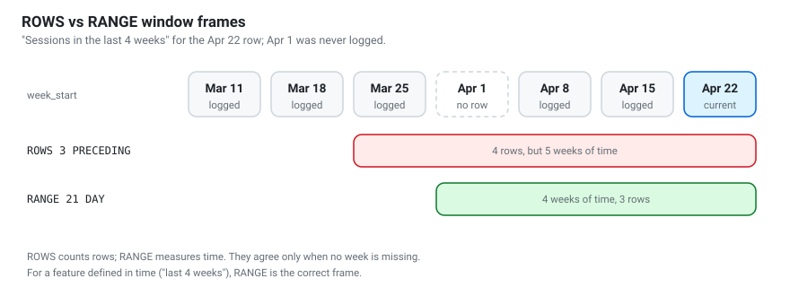

# Chapter 17 · Python & SQL drills

*Part I · Prerequisites: Chapters 1, 3 and 4 · Estimated time: reading ~30 min, lab ~60 min · Compute: CPU*

[](https://colab.research.google.com/github/berdakh/MLBOOTCAMP/blob/main/part1-foundations/ch17-python-and-sql-drills/notebook.ipynb) · [Lab: notebook.ipynb](notebook.ipynb) · [Solutions](solutions.md)

## Learning objectives

After this chapter you should be able to:

1. State the time and space complexity of a solution before writing it, including amortised costs.
2. Recognise five recurring patterns in data-flavoured Python interview problems: a single dictionary pass, sort-then-sweep, a monotonic deque, a metric computed from first principles, and stratified sampling.
3. Write SQL with window functions, including running totals, ranking within groups, and explicit window frames.
4. Write cohort-retention and gaps-and-islands queries, and explain the reasoning behind them.
5. Choose between the median and the mean for skewed quantities, and say why.
6. Practise under realistic conditions, with a timer and an automatic check, and plan the practice that follows.

## 17.1 Introduction

Most interview loops for ML engineering roles include a live coding round
and, increasingly often, a SQL round, and both are timed. A trained
researcher can usually solve the problems they contain given enough time.
What these rounds test is the ability to solve them **quickly, correctly and
while explaining the reasoning aloud**. That is a skill of fluency rather
than of knowledge, and fluency comes only from repeated practice against a
clock.

This chapter is therefore shorter on new concepts than the others. It
reviews the ideas that the drills exercise (Sections 17.2–17.4), explains how
to talk while solving (Section 17.5), and describes a practice plan for the
weeks after Part I (Section 17.6). The lab contains ten timed, automatically
checked drills on the TaskFlow tables: five in Python and five in SQL. It
records the time and result of each in a dated file, so that progress can be
measured. The skills diagnostic of Chapter 1 provides the baseline for
comparison.

## 17.2 Complexity, stated first

The **time complexity** of an algorithm describes how its running time grows
with the size $n$ of its input, ignoring constant factors. A loop over $n$
items is $O(n)$; a loop inside a loop over the same items is $O(n^2)$; sorting
is $O(n \log n)$. **Space complexity** describes the extra memory in the same
way. Interviewers grade the sentence that states the approach and its
complexity before any code is written, because it shows that the solution was
designed, not found by trial.

Complexity is not a formality. In the sliding-window drill, the input has
$n = 200{,}000$ values and a window of $k = 5{,}000$. Computing the maximum of
each window from scratch costs about

$$
(n - k + 1)\, k \approx 10^{9} \qquad (17.1)
$$

comparisons, which takes minutes in Python, whereas a linear method needs a
few times $n$, about $4 \times 10^5$ operations. Big-O notation does hide
constants, however: for $n = 100$, a simple $O(n^2)$ loop may be faster than an
elaborate structure. It is good practice to state the expected input size
along with the complexity.

Some algorithms have expensive individual steps but a low average cost. The
**amortised cost** is the total cost of a sequence of operations divided by
their number. The standard argument is a counting one: if every element is
added to a data structure once and removed at most once, then the total
number of additions and removals over the whole run is at most $2n$, whatever
happens in any single step. Such an algorithm is $O(n)$ overall even if one
step removes many elements.

## 17.3 Five Python patterns

The five Python drills each rest on one idea. Recognising the idea is most of
the work; the code is short once it is identified.

| Pattern | The idea | Typical complexity | Drill |
|---|---|---|---|
| **One dictionary pass** | Keep the best record seen so far for each key; a Python `dict` preserves insertion order (guaranteed since Python 3.7) | $O(n)$ time, $O(u)$ space for $u$ keys | Deduplicate records, keeping the latest |
| **Sort, then sweep** | After sorting by start, overlapping or touching items are adjacent | $O(n \log n)$ | Merge subscription intervals |
| **Monotonic deque** | Keep only the candidates that could still be the answer, in order; each element enters and leaves at most once | $O(n)$ amortised, $O(k)$ space | Sliding-window maximum |
| **Metric from first principles** | Compute an evaluation metric with plain Python, handling edge cases explicitly | $O(n \log n)$ for the ranking | Precision at $k$ |
| **Stratification** | Split each class separately so that class proportions are preserved | $O(n)$ | Stratified train/test split |

A **deque** (double-ended queue, `collections.deque`) supports adding and
removing at both ends in constant time. A **monotonic** deque keeps its
contents ordered (for example, decreasing values) by discarding, on each
insertion, elements that can no longer matter. The counting argument of
Section 17.2 then bounds the total work.

Two of these drills are evaluation code an ML engineer writes routinely. The
**precision at $k$** of a ranking is the share of positives among the $k$
highest-scored items:

$$
\text{precision@}k = \frac{1}{k} \sum_{i \in \text{top-}k} y_i, \qquad (17.2)
$$

where $y_i \in \{0, 1\}$ is the label of item $i$. If the labels of the four
highest-scored items are 1, 0, 1, 0, then precision@4 is 0.5. A careful answer
also states what happens for $k \le 0$ and for $k$ larger than the number of
items, and how ties in the score are broken.

A **stratified split** keeps each class's share the same in both parts. Its
usual follow-up question in an interview is what to do when rows are grouped,
for example several rows per customer. The answer is to stratify and split
*groups*, not rows (scikit-learn's `StratifiedGroupKFold`), for the same
reason that one patient's or participant's measurements are never divided
between training and test in a clinical or sensor study (Chapter 5).

Several drills require a **stable tie-break**: a rule that resolves equal keys
in the same way every time, such as "the later record wins". Unstated tie
rules are a common source of answers that pass on examples and fail on the
grader's edge cases.

## 17.4 SQL patterns

The SQL drills run in DuckDB against the four cleaned TaskFlow tables
(`customers`, `usage_weekly`, `invoices`, `tickets`). Each drill is a function
that returns a query string; the grader runs it and compares the result with a
reference query. Four families of query cover most interview questions.

### Window functions

A **window function** computes a value for each row from a set of related
rows (its *window*) without collapsing the rows, unlike `GROUP BY`. The
general form is

```sql
f(...) OVER (PARTITION BY p ORDER BY o ROWS|RANGE BETWEEN ... AND ...)
```

`PARTITION BY` divides the rows into independent groups, `ORDER BY` orders
them within a group, and the **frame** clause selects which rows around the
current one are included. A **running total** is a sum over the frame from
the first row to the current row, ordered by time. A window can also be
applied to the result of an aggregation, for example a running total of
monthly sums.

The distinction between `ROWS` and `RANGE` frames matters for time series
with gaps. `ROWS 3 PRECEDING` counts physical rows, so if a week is missing it
reaches further back in time; `RANGE INTERVAL 21 DAY PRECEDING` counts by value,
so it always covers the same span of time. When `ORDER BY` is given without
a frame, the SQL default is `RANGE BETWEEN UNBOUNDED PRECEDING AND CURRENT
ROW`, which treats rows with equal ordering values as peers.



*Figure 17.1 — `ROWS` versus `RANGE` frames when one week is missing. The `ROWS` frame reaches back further in time to collect its four rows; the `RANGE` frame covers a fixed span.*

### Ranking within groups

"The $n$-th item per group" and "the top $N$ per group" are answered with a
ranking window function partitioned by the group. The three ranking functions
differ only on ties:

| Function | Values on a tie between the first two rows | "Exactly one row per rank"? |
|---|---|---|
| `ROW_NUMBER()` | 1, 2, 3 | Yes, if the ordering includes a deterministic tie-breaker |
| `RANK()` | 1, 1, 3 | No; a rank can be shared or skipped |
| `DENSE_RANK()` | 1, 1, 2 | No; a rank can be shared |

Because window functions cannot appear in `WHERE`, the rank is computed in a
subquery or common table expression (CTE) and filtered outside it, or with
DuckDB's `QUALIFY` clause.

### Cohort retention

A **cohort** is the set of customers who share a starting period, such as the
month of sign-up. **Retention at month $+k$** is the share of a cohort still
active $k$ months after its start:

$$
\text{ret}_k(c) = \frac{\bigl\lvert \{\text{customers of cohort } c \text{ active in month } c + k\} \bigr\rvert}{\lvert \text{cohort } c \rvert}. \qquad (17.3)
$$

For example, if 120 customers signed up in March and 96 of them have any usage
in April, then $\text{ret}_1 = 0.80$. The classic error is a retention above 1,
which arises when a join to weekly usage multiplies each customer by the
number of active weeks before counting. The numerator must count *distinct*
customers, or the data must be reduced to one row per customer and month
before the join. This is the join fan-out problem of Chapter 4 in another
form.

### Gaps and islands

A **gaps-and-islands** problem asks for runs of consecutive values (islands)
or the breaks between them (gaps): streaks of active weeks, periods of
inactivity, consecutive days above a threshold. Two approaches are standard.

1. **Compare each row with the next.** `LEAD()` returns the next row's value
   within the partition. For weekly data on Mondays, two consecutive active
   weeks are 7 days apart, so the number of inactive weeks between active weeks
   at dates $d_j$ and $d_{j+1}$ is
   $$
   g_j = \frac{d_{j+1} - d_j}{7\ \text{days}} - 1. \qquad (17.4)
   $$
   Forgetting the "$-1$" is the usual off-by-one error.
2. **The difference of two row numbers.** Number all of a customer's weeks in
   order, $t_j$, and separately number the weeks within each state (active or
   inactive), $r_j$. Within one uninterrupted run of the same state, both
   numbers increase by one per week, so $t_j - r_j$ is constant; when the run
   is broken, the difference changes. The difference therefore labels the run,
   and grouping by (customer, state, label) gives each island and its length.

Both approaches should be known, because an interviewer may ask for the
second after seeing the first.

### Median versus mean

For skewed quantities, such as ticket resolution times where a few tickets
stay open for days, the mean is pulled towards the long tail and describes
almost no actual ticket. The median describes the typical case. DuckDB offers
`MEDIAN(x)` and `quantile_cont(x, 0.5)`, which interpolates between the two
middle values, as well as `quantile_disc`, which returns an observed value.
In the lab's data, cancellation tickets have a median resolution of about 5
hours against about 15 for the other categories. On synthetic data that is a
property of the generator; on real data it would be a question for the
support team, and an honest comparison would also report counts and a measure
of spread for each category.

## 17.5 Solving aloud

A live coding round is graded on the process as well as the result. A
reliable sequence is:

1. **Restate the problem** and the edge cases (empty input, ties, duplicates,
   $k$ larger than $n$, missing values).
2. **State the approach and its complexity** in one or two sentences before
   writing code.
3. **Write the code**, narrating the decisions that are not obvious.
4. **Test it** on a small example, including one edge case.
5. **Anticipate the follow-up**: what if the data does not fit in memory,
   arrives as a stream, or is grouped?

The lab's drill timer is itself a small exercise of this kind. It is a
**context manager**: an object used in a `with` statement, whose `__enter__`
method runs before the block and whose `__exit__` method runs after it, even
if the block raises an exception.

## 17.6 Deliberate practice

Practice improves fluency fastest when it is short, frequent, timed and
recorded. The lab suggests a 30-minute daily session for the three weeks after
Part I:

| Minutes | Activity |
|---|---|
| 0–5 | Re-solve one drill from the repeat list, from a blank cell, timed |
| 5–20 | One new problem, alternating between Python (hashing, intervals, heaps, two pointers, sliding windows) and SQL (window functions, retention, funnels, gaps and islands, top $N$ per group) |
| 20–27 | Explain it aloud, or record two minutes; note one thing to say better |
| 27–30 | Log the problem, the time, the result and a one-line lesson |

A drill goes on the **repeat list** when it took more than 50% longer than
its target time. Week by week, the emphasis moves from re-running these drills
until all ten pass within target, to ML-flavoured coding (ROC-AUC computed
from ranks, a time-based split, one step of k-means, a batched inference
loop), to interview-length sessions with self-posed follow-up questions. The
goal is a trend: a drill that took 15 minutes in the first week should take
about 5 in the fourth.

## Key terms

| Term | Definition |
|---|---|
| Time complexity (Big-O) | How the running time of an algorithm grows with the input size, ignoring constant factors. |
| Space complexity | How the extra memory of an algorithm grows with the input size. |
| Amortised cost | The total cost of a sequence of operations divided by their number. |
| Deque | A double-ended queue that supports constant-time insertion and removal at both ends. |
| Monotonic deque | A deque kept in sorted order by discarding elements that can no longer be the answer. |
| Stable tie-break | A rule that resolves equal keys in the same way every time. |
| Precision at $k$ | The share of positives among the $k$ highest-scored items (Equation 17.2). |
| Stratified split | A split that preserves each class's proportion in every part. |
| Window function | A SQL function computed over a set of rows related to the current row, without collapsing rows. |
| Window frame | The `ROWS` or `RANGE` clause that selects which rows around the current one a window includes. |
| Running total | A cumulative sum ordered by time. |
| Common table expression (CTE) | A named subquery introduced with `WITH`, used to structure a query in steps. |
| Cohort | A set of customers who share a starting period. |
| Retention at month $+k$ | The share of a cohort still active $k$ months after its start (Equation 17.3). |
| Gaps and islands | Problems about runs of consecutive values and the breaks between them. |
| Context manager | An object used with `with` that runs set-up and clean-up code around a block. |

## Summary

1. Timed coding and SQL rounds test fluency: solving quickly, correctly and aloud. Fluency comes from practice against a clock.
2. State the approach and its complexity before coding, together with the expected input size; a quadratic method can be infeasible at realistic sizes (Equation 17.1).
3. Five Python patterns recur: a dictionary pass, sort-then-sweep, a monotonic deque with an amortised linear bound, metrics from first principles, and stratification by class (and by group when rows are grouped).
4. Window functions compute per-row values over partitions; `ROWS` and `RANGE` frames differ when the series has gaps.
5. `ROW_NUMBER`, `RANK` and `DENSE_RANK` differ only on ties; "the $n$-th item" needs `ROW_NUMBER` with a deterministic tie-breaker.
6. Cohort retention (Equation 17.3) must count distinct customers; a value above 1 indicates join fan-out.
7. Gaps and islands are solved by comparing adjacent rows (Equation 17.4) or by the difference of two row numbers.
8. Use the median for skewed quantities, and report counts and spread with any comparison.
9. A short, daily, timed and logged practice routine, with a repeat list, produces measurable progress.

## Exercises

The drills are in the lab, [notebook.ipynb](notebook.ipynb); worked answers are in [solutions.md](solutions.md). Each has a target time.

- **Exercise 1 (5 min).** `dedupe_keep_latest`: one record per key, the latest by timestamp, with a stated tie rule and first-appearance order.
- **Exercise 2 (6 min).** `merge_intervals`: merge overlapping or touching subscription periods.
- **Exercise 3 (8 min).** `sliding_window_max`: the maximum of every window of length $k$, in linear time.
- **Exercise 4 (4 min).** `precision_at_k`: precision among the $k$ highest-scored rows, in plain Python.
- **Exercise 5 (7 min).** `stratified_split`: a seeded split that preserves each class's ratio to within one row.
- **Exercise 6 (5 min).** Monthly paid revenue with a running total.
- **Exercise 7 (10 min).** Sign-up-month cohort retention at months +1, +2 and +3.
- **Exercise 8 (5 min).** Each customer's third invoice.
- **Exercise 9 (12 min).** The longest run of inactive weeks per customer (gaps and islands).
- **Exercise 10 (4 min).** Median ticket resolution hours per category.
- **Checkpoint.** Five questions to answer aloud: the complexity of the sliding-window maximum; the three ranking functions and ties; diagnosing a retention of 1.4; explaining the row-number trick; and median versus mean.

## Further reading

- T. H. Cormen, C. E. Leiserson, R. L. Rivest and C. Stein (2009). *Introduction to Algorithms*, 3rd ed. MIT Press. Chapters 3 (growth of functions) and 17 (amortised analysis).
- Python documentation, `collections.deque` and the data model for context managers: <https://docs.python.org/3/>
- DuckDB documentation, "Window Functions" and "Aggregate Functions": <https://duckdb.org/docs/>
- K. A. Ericsson, R. T. Krampe and C. Tesch-Römer (1993). "The Role of Deliberate Practice in the Acquisition of Expert Performance." *Psychological Review* 100(3), 363–406.
- scikit-learn documentation, "Cross-validation: evaluating estimator performance" (including `StratifiedGroupKFold`): <https://scikit-learn.org/stable/>

**Next:** [Chapter 18 · System design & mock interview](../ch18-system-design-and-mock-interview/README.md)
