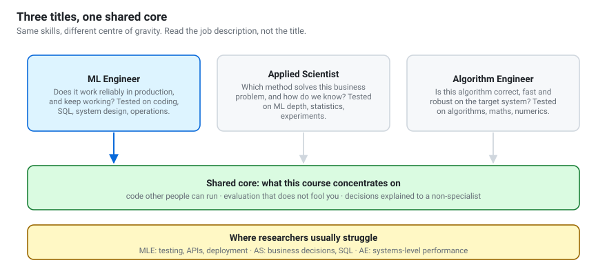
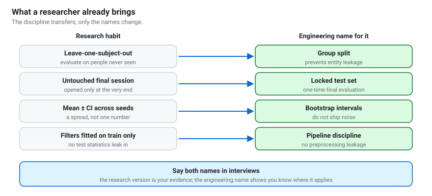
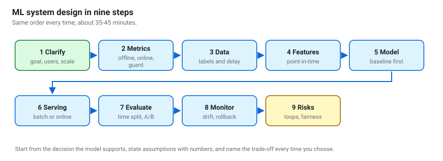
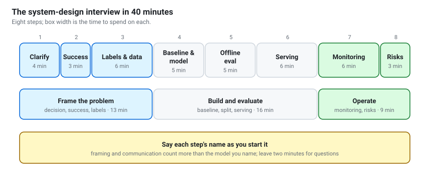
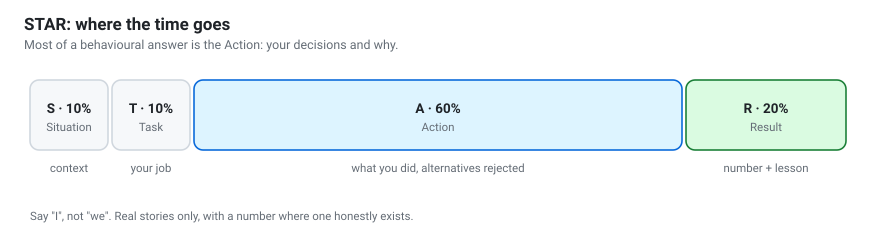

# Chapter 18 · System design & mock interview

*Part I · Prerequisites: Chapters 2–17 · Estimated time: reading ~55 min, lab ~70 min · Compute: CPU*

 · [Lab: notebook.ipynb](notebook.ipynb) · [Solutions](solutions.md)

## Learning objectives

After this chapter you should be able to:

1. Describe the three job titles this book prepares for (ML Engineer, Applied Scientist, Algorithm Engineer), what they share, and what each adds.
2. Name the research habits that transfer to industry and those that need to change.
3. Conduct an ML system design discussion through a fixed sequence of headings, starting from the decision and the metric rather than the model.
4. Do back-of-envelope capacity, concurrency and latency-budget arithmetic aloud.
5. Present a worked design at scale, with explicit assumptions, failure modes and trade-offs.
6. Run a timed mock interview on yourself, score it with a rubric, and track the scores.
7. Answer behavioural questions in STAR form using research experience.

## 18.1 Introduction

Part I has built one project from end to end: data validation, point-in-time
features, a leakage-safe split, model selection, a cost-based threshold, a
versioned registry, a tested service, operations and monitoring, and a single
honest test evaluation. This final chapter of Part I asks how that work is
examined in an interview, and in particular in the **ML system design**
round, in which a candidate is given a vague product problem and about 40
minutes.

The system design round does not test knowledge of the newest model. It tests
whether a candidate can turn ambiguity into a system that supports a good
decision, can be evaluated honestly, and can be operated after launch; and
whether the candidate can explain all of this in a structured way under time
pressure. Interviewers are, in effect, checking whether the candidate knows
how good the model is, how they would find out if it were wrong, and whether
they can say both clearly.

The chapter begins with background on the roles themselves (Section 18.2),
because the design round means somewhat different things for different
titles. Section 18.3 presents a framework for the design discussion and
Section 18.4 the arithmetic that accompanies it. Sections 18.5 and 18.6 work
through two designs, and Section 18.7 shows that the same concerns recur
across very different problems. Sections 18.8 and 18.9 cover the mock
interview and behavioural questions.

## 18.2 Background: the ML engineering job

### Three titles, overlapping jobs

Job titles are not standardised. The same title means different work at
different companies, and sometimes in different teams of one company, so the
job description matters more than the title. With that caution, the usual
emphasis of each role is:

| | ML Engineer | Applied Scientist | Algorithm Engineer |
|---|---|---|---|
| **Core question** | Does the model work reliably in production, and keep working? | Which model or method solves this business problem, and how do we know? | Is this algorithm correct, fast and robust on the target system? |
| **Typical output** | Pipelines, services, training and evaluation infrastructure, monitoring | Experiments, analyses, prototypes, design documents, sometimes papers | Optimised implementations, signal-processing or estimation code, often for constrained hardware or real time |
| **Code expectation** | Production code, reviewed, tested and owned after launch | Clean, reproducible research code, often close to production | Production code, often performance-critical (C++, CUDA or optimised Python) |
| **Interviews usually test** | Coding, SQL, ML fundamentals, ML system design, debugging and operations | ML depth, experimental design, statistics, coding, a deep dive into past work | Algorithms and data structures, mathematics, numerical methods, domain depth, coding |
| **Where researchers struggle** | Testing, APIs, deployment, on-call thinking | Turning results into business decisions; SQL | Systems-level performance; production C++ |

*Figure 18.1 — Three roles and their shared core. Whichever title one applies for, the shared core (code others can run, evaluation that does not fool its author, decisions explained to non-specialists) is examined; the role determines what is added on top.*

All three roles expect code that other people can run, an evaluation that
does not mislead, and the ability to explain a decision to a non-specialist.
Part I concentrated on that shared core and on the production skills that the
ML Engineer role adds. The system design round examines the core directly.

### What a researcher brings

Many research habits are the engineering practices of this book under
different names. They should be named explicitly in interviews, and
supported by examples:

| Research habit | Engineering name |
|---|---|
| Cross-subject or leave-one-subject-out evaluation | Group-aware splitting; preventing entity leakage (Chapter 5) |
| Not touching the held-out session until the end | A locked test set; a single final evaluation (Chapter 16) |
| Reporting means with confidence intervals, or across seeds | Uncertainty in offline metrics (Chapters 7 and 16) |
| Fitting filters, ICA or normalisation on training data only | Preventing preprocessing leakage; `Pipeline` discipline (Chapter 6) |
| Artifact rejection and channel quality checks | Data validation and data contracts (Chapter 3) |
| Building a baseline before a deep model | Honest baselines |
| Answering reviewers who want to reject the paper | Justifying decisions under questioning |

*Figure 18.2 — Research habits and their engineering names. Little on the right is new to a careful researcher; the interview skill is to name the engineering version and then tell the research story as evidence.*

For EEG and BCI researchers in particular, a cross-subject evaluation story is
one of the strongest leakage stories available. It is concrete, it has a
measurable before and after, and it maps exactly onto entity leakage in
customer, patient or device data.

### Research habits that need to change

Some habits are rational in research and costly in a product team:

| Habit | Why it is rational in research | Why it is costly in a product team |
|---|---|---|
| Optimising a metric to the third decimal | Papers are compared on benchmark numbers | A gain of 0.003 inside the noise is not a result; the threshold and the data matter more |
| One long notebook | Fast iteration by one author | Nobody else can review, test, rerun or deploy it |
| An environment that works on one machine | The author is the only user | The model must run on a server the author has never seen, months later |
| Results without decisions | A paper's purpose is to inform | The team needs to know what to *do*: whom to call, what to flag, when to retrain |
| Novelty first | Novelty is published | A simple model that is monitored is preferable to a clever one nobody can debug |
| Accepting quiet failures | A failed run is simply rerun | A silent failure in production costs money until someone notices |
| Evaluating once, at the end | The paper is finished when published | The model is *starting* when it is deployed; evaluation continues as monitoring |

### The work itself

Over a quarter rather than a day, the work of a modelling-focused engineer in
a product team typically has seven stages: understand the decision the model
supports and how it is measured; find and validate the data (usually the
longest stage, usually in SQL); build a baseline and an honest evaluation
(often the baseline is deployed first); improve the model while keeping the
evaluation honest; package, serve or schedule it, and test it; monitor it,
respond to degradation, retrain and roll back; and write it up so that the
next person can own it. Research training concentrates on the fourth stage.
Part I spent most of its time on the second, third, fifth and sixth, and
Chapter 16 on the last.

Across all three roles, interviewers probe the same four things. **Do you know
where numbers come from?** Which split, which period, which unit of
resampling, how many rows. **Do you think about failure?** What happens if the
input is wrong, the service is down, the data shifts or the label is
delayed. **Can you trade off?** Latency against accuracy, recall against
reviewer workload, a simple model that can be monitored against a complex one
that cannot. **Can you communicate?** A clear two-minute explanation is
preferable to a complete twenty-minute one.

Part I also has limits that should be acknowledged. It teaches with
scikit-learn and tabular data, because that runs on a free CPU and is what
most applied interviews probe; it does not cover large-scale distributed
training or GPU serving, which Parts II and III address. It teaches
deployment by writing and explaining files, which cannot replace the
experience of operating a service in production. And it cannot supply domain
knowledge for a particular employer; the capstones use public data from
several domains for that reason.

## 18.3 A framework for the design discussion

A fixed sequence of headings, used every time, keeps a design discussion
structured and lets the interviewer follow it and redirect it. The lab uses
nine headings:

| # | Heading | Questions to answer aloud | Typical time |
|---|---|---|---|
| 1 | **Clarify goal and constraints** | Who acts on the prediction, how often, with what capacity? What happens today without a model? Scale, latency, budget, regulation | 3–5 min |
| 2 | **Success metrics** | Offline (PR-AUC, recall at capacity, NDCG@10); online (the business outcome, measured by an experiment); guardrails (latency, complaint rate, fairness across slices) | 3–4 min |
| 3 | **Data and labels** | Where do labels come from, how late, how noisy? Are they affected by our own actions? | 4–5 min |
| 4 | **Features** | Batch versus online features; point-in-time correctness; one definition for training and serving | 4–5 min |
| 5 | **Model** | A baseline first (a rule, logistic regression), then the step up and what would justify it; training cadence | 3–5 min |
| 6 | **Serving** | Batch, online or both; latency budget; capacity; fallbacks when a dependency fails | 4–5 min |
| 7 | **Evaluation and experimentation** | Time-based offline evaluation; A/B test design (unit, metric, duration, power); interleaving for rankers | 3–5 min |
| 8 | **Monitoring and iteration** | Drift, delayed-label performance, alerts, retraining triggers, rollback | 3–4 min |
| 9 | **Risks and ethics** | Feedback loops, unequal error rates across groups, privacy, abuse, what the model must never do on its own | 2–3 min |

*Figure 18.3 — The nine headings. The model is step 5 of 9; more than half of the answer concerns the problem, the data and what happens after deployment.*

The handbook version of the same framework merges features into data and
model, and evaluation into monitoring, giving eight steps. Its time
allocation for a 40-minute interview is instructive:

*Figure 18.4 — Time allocation in a 40-minute design interview. Framing (clarify, success, labels and data) takes about a third of the time before any model is named, and operating (monitoring and risks) is not optional: it is where many candidates run out of time.*

What is being assessed, roughly in order of weight, is: **problem framing**
(is the decision and its success measure found before a model is chosen?);
**data thinking** (where labels come from, how late, how biased; what is
available at prediction time); **evaluation** (offline metrics matched to the
decision, and an online test of the outcome); **engineering judgement**
(batch or online, latency, cost, failure modes, monitoring, rollback); and
**communication** (structure, signposting, checking in, and trading off
aloud). Interviewers usually care more about the first and the last than
about which model is named.

Several habits are consistently rewarded:

- **Ask before assuming, then state the assumption with a number.** "I will
  assume about a million transactions a day and a 100 ms budget; please tell
  me if that is wrong."
- **Draw the pipeline early**: data sources, features, model, decision,
  feedback. Then talk over it.
- **Name the baseline.** It shows that complexity must earn its place.
- **Name the failure modes before being asked**: leakage, skew, delayed and
  biased labels, feedback loops, cold start.
- **Quantify roughly**: rows per day, positives per day, requests per second,
  reviewer capacity. Order-of-magnitude arithmetic is expected.
- **Trade off aloud.** "A larger model might gain a little recall, but it
  would push p99 latency past the budget, so I would start with…"

The framework is a map, not a script. A real interviewer interrupts and
steers; the candidate should follow, and return later to any heading that was
skipped.

## 18.4 Back-of-envelope arithmetic

Capacity arithmetic should take about thirty seconds and be done aloud,
because its result often decides the architecture. Let DAU be the number of
daily active users, $r$ the requests per user per day, $f$ the **peak factor**
(the ratio of the busiest hour's rate to the daily average), $u$ the target
utilisation of each replica, and $\text{QPS}_{\text{rep}}$ the measured
throughput of one replica in queries per second. Then

$$
\text{QPS}_{\text{avg}} = \frac{\text{DAU} \times r}{86{,}400}, \qquad
\text{QPS}_{\text{peak}} = f\, \text{QPS}_{\text{avg}}, \qquad
\text{replicas} = \left\lceil \frac{\text{QPS}_{\text{peak}}}{u\, \text{QPS}_{\text{rep}}} \right\rceil. \qquad (18.1)
$$

A day has 86,400 seconds; rounding to $10^5$ makes the division easy and
underestimates by about 14%, which is acceptable for an architectural
decision and worth saying. For an in-app badge seen by 3 million daily users
with 5 requests each, $1.5 \times 10^{7} / 86{,}400 \approx 174$ QPS on average
and, with $f = 3$, about 521 at peak. At an assumed 50 QPS per replica and a
target utilisation of 0.6, $\lceil 521 / 30 \rceil = 18$ replicas. A peak
factor of 2–3 is typical of a global consumer product; it is higher for a
service used in one time zone, and traffic can be far burstier than any
average suggests (a push notification reaches everyone at once). It is worth
asking about bursts before sizing for averages. Per-replica throughput is an
assumption in a design discussion; in practice it is measured, as Chapter 14
did for the churn service.

Little's law (Chapter 14) gives the concurrency the system must support:

$$
L = \lambda\, W. \qquad (18.2)
$$

At 521 QPS and 100 ms per request, about 52 requests are in flight at any
moment, so the replicas together must accept at least that many concurrent
requests.

A **latency budget** splits an end-to-end target among the steps of a
request, so that each component knows how much time it may take:

$$
\text{headroom} = T_{\text{total}} - \sum_{s} t_s, \qquad (18.3)
$$

where $t_s$ is the (p95) time of step $s$. For the support-console API in the
first design below, assumed components totalling 95 ms leave 105 ms of
headroom in a 200 ms budget. Headroom is not waste: percentiles do not add
exactly, and the tail of the slowest dependency dominates.

Finally, the duration of a batch job is $t = N / (\text{rows per second})$. The
lab measures the course's pipeline at the order of $10^5$ to $10^6$ rows per
second on one CPU process (machine-dependent), so scoring 10 million accounts
takes minutes of model time.

## 18.5 Worked design: churn prediction for 10 million accounts

*Prompt: "Design a churn prediction system for a SaaS company with 10
million accounts. Customer success wants a daily ranked list, and support
agents want a churn-risk score in their console when a customer calls."*

This is the TaskFlow project at scale. The numbers are assumptions, stated as
they would be in an interview.

1. **Clarify.** Customer-success managers call the top of a daily list
   (capacity, say, 5,000 calls a day); support agents see a score during live
   calls. Today a rule such as "failed payment and a usage drop" is used.
   Scale: 10 million accounts, about 2% monthly churn. The list is produced
   overnight; the console needs an answer in under 200 ms. Customer data is
   personal data, with retention and access rules.
2. **Metrics.** Offline: PR-AUC on a time split, and precision and recall *at
   the call capacity*, because that is the decision. Online: the retention rate
   of contacted accounts against a randomised holdout of similarly scored
   accounts, that is, the *uplift* rather than the score. Guardrails:
   complaint and unsubscribe rates among contacted customers, console p95
   latency, calls per manager.
3. **Data and labels.** The label is "cancelled within 30 days of the
   snapshot", known 30 days late. Interventions contaminate labels: a customer
   retained by a call looks like a false positive. Every contact is logged, a
   random holdout is never contacted, and training uses holdout and
   pre-launch data or models the treatment explicitly.
4. **Features.** The point-in-time definitions of Chapter 4, computed by a
   scheduled job into a **feature store**: an offline table keyed by (snapshot,
   account) for training, and an online key–value copy of the latest values for
   the console. One definition with two materialisations prevents
   training/serving skew (Chapter 11). Training sets are built with
   point-in-time ("as of") joins, never with today's values.
5. **Model.** The current rule, then logistic regression (on TaskFlow it was
   better than boosted trees on validation, so one should not assume trees
   win), then gradient boosting, which has more data to support interactions
   at 10 million rows. Monthly retraining on a rolling window; promotion only
   if a paired comparison on the latest validation month supports it.
6. **Serving.** Both paths share one model bundle from the registry. The
   **batch** path is the main product: a nightly job scores all active accounts
   and writes the account, score, model version, time and top reasons to a
   table the CRM reads. The **online** path reads the precomputed score; only
   if an agent asks to refresh with today's activity does it compute features
   online and call the model. Traffic is tiny (about 1.4 requests per second on
   average, about 5.6 at peak), so this is a question of latency and
   availability, not throughput. The fallback is yesterday's score with its
   date. Inference is cheap; the expensive and risky part is computing features
   for 10 million accounts from billions of usage events, and that is where the
   design effort belongs.
7. **Evaluation and experimentation.** Offline: rolling-origin backtests on
   monthly snapshots, with a cluster bootstrap by account. Online: randomise
   *accounts* (not calls) into treatment (called if flagged) and holdout (never
   called); primary metric, 60-day retention among flagged accounts; power the
   test from the baseline churn rate among flagged accounts, and run it for at
   least two label windows (Chapters 29–30).
8. **Monitoring.** Daily: feature PSI, score distribution, share flagged, and
   the batch job's success and row counts. Monthly, once labels arrive:
   PR-AUC and calibration on the holdout. Online: p95 latency, error rate,
   fallback rate. Alerts route to an owner; rollback moves the registry's
   `CURRENT` pointer (Chapter 15).
9. **Risks.** Feedback loops; a model penalising a region or plan because of
   how the business treated it historically (slice metrics); privacy (no raw
   ticket text in features without review); over-contacting (cap calls per
   account per quarter).

The trade-offs should be stated explicitly:

| Choice | Option A | Option B | What decides |
|---|---|---|---|
| Scoring mode | Nightly batch only | Batch plus online refresh | Whether a same-day signal would change the agent's action |
| Feature store | Build or buy one | A shared feature library and two jobs | How many models and teams reuse the features |
| Model | Logistic regression | Gradient boosting | Measured paired gain on validation, against interpretability for the CS team |
| Threshold | Fixed probability | Top $k$ by capacity | Capacity is fixed daily, so top $k$ is simpler and robust to drift |
| Retraining | Scheduled monthly | Triggered by drift | The label delay makes triggers slow anyway; schedule plus alerts |

A shorter second design in the lab, a **moderation triage queue** (5 million
comments a day, reviewer capacity 20,000), applies the same headings: the
model ranks for human review and removes nothing on its own; the offline
metric is recall at the capacity cut-off (0.4% of comments); reviewer
decisions are labels only for comments that were sent to review, a
**selection bias** corrected by also reviewing a small random sample of
unflagged comments; and the traffic, about 58 QPS on average and about 174 at
peak, needs a handful of CPU replicas with a small text model rather than a
GPU cluster. Capstone 5 builds this system.

## 18.6 Worked sketch: card-transaction fraud screening

The handbook's worked sketch is a problem with very different constraints.
*Prompt: "Design a system to detect fraudulent card transactions for a
payments company."*

1. **Clarify the decision.** At authorisation time each transaction is
   approved, declined, or sent for step-up verification or manual review. The
   scoring service sits in the payment path, so assume a strict budget of
   50–100 ms at p99. Manual review capacity is limited.
2. **Define success.** Business: fraud losses avoided minus the cost of false
   declines (lost sales, unhappy customers) and review effort. Offline:
   precision and recall at the operating thresholds, PR-AUC, and an
   amount-weighted view. Guardrails: false-decline rate, review queue size,
   latency.
3. **Labels and data.** Labels come mostly from chargebacks and confirmed
   fraud reports, which arrive **weeks** later, and are **biased by the
   current system**: declined transactions never receive a chargeback, so
   whether they were fraud is never learned. Features: transaction fields,
   card and account history (velocity counts over the last minute, hour and
   day), device and location signals, merchant risk. Velocity features must
   be computed as of the transaction time, from an event stream, identically
   online and offline.
4. **Baseline and model.** The existing rules (velocity limits, blocked
   merchants) are the baseline and a comparison point. Gradient-boosted trees
   on tabular features are a strong, fast default. Rules remain as a layer for
   hard policy and for new attack patterns.
5. **Offline evaluation.** A time-based split with an embargo at least as long
   as the label delay, since recent transactions have immature labels. Thresholds
   from the cost of fraud against false declines, and from review capacity for
   the middle band. Slices by merchant category, region, and new versus
   established cards. Bootstrap intervals resampling by card or account.
6. **Serving.** An online scoring service called by the authorisation system,
   with velocity features from a low-latency store updated by a stream
   processor; the same feature code backfills training data. If the model is
   unavailable or too slow, **fall back to the rules** rather than blocking
   payments. The fallback is part of the design.
7. **Monitoring and iteration.** Latency, timeouts and fallback rate; feature
   and score distributions, decline and review rates; matured-cohort
   precision and recall once chargebacks arrive. Because declined transactions
   produce no labels, a small randomised **exploration** group is approved or
   reviewed regardless of score, so that unbiased labels keep arriving. New
   models go to shadow, then canary, with instant rollback.
8. **Risks and trade-offs.** Adversaries adapt, so performance decays faster
   than in most problems; plan regular retraining and rule updates. False
   declines may fall unevenly across groups or regions; monitor slice rates.
   Device and location data need access controls and retention limits. With
   more time: graph features linking cards, devices and merchants, and
   cost-sensitive training weighted by amount.

## 18.7 The same ideas recur

The two problems look unrelated, but the concerns that drive their designs
are the same:

| Concern | TaskFlow churn | Fraud screening |
|---|---|---|
| Label delay | 30 days | Weeks (chargebacks) |
| Point-in-time features | Monthly snapshots in SQL | Per-transaction velocity from a stream |
| Correlated rows | One customer across snapshots | One card across transactions |
| Threshold from costs | \$150 against \$30 (assumed) | Fraud loss against false-decline cost (assumed) |
| Feedback effect | Called customers may be retained | Declined transactions receive no label |
| Serving | Batch is sufficient | Online, strict latency, with a fallback |

The same ideas recur in nearly every ML system design question. Learning them
once, in depth, on a project one has built, is more useful than memorising
designs for twenty products. The lab lists six practice prompts (fraud,
shopping recommendations, demand forecasting, predictive maintenance,
electricity load forecasting and help-centre search), with what a strong
answer covers for each; three of them correspond to capstones.

Two further evaluation tools appear in several prompts. An **A/B test**
randomises a unit (user, account) into variants and measures an outcome; its
design specifies the unit, metric, duration and statistical power. For
comparing two rankers, **interleaving** merges their result lists for the same
user and query and credits each click to the ranker that contributed the
item; because every user sees both rankers, the comparison is within-user and
usually needs far less traffic than an A/B test. Interleaving measures
preference, not long-term business outcomes, so its winners are usually
confirmed with an A/B test. Part II treats both in depth.

## 18.8 The mock interview

Reading designs and producing one under time pressure are different skills.
The lab runs a 45-minute mock interview with randomly drawn questions:

| Segment | Minutes | Content |
|---|---|---|
| Introduction | 0–5 | "Tell me about yourself" (at most 90 seconds) and why this role |
| Project deep dive | 5–20 | A walkthrough of TaskFlow or a capstone; the interviewer probes two or three decisions |
| ML system design | 20–35 | One practice prompt |
| Coding or SQL | 35–45 | One drill from Chapter 17 not just practised |
| Candidate's questions | last 2–5 | Two questions for the interviewer |

The mock is scored immediately afterwards, from a recording if possible, on
six dimensions with four levels each: **communication**, **technical depth**,
**trade-offs**, **evaluation rigour**, **operations awareness** and
**ownership**. The rubric's top level in evaluation rigour, for example,
requires pre-registration, paired comparisons, an online experiment design
and attention to label bias; in operations awareness, failure modes and
fallbacks, alert design, cost and the reality of being on call. The score
should reflect what was *done* in the mock, not what is known. Scores are
appended, with the date, to a file, so that progress can be tracked from week
to week. A reasonable target before interviewing is at least 3 in every
dimension; the lowest dimension decides the next week's practice.

## 18.9 Behavioural questions

Behavioural rounds are scored as seriously as technical ones. Researchers
often undersell themselves by describing their field instead of their own
decisions. The **STAR** structure (Situation, Task, Action, Result) helps, with
most of the time spent on the action.

*Figure 18.5 — The STAR structure. Situation and task together take a fifth of the time; a research story that spends two minutes describing the field before reaching "I decided" has run out of time.*

| Part | Content | Share |
|---|---|---|
| Situation | The context, in one or two sentences | 10% |
| Task | What *you* were responsible for | 10% |
| Action | What *you* did: the decisions, the reasons, the alternatives rejected | 60% |
| Result | The outcome, with a number if one honestly exists, and what you learned | 20% |

Three prompts map well onto research experience: a time you found a flaw in
your own evaluation (for example, cross-subject leakage in an EEG study);
a time a result did not replicate; and a time you simplified a model for a
user. The rules are simple: real stories only, your own role explicit ("I",
not "we"), a number where one honestly exists, and no inflation of outcomes,
because a follow-up question will expose it.

## Key terms

| Term | Definition |
|---|---|
| ML system design interview | A 35–45 minute spoken design of an ML product, from the decision to monitoring. |
| Offline metric | A metric computed on historical data, such as PR-AUC on a time split. |
| Online metric | A metric measured on live users, usually through an experiment. |
| Guardrail metric | A metric that must not get worse while the main metric is optimised. |
| QPS | Queries (requests) per second that a system must handle. |
| Peak factor | The ratio of the busiest period's request rate to the daily average. |
| Replica | One copy of a service behind a load balancer. |
| Latency budget | An end-to-end time target divided among the steps of a request (Equation 18.3). |
| Batch versus online scoring | Precomputing scores on a schedule versus computing them per request. |
| Feature store | A system that serves the same feature definitions to training (offline) and serving (online). |
| Fallback | The behaviour of a system when the model or a dependency is unavailable, such as rules or a stale score. |
| Selection bias (in labels) | Labels exist only for items the current system chose to act on or review. |
| Exploration group | A small random sample treated regardless of score, so that unbiased labels keep arriving. |
| Interleaving | Comparing two rankers by merging their results for the same user and crediting clicks to each. |
| Uplift | The causal effect of acting on a prediction, measured against a randomised holdout. |
| STAR | Situation, Task, Action, Result: a structure for behavioural answers. |

## Summary

1. ML Engineer, Applied Scientist and Algorithm Engineer roles overlap in a shared core: runnable code, honest evaluation and explained decisions. Read the job description, not the title.
2. Many research habits transfer under engineering names; some (metric chasing, single notebooks, results without decisions) need to change.
3. A design discussion follows fixed headings, starting from the decision and the metric; the model comes in the middle, and operations and risks are not optional.
4. State assumptions with numbers, draw the pipeline, name the baseline and the failure modes, and trade off aloud.
5. Capacity (Equation 18.1), concurrency (Equation 18.2) and latency budgets (Equation 18.3) are computed aloud to one significant figure; their results decide the architecture.
6. In the churn design, inference is cheap and the feature pipeline is the system; batch scoring with an online read of precomputed scores meets both users' needs.
7. Interventions bias future labels (retained customers, declined transactions, unreviewed comments); holdouts, exploration groups and action logs keep evaluation honest.
8. Label delay, point-in-time features, correlated rows, cost-based thresholds and feedback effects recur across nearly every design problem.
9. A timed, recorded, rubric-scored mock interview, repeated weekly, measures progress; behavioural answers use STAR with most time on the action.

## Exercises

The exercises are in the lab, [notebook.ipynb](notebook.ipynb); worked answers are in [solutions.md](solutions.md).

- **Exercise 1 (graded).** Write `peak_qps(dau, requests_per_user_per_day, peak_factor)`, then estimate aloud, without running it, the peak QPS for 1 million daily users with 20 requests each and a peak factor of 3.
- **Exercise 2 (graded).** Write `latency_budget(total_ms, components)`, which returns the headroom and raises a `ValueError` stating the overrun when the components exceed the budget.
- **Exercise 3 (written).** Choose one practice prompt and write a full design under the nine headings in 35 minutes, with at least one capacity or latency figure and one trade-off table.
- **Exercise 4 (written).** Write two STAR stories from your own experience, about 250 words each, for two of the three behavioural prompts.
- **Mock interview.** Run the 45-minute mock with randomly drawn questions, score it on the six-dimension rubric, and save the scores.
- **Checkpoint.** Six questions to answer aloud: the nine headings and why metrics precede the model; a capacity estimate; why the console reads a precomputed score; how interventions corrupt labels; what interleaving is; and a 90-second STAR story.

## Further reading

- C. Huyen (2022). *Designing Machine Learning Systems*. O'Reilly. The most complete single treatment of the topics in this chapter.
- M. Kleppmann (2017). *Designing Data-Intensive Applications*. O'Reilly. Chapter 1 on reliability, scalability and maintainability, and on describing load.
- R. Kohavi, D. Tang and Y. Xu (2020). *Trustworthy Online Controlled Experiments: A Practical Guide to A/B Testing*. Cambridge University Press.
- O. Chapelle, T. Joachims, F. Radlinski and Y. Yue (2012). "Large-Scale Validation and Analysis of Interleaved Search Evaluation." *ACM Transactions on Information Systems* 30(1), article 6.
- D. Sculley et al. (2015). "Hidden Technical Debt in Machine Learning Systems." *Advances in Neural Information Processing Systems 28*. On feedback loops and the size of the system around the model.
- The course's [interview question bank](../../appendices/interview-questions.md) and [readiness rubric](../../appendices/readiness-rubric.md).

**Next:** [Part II · Machine Learning at Scale](../../part2-ml-at-scale/README.md)
