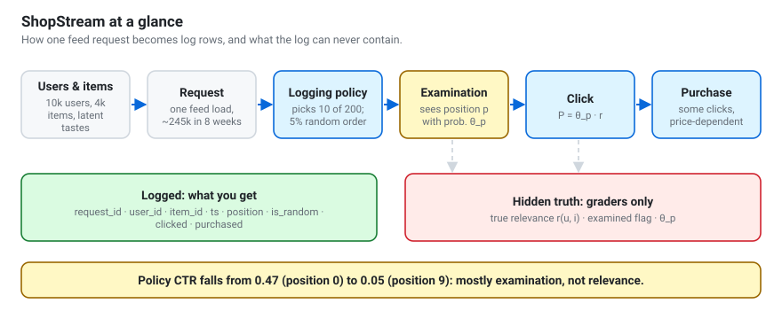

# Part II · Machine Learning at Scale

*Chapters 19–38 · about two weeks at three hours a day · Google Colab CPU runtime (a GPU only speeds up optional sections)*

Part II studies the systems that occupy much of industrial machine learning:
ranking and recommendation over large interaction logs. It covers data
processing at scale, features that are correct at serving time, learning from
biased implicit feedback, retrieval with embeddings, controlled experiments,
and the two kinds of coding interview: data structures and algorithms, and
implementing machine learning methods from first principles.

**Prerequisites.** Part I, or equivalent fluency with pandas, SQL,
scikit-learn, pytest and FastAPI. Readers who score below "solid" in an area
of the Chapter 1 diagnostic should revisit the corresponding Part I chapters
first.

## The project: ShopStream

ShopStream is a synthetic marketplace with 10,000 users, 4,000 items and
eight weeks of feed requests: about 2.4 million impressions at the default
scale, and tens of millions at the large scale used in Chapter 19. Each
request shows ten items chosen by a production *logging policy*. Users examine
top positions far more often than lower ones, click an examined item with a
hidden true probability, and sometimes buy.

*Figure II.1 — How ShopStream generates its logs. Only the left half is
observable in a real system; the simulator also keeps the hidden truth.*

The data is generated by [`src/shoprank/data.py`](../src/shoprank/data.py)
because it retains what real click logs never provide: the true relevance of
every (user, item) pair. This makes it possible to check whether a correction
for position bias recovers relevance, and whether an offline metric agrees
with what users prefer. On the logged data, the production policy's own
ordering obtains a higher NDCG on clicks than an ordering by true relevance;
Chapter 23 explains why, and why this matters for model selection.

The time split is fixed throughout: weeks 1–6 for training, week 7 for
validation and week 8 for the final test, which is used once, in Chapter 38.
ShopStream does not describe any real company or person.

## Organisation

| Chapters | Theme |
|---|---|
| 19–20 | Data at scale: event logs, columnar storage, partitioning, distributed aggregation and joins |
| 21–22 | Features that are correct at serving time: feature stores, point-in-time joins, streaming windows |
| 23–24 | Learning from clicks: position bias, inverse propensity weighting, learning to rank |
| 25–26 | Retrieval: candidate generation, matrix factorisation, two-tower models, approximate nearest neighbours |
| 27–28 | Deep learning practice: training loops, reproducibility, debugging, sequence models |
| 29–30 | Controlled experiments: power, sample-ratio mismatch, CUPED, the delta method, interleaving |
| 31–32 | Machine learning from first principles (interview practice) |
| 33–34 | Data structures and algorithms (interview practice) |
| 35–36 | Serving a ranking cascade; optimising models for inference |
| 37–38 | Recommendation and search system design; final evaluation and a mock interview loop |

**Interview preparation.** Chapters 31–34 teach the patterns and a way of
explaining a solution aloud. Fluency comes from four to eight weeks of daily
practice afterwards; see [Appendix: study plan](../appendices/study-plan.md).

## Chapters

<!-- toc:start -->
| Ch. | Chapter | Lab | Time |
|---:|---|---|---|
| 19 | [Event logs & columnar data](ch19-event-logs-and-columnar-data/README.md) | [notebook](ch19-event-logs-and-columnar-data/notebook.ipynb) ·  | 90 min |
| 20 | [Aggregation & joins at scale](ch20-aggregation-and-joins-at-scale/README.md) | [notebook](ch20-aggregation-and-joins-at-scale/notebook.ipynb) ·  | 90 min |
| 21 | [Feature pipelines & feature stores](ch21-feature-pipelines-and-feature-stores/README.md) | [notebook](ch21-feature-pipelines-and-feature-stores/notebook.ipynb) ·  | 90 min |
| 22 | [Streaming features](ch22-streaming-features/README.md) | [notebook](ch22-streaming-features/notebook.ipynb) ·  | 90 min |
| 23 | [Implicit feedback & position bias](ch23-implicit-feedback-and-position-bias/README.md) | [notebook](ch23-implicit-feedback-and-position-bias/notebook.ipynb) ·  | 90 min |
| 24 | [Learning to rank](ch24-learning-to-rank/README.md) | [notebook](ch24-learning-to-rank/notebook.ipynb) ·  | 90 min |
| 25 | [Candidate generation](ch25-candidate-generation/README.md) | [notebook](ch25-candidate-generation/notebook.ipynb) ·  | 90 min |
| 26 | [Two-tower retrieval & ANN](ch26-two-tower-retrieval-and-ann/README.md) | [notebook](ch26-two-tower-retrieval-and-ann/notebook.ipynb) ·  | 90 min |
| 27 | [PyTorch training done right](ch27-pytorch-training-done-right/README.md) | [notebook](ch27-pytorch-training-done-right/notebook.ipynb) ·  | 90 min |
| 28 | [Sequence models for user behaviour](ch28-sequence-models-for-user-behavior/README.md) | [notebook](ch28-sequence-models-for-user-behavior/notebook.ipynb) ·  | 90 min |
| 29 | [A/B testing fundamentals](ch29-ab-testing-fundamentals/README.md) | [notebook](ch29-ab-testing-fundamentals/notebook.ipynb) ·  | 90 min |
| 30 | [Advanced experimentation](ch30-advanced-experimentation/README.md) | [notebook](ch30-advanced-experimentation/notebook.ipynb) ·  | 90 min |
| 31 | [ML from scratch I](ch31-ml-from-scratch-1/README.md) | [notebook](ch31-ml-from-scratch-1/notebook.ipynb) ·  | 90 min |
| 32 | [ML from scratch II](ch32-ml-from-scratch-2/README.md) | [notebook](ch32-ml-from-scratch-2/notebook.ipynb) ·  | 90 min |
| 33 | [Coding patterns I](ch33-coding-patterns-1/README.md) | [notebook](ch33-coding-patterns-1/notebook.ipynb) ·  | 90 min |
| 34 | [Coding patterns II](ch34-coding-patterns-2/README.md) | [notebook](ch34-coding-patterns-2/notebook.ipynb) ·  | 90 min |
| 35 | [Serving a ranking cascade](ch35-serving-a-ranking-cascade/README.md) | [notebook](ch35-serving-a-ranking-cascade/notebook.ipynb) ·  | 90 min |
| 36 | [Model optimisation for inference](ch36-model-optimization-for-inference/README.md) | [notebook](ch36-model-optimization-for-inference/notebook.ipynb) ·  | 90 min |
| 37 | [Recommendation & search system design](ch37-recsys-and-search-system-design/README.md) | [notebook](ch37-recsys-and-search-system-design/notebook.ipynb) ·  | 90 min |
| 38 | [Final evaluation & mock loop](ch38-final-evaluation-and-mock-loop/README.md) | [notebook](ch38-final-evaluation-and-mock-loop/notebook.ipynb) ·  | 90 min |
<!-- toc:end -->

**Next:** [Part III · Deep Learning and Large-Scale Systems](../part3-deep-learning-systems/README.md)
