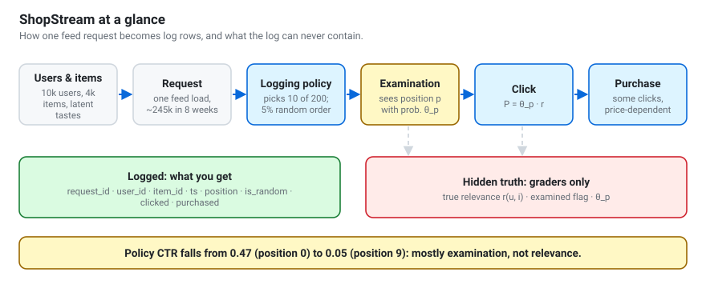
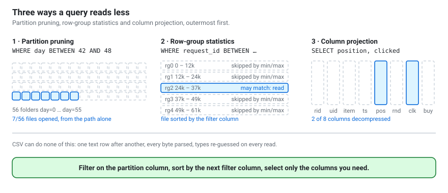

# Chapter 19 · Event logs & columnar data

*Part II · Prerequisites: Chapters 3, 4 and 5 · Estimated time: reading ~60 min, lab ~90 min · Compute: CPU*

[](https://colab.research.google.com/github/berdakh/MLBOOTCAMP/blob/main/part2-ml-at-scale/ch19-event-logs-and-columnar-data/notebook.ipynb) · [Lab: notebook.ipynb](notebook.ipynb) · [Solutions](solutions.md)

## Learning objectives

After this chapter you should be able to:

1. describe ShopStream, the synthetic marketplace used throughout Part II: how its users, items, requests, clicks and purchases are generated, which quantities are logged and which are hidden, and why a synthetic data set is used at all;
2. state what an impression log row must contain, and explain why some quantities (whether the user looked at an item) can never be logged;
3. explain why a columnar file format such as Parquet is smaller and faster to query than CSV, and read the row-group statistics of a Parquet file;
4. use day partitioning, partition pruning and predicate pushdown in DuckDB, and confirm from the query plan (`EXPLAIN ANALYZE`) that they took place;
5. aggregate a data set that does not fit in a given memory budget with an out-of-core engine, and say which aggregates are cheap and which are not;
6. draw a sample from a log that leaves the metric of interest unbiased, and make that sample reproducible with a stable hash.

## 19.1 Introduction

The models in Part II rank items: products in a feed, results for a search
query, candidates for a recommendation. Every such model is trained and
evaluated on *logs*, the records a production system writes each time it shows
something to a user and each time the user responds. A log is not an
experiment designed by the analyst. It is a by-product of a serving system
whose authors had other concerns, and it records only what that system chose
to show. Whether a ranking model can later be trained, debugged and evaluated
without bias is therefore decided to a large extent *before* any modelling:
by which fields the log records, how the log is stored, and how it is sampled.

The situation is familiar from any experimental study that records data.
The quality of the study is bounded by the acquisition protocol: if the
event markers (stimulus onsets, say, or the times of clinical events) were not
written with the measurements, or were written with the wrong clock, no later
analysis can recover them. Event logs play the role of the
recording, and the logging specification plays the role of the protocol.

This chapter proceeds as follows. Section 19.2 introduces ShopStream, the
synthetic marketplace that generates every data set in Part II, and explains
why its hidden ground truth makes it suitable for teaching. Section 19.3
specifies what a good impression log row contains. Sections 19.4 to 19.6 cover
storage: columnar formats, partitioning and the ways a query engine avoids
reading data it does not need. Section 19.7 treats out-of-core aggregation.
Section 19.8 treats sampling, and shows that the unit of sampling must match
the unit of the metric.

## 19.2 ShopStream: a synthetic marketplace with known ground truth

### 19.2.1 Why a synthetic data set

Real click logs have one property that makes them unsuitable for learning the
methods of Part II: the true answer is never known. When a user does not click
an item at position 8, we cannot tell whether the user disliked the item or
never scrolled that far. When a position-bias correction (Chapter 23) produces
a new estimate of relevance, there is no reference against which to check it.
When an offline metric prefers model A to model B, we cannot know whether
users would actually prefer A. In a real system these questions are answered,
slowly and expensively, by online experiments (Chapters 29–30).

A simulator removes this limitation. Because ShopStream *generates* every
click, it knows the probability with which each click was generated. Every
method in Part II can therefore be graded against the truth, not only against
other methods. This is the same reason signal-processing courses test a filter
on a synthetic signal with known components before applying it to recorded
data: on real data one can only compare estimators with each other; on
synthetic data one can measure their error.

The price of this design is realism. ShopStream is simple: tastes do not drift,
there is no seasonality beyond the weekly cycle of requests, and users do not
influence each other. Results on ShopStream should be read as demonstrations
of a mechanism ("position bias makes the logging policy look better than it
is"), not as estimates of effect sizes in any real marketplace. Nothing in
ShopStream describes a real company or real people.

### 19.2.2 The generating process

The generator lives in [`src/shoprank/data.py`](../../src/shoprank/data.py).
It builds a *world* (users, items and their hidden properties) and then
simulates eight weeks of feed requests in that world.



*Figure 19.1 — ShopStream at a glance. The log records what was shown where and what was clicked; examination and true relevance remain hidden inside the simulator.*

**Items.** The default (`small`) world has 4,000 items in 20 categories. Each
category has a centroid in a 16-dimensional latent space, and each item's
latent vector $\mathbf{v}_i$ is its category centroid plus Gaussian noise, so
items of the same category are similar. Each item also has a price (log-normal
around a category-specific base price), a scalar quality $q_i \sim
\mathcal{N}(0, 1)$, and a creation day. About 15% of items are created during
the eight weeks rather than before them; these are the *cold-start* items of
Chapter 25.

**Users.** The world has 10,000 users. Each user belongs to one of five
segments; each segment prefers a few categories. A user's latent taste vector
$\mathbf{u}_u$ is a weighted mixture of the centroids of three favourite
categories plus individual noise. Each user also has an activity rate (how
often they open the feed, log-normally distributed, so a minority of heavy
users produces a large share of traffic), a country, a device, and a signup
day; about 20% of users sign up during the window.

**True relevance.** The probability that user $u$ clicks item $i$ *given that
the user examines it* is a logistic function of a relevance score:

$$
P(C = 1 \mid E = 1, u, i) = \sigma\!\left(1.6\,\mathbf{u}_u^{\top}\mathbf{v}_i + 0.5\,q_i - 0.25\,\log \text{price}_i - 1.2\right)
\qquad (19.1)
$$

where $C$ is the click indicator, $E$ the examination indicator,
$\sigma(x) = 1/(1+e^{-x})$ the logistic function, $\mathbf{u}_u$ and
$\mathbf{v}_i$ the user and item latent vectors, $q_i$ the item quality, and
$\text{price}_i$ the item price. This quantity does not depend on where the
item was shown. It is what a perfectly debiased model would predict, and the
simulator exposes it as `World.true_click_prob`.

**Requests and the logging policy.** Each day, user $u$ opens the feed a
Poisson-distributed number of times, with a mean of 0.35 times their activity
rate. Each opening is a *request*. For each request the production ranker,
called the *logging policy*, draws 200 random candidate items that already
exist on that day, scores them, and shows the top $K = 10$ in order. The
policy's score is

$$
s_{ui} = \log \text{pop}_i + 0.8\,\tilde{\mathbf{u}}_u^{\top}\mathbf{v}_i + g_{ui},
\qquad g_{ui} \sim \operatorname{Gumbel}(0, 0.7)
\qquad (19.2)
$$

where $\text{pop}_i$ is a noisy popularity built from item quality,
$\tilde{\mathbf{u}}_u$ is the policy's *noisy* estimate of the user's taste
(the true vector plus noise), and $g_{ui}$ is random noise. The policy is
therefore reasonable but imperfect: it knows popularity well and taste
poorly. The Gumbel noise makes the ranking stochastic; taking the top 10
after adding Gumbel noise is equivalent to sampling ten items without
replacement from a softmax over the scores divided by 0.7 (the "Gumbel-top-$k$" trick). In
principle the probability of each displayed list could therefore be computed,
but the generator does not log it, which mirrors a common gap in real logs
(Section 19.3).

**Exploration traffic.** In 5% of requests the policy is bypassed and ten
eligible items are shown in uniformly random order. These requests carry
`is_random = True`. They are the only part of the log in which an item's
position is independent of its relevance, and Chapter 23 uses them to
estimate position bias.

**Examination, clicks and purchases.** The user examines the item at position
$p$ (counted from 0 at the top) with probability

$$
P(E = 1 \mid p) = (1 + p)^{-\eta}, \qquad \eta = 0.9
\qquad (19.3)
$$

so the top item is always examined and the item at position 9 is examined
with probability $10^{-0.9} \approx 0.13$. An examined item is clicked with the
probability of Equation (19.1). A clicked item is purchased with a probability
that falls with price and rises with quality. The overall click probability
is the product

$$
P(C = 1 \mid u, i, p) = P(E = 1 \mid p)\; P(C = 1 \mid E = 1, u, i)
\qquad (19.4)
$$

This is the *examination hypothesis*, the simplest click model, studied in
Chapter 23. Equation (19.4) is the reason why clicks are a biased measure of
relevance: the same item collects fewer clicks at position 8 than at position
0, for reasons that have nothing to do with the item.

### 19.2.3 What is logged and what is hidden

Each impression produces one row with the columns `request_id`, `ts` (event
time), `day`, `user_id`, `item_id`, `position`, `is_random`, `policy_score`
(missing on exploration traffic), `clicked` and `purchased`. The raw files also
contain a column `examined`, which is simulation truth. The loader
`shoprank.store.load` drops it, and every lab in Part II works without it.
Using it would amount to training on information that no production system
possesses.

The hidden quantities that the simulator keeps, and the labs use for grading,
are: the examination indicator, the true click probability of any (user,
item) pair, the latent vectors, and the policy's internal noise. The
consequences are substantial. As the Part II overview notes, on the logged
data the logging policy's own ordering obtains a *higher* NDCG on clicks than a
ordering by true relevance does: the policy put its favourite items at the
top, the top positions are examined most, and so those items collected the
clicks. An offline evaluation on clicks therefore rewards models that imitate
the logging policy. Chapters 23 and 24 return to this.

### 19.2.4 Scales and the time split

The generator has three presets, all deterministic given the seed:

| Preset | Users | Items | Days | Impressions | Used for |
|---|---|---|---|---|---|
| `tiny` | 600 | 300 | 14 | small | unit tests and graders |
| `small` | 10,000 | 4,000 | 56 | about 2.4 million | every lab in Part II |
| `large` | 200,000 | 20,000 | 56 | about 46 million | this chapter's scale experiments |

Days are numbered 0 to 55, starting on Monday 3 March 2025. Part II uses a
fixed time split: weeks 1–6 (days 0–41) for training, week 7 (days 42–48) for
validation, and week 8 (days 49–55) for the final test, which is touched once,
in Chapter 38. A time split rather than a random split is used for the reasons
given in Chapter 5: a model is always trained on the past and applied to the
future, and a random split would let information from the future leak into
training. The data are regenerated from the seed in each runtime rather than
downloaded; the generation of `small` takes about 10 s on a 4-core machine and
30–60 s on a free Colab CPU. Because NumPy random streams may differ slightly
between versions, the labs quote approximate values rather than exact ones.

## 19.3 What a good log row contains

A useful way to think about a log row is as a statement that must allow a
reader, months later, to answer the questions *who saw what, where, when,
chosen by which system, with what probability, and what happened next*. A row
that omits one of these cannot be repaired afterwards, because the serving
state at the time of the event is gone.

| Field | Purpose | ShopStream column |
|---|---|---|
| event id (unique per impression) | deduplication; joining outcomes to the impression they belong to | derived as `request_id * 10 + position` |
| request id | groups the items shown together; every per-list metric (NDCG, "did the user click anything") needs it | `request_id` |
| entity ids | user, item, and where relevant session, device and surface | `user_id`, `item_id` |
| event time | when the event happened, in UTC; the time as of which features must be computed (Chapter 21) | `ts` |
| position | the strongest single driver of clicks (Chapter 23) | `position` |
| policy or model version | which ranker produced the list; without it, models cannot be compared in the log | (one policy in ShopStream) |
| logging propensity | the probability that the policy showed this item at this position; needed for unbiased off-policy evaluation | not logged; only the exploration flag `is_random` |
| outcomes | click, purchase, dwell time, each with its own timestamp | `clicked`, `purchased` |

Two of these fields deserve comment.

**The propensity.** Off-policy evaluation asks how a *new* ranker would have
performed, using logs collected under the *old* one. The standard estimators
(inverse propensity scoring, doubly robust estimation) reweight each logged
outcome by the inverse of the probability with which the old policy took the
logged action. Without that probability, the estimators cannot be computed,
and every new idea must be tested online. The propensity is also the field
most often forgotten, because the serving system does not need it to function.
ShopStream reproduces this gap on purpose: it logs the exploration flag but
not the propensities of the main policy.

**Examination.** No real log can record whether the user looked at an item.
A missing click has two possible explanations, "not examined" and "examined
and not relevant", and the log cannot distinguish them. The closest
observable proxy is viewport data (was the item rendered on screen, and for
how long), which is worth logging, but it is not examination. ShopStream knows
examination because it decided it; that is why its raw files contain the
hidden `examined` column and why the loader removes it.

A related design decision is to keep outcomes in separate tables keyed by the
impression id rather than as columns of the impression row. Outcomes arrive
later than impressions, often from other systems (a purchase is recorded by the
payment service), and a purchase may happen hours after the click. ShopStream
stores them as columns for simplicity.

## 19.4 Row-oriented and columnar storage

A CSV file stores the data row after row as text. To compute the mean of one
column, a reader must parse every character of every column, and it must guess
the type of each column again on every read. Parquet differs in three ways.

1. **Columnar layout.** The values of each column are stored contiguously. A
   query that needs two of ten columns reads only those two (*column
   projection*).
2. **Typed, compressed encodings.** Each column has a declared type, and
   similar values stored next to each other compress well. Parquet uses
   dictionary encoding for repeated values, run-length encoding for runs of
   equal values, and general-purpose compression on top.
3. **Row groups with statistics.** The file is divided horizontally into *row
   groups* (DuckDB writes groups of 122,880 rows by default). For each row group
   and column, the file footer stores the minimum and maximum value. A filter
   whose range does not overlap a row group's range lets the reader skip that
   group without decompressing it.

The schema is stored in the file, so it travels with the data. In the lab,
`pandas.read_csv` returns the timestamp column `ts` as plain strings, whereas
`read_parquet` returns it as a timestamp.

On ShopStream `small` (about 2.45 million rows, CPU run in the lab), the CSV
file is about 5–6 times larger than the Parquet file (about 165 MB against
25 MB), `read_csv` is roughly 10 times slower than `read_parquet` (about 2.8 s
against 0.25 s), and reading only two columns from Parquet takes about 0.05 s.

**Row-group statistics depend on sort order.** Statistics are useful only if
the values within a row group span a narrow range. The lab writes the file
sorted by `request_id`, so each of its roughly 20 row groups covers a narrow
range of request ids, and a filter `request_id BETWEEN 100000 AND 100500` can
match exactly one row group. A filter on `user_id` cannot skip anything: every
row group contains almost every user. The practical rule is to sort (or
*cluster*) a table by the column it is filtered on most often.

Columnar formats are designed for reading. Changing one row requires rewriting
a whole file; they are not a replacement for a transactional database.

## 19.5 Partitioning, partition pruning and predicate pushdown

Row-group skipping still requires the reader to open every file and read its
footer. *Partitioning* acts one level higher. In a Hive-style layout, the table
is a directory with one subdirectory per value of the partition column, and the
value is written into the path:

```
impressions/
  day=0/part-0000.parquet
  day=1/part-0000.parquet
  ...
  day=55/part-0012.parquet
```



*Figure 19.2 — Three ways a columnar scan reads less: partition pruning skips folders by name, row-group statistics skip parts of files, and column projection skips columns.*

The figure shows three distinct mechanisms, which are often confused:

* **Partition pruning.** A filter on the partition column (`WHERE day BETWEEN
  42 AND 48`) is evaluated against the directory listing. Files outside the
  range are never opened. In DuckDB's plan this appears as `File Filters` and
  `Scanning Files: 7/56`.
* **Predicate pushdown.** A filter on an ordinary column is passed into the
  file reader, which uses the row-group statistics to skip groups and avoids
  materialising rows that fail the filter.
* **Column projection.** Only the columns the query uses are read. In DuckDB's
  plan this appears as the `Projections` list of the scan.

Pruning works only when the filter is written on the partition column itself.
In the lab, the same weekly aggregate is computed twice: once with `WHERE day
BETWEEN 42 AND 48`, and once with the day computed from the timestamp,
`date_diff('day', TIMESTAMP '2025-03-03', ts) BETWEEN 42 AND 48`. Both give the
same answer, but the second must read every row before it can evaluate the
filter, so it scans all 56 files and takes roughly ten times longer (about
10 ms against 130 ms on the lab machine). On a laptop the difference is
milliseconds; on a table of several terabytes in a cloud warehouse, which bills
by bytes scanned, it is the difference between a cheap query and an expensive
one. The same rule holds in BigQuery, Snowflake and Spark.

**Choosing the partition key.** The partition key should be the column used in
almost every query's filter (for logs, the date) and should have moderate
cardinality. A key that is too fine, such as the user id or the minute, creates
millions of small files. Listing and per-file overhead then dominate, and the
statistics within each file become useless.

**A practical detail.** If the partition folders are written zero-padded
(`day=07`), DuckDB infers `day` as text, and a comparison with an integer
fails. ShopStream writes unpadded names (`day=7`) for that reason.

## 19.6 Two scales of the same world

The `small` preset fits comfortably in pandas. The `large` preset (200,000
users, 20,000 items) produces about 46 million impressions, which is too much
for the time budget of a lab. Because the generator emits requests in day
order, the lab writes only the first seven days of `large` (about 4.7 million
rows, about 50 MB on disk, written in about 30 s on the test machine) and
extrapolates the cost of the full data set (about 5 minutes on the same
machine). The rows written are exactly the first week of the full world, not a
different, smaller world.

## 19.7 Out-of-core aggregation

pandas holds an entire table in memory, and many operations (a `groupby`, a
merge) create further copies. The week of `large` occupies about 155 MB as a
pandas frame. An *out-of-core* engine such as DuckDB instead streams the files
through its operators and, when its memory limit is reached, writes
intermediate state to a temporary directory on disk ("spilling").

Whether an aggregate can be computed in a small, fixed amount of memory
depends on the size of its *state per group*. Aggregates fall into three
classes:

* **Distributive** aggregates (count, sum, min, max) can be computed from
  partial results of the same kind: the sum of a group is the sum of partial
  sums.
* **Algebraic** aggregates (mean, variance) can be computed from a fixed number
  of distributive ones: the mean is a sum divided by a count.
* **Holistic** aggregates (exact distinct count, exact median) need state that
  grows with the data: to count distinct items exactly, the engine must
  remember every item seen in the group.

In the lab, DuckDB computes per-user counts and click sums for the roughly
130,000 users active in the `large` week within a 64 MB memory limit in well
under a second. The exact `count(DISTINCT item_id)` per user failed with an
out-of-memory error at 64 MB in our run (DuckDB 1.2.2; it needed about 250 MB);
other versions may spill and succeed slowly. The approximate
`approx_count_distinct`, which uses the HyperLogLog sketch, keeps a fixed-size
state per group and succeeds. Chapter 20 measures the accuracy that the sketch
gives up.

The same reasoning applies in distributed engines (Spark, BigQuery): the
analyst writes the aggregate, and the engine streams, shuffles and spills.
Holistic aggregates are the ones that cause trouble.

## 19.8 Sampling a log without bias

Analyses are rarely run on a full log; they are run on a sample. A sample is
unbiased for a metric only if it preserves the structure the metric depends
on. Consider three 10% samples of ShopStream `small`:

* a **row sample**, which keeps each impression independently;
* a **request sample**, which keeps all ten rows of 10% of requests;
* a **user sample**, which keeps every row of 10% of users;

and three metrics defined at three levels: impression click-through rate (CTR,
per row), the share of requests with at least one click (per request), and the
number of distinct items a user saw (per user).

### 19.8.1 Per-row metrics

The CTR $\hat p$ in a random sample of $n$ rows is an unbiased estimate of the
population CTR $p$, with standard error

$$
\operatorname{SE}(\hat p) = \sqrt{\frac{p\,(1-p)}{n}}
\qquad (19.5)
$$

(strictly, this formula assumes independent rows; rows of the same request or
user are correlated, which makes the true standard error somewhat larger). With
$p = 0.137$ and $n \approx 245{,}000$, Equation (19.5) gives
$\operatorname{SE} \approx 0.0007$. In the lab, the CTR is about 0.137 in every
sample.

### 19.8.2 Per-request metrics

The share of requests with a click is about 0.76 in the full log, the request
sample and the user sample, but only about 0.20 in the row sample. Under row
sampling with rate $f$, a request that contains $c$ clicks keeps at least one
of them with probability $1-(1-f)^{c}$, and the request survives at all (keeps
at least one of its ten rows) with probability $1-(1-f)^{10}$. Hence

$$
P(\text{click kept} \mid \text{request kept}) = \frac{\mathbb{E}\left[1-(1-f)^{c}\right]}{1-(1-f)^{10}}
\qquad (19.6)
$$

where the expectation is over the distribution of $c$ across requests. For a
request with one click and $f = 0.1$, the ratio is $0.1/0.651 \approx 0.15$,
although the full log says the request has a click with certainty. NDCG, MRR
and every other per-list metric are distorted in the same way, because the
lists they are computed on have been reduced to one or two items.

### 19.8.3 Per-user metrics

The number of distinct items per user is about 210 in the full log and in the
user sample, but only 25–30 in the row and request samples: a per-user metric
needs *all* of the user's rows.

The general rule is: **sample at the level of the unit over which the metric is
computed, or at a coarser level.** Sample requests for ranking metrics; sample
users for per-user metrics and for A/B tests, in which the user is the unit of
randomisation (Chapter 29).

### 19.8.4 Reproducible samples with a stable hash

A sample drawn with a random number generator has two weaknesses. It changes
when the population or its order changes, and it cannot be recomputed in a
different system (an SQL warehouse, a Spark job) with the same result. The
standard remedy is to decide membership by a *hash of the key*:

$$
\text{keep}(u) = \Big[\, h(\text{salt} \,\|\, \texttt{:} \,\|\, u) \bmod 100 < \text{pct} \,\Big]
\qquad (19.7)
$$

where $h$ is a fixed hash function that maps a string to a large integer,
$\|$ denotes string concatenation, $u$ is the key (a user id), and pct is the
sample percentage. The decision is a pure function of the key: the same user
receives the same decision every day, in every job and on every machine, and
samples are nested (a 5% sample is contained in the 10% sample).

Three details matter.

1. **The hash must be stable.** Python's built-in `hash()` of a string is
   randomised per process (controlled by `PYTHONHASHSEED`, a protection
   against denial-of-service attacks), and `hash()` of an integer is the
   integer itself, so `hash(user_id) % 100 < 10` keeps users whose ids end in
   00–09, which is often a signup cohort. A cryptographic hash such as SHA-256
   is defined by a standard and gives the same digest everywhere. The lab uses
   the first 16 hexadecimal digits (64 bits) of the SHA-256 digest; the modulo
   bias of $2^{64} \bmod 100$ is negligible.
2. **The salt makes samples independent.** Without a salt, every analysis that
   keeps bucket < 10 obtains the same users. Two experiments would always share
   their treatment groups, and one unusual bucket would bias every study.
3. **The separator prevents collisions.** Without the colon, salt `exp1` with
   user 23 and salt `exp12` with user 3 both hash the string `exp123`.

Because each key is kept with probability $q = \text{pct}/100$ independently of
the others, the sample size is binomial:

$$
\mathbb{E}[\text{kept}] = N q, \qquad \operatorname{SD}[\text{kept}] = \sqrt{N q (1-q)}
\qquad (19.8)
$$

where $N$ is the number of keys. For $N = 10{,}000$ and $q = 0.1$ this is
$1{,}000 \pm 30$. In the lab the hash sample contains about 1,030 users, one
standard deviation above the mean, and it reproduces the per-user metric of
the full log (about 209 distinct items per user).

## Key terms

| Term | Definition |
|---|---|
| Impression | One item shown to one user at one position; one row of the `impressions` table. |
| Request | One feed load: the ten items shown together, identified by `request_id`. |
| Logging policy | The production ranker that chose what was shown; in ShopStream, a noisy mix of popularity and a weak taste model. |
| Exploration traffic | Requests in which items are shown in random order on purpose (`is_random = True`, 5% of requests). |
| Examination | The event that the user actually looked at an item; never observable in a real log. |
| Ground truth | Quantities known to the simulator but not to the analyst: examination, true click probabilities, latent vectors. |
| Propensity | The probability that the logging policy took the logged action (showed this item at this position). |
| Columnar format | A file format that stores each column contiguously, typed and compressed (Parquet). |
| Row group | A horizontal slice of a Parquet file, with minimum and maximum statistics per column. |
| Hive partitioning | A directory layout with one folder per value of a column, the value written in the path (`day=7/`). |
| Partition pruning | Skipping whole files using only the partition values in their paths. |
| Predicate pushdown | Evaluating a filter inside the file reader, using row-group statistics to skip data. |
| Column projection | Reading only the columns a query uses. |
| Out-of-core processing | Processing data larger than the memory budget by streaming it and spilling intermediate state to disk. |
| Holistic aggregate | An aggregate whose state grows with the data (exact distinct count, median). |
| Stable hash sample | A sample in which a key is kept if a fixed hash of salt and key falls below a threshold. |

## Summary

1. ShopStream is a synthetic marketplace whose generator knows the truth: the
   true click probability of every (user, item) pair and whether each item was
   examined. Methods in Part II are graded against that truth.
2. Clicks in ShopStream follow the examination hypothesis (Equation 19.4):
   position affects clicks independently of relevance, so clicks are a biased
   measure of relevance.
3. An impression log must record who saw what, where, when, from which policy,
   with what probability, and what followed. The propensity is the field most
   often forgotten; examination can never be logged.
4. Parquet is columnar, typed, compressed and carries row-group statistics; on
   ShopStream `small` it is about 6 times smaller and 10 times faster to read
   than CSV.
5. Partition pruning skips files by path, predicate pushdown skips row groups
   by statistics, and column projection skips columns. Pruning requires a
   filter on the partition column itself; `EXPLAIN ANALYZE` shows whether it
   took place.
6. Out-of-core engines aggregate data larger than memory. Distributive and
   algebraic aggregates are cheap; holistic aggregates such as exact distinct
   counts are not, and sketches replace them.
7. The sampling unit must match the metric's unit, or be coarser. Row samples
   preserve CTR but destroy per-request and per-user metrics.
8. Reproducible samples come from a salted, stable hash of the key, never from
   Python's built-in `hash()`.

## Exercises

The exercises are in the lab, [notebook.ipynb](notebook.ipynb); worked answers
are in [solutions.md](solutions.md).

* **Exercise 1** (graded). Implement `user_hash_sample(user_ids, pct, salt)`
  with the SHA-256 rule of Equation (19.7). The grader checks the exact
  decisions, determinism, nesting of samples and the effect of the salt.
* **Exercise 2** (graded). Write a DuckDB query that computes daily CTR by
  position for days 7–13 over the day-partitioned layout. The grader corrupts
  every file outside the requested days, so only a query that prunes partitions
  succeeds.
* **Exercise 3** (written). Specify the impression log of a "similar items"
  carousel: fields and types, partitioning and sort order, how to sample for
  two given metrics, and the one field whose omission makes later offline
  evaluation impossible.
* **Checkpoint questions.** Six oral questions on log design, Parquet versus
  CSV, pruning versus pushdown, out-of-core aggregation, sampling for NDCG, and
  stable hashing.

## Further reading

* M. Kleppmann, *Designing Data-Intensive Applications*, O'Reilly, 2017 — Chapter 3 (storage and retrieval, column-oriented storage) and Chapter 10 (batch processing).
* C. Huyen, *Designing Machine Learning Systems*, O'Reilly, 2022 — Chapter 3 (data engineering fundamentals: formats, row-major versus column-major storage).
* Apache Parquet documentation, "File format" — <https://parquet.apache.org/docs/>.
* DuckDB documentation, "Reading and writing Parquet files" and "Hive partitioning" — <https://duckdb.org/docs/>.
* R. Kohavi, D. Tang and Y. Xu, *Trustworthy Online Controlled Experiments*, Cambridge University Press, 2020 — chapters on randomisation units and logging.
* T. Joachims, A. Swaminathan and T. Schnabel, "Unbiased Learning-to-Rank with Biased Feedback", WSDM 2017 — the examination hypothesis and propensity weighting used in Chapter 23.

**Next:** [Chapter 20 · Aggregation & joins at scale](../ch20-aggregation-and-joins-at-scale/README.md)
