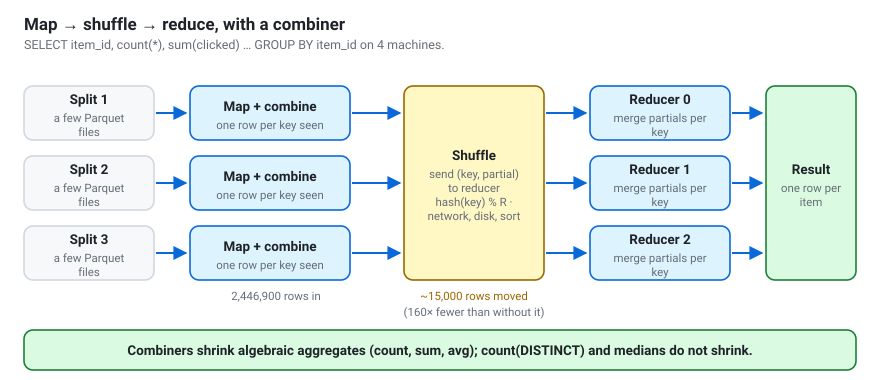
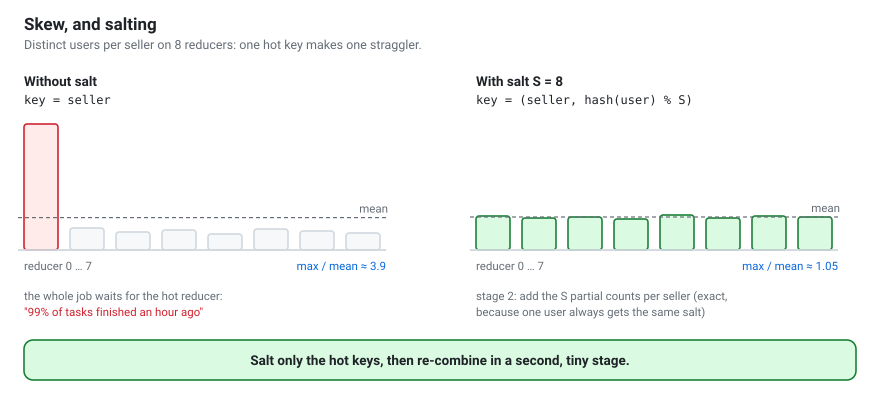
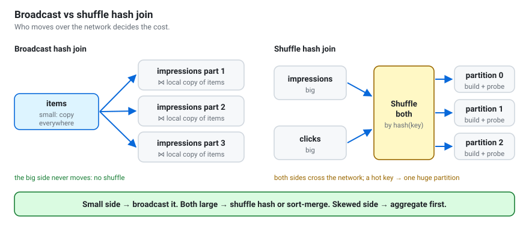
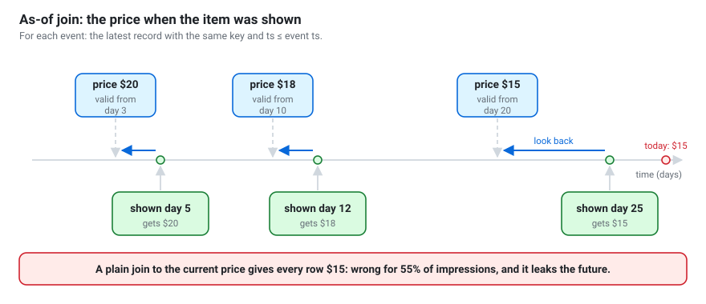

# Chapter 20 · Aggregation & joins at scale

*Part II · Prerequisites: Chapters 4 and 19 · Estimated time: reading ~55 min, lab ~90 min · Compute: CPU*

[](https://colab.research.google.com/github/berdakh/MLBOOTCAMP/blob/main/part2-ml-at-scale/ch20-aggregation-and-joins-at-scale/notebook.ipynb) · [Lab: notebook.ipynb](notebook.ipynb) · [Solutions](solutions.md)

## Learning objectives

After this chapter you should be able to:

1. describe how a distributed engine executes a `GROUP BY` as map, shuffle and reduce stages, and explain why a combiner reduces the cost of the shuffle;
2. classify aggregates as distributive, algebraic or holistic, and predict which of them combine cheaply;
3. recognise key skew, explain why it makes one task a straggler, and remove it with salting (two-stage aggregation);
4. choose between broadcast, shuffle-hash and sort-merge joins, and predict the output size of a join on a skewed key;
5. attach the value of a changing attribute *as of* an event's time with an as-of join, and explain why a plain join to the current value leaks future information;
6. deduplicate events delivered more than once, deterministically;
7. use HyperLogLog, quantile sketches and reservoir sampling, state their error, and say when an approximate answer is acceptable.

## 20.1 Introduction

Chapter 19 showed how logs are stored and how a single-machine engine reads
them efficiently. Production logs, however, are processed on clusters. A
`GROUP BY` over a billion rows is split into many tasks on many machines, and
the tasks must exchange data so that all rows with the same key meet in one
place. Most slow or failing data pipelines can be traced to this exchange: too
much data moved, or one task given far more data than the others.

The purpose of this chapter is to give an accurate mental model of what an
engine (Spark, BigQuery, Flink, or DuckDB on one machine) does with an
aggregation or a join, so that a query plan or a stuck job can be reasoned
about. The lab implements the mechanisms by hand on ShopStream and checks
each one against DuckDB. Section 20.2 covers the map–shuffle–reduce model.
Section 20.3 covers skew and salting. Section 20.4 covers join strategies and
the size of joins on skewed keys. Section 20.5 covers as-of joins, which attach
time-varying attributes without leaking the future. Section 20.6 covers
deduplication, and Section 20.7 covers approximate algorithms.

## 20.2 Map, shuffle and reduce

A distributed `SELECT item_id, count(*), sum(clicked) FROM impressions GROUP
BY item_id` runs in three stages.

1. **Map.** Each map task reads one input split (a few files or row groups)
   and emits `(key, value)` pairs. Optionally it *combines*: it pre-aggregates
   its own pairs by key, so it emits one row per distinct key it saw instead of
   one row per input row.
2. **Shuffle.** Each pair is sent to the reduce task that owns its key,
   determined by a hash of the key:

   $$
   \text{reducer}(k) = h(k) \bmod R
\qquad (20.1)
   $$

   where $k$ is the key, $h$ a stable hash function and $R$ the number of
   reducers. All rows with the same key therefore meet at one reducer. The
   shuffle is the expensive stage: data are serialised, written to local disk,
   sent over the network and usually sorted.
3. **Reduce.** Each reduce task merges the values of the keys it owns.



*Figure 20.1 — A distributed `GROUP BY`. The shuffle is the only stage that crosses the network; the combiner determines how much data enters it.*

**The combiner.** Without a combiner, every input row crosses the network. With
a combiner, each mapper sends at most one row per distinct key in its split.
If $M$ mappers each see $d_m$ distinct keys, the number of rows shuffled falls
from the number of input rows $N$ to

$$
N_{\text{shuffled}} = \sum_{m=1}^{M} d_m \;\le\; \min\!\left(N,\; M \cdot d\right)
\qquad (20.2)
$$

where $d$ is the total number of distinct keys. In the lab, with four mappers
over the 2,446,900 impressions of ShopStream `small` and `item_id` as key, the
shuffle falls from 2,446,900 rows to about 15,000 (four mappers times about
3,700 items each), roughly 160 times less data, and the result is identical to
DuckDB's.

**Which aggregates combine.** The combiner works only for aggregates whose
partial results can be merged exactly into a state of fixed size. This leads
to the classification already met in Chapter 19:

* **distributive**: count, sum, min, max (the merge is the same operation);
* **algebraic**: mean, variance (carry a fixed tuple such as (sum, count) and
  finish at the end);
* **holistic**: exact distinct count, exact median, "collect all values"
  (the state grows with the data).

Holistic aggregates cannot be reduced to a fixed size at the mapper, so all
their data must cross the network. They are the slow, memory-intensive
aggregates; Chapter 19 observed an exact `count(DISTINCT)` failing under a
64 MB memory limit where counts and sums succeeded.

A familiar analogy is an election count. Each polling station counts its own
ballots and reports totals, rather than sending every ballot to the capital;
totals add up exactly. The median age of the voters, however, cannot be
assembled from per-station medians, which is why holistic aggregates are
expensive.

## 20.3 Skew and salting

The hash in Equation (20.1) spreads keys evenly over reducers, but it cannot
spread *rows* evenly if a few keys hold most of the rows. This condition is
called *key skew*. It is the rule rather than the exception: marketplaces are
dominated by a few large sellers, search logs by a few frequent queries, and
pipelines by a few junk keys (`NULL`, `-1`, `"unknown"`). If one key holds a
fraction $s$ of the rows, the reducer that owns it receives at least

$$
\frac{\text{load of the hot reducer}}{\text{mean load}} \;\ge\; s \cdot R
\qquad (20.3)
$$

times the average load, whatever hash function is used. A job finishes only
when its slowest task finishes, so one overloaded reducer (a *straggler*)
determines the run time: the familiar situation of 999 tasks finished and one
still running.

The lab assigns each ShopStream item to one of 500 sellers with power-law
sizes. For an aggregate that combines (impressions per seller), skew is
harmless: each mapper sends one row per seller. For a holistic aggregate
(distinct users per seller), each mapper can only remove the duplicate
`(seller, user)` pairs it sees itself, and every remaining pair must travel to
the seller's reducer.



*Figure 20.2 — Key skew and salting. The job time is set by the tallest bar; salting evens the bars and a small second stage adds the partial results.*

**Salting.** Salting replaces the hot key $k$ by a compound key $(k, \text{salt})$
with $\text{salt} = h(\text{user}) \bmod S$ for some number of salts $S$. The
first stage computes the distinct users of each sub-key; because a given user
always receives the same salt, the sub-keys of one seller hold disjoint sets of
users. The second stage sums the $S$ partial counts per seller, which gives the
exact answer. In the lab, with 64 reducers and $S = 16$, the ratio of the
busiest reducer's load to the mean falls from several (about 4.3 in our run) to
close to 1 (about 1.4), and the two-stage answer equals the exact one.

Salting has costs: a second stage, and $S$ times more partial rows for small
keys. In practice only the hot keys are salted, identified from a sample or
from the statistics of the previous run. Spark 3's adaptive query execution
splits skewed partitions automatically for joins, but the manual technique
remains necessary when the automatic one is not sufficient, and it is a
standard interview question.

## 20.4 Join strategies

| Strategy | Mechanism | Appropriate when | Cost |
|---|---|---|---|
| Broadcast hash join | copy the small table to every worker; each joins its split locally | one side fits in memory (items, sellers, other dimension tables) | no shuffle of the large side |
| Shuffle hash join | hash-partition both sides by the key; each reducer builds a hash table of one side | both sides large, one side's partitions fit in memory | full shuffle of both sides; a hot key creates one huge partition |
| Sort-merge join | partition and sort both sides by the key, then merge | both sides very large (Spark's default for large–large joins) | shuffle and sort; robust because it can spill; skew still hurts |



*Figure 20.3 — Broadcast versus shuffle hash join. In a broadcast join the large table never moves; in a shuffle join both tables cross the network, and a hot key lands entirely in one partition.*

**The size of a join.** Skew is more damaging in a join than in an
aggregation, because nothing combines. If key $k$ has $a_k$ rows in table $A$
and $b_k$ rows in table $B$, the equi-join produces

$$
\lvert A \bowtie B \rvert = \sum_{k} a_k \, b_k
\qquad (20.4)
$$

rows. The sum is dominated by keys that are large on *both* sides. In the lab,
ShopStream impressions are joined to a promotions table in which large sellers
run many promotions. The join produces about 129 million rows, about 53 times
the number of impressions, most of them from the top few sellers. Aggregating
the promotions table to one row per seller *before* the join (so that
$b_k = 1$) gives the same per-seller answer in about 0.02 s instead of 0.6 s.
DuckDB survives the naive query only because it never materialises the joined
rows; a distributed engine would shuffle them, and the top seller's reducer
would run out of memory or time.

Three rules of thumb follow:

1. aggregate or deduplicate the many-rows-per-key side before joining;
2. broadcast small tables (Spark does so automatically below
   `spark.sql.autoBroadcastJoinThreshold`, 10 MB by default);
3. salt only when both sides are large and skewed: salt the large side
   randomly and replicate the hot keys of the other side $S$ times.

On a single machine, a broadcast join with a small dimension table reduces to
an array lookup: build an array indexed by `item_id` and index it with the
impressions' item ids. In the lab this is several times faster than
`pandas.merge` and gives the same result.

## 20.5 As-of joins

Many attributes change over time: prices, stock levels, a user's subscription
tier. A model that uses such an attribute as a feature must see the value that
held *when the event happened*, not the value at the time the training table
was built. The operation that provides it is the *as-of join*: for each left
row with key $k$ and time $t$, take the right row with the same key and the
latest timestamp not after $t$:

$$
\operatorname{asof}(k, t) = \text{value of the row } r \text{ with } r.\text{key} = k
\text{ that maximises } r.\text{valid\_from} \text{ subject to } r.\text{valid\_from} \le t
\qquad (20.5)
$$



*Figure 20.4 — An as-of join on a timeline. Each impression looks back to the most recent price record; records to its right are invisible to it.*

In the lab each item receives a few price changes over the eight weeks
(about 12,100 price records in total), and DuckDB's `ASOF JOIN` attaches the
price at the time of each impression; `pandas.merge_asof` gives the same
result. About 55% of impressions would receive a wrong price from a plain join
to the current price.

The wrong price is not merely noisy; it leaks the future. The current price is
partly a *consequence* of the outcomes the model is meant to predict, because a
seller lowers the price of an item that sells poorly. A model trained on
current prices therefore learns a relation that is not available at
prediction time, performs well offline and disappoints online. This is the
same class of error as the target leakage of Chapter 5, now in time. Chapter 21
builds entire feature tables with point-in-time joins of this kind.

**Strict or non-strict inequality.** With $\le$, an event can see a record
stamped at the same instant. When the right-hand side is derived from data
that include the event itself (for example, a daily aggregate stamped at the
event's time), the inequality must be strict ($<$), so that an event never sees
its own outcome. DuckDB supports both forms; in pandas, `merge_asof` with
`allow_exact_matches=False` gives the strict version.

## 20.6 Deduplicating re-delivered events

Logging pipelines usually provide *at-least-once* delivery: a client retries a
send when it does not receive an acknowledgement, and a consumer that restarts
re-reads its last batch. Duplicates are therefore normal. In the lab, 2% of one
week's impressions are delivered twice; the click count rises by 2% (from
44,188 to about 45,060), which would appear as a spurious improvement in any
metric computed from the raw table.

The standard deduplication keeps the first delivery of each event:

```sql
SELECT * EXCLUDE (rn) FROM (
    SELECT *, ROW_NUMBER() OVER (PARTITION BY request_id, position ORDER BY ingest_ts) AS rn
    FROM raw_log)
WHERE rn = 1
```

Three details matter:

* the deduplication key must identify the *event*, not its content. Here the
  event is `(request_id, position)`; deduplicating on all columns fails as soon
  as a retry carries a different ingestion time;
* ordering by ingestion time and keeping the first row makes the result
  deterministic. (DuckDB's `QUALIFY rn = 1` is shorthand for the subquery.)
* duplicates can cross partition boundaries, for example an event at 23:59
  re-delivered at 00:01. The deduplication must cover a window at least as
  long as the maximum delivery delay, or the table must be partitioned by
  event time rather than ingestion time.

## 20.7 Approximate answers

Exact distinct counts and quantiles need memory that grows with the data.
*Sketches* are data structures that answer such questions with a small,
fixed-size state and a known error.

### 20.7.1 HyperLogLog

HyperLogLog (HLL) estimates the number of distinct values. Each value is
hashed to a uniformly distributed bit string. The first $p$ bits select one of
$m = 2^p$ registers; the register stores the maximum, over all values routed to
it, of the position of the first 1-bit in the remaining bits. If $n$ distinct
values have been seen, a run of $\rho$ leading zeros occurs with probability
$2^{-\rho}$, so the maximum observed run is about $\log_2(n/m)$. The estimate
combines the registers through a bias-corrected harmonic mean. Its relative
standard error is

$$
\frac{\operatorname{SE}(\hat n)}{n} \approx \frac{1.04}{\sqrt{m}}, \qquad m = 2^{p}
\qquad (20.6)
$$

where $\hat n$ is the estimate, $n$ the true distinct count and $p$ the number
of precision bits. With $m = 1{,}024$ the error is about 3.3%; with
$m = 16{,}384$ (about 12 KB) it is about 0.8%, whether there are a thousand or a
billion distinct values.

An intuitive version: if a person reports only that their longest run of heads
in a day of coin tossing was 10, one can estimate that they tossed about
$2^{10}$ times. A single register is a very noisy estimate of this kind;
averaging $m$ registers reduces the noise, which is the origin of
Equation (20.6).

The essential property of HLL is that sketches **merge**. A register stores a
maximum, and the maximum is associative and commutative, so the register-wise
maximum of two sketches is the sketch of the union of their inputs. This
allows combiners in the map stage, distributed distinct counts without a full
shuffle, and the storage of daily sketches that can later be merged into the
number of distinct users over any range of days. Summing daily distinct counts
instead would count a returning user once per day.

### 20.7.2 Quantile sketches and reservoir sampling

Quantile sketches (t-digest, KLL; DuckDB's `approx_quantile`) store a
compressed summary of a distribution that is accurate in the tails. Reservoir
sampling draws a uniform sample of fixed size $k$ from a stream of unknown
length in one pass (Algorithm R): keep the first $k$ items; for the item with
0-based index $i \ge k$, draw $j$ uniformly from $\{0, \dots, i\}$ and replace
slot $j$ if $j < k$. After $n$ items, every item is in the reservoir with the
same probability:

$$
P(\text{item } i \text{ in the sample after } n \text{ items}) = \frac{k}{n}
\qquad (20.7)
$$

The proof is by induction. Item $i$ (counting from 1, with $i > k$) enters
with probability $k/i$, and each later item $j$ evicts it with probability
$(k/j)(1/k) = 1/j$, so it survives to the end with probability
$\frac{k}{i}\prod_{j=i+1}^{n}\frac{j-1}{j} = \frac{k}{i}\cdot\frac{i}{n} = \frac{k}{n}$.

### 20.7.3 When to approximate

In the lab, on 2.4 million rows held in memory, the approximations buy little
speed and sometimes none (all figures from our CPU run on ShopStream `small`):

* distinct `(user, item)` pairs: about 2.06 million exact; DuckDB's HLL
  answered about 1.93 million, about 6% low, roughly 5 times faster;
* distinct users per item-day: a median absolute relative error of about 6%
  and a 99th percentile of about 24%. DuckDB's sketch is small and favours
  memory over precision, so individual small groups should not be read from it;
* the 99th percentile of the policy score: within about 0.01 of the exact
  value, but slower than the exact computation;
* the CTR from a 20,000-row reservoir: within about 0.005 of the exact 0.137,
  consistent with a binomial standard error of
  $\sqrt{0.137 \cdot 0.863 / 20{,}000} \approx 0.0024$.

The case for sketches is therefore **memory and mergeability at scale**, not
speed on small data: an exact distinct count over ten billion rows needs
gigabytes of state per reducer, an HLL sketch a few kilobytes. The error is
set by the sketch size, which BigQuery's `HLL_COUNT` and Spark's
`approx_count_distinct(col, rsd)` let the user choose. The case for a
reservoir is that the next step is expensive per row (training, a Python loop,
manual labelling). Approximations should not be used where an exact count is a
contractual or legal requirement (billing, payments, regulatory reports), or
where the differences of interest are as small as the sketch error (experiment
metrics).

## Key terms

| Term | Definition |
|---|---|
| Map task | A task that reads one input split and emits (key, value) pairs. |
| Shuffle | The redistribution of pairs over the network so that all pairs with the same key reach the same reducer. |
| Reduce task | A task that merges all values of the keys it owns. |
| Combiner | A map-side pre-aggregation that reduces the volume of the shuffle. |
| Distributive / algebraic aggregate | An aggregate whose partial results merge exactly into a fixed-size state (count, sum; mean as (sum, count)). |
| Holistic aggregate | An aggregate whose state grows with the data (exact distinct count, median). |
| Key skew | A distribution in which a few keys hold a large share of the rows. |
| Straggler | A task that runs much longer than the others and delays the whole job. |
| Salting | Splitting a hot key into $S$ sub-keys and recombining the partial results in a second stage. |
| Broadcast join | A join in which the small table is copied to every worker, so the large table is not shuffled. |
| Sort-merge join | A join in which both sides are partitioned and sorted by the key, then merged. |
| As-of join | A join that attaches, for each left row, the latest right row with the same key and a timestamp not after the left row's. |
| At-least-once delivery | A delivery guarantee under which every event arrives, some more than once. |
| Sketch | A small, fixed-size summary of a data set with a known error (HyperLogLog, t-digest, reservoir). |
| Reservoir sampling | A one-pass algorithm that keeps a uniform sample of fixed size from a stream of unknown length. |

## Summary

1. A distributed aggregation is a map stage, a shuffle by hash of the key, and
   a reduce stage. The shuffle dominates the cost.
2. A combiner pre-aggregates at the mapper; it applies to distributive and
   algebraic aggregates and reduced the shuffle about 160-fold in the lab.
   Holistic aggregates cannot be combined to a fixed size.
3. Key skew makes the reducer of a hot key a straggler; its load is at least
   $s \cdot R$ times the mean. Salting the hot key with a stable hash of a
   second attribute and summing in a second stage removes the imbalance and
   keeps the answer exact.
4. Broadcast small tables; use shuffle-hash or sort-merge joins for large–large
   joins. A join on a skewed key produces $\sum_k a_k b_k$ rows; aggregate the
   many-rows side first.
5. An as-of join attaches the value valid at the event time. A join to the
   current value leaks the future; in the lab 55% of impressions would have
   received a wrong price. Use a strict inequality when the attribute is
   derived from the event's own outcome.
6. At-least-once pipelines produce duplicates; deduplicate on the event's
   identity with a deterministic tie-break, over a window that covers the
   maximum delay.
7. HyperLogLog, quantile sketches and reservoirs trade a known error for fixed
   memory. Their main value is memory and mergeability at scale, not speed on
   small data, and they are not appropriate where exact counts are required.

## Exercises

The exercises are in the lab, [notebook.ipynb](notebook.ipynb); worked answers
are in [solutions.md](solutions.md).

* **Exercise 1** (graded). Implement `reservoir_sample(stream, k, seed)` with
  Algorithm R in one pass and $O(k)$ memory. The grader applies a chi-square
  test of uniformity over 2,000 seeds and checks edge cases.
* **Exercise 2** (graded). Implement `partitioned_count(keys, n_partitions)` as
  map, combine, shuffle by stable hash, and reduce. The result must equal
  `collections.Counter(keys)` exactly, including for skewed input, string keys,
  an empty list and a single partition.
* **Exercise 3** (written). Design the daily computation of distinct users per
  item per day over a ten-billion-row log: exact or approximate, what to store
  per day so that 7- and 30-day figures need no rescan, how to treat a few very
  hot items, and how to validate the numbers.
* **Checkpoint questions.** Six oral questions on the physical execution of a
  `GROUP BY`, diagnosing a straggler, choosing a join strategy, the
  current-price leak, detecting duplicate delivery, and the use of HLL.

## Further reading

* J. Dean and S. Ghemawat, "MapReduce: Simplified Data Processing on Large Clusters", OSDI 2004.
* M. Kleppmann, *Designing Data-Intensive Applications*, O'Reilly, 2017 — Chapter 10 (batch processing, including join strategies and skew) and Chapter 11 (stream processing, delivery guarantees).
* P. Flajolet, É. Fusy, O. Gandouet and F. Meunier, "HyperLogLog: the analysis of a near-optimal cardinality estimation algorithm", AofA 2007.
* J. S. Vitter, "Random Sampling with a Reservoir", *ACM Transactions on Mathematical Software* 11(1), 1985.
* T. Dunning and O. Ertl, "Computing Extremely Accurate Quantiles Using t-Digests", arXiv:1902.04023, 2019.
* Apache Spark documentation, "Performance Tuning: Adaptive Query Execution" — <https://spark.apache.org/docs/latest/sql-performance-tuning.html>.
* DuckDB documentation, "ASOF JOIN" and "Aggregate functions" — <https://duckdb.org/docs/>.

**Next:** [Chapter 21 · Feature pipelines & feature stores](../ch21-feature-pipelines-and-feature-stores/README.md)
