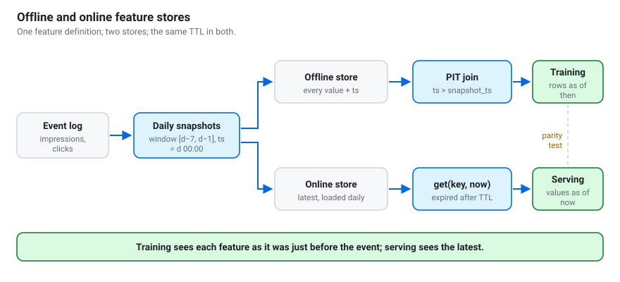

# Chapter 21 · Feature pipelines & feature stores

*Part II · Prerequisites: Chapters 5, 11 and 20 · Estimated time: reading ~50 min, lab ~90 min · Compute: CPU*

 · [Lab: notebook.ipynb](notebook.ipynb) · [Solutions](solutions.md)

## Learning objectives

After this chapter you should be able to:

1. name the components of a feature store (entities, feature views, offline store, online store, materialisation, time-to-live) and explain the role of each;
2. compute user and item features as daily snapshots in SQL, with windows that end strictly before the snapshot time;
3. build a point-in-time-correct training set with an as-of join, and use a time-to-live to treat stale values as missing;
4. demonstrate a same-day leakage bug and measure its effect on a validation metric, both as reported offline and as experienced in production;
5. state the properties that make a backfill correct and safe to repeat, and measure what feature freshness is worth on a given data set;
6. serve the same values from an online store and verify online/offline parity.

## 21.1 Introduction

A model can only be as good as the features it receives *at the moment it
scores a request*. In practice, many of the most damaging errors in
production machine learning are not in the model but in the feature pipeline:
a training set that used information from the future, a serving system that
supplies values the model never saw in training, or a feature that stopped
updating weeks ago without anyone noticing. Such errors do not raise
exceptions. They appear only as a model that looks excellent offline and
disappoints in an online experiment.

Chapter 5 introduced leakage on a single static table, and Chapter 11 showed
how to keep preprocessing consistent between training and serving. This
chapter extends both ideas to features that are computed over time from event
logs and must be available in two places: in the past, for every training
example, and in the present, for every live request. The organising principle
is a single rule:

> A feature value used for an event at time $t$ may only use data from before $t$.

Section 21.2 introduces the vocabulary of feature stores. Section 21.3 builds
daily snapshots. Section 21.4 builds a point-in-time training set and
introduces the time-to-live. Section 21.5 measures a leakage bug. Section 21.6
covers backfills and freshness. Section 21.7 covers the online store and
parity testing.

## 21.2 What a feature store is

A feature store can be described as two databases and a contract between them.

| Concept | Meaning | In the lab |
|---|---|---|
| Entity | The object a feature describes, identified by a key. | user (`user_id`), item (`item_id`), user × category |
| Feature view | A named group of features for one entity, with its definition (SQL), source and time-to-live. | `user_snap`: impressions and clicks in the last 7 days |
| Offline store | The full *history* of feature values, each with a timestamp; large, inexpensive, columnar (Parquet files, BigQuery). | DuckDB tables of daily snapshots |
| Online store | Only the *latest* value per entity key, readable in about a millisecond (Redis, DynamoDB, Bigtable). | `OnlineStore`, a dictionary with a time-to-live |
| Point-in-time join | The operation that builds training rows: for each event, the feature values as they were just before it. | `ASOF JOIN … e.ts > s.snapshot_ts` |
| Materialisation | A scheduled job that copies the newest offline values into the online store. | a daily loop |
| Time-to-live (TTL) | The maximum age at which a stored value is still used; older values count as missing. | 1 day for daily snapshots |

The purpose of the contract is that each feature has **one definition**, used
both to build training data (offline, as of each past event) and to serve the
model (online, as of now). Open-source and commercial products such as Feast,
Tecton, Vertex AI Feature Store and SageMaker Feature Store implement these
ideas; the lab builds a small version so that their behaviour is understood.

*Figure 21.1 — A feature store. Training and serving both start from the same snapshots and differ only in the time as of which they read them: each past event, or now. The parity test checks that the two agree.*

## 21.3 Daily aggregates and snapshots

The lab computes features in two steps, both in SQL.

1. **Daily aggregates.** Impressions and clicks per user per day, per item per
   day, and clicks per (user, category) per day.
2. **Snapshots.** For each snapshot day $d$, the daily aggregates are summed
   over the window of days $d-7$ to $d-1$ (14 days for the category features),
   and the row is stamped `snapshot_ts` $= d$ 00:00. Everything in a snapshot
   was known at its timestamp.

For a user $u$, the click feature of the snapshot stamped at day $d$ is

$$
x_u(d) = \sum_{t=d-7}^{d-1} \text{clicks}_u(t)
\tag{21.1}
$$

where $\text{clicks}_u(t)$ is the number of clicks by user $u$ on day $t$. For
example, clicks of 0, 2, 1, 0, 0, 3 and 1 on days $d-7, \dots, d-1$ give
$x_u(d) = 7$. Computing windows from daily aggregates, rather than rescanning
raw events for every snapshot, is what makes the computation cheap: each
snapshot sums seven small rows.

On ShopStream `small` the whole computation takes about a second and produces
about 410,000 user-snapshot rows (one per user and day on which the user had
activity in the previous week), about 200,000 item-snapshot rows and 1.5
million user × category rows. There is no snapshot for day 0, because there is
no history before it.

Raw counts are often turned into rates. A click-through rate computed from a
few impressions is extremely noisy (one click in two impressions gives 0.5), so
the lab uses a *smoothed* rate, which adds $\alpha$ pseudo-impressions at a
prior rate $p_0$:

$$
\widetilde{\text{CTR}} = \frac{\text{clicks} + \alpha\, p_0}{\text{impressions} + \alpha}
\tag{21.2}
$$

With one click in two impressions, $p_0 = 0.137$ and $\alpha = 20$, the smoothed
rate is $(1 + 2.74)/22 = 0.17$. This is the posterior mean of a Beta–binomial
model with a Beta prior of mean $p_0$ and strength $\alpha$. The prior $p_0$
itself must be computed from past data only; otherwise the prior leaks.

## 21.4 A point-in-time training set

For every impression, the training set attaches the **latest snapshot strictly
before the impression's timestamp**. This is the as-of join of Chapter 20,
applied per entity with a strict inequality. Formally, for an event $e$ with
key $k_e$ and time $t_e$, and snapshots $s$ with key $k_s$ and timestamp
$\tau_s$,

$$
s^{*}(e) = \underset{s:\; k_s = k_e,\; \tau_s < t_e}{\arg\max}\; \tau_s,
\qquad \text{use } s^{*} \text{ only if } t_e - \tau_{s^{*}} \le \text{TTL}
\tag{21.3}
$$

The second half of Equation (21.3) addresses a trap. Snapshots contain only
entities that were *active* in their window. If a user was inactive last week,
there is no snapshot for them for today, and the as-of join returns their most
recent snapshot, which may be three weeks old. Stale counts would then be
carried forward as if they were current. The **time-to-live** of the feature
view prevents this: a value older than the TTL counts as missing, and missing
activity is encoded as zero. Because the snapshots are daily, the TTL is one
day.

The lab builds a training set from a 20% request sample of days 14–41 (so that
every 14-day window is complete) and a validation set from all of week 7.
About 5% of training rows would have carried a stale user snapshot forward
without the TTL, and about 1.4% have no user snapshot at all. A direct check
confirms that no row has a snapshot at or after its event.

An analogy is a newspaper archive. To explain a stock movement on 3 March, one
may use only papers printed before 3 March. A same-day snapshot is like an
evening edition printed after the event but stamped with the morning's date.
The analogy has a limit: newspapers carry trustworthy dates, whereas a feature
table carries only the timestamp that the pipeline wrote. That is why the
condition `snapshot_ts < ts` should be asserted in code rather than assumed
from a table's name.

**Implementation in pandas.** `pandas.merge_asof` performs the join with
`direction="backward"` and, for the strict inequality,
`allow_exact_matches=False`. It requires both frames to be sorted by the time
column, so the original order of the events must be recorded and restored
afterwards. Exercise 1 implements this.

## 21.5 The same-day leak, measured

A very common error is to compute the snapshot for day $d$ over days $d-6$ to
$d$ instead of $d-7$ to $d-1$. Each row is still stamped "as of" day $d$,
nothing looks wrong, and the as-of join still uses a strict inequality. But a
snapshot computed at the *end* of day $d$ and stamped at its *start* contains
day $d$'s clicks, including the click that is being predicted.

The lab trains a small logistic regression (on log counts, smoothed CTRs and
log position) in three settings and validates on week 7. The results on
ShopStream (CPU run) are:

| Setting | Validation AUC |
|---|---|
| position only (baseline) | about 0.73 |
| honest features, honest validation | about 0.793 |
| leaky features, leaky validation (what the offline report shows) | about 0.85 |
| leaky model served honest features (what production experiences) | about 0.786 |

Two conclusions follow. First, a validation metric computed with the same
leaky pipeline cannot detect the leak, because training and validation leak in
the same way. Second, the leaky model is *worse* than the honest model in
production, because it learned to rely on a same-day signal that production
never has. The leak does not cause a failure anywhere; it shows only as a large
offline improvement that the online experiment does not confirm. The defences
are mechanical: assert `snapshot_ts < ts` for every training row, and compare
offline feature values with the values logged at serving time (Section 21.7).

## 21.6 Backfills and freshness

### 21.6.1 Backfills

A *backfill* computes a feature for past dates. It is needed whenever a new
feature is introduced, because a model cannot be trained on the feature until
it has a history. A backfill is safe if it has two properties.

* **Deterministic and idempotent.** Recomputing one day alone must give the
  same rows as that day in the full backfill, and re-running the backfill must
  not duplicate rows. In practice this means overwriting each date partition
  rather than appending to it. In the lab, day 30 recomputed alone equals day
  30 from the full run.
* **Point-in-time.** The value backfilled for day 30 must use only data that
  would have existed on day 30. A subtle case is late-arriving data: an event
  that landed after day 30 should be included only if it would also have
  arrived before serving in production. Streaming pipelines (Chapter 22) treat
  late data differently from batch recomputations, and the two can disagree.

### 21.6.2 Freshness

*Freshness* is the age of the newest data behind a served value:

$$
\text{age} = t_\text{request} - t_\text{newest event in the value}
\tag{21.4}
$$

A daily batch job that runs at 02:00 over data up to midnight serves values
between 2 and 26 hours old; if it fails for three days, the values are 74 to 98
hours old. Feature age should therefore be monitored.

How much is freshness worth? The lab answers this empirically by building
snapshots that are 1, 3 and 7 days staler than necessary (the snapshot for day
$d$ sees data only up to day $d-1-\text{lag}$), retraining and revalidating. On
ShopStream the AUC falls only from about 0.793 to 0.792 between a lag of 0 and
a lag of 7 days. The reason is that ShopStream users have fixed tastes and
items have fixed quality, so last week's CTR is almost as informative as
yesterday's. Real products are different: trends, new items, sales and news
make fresh features valuable, which is the motivation for the streaming
features of Chapter 22. The general lesson is methodological: before paying
for a streaming pipeline, measure what freshness is worth on the actual data,
and look in particular at the segments where it should matter (new items,
trending items, session intent).

## 21.7 The online store and parity

At serving time there is no as-of join. The service reads the *latest* values
per key from the online store, which a scheduled job has filled by
materialising each new snapshot. The online store must apply the same TTL rule
as the offline join, or the two will disagree for inactive users.

Two properties of the online store deserve attention.

1. **Writes are ordered by event time, not by arrival time.** Writers are
   distributed and retried: a backfill re-materialising an old day, a delayed
   batch, a streaming job replaying a partition. If writes were applied in
   arrival order, any of them could roll a key back to an old value. Comparing
   event times ("last writer wins by event time") makes the store converge to
   the newest value regardless of arrival order.
2. **The TTL boundary is the same on both sides.** If the offline join treats a
   value exactly TTL old as valid, so must the online store. A `>=` on one side
   and a `>` on the other is exactly the kind of one-character difference that
   a parity test exists to catch.

**Parity test.** The lab materialises the user snapshots of days 40–45 in
order, reads features for every day-45 request at its request time, and
compares them with the offline point-in-time features of the same impressions.
About 8,900 users are in the store; of 4,739 day-45 requests, about 6% receive
the default value, and the agreement is 100%. Setting the online TTL to seven
days breaks the agreement: the store now serves stale counts that the training
data never contained. A single configuration value has created
*training/serving skew*.

In production, parity is checked continuously. The service **logs the feature
values it served** together with the request id, and a daily job joins them to
the offline values for the same requests. The table of logged features is also
the safest source of training data, because by construction it contains
exactly what the model will see.

## Key terms

| Term | Definition |
|---|---|
| Entity | The object a feature describes, identified by a key (user, item, user × category). |
| Feature view | A named group of features for one entity, with a definition, a source and a TTL. |
| Snapshot | Feature values computed for a cut-off time and stamped with that time. |
| Offline store | The full history of feature values, used to build training sets. |
| Online store | The latest value per key, readable with low latency at serving time. |
| Point-in-time join | A join that attaches to each event the feature values as they were just before it. |
| Time-to-live (TTL) | The maximum age at which a stored value is still used; older values are treated as missing. |
| Materialisation | Copying the newest offline values into the online store on a schedule. |
| Backfill | Computing a feature for past dates. |
| Idempotent | Producing the same result when run once or several times. |
| Freshness | The age of the newest data behind a served feature value. |
| Leakage | Use of information in a feature that is not available at prediction time. |
| Training/serving skew | A difference between the feature values a model saw in training and those it receives in production. |
| Parity test | A comparison of online served values with offline values for the same requests. |

## Summary

1. A feature store keeps one definition per feature, an offline store with
   history for training, and an online store with the latest values for
   serving.
2. Daily snapshots stamped at $d$ 00:00 must be computed from days strictly
   before $d$ (Equation 21.1).
3. A point-in-time training set attaches the latest snapshot strictly before
   each event; a TTL prevents stale snapshots from being carried forward
   (Equation 21.3).
4. A same-day window leaks the label. In the lab it raised the reported AUC
   from about 0.793 to 0.85, while the leaky model scored about 0.786 on the
   features available in production. Validation on the same pipeline cannot
   detect the leak.
5. Backfills must be deterministic, idempotent and point-in-time.
6. The value of freshness should be measured before building streaming
   features; on ShopStream, with static tastes, it is close to zero.
7. The online store must order writes by event time and apply the same TTL as
   the offline join; logged served features enable continuous parity tests and
   are a safe source of training data.

## Exercises

The exercises are in the lab, [notebook.ipynb](notebook.ipynb); worked answers
are in [solutions.md](solutions.md).

* **Exercise 1** (graded). Implement `point_in_time_join(events, snapshots, key,
  ts_col)` in pandas, with a strict inequality and the events returned in their
  original order. The grader compares the result with DuckDB's `ASOF LEFT JOIN`
  on data with ties and unsorted events.
* **Exercise 2** (graded). Implement `OnlineStore(ttl_seconds)` with `put`,
  which ignores writes older than the stored value, and `get`, which returns
  `None` for unknown or expired keys. The exercise also asks why older writes
  must be ignored.
* **Exercise 3** (written). A streaming feature "item CTR over the last hour" is
  joined to impressions from the streaming job's output table as it is today.
  List at least three problems and describe how to build and verify a
  point-in-time-correct training set for it.
* **Checkpoint questions.** Six oral questions on offline versus online stores,
  point-in-time joins, diagnosing an offline gain with a flat A/B test, TTLs,
  the value of real-time features, and backfills.

## Further reading

* C. Huyen, *Designing Machine Learning Systems*, O'Reilly, 2022 — Chapter 5 (feature engineering, data leakage) and Chapter 10 (infrastructure, feature stores).
* D. Sculley et al., "Hidden Technical Debt in Machine Learning Systems", NeurIPS 2015.
* E. Breck, S. Cai, E. Nielsen, M. Salib and D. Sculley, "The ML Test Score: A Rubric for ML Production Readiness and Technical Debt Reduction", IEEE Big Data 2017 — includes training/serving skew tests.
* S. Kaufman, S. Rosset, C. Perlich and O. Stitelman, "Leakage in Data Mining: Formulation, Detection, and Avoidance", *ACM TKDD* 6(4), 2012.
* Feast documentation, "Concepts: point-in-time joins" — <https://docs.feast.dev/>.
* M. Kleppmann, *Designing Data-Intensive Applications*, O'Reilly, 2017 — Chapter 5 (replication; last-write-wins conflict resolution).

**Next:** [Chapter 22 · Streaming features](../ch22-streaming-features/README.md)
