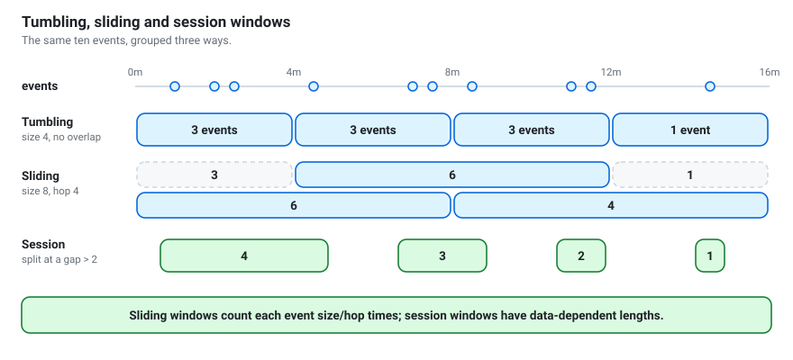
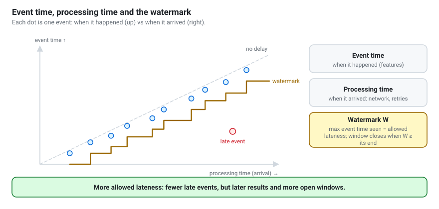

# Chapter 22 · Streaming features

*Part II · Prerequisites: Chapters 20 and 21 · Estimated time: reading ~50 min, lab ~90 min · Compute: CPU*

 · [Lab: notebook.ipynb](notebook.ipynb) · [Solutions](solutions.md)

## Learning objectives

After this chapter you should be able to:

1. distinguish event time from processing time, and measure how far out of order a stream is;
2. compute tumbling, sliding and session windows incrementally, one event at a time;
3. explain what a watermark is, use one to decide when a window is complete, and choose a policy for late events (drop, side output, update) on the basis of measured trade-offs;
4. explain at-most-once, at-least-once and exactly-once processing, and make an aggregation idempotent by deduplicating on a source-assigned event id;
5. write a parity test between a batch (SQL) and a streaming implementation of the same feature;
6. relate these concepts to Kafka, Flink and Spark Structured Streaming.

## 22.1 Introduction

Some features cannot be produced by a daily batch job. "Clicks on this
category in the last 15 minutes" or "items the user has viewed in the current
session" must be computed from the stream of events as the events arrive.
Chapter 21 measured that freshness is worth little on ShopStream, whose users
have fixed tastes; in real products with trends, sales and session intent, it
is often worth a great deal.

Event streams have three properties that batch tables hide. Events arrive
*late*, because phones go offline and networks retry. They arrive *out of
order*, because different paths have different delays. And they sometimes
arrive *more than once*, because delivery systems retry after failures. A
streaming feature is therefore not only a formula but a set of explicit
decisions about time, completeness and duplicates. Readers with a
signal-processing background will find some of this familiar: a stream
processor is a causal online filter that must emit outputs before all the
inputs for a given time interval are guaranteed to have arrived.

The lab simulates such a stream from one day of ShopStream impressions and
makes each decision measurable. Section 22.2 distinguishes event time from
processing time. Section 22.3 covers windows. Section 22.4 introduces
watermarks and late data. Section 22.5 covers delivery guarantees and
idempotence. Section 22.6 covers parity testing, and Section 22.7 relates the
concepts to production systems.

## 22.2 Event time and processing time

Two clocks are involved in every streaming computation.

* **Event time** is the time at which the event happened at its source, for
  example when an impression was rendered on a phone. Features and labels are
  defined in event time.
* **Processing time** (or arrival time) is the time at which the event reaches
  the stream processor. It is later than the event time by the network delay,
  client-side batching, retries, and periods when the device was offline.

The lab's simulator, `F.simulate_event_stream`, assigns each impression of day
42 an `event_id`, an `event_ts` and an `arrival_ts`. Most delays are a few
seconds; 3% of events arrive 1 to 60 minutes late. Sorted by arrival, the
stream has a median delay of about 2 s and a 99th percentile in the tens of
minutes. About 65% of events arrive after some event with a later timestamp,
so a small amount of disorder is the normal state of a stream, but only about
3% are more than a minute behind.

An analogy is the postal system: event time is the postmark, processing time
is the day the letter arrives. Sorting letters by arrival day places a card
posted on Monday but delayed by a strike next to Thursday's mail. The analogy
has a limit: a postmark is applied by the post office, whereas event
timestamps come from device clocks, which can be wrong, so real pipelines also
check event times for plausibility.

**The cost of using processing time.** The lab's feature is clicks per category
per 15-minute window. Its batch definition, in event time, is a `GROUP BY`
over `floor(event_ts / 900) * 900`. A naive streaming implementation assigns
each event to the window of its *arrival* time. About 15% of the resulting
windows hold different counts from the event-time definition: events near a
boundary move into the next window, and late events land in whatever window
is open when they arrive. A model trained on event-time features and served
processing-time features experiences training/serving skew. Event-time
processing removes the skew, at the price of having to decide when a window
is complete.

## 22.3 Windows

A stream processor cannot run a `GROUP BY` over a whole day; it updates state
one event at a time. Three window types cover almost every streaming feature.

| Window | Definition | Example feature |
|---|---|---|
| Tumbling | fixed size $w$, no overlap: $[0, w), [w, 2w), \dots$ | clicks per category per 15 minutes |
| Sliding (hopping) | size $S$, advancing by a hop $h < S$; windows overlap | clicks in the last hour, updated every 15 minutes |
| Session | per key; events closer than a gap $g$ belong to the same window; windows merge | session length, items viewed in the session |

*Figure 22.1 — Tumbling, sliding and session windows over the same events. Tumbling windows partition time; sliding windows overlap, so each event is counted in several of them; session windows have no fixed length and grow while events keep arriving.*

**Tumbling windows.** An event at time $t$ belongs to the window that starts at

$$
\text{start}(t) = \left\lfloor \frac{t}{w} \right\rfloor w
\tag{22.1}
$$

where $t$ is the event time in seconds since an agreed epoch and $w$ the window
size. With $w = 900$ s and $t = 2{,}000$ s, the window is $[1800, 2700)$. All
systems that compute the same feature must align windows on the same epoch
(normally UTC epoch seconds), or they will disagree at every boundary.

**Sliding windows.** With size $S$ and hop $h$ (with $S$ a multiple of $h$), an
event at time $t$ belongs to the $S/h$ windows whose starts are

$$
\left\{\, \left\lfloor t/h \right\rfloor h - j h \;:\; j = 0, \dots, S/h - 1 \,\right\}
\tag{22.2}
$$

With $S = 3600$ s, $h = 900$ s and $t = 2{,}000$ s, the starts are 1,800, 900, 0
and −900. Each event is therefore added to four windows, so a sliding
aggregation performs $S/h$ times the state updates of a tumbling one. In the
lab, processing the whole stream before reading the state, the incremental
sliding-window counts equal the batch definition exactly (1,980 windows).

**Session windows.** Session windows are harder to maintain incrementally,
because an out-of-order event can *bridge* two sessions that were separate so
far. Per key, the processor keeps a list of sessions $[a, b]$. A new event at
time $t$ starts the session $[t, t]$, which is merged with every existing
session within the gap:

$$
t \text{ joins } [a, b] \iff a - g \le t \le b + g
\tag{22.3}
$$

For example, with $g = 30$ minutes and sessions $[10{:}00, 10{:}20]$ and
$[10{:}55, 11{:}05]$, a late event at 10:40 is within 30 minutes of both, so all
three merge into $[10{:}00, 11{:}05]$. An implementation that stops at the first
matching session gives wrong counts in exactly this case. In the lab, the
streaming implementation finds the same 4,416 sessions on day 42 as a batch
sessionisation of the sorted data.

## 22.4 Watermarks and late data

A streaming job must *emit* the result of a window at some point, yet a late
event for that window may still be on its way. A **watermark** is the
processor's assertion that events with event time up to $W$ have (almost) all
arrived. The most common kind is the *bounded out-of-orderness* watermark:

$$
W = \max_{\text{events seen}} t \; - \; L,
\qquad \text{close } [s, s+w) \text{ when } W \ge s + w,
\qquad \text{an event is late if } s + w \le W_\text{before}
\tag{22.4}
$$

where $L$ is the *allowed lateness*, $[s, s+w)$ a tumbling window, and
$W_\text{before}$ the watermark before the event is processed. With $L = 60$ s
and a largest event time seen of 1,000 s, $W = 940$ s: the window $[0, 900)$ is
closed, an event arriving now with $t = 850$ s is late, and one with $t = 920$ s
is counted. Two details matter in implementation: the watermark must only move
forward (take the maximum), and the late test must use the watermark before
the event, so that an event cannot make its own window late.

*Figure 22.2 — Event time against processing time. All events lie below the no-delay line, because events arrive after they happen. The watermark trails the latest event time by the allowed lateness; the red event happened early but arrived after the watermark had passed it.*

An event that arrives for a window that has already closed is **late**, and a
policy decides what happens to it:

* **drop** it: the simplest policy; the feature undercounts slightly;
* **side output**: exclude it from the streaming result but keep it, so that a
  batch job can reconcile the numbers later;
* **update**: emit a corrected result for the window. Downstream systems must
  accept upserts, and consumers may already have used the first value.

A watermark resembles a teacher's announcement that the papers are being
collected: after it, a late paper is refused, set aside for later grading, or
accepted with a corrected grade sent out later. The analogy breaks down in one
respect: a teacher knows how many students are in the room, whereas a stream
processor never knows how many events are still on their way. A watermark is a
heuristic promise, not a fact.

**The trade-off, measured.** The allowed lateness trades completeness against
latency and memory. On day 42 of ShopStream (lab run):

| Allowed lateness | Late events dropped | Windows exactly right | Open windows held | Result delay after window end |
|---|---|---|---|---|
| 0 s | about 1,100 (2.5%) | about 92% | about 20 | 0 s |
| 10 min | about 900 | about 94% | between the two | 10 min |
| 1 hour | none | 100% | about 100 | 1 hour |

For a "last 15 minutes" feature, a result delayed by an hour defeats its
purpose. The usual design is therefore a short allowed lateness, chosen from
the measured delay distribution, plus a policy for the stragglers. With 60 s of
lateness, the *side-output* policy keeps about 1,100 late events for
reconciliation (the streaming result is the same as with *drop*), and the
*update* policy makes every window exact at the cost of about 1,100 corrections
that downstream systems must apply. The online store of Chapter 21 applies
such corrections naturally, since a newer write for the same key replaces the
old one, but a request that was already scored with the first value cannot be
re-scored.

## 22.5 Delivery guarantees and idempotence

Between a durable log such as Kafka and a stream processor, three delivery
guarantees are possible.

* **At-most-once.** The processor commits its read position (offset) before
  processing. A crash loses the events in flight.
* **At-least-once.** The processor processes, then commits. A crash causes the
  events processed since the last commit to be delivered again: duplicates.
* **Exactly-once** (more precisely, *effectively-once*). The update of the
  processor's state and the commit of the offset happen atomically, as in Flink
  checkpoints with transactional sinks, Kafka transactions, or Spark
  checkpoints with idempotent sinks. The guarantee concerns the *effect* of
  each event on state and outputs; the network may still deliver an event more
  than once.

The cheapest robust defence works under at-least-once delivery: make every
update **idempotent**, meaning that applying it twice has the same effect as
applying it once. "Add 1 to the counter" is not idempotent; "record event 8812
as counted" is. Deduplicating on the event id converts the first form into the
second. In the lab, 5% of the stream (2,242 events) is re-delivered. Without
deduplication the click total is about 5% too high (6,586 instead of 6,259) and
about 15% of windows are wrong; with deduplication by event id, all duplicates
are ignored and the result equals the batch definition exactly.

Two conditions make this work. First, the event id must be **assigned at the
source** (by the client or the first server); an id generated by the processor
would differ between the original and the retry. Second, the deduplication
state (the ids seen per open window) is released when the window closes, so its
memory is bounded by the allowed lateness; a duplicate that arrives after its
window has closed is handled by the late-data policy instead. The same reasoning
applies to sinks: writing the full window value (`SET key = value`) can be
replayed safely, whereas an increment (`INCRBY`) cannot.

## 22.6 Online/offline parity

The feature now has two implementations: the batch SQL used to build training
data (Chapter 21) and the streaming job used for serving. A **parity test**
runs both over the same events and reports where they disagree. For the
60-second-lateness *drop* stream in the lab, every window appears in both
outputs, and about 150 of about 1,900 windows differ, each by at most two
clicks: exactly the late events the policy discarded.

A useful parity report distinguishes several outcomes rather than producing a
single number:

* keys present only in the batch output or only in the stream output (a missing
  window indicates a different kind of fault, such as a stuck watermark or a
  lost partition, from a slightly different count);
* keys present in both whose values differ by more than a tolerance;
* the largest absolute difference and the match rate;
* a pass/fail decision.

Duplicated keys must raise an error, because a merge on duplicated keys forms a
cross product and compares the wrong rows while reporting plausible numbers.
The tolerance should be explicit: zero for counts, small for floating-point
quantities computed in different orders. A difference caused by a *policy*
(dropped late events) is better handled by a threshold on the match rate than
by a larger tolerance. A parity test converts "the streaming feature looks
fine" into a number that can gate a deployment or trigger an alert.

## 22.7 Production systems

| Concept in the lab | Kafka | Flink | Spark Structured Streaming |
|---|---|---|---|
| the stream, ordered by arrival | a topic split into partitions (ordered within a partition only), retained for days | a source (`KafkaSource`) | `readStream.format("kafka")` |
| `event_ts` | the record timestamp or a payload field | `WatermarkStrategy.withTimestampAssigner` | a column used in `withWatermark` |
| bounded-out-of-orderness watermark | — | `forBoundedOutOfOrderness(Duration)` | `withWatermark("ts", "60 seconds")` |
| tumbling, sliding, session windows | — | `TumblingEventTimeWindows`, `SlidingEventTimeWindows`, `EventTimeSessionWindows` | `window(ts, "15 minutes")`, `window(ts, "1 hour", "15 minutes")`, `session_window` |
| late-data policy | — | `allowedLateness` (update), `sideOutputLateData` (side output) | rows dropped after the watermark; `outputMode("update")` |
| per-window state | — | keyed state in RocksDB, checkpointed | state store, checkpointed |
| deduplication by event id | idempotent producer prevents producer-side duplicates | keyed state with a TTL | `dropDuplicatesWithinWatermark("event_id")` |
| exactly-once | transactions (`read_committed`) | checkpoints and two-phase-commit sinks | checkpoints and idempotent or transactional sinks |

A streaming job usually writes each emitted value to two places: the **online
store**, for serving, and an **offline log** with the window end time, so that
training sets can be built point-in-time from exactly the values that were
served. Teams that cannot afford two implementations run the streaming code in
batch mode over historical data (the "kappa" architecture) instead of
maintaining a separate SQL version. They still run parity tests, because
configuration (allowed lateness, deduplication, time zones) differs between
deployments.

## Key terms

| Term | Definition |
|---|---|
| Event time | The time at which an event happened at its source. |
| Processing time | The time at which an event reaches the stream processor. |
| Out-of-order event | An event that arrives after an event with a later event time. |
| Tumbling window | A fixed-size window; consecutive windows do not overlap. |
| Sliding (hopping) window | A fixed-size window that advances by a smaller hop, so windows overlap. |
| Session window | A per-key window that groups events separated by less than a gap. |
| Watermark | The processor's assertion that events up to a given event time have (almost) all arrived. |
| Allowed lateness | The delay the processor accepts before treating an event as late. |
| Late event | An event that arrives for a window that has already been closed. |
| Side output | A separate stream of late events kept for later reconciliation. |
| At-least-once delivery | A guarantee that every event affects the result at least once; duplicates are possible. |
| Exactly-once processing | A guarantee that each event affects the processor's state, and with suitable sinks its outputs, exactly once. |
| Idempotent update | An update whose repeated application has the same effect as a single application. |
| Parity test | A comparison, key by key, of the batch and streaming implementations of a feature. |

## Summary

1. Features are defined in event time; streams arrive in processing time.
   Windows computed on arrival time differed from the event-time definition in
   about 15% of cases in the lab.
2. Tumbling windows are assigned by Equation (22.1); sliding windows place each
   event in $S/h$ windows; session windows must merge every session within the
   gap, because a late event can bridge two sessions.
3. A watermark trails the largest event time seen by the allowed lateness and
   decides when a window is complete. A larger lateness gives more complete
   results, later and with more state.
4. Late events are dropped, sent to a side output, or used to update emitted
   results; each policy has a different cost for downstream systems.
5. At-least-once delivery produces duplicates; deduplication on a
   source-assigned event id makes the aggregation idempotent and, in the lab,
   exact.
6. Exactly-once guarantees apply to state; external effects are exactly-once
   only with transactional or idempotent sinks.
7. A parity test between the batch and streaming implementations, with explicit
   handling of missing keys, duplicated keys and tolerances, is the main
   defence against training/serving skew in streaming features.

## Exercises

The exercises are in the lab, [notebook.ipynb](notebook.ipynb); worked answers
are in [solutions.md](solutions.md).

* **Exercise 1** (graded). Implement `TumblingWindowCounter(window_seconds,
  allowed_lateness_seconds)` with a bounded-out-of-orderness watermark, late
  events recorded separately, and a `flush` method. The grader replays a crafted
  out-of-order sequence and a random stream against a reference.
* **Exercise 2** (graded). Implement `parity_report(batch_df, stream_df, key,
  tol)`, returning counts of missing and mismatched keys, the maximum absolute
  difference, the match rate and a pass flag, and raising an error on duplicated
  keys.
* **Exercise 3** (written). A Flink job restarts from a checkpoint taken four
  minutes earlier. Describe the consequences for the job's state, the online
  store, the model's inputs and the feature log under three delivery
  configurations, and what to monitor in each.
* **Checkpoint questions.** Six oral questions on event versus processing time,
  watermarks, late-data policies, delivery semantics, train/serve equality for
  streaming features, and the design of a session feature.

## Further reading

* T. Akidau et al., "The Dataflow Model: A Practical Approach to Balancing Correctness, Latency, and Cost in Massive-Scale, Unbounded, Out-of-Order Data Processing", *PVLDB* 8(12), 2015.
* T. Akidau, S. Chernyak and R. Lax, *Streaming Systems*, O'Reilly, 2018.
* M. Kleppmann, *Designing Data-Intensive Applications*, O'Reilly, 2017 — Chapter 11 (stream processing).
* P. Carbone et al., "Apache Flink: Stream and Batch Processing in a Single Engine", *IEEE Data Engineering Bulletin* 38(4), 2015.
* Apache Flink documentation, "Timely Stream Processing" and "Windows" — <https://nightlies.apache.org/flink/flink-docs-stable/>.
* Apache Spark documentation, "Structured Streaming Programming Guide" — <https://spark.apache.org/docs/latest/structured-streaming-programming-guide.html>.

**Next:** [Chapter 23 · Implicit feedback & position bias](../ch23-implicit-feedback-and-position-bias/README.md)
