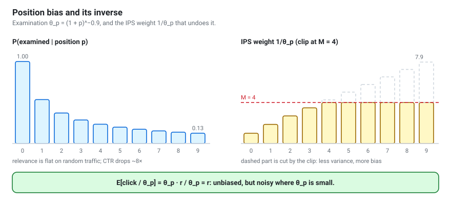

# Chapter 23 · Implicit feedback & position bias

*Part II · Prerequisites: Chapters 8 and 19 · Estimated time: reading ~60 min, lab ~90 min · Compute: CPU*

 · [Lab: notebook.ipynb](notebook.ipynb) · [Solutions](solutions.md)

## Learning objectives

After this chapter you should be able to:

1. state the examination hypothesis and the position-based click model, and identify their effects in click logs;
2. explain why the logging policy's own ordering obtains a higher offline click metric than a better ordering;
3. estimate position propensities from randomised (exploration) traffic, quantify their uncertainty, and stabilise them with a parametric fit;
4. use inverse propensity scoring (IPS) to estimate click rates and to evaluate a new ranking offline, and reason about its variance and about clipping;
5. train a click model with IPS weights and show, against ground truth, when the correction matters and when it does not;
6. name the main alternatives for obtaining propensities and for debiasing training in production.

## 23.1 Introduction

Ranking systems learn from *implicit feedback*: behaviour such as clicks and
purchases, used in place of explicit relevance judgements. Implicit feedback is
abundant and inexpensive, but it is not a measurement of relevance. Users click
what they *see*, and they see mostly the top of a list. A model trained or
evaluated on raw clicks therefore learns, and rewards, whatever the previous
ranker already did.

This is a problem of biased measurement, of a kind familiar from experimental
science: the instrument (the user's attention) has a sensitivity that varies
with a nuisance variable (position), and the nuisance variable is correlated
with the quantity of interest (relevance), because the old ranker put relevant
items at the top. Without a model of the instrument, the two effects cannot be
separated.

ShopStream is designed for this chapter. Its clicks are generated exactly by
the position-based model of Section 23.2, and the simulator knows the true
relevance of every (user, item) pair (Chapter 19, Equation 19.1). Methods can
therefore be graded against the truth. The lab attaches the truth as a column
`true_p` for grading only; it is never used as a feature or as a training
label, except in one explicitly labelled "oracle" model.

Section 23.2 introduces click models. Section 23.3 shows that offline click
metrics favour the logging policy. Section 23.4 estimates propensities.
Section 23.5 introduces IPS for click rates, and Section 23.6 uses it for
offline evaluation, including its variance. Section 23.7 applies IPS to
training. Section 23.8 discusses the cost of exploration.

## 23.2 Click models

### 23.2.1 The examination hypothesis and the position-based model

The **examination hypothesis** states that a user clicks an item only if they
examine it *and* find it relevant. The simplest model built on it, the
**position-based model (PBM)**, assumes that examination depends only on the
position and is independent of relevance:

$$
P(c = 1 \mid u, i, p) = \underbrace{\theta_p}_{P(\text{examined} \mid p)} \cdot \underbrace{r_{u,i}}_{P(\text{relevant} \mid u, i)}
\tag{23.1}
$$

where $c$ is the click indicator, $p$ the position (0 at the top), $\theta_p$
the *examination propensity* of position $p$, and $r_{u,i}$ the relevance of
item $i$ to user $u$. ShopStream follows Equation (23.1) exactly, with
$\theta_p = (1 + p)^{-0.9}$ (Equation 19.3). An item with relevance 0.4 is
clicked with probability 0.40 at position 0 and with probability
$0.126 \times 0.4 \approx 0.05$ at position 9.

Real users follow the PBM only approximately. They stop after a satisfying
click, which makes examination of lower positions depend on what was above;
this is captured by the **cascade model** and its successors (the dependent
click model, the user browsing model, the dynamic Bayesian network model).
They are also drawn by attractive images regardless of relevance, and the
pattern of examination depends on the device and the layout (lists, grids,
carousels).

An analogy is a shop window. Items at eye level are looked at; items near the
floor are rarely looked at. Counting sales per shelf reveals mostly *where*
items were placed, not how good they are.

### 23.2.2 What the logs show

The lab computes the click rate by position separately for policy traffic (95%
of requests, ordered by the production ranker) and for exploration traffic (5%,
random order). On ShopStream:

* the overall CTR is about 0.14 on policy traffic and about 0.06 on random
  traffic;
* policy CTR falls from about 0.47 at position 0 to about 0.05 at position 9;
  random CTR falls from about 0.19 to about 0.02;
* the mean *true* relevance falls with position on policy traffic (from about
  0.47 to 0.38, so the ranker has some skill) but is flat on random traffic
  (about 0.19 at every position).

On random traffic, relevance is flat while the CTR falls by a factor of about
eight: that fall is entirely examination. On policy traffic, the fall mixes
examination and relevance, and the clicks alone do not reveal the proportions.
This is the central problem of learning from implicit feedback.

*Figure 23.1 — Examination probability by position (left) and the inverse-propensity weight that IPS gives a click at each position (right). The dashed tops of the weight bars are what a clip at 4 removes.*

## 23.3 Offline click metrics favour the logging policy

The usual offline evaluation of a ranker takes logged requests, re-ranks the
shown items with the new model, and computes NDCG@10 (Chapter 24) with the
logged clicks as relevance labels. The lab applies this procedure to the best
possible "model", the true relevance itself, and compares it with the logging
policy's own order. On the validation week (policy traffic):

| Ordering | NDCG@10 on clicks | NDCG@10 on true relevance | True expected clicks per request |
|---|---|---|---|
| logged policy order | about 0.76 | about 0.81 | about 1.41 |
| true relevance order | about 0.68 | 1.00 | about 1.84 |
| random order | about 0.53 | — | — |

A ranking by true relevance would earn roughly 30% more clicks online, yet the
offline click metric declares it worse. The reason is that every logged click
happened *at its logged position*, and positions 0–2 receive most of the
examination. Re-ranking moves clicked items away from the top, so any
re-ranking is penalised for disagreeing with the logging policy, however good
it is. Comparing against the logged order on exploration traffic does not help
either, because the clicks there are also concentrated at the top.

Two practical rules follow:

1. never compare a new ranker with the logging policy on that policy's own
   clicks;
2. NDCG on clicks is approximately fair only between two *new* rankers, and
   only once the propensity effects are removed, which is what IPS does.

The analogy is judging a new seating plan for a concert by the applause
recorded under the old plan: the people who applauded most sat in the front
rows, so any plan that moves them back appears to lose applause. Unlike
applause, clicks can be corrected exactly, provided the examination
probability of each seat is known.

## 23.4 Estimating propensities from exploration traffic

### 23.4.1 The ratio estimator

On exploration traffic, the item at position $p$ is a uniformly random draw
from the candidates, so its expected relevance $\bar r$ is the same at every
position. Under the PBM,

$$
\frac{\text{CTR}_\text{rand}(p)}{\text{CTR}_\text{rand}(0)} = \frac{\theta_p \, \bar r}{\theta_0 \, \bar r} = \frac{\theta_p}{\theta_0}
\tag{23.2}
$$

Only *relative* propensities are identifiable: multiplying every $\theta_p$ by a
constant and dividing every $r_{u,i}$ by the same constant changes nothing
observable. The convention is therefore $\theta_0 = 1$. IPS needs only ratios,
so the convention costs nothing.

### 23.4.2 Bias and variance of the two naive estimates

The lab estimates propensities from the roughly 89,000 exploration impressions
(about 8,900 requests) of the training weeks, and compares them with the
ratio computed on policy traffic.

* The **policy-traffic** estimate is *biased*: every position is below the
  truth, by about 0.02–0.03, because the ranker places more relevant items at
  the top and the naive ratio attributes that to examination. More data do not
  remove the bias. ShopStream's logging policy is weak, so the bias is modest;
  a strong ranker makes it much larger.
* The **random-traffic** estimate is *unbiased but noisy*, with errors of up to
  about ±0.04. Most errors have the same sign, and a 90% bootstrap interval
  (over requests, the randomised unit) misses the truth at several positions.
  This is not a bias: all ten ratios share one denominator, CTR(0), which in
  this sample came out about 2% low, so all the ratios moved up together. The
  apparent misses are essentially one unlucky draw of one number.

### 23.4.3 A parametric fit

Both the noise and the shared-denominator problem are reduced by fitting a
smooth curve to all ten positions at once. Examination often decays roughly as
a power law, $\theta_p \propto (1 + p)^{-\eta}$, so the lab fits

$$
\log \text{CTR}_\text{rand}(p) = a - \eta \log(1 + p)
\tag{23.3}
$$

by weighted least squares, with weights proportional to the square root of the
number of clicks at each position (a rough inverse-variance weighting of the
log rates), and sets $\hat\theta_p = (1 + p)^{-\hat\eta}$. The fitted
$\hat\eta$ is about 0.88 (true value 0.9), and the largest error falls from
about 0.044 for the raw ratios to about 0.01. This is the best case: the
one-parameter curve is the true model. On real data the residuals of the fit
should be inspected before it is trusted.

In production, propensities are re-estimated periodically, because examination
depends on the user interface (a redesign changes $\theta$), on the device and
on the query type; they are often estimated per segment. Other ways to obtain
them include:

* **RandPair or swap interventions**: swap two positions rather than shuffling
  the whole list, which costs users less;
* **intervention harvesting**: reuse the natural variation in positions that
  arises when several rankers have been live (for example in past A/B tests);
* **regression EM**: fit $\theta$ and $r$ jointly from ordinary logs, which
  replaces randomisation by modelling assumptions.

## 23.5 Inverse propensity scoring

If a click at position $p$ occurs with probability $\theta_p r$, then $c/\theta_p$
has expectation $r$. Weighting each click by $1/\theta_p$ turns "clicks that
happened to be observed" into "clicks that would have been observed had every
item been examined". The **IPS estimator** of mean relevance over $n$
impressions, and its clipped version, are

$$
\hat r_\text{IPS} = \frac{1}{n} \sum_{j=1}^{n} \frac{c_j}{\theta_{p_j}},
\qquad
\hat r_\text{clip} = \frac{1}{n} \sum_{j=1}^{n} c_j \min\!\left(\frac{1}{\theta_{p_j}}, M\right)
\tag{23.4}
$$

where $c_j$ and $p_j$ are the click and position of impression $j$, and $M$ is
the cap. The unclipped estimator is unbiased under the PBM with correct
propensities, since $\mathbb{E}[c/\theta_p] = \theta_p r / \theta_p = r$. Its
cost is variance: rare clicks at low positions receive large weights (up to
$1/0.126 \approx 8$ in ShopStream). Clipping reduces the variance and introduces
a downward bias wherever $1/\theta_p > M$. A third estimator, **self-normalised
IPS** (SNIPS), divides the weighted sum by the sum of the weights rather than by
$n$; it is slightly biased but often has much lower variance.

The analogy is a survey in which young people respond once in eight requests
and older people every time: weighting each young response by eight makes the
totals represent everyone again. If a group responds once in a thousand
requests, however, a single respondent carries a weight of a thousand and
determines the result; this is the variance that clipping trades away.

**Example from the lab.** For validation policy traffic, the raw CTR is about
0.29 at positions 0–2 and about 0.055 at positions 7–9, a factor of five. IPS
brings both close to the true mean relevance (about 0.44 against 0.45 at the
top, 0.38 against 0.385 at the bottom): the lower items are worse, but by about
15%, not 80%. Clipping at 4 badly underestimates the lower slice (about 0.22),
because every weight there (about 6–8) is cut to 4. Clipping bias is largest
precisely where the weights are large.

## 23.6 IPS for offline evaluation of a new ranking

### 23.6.1 The estimator

To estimate how many clicks a new ordering of the logged items would receive,
each logged click is moved to its new position. A click observed at logged
position $p$ that the new ranking places at position $q$ counts
$\theta_q / \theta_p$ clicks. Summed over a request,

$$
\hat V(\text{new}) = \sum_{i \in \text{request}} \frac{\theta_{q_i}}{\theta_{p_i}}\, c_i
\tag{23.5}
$$

where $p_i$ and $q_i$ are the logged and new positions of item $i$ and $c_i$ its
logged click. For example, a click at logged position 3 ($\theta_3 = 0.287$)
moved to position 0 counts $1/0.287 = 3.5$ clicks; moved to position 9 it
counts $0.126/0.287 = 0.44$.

Under the PBM with correct propensities, Equation (23.5) is unbiased for the
true expected clicks per request, *for re-orderings of the items that were
shown*. It cannot evaluate items the old policy never showed, because there
are no clicks to re-weight. This is the **support problem**, and it is one
reason why two-stage systems also log exploration among candidates. Estimating
the value of one policy from data collected under another is called
**off-policy evaluation**; Equation (23.5) is a special case of the general IPS
estimator from the contextual-bandit literature.

### 23.6.2 Results

The lab evaluates five orderings of the validation requests in three ways:

| Ordering | Naive NDCG@10 on clicks | IPS estimate vs truth | True expected clicks per request |
|---|---|---|---|
| true relevance (oracle) | ranked below the logged order | within about 1% | about 1.84 |
| item CTR (popularity) | ranked below the logged order | within about 1% | about 1.60 |
| logged policy order | highest of the five | exact (all weights 1) | about 1.41 |
| random order | below the logged order | within about 1% | about 1.34 |
| reversed logged order | below the logged order | within about 1% | about 1.29 |

The IPS estimates fall within about 1% of the truth for every ordering (errors
of about −0.5% to −1%, from the slightly imperfect $\hat\theta$) and rank the five
orderings correctly. Naive NDCG on clicks places the logged order first. The
table also shows how weak ShopStream's logging policy is: only about 5% more
true clicks than a random order, a common situation that is invisible in the
policy's own click logs.

The logged order's IPS estimate equals its observed clicks exactly, because all
its weights are 1. IPS is a correction *relative to the logging policy*: the
further a ranking departs from it, the larger the weights and the noisier the
estimate.

### 23.6.3 Variance and the choice of cap

Real evaluation sets are smaller than the 24,000 validation requests of the
lab. The lab draws 300 random subsets of 1,000 requests and estimates the
oracle's value on each, with several caps on the weight $\theta_q/\theta_p$:

* no clip: a small bias (about −0.02, from $\hat\theta$) and a standard
  deviation of about 0.06;
* a cap of 6: slightly less spread, twice the bias (about −0.04);
* a cap of 4: a bias of about −0.13;
* a cap of 1: half the spread, and a bias of about −0.8, which makes the
  estimate useless.

The root-mean-square error is lowest without clipping here, because the weights
never exceed about 8. With more positions, steeper decay, or propensities close
to zero, the variance term dominates and a cap pays for itself. The cap should
be chosen by measured RMSE (by simulation or bootstrap), not by habit, and
reported with the estimate. Two further variance reducers are self-normalised
IPS and **doubly robust** estimators, which combine a model of the reward with
an IPS correction of its residuals.

## 23.7 Training on clicks

### 23.7.1 How position bias enters a model

Evaluation is half of the problem. A model trained on clicks also learns
position bias, *through any feature correlated with position*. The most common
such feature is the **previous ranker's score**, included because it is
available at serving time and usually predictive. On policy traffic the policy
score determines the position, so a naive click model learns "high policy score
leads to clicks", partly because high-scored items were examined more.

### 23.7.2 The experiment

The lab trains logistic regressions on days 35–41 with point-in-time features
from days 0–34 (log item CTR, log user × category CTR, log price, and the policy
score) under three labelling schemes:

* **naive**: clicks as labels, unweighted;
* **IPS**: clicks as labels, clicked rows weighted by $1/\hat\theta_p$ (capped at
  10), unclicked rows weighted 1;
* **oracle labels**: labels drawn from the true relevance, i.e. what clicks would
  be if every position were examined. This is the best these features can
  achieve, and the ceiling for any debiasing method.

Only the positives are weighted because the fully unbiased pointwise loss
(Joachims et al., 2017) gives a clicked row a weight of $1/\theta$ on the
positive term and $1 - 1/\theta$, which is negative, on the negative term. That
loss is unbounded below and unstable in practice. Weighting only the positives
is a common compromise that removes most of the position effect but not all.

### 23.7.3 Results

With the policy score among the features (validation, lab run):

| Model | NDCG@10 on truth | True expected clicks | Coefficient on `policy_score` |
|---|---|---|---|
| naive | about 0.90 | about 1.63 | about 0.84 |
| IPS | about 0.94 | about 1.72 | about 0.28 |
| oracle labels | about 0.95 | about 1.73 | about 0.18 |
| (logged order) | about 0.81 | about 1.41 | — |

IPS recovers about 80% of the gap between the naive and the oracle model. The
coefficients show the mechanism: the naive model relies heavily on the policy
score, that is, on position. Without the policy score, the three models are
within 0.0002 of each other (about 0.948): the remaining features are only
weakly tied to position, so reweighting changes the coefficients but not the
ordering. **Position bias causes most harm through features that encode the old
ranking.**

Once more, the evaluation metric matters. On naive click-NDCG, the *naive* model
appears best (about 0.77, above even the logged order) and the oracle-label
model worst of the three. A debiased model must be evaluated with a debiased
metric.

Production systems use other forms of correction besides sample weights:
**position as a training feature**, set to a constant at serving time
(Chapter 24); a separate **position tower** whose output is added to the logit
during training and dropped at serving (the "shallow tower" of Zhao et al.,
2019); and unbiased pairwise or listwise losses, such as IPS-weighted
LambdaMART.

## 23.8 The cost of exploration

Exploration traffic is not free: random orderings show worse items. On
ShopStream, exploration requests receive a CTR of about 0.062 per impression
against 0.141 for policy traffic, so 5% exploration costs about 3% of clicks.
What it buys is the only unbiased estimate of propensities, and through it
unbiased offline evaluation and training. Exercise 3 asks for this case to be
made quantitatively, together with ways to make exploration cheaper:
a smaller exploration share combined with a parametric fit, swaps of adjacent
pairs instead of full shuffles, randomisation restricted to the policy's top
candidates, and harvesting of interventions from experiments that are run
anyway.

## Key terms

| Term | Definition |
|---|---|
| Implicit feedback | Behaviour (clicks, purchases) used as a training or evaluation label in place of explicit judgements. |
| Examination hypothesis | The assumption that a click requires the item to be examined and to be found relevant. |
| Position-based model (PBM) | A click model in which examination depends only on position: $P(c) = \theta_p r_{u,i}$. |
| Cascade model | A click model in which the user scans from the top and stops after a satisfying click. |
| Propensity $\theta_p$ | The probability that position $p$ is examined, usually normalised so that $\theta_0 = 1$. |
| Exploration traffic | Requests shown in random order, so that relevance is independent of position. |
| Inverse propensity scoring (IPS) | Weighting each observation by the inverse of its propensity to remove a selection bias. |
| Clipping | Capping IPS weights at a maximum $M$, which reduces variance and introduces bias. |
| Self-normalised IPS | IPS divided by the sum of the weights instead of the number of observations. |
| Doubly robust estimator | An estimator that combines a reward model with an IPS correction of its residuals. |
| Off-policy evaluation | Estimating the value of a new policy from logs collected under a different policy. |
| Support problem | The impossibility of evaluating actions that the logging policy never took. |
| Oracle | The simulator's ground truth, used only to grade methods. |

## Summary

1. Clicks confound examination and relevance. Under the position-based model,
   $P(c) = \theta_p r_{u,i}$; on random traffic the CTR still falls about
   eightfold from top to bottom.
2. Offline NDCG on logged clicks favours the logging policy: on ShopStream it
   ranks the logged order (0.76) above a true-relevance order (0.68) that would
   earn about 30% more clicks.
3. Exploration traffic identifies relative propensities as CTR ratios. The raw
   ratios are unbiased but noisy and share a denominator; a power-law fit
   reduced the largest error from about 0.044 to 0.01.
4. IPS divides each click by its propensity and is unbiased under the PBM.
   Clipping reduces variance but biases the estimate downward where weights are
   large; the cap should be chosen by measured RMSE.
5. IPS off-policy evaluation estimated the true clicks of five orderings within
   about 1% and ranked them correctly; it cannot evaluate items that were never
   shown.
6. Features that encode the previous ranking carry position bias into a trained
   model. IPS weighting recovered about 80% of the gap to an oracle-label model;
   without such features the correction made almost no difference.
7. Debiased models must be evaluated with debiased metrics, and exploration
   traffic has a measurable cost that can be reduced.

## Exercises

The exercises are in the lab, [notebook.ipynb](notebook.ipynb); worked answers
are in [solutions.md](solutions.md).

* **Exercise 1** (graded). Implement `estimate_propensities(random_imps)`: the
  click rate at each position divided by the click rate at position 0, robust to
  row order. The grader compares the estimate with the true examination
  probabilities of a simulated world.
* **Exercise 2** (graded). Implement `ips_ctr_estimate(clicks, positions,
  propensities, clip)` following Equation (23.4).
* **Exercise 3** (written). Estimate the cost of 5% exploration traffic in
  clicks per day from the lab's numbers, write the case for keeping it, and
  propose at least one way to make it cheaper.
* **Checkpoint questions.** Six oral questions on click models, a ranker that
  loses offline and wins online, obtaining propensities without exploration,
  the IPS estimator and its limits, clipping, and the use of the previous
  model's score as a feature.

## Further reading

* T. Joachims, A. Swaminathan and T. Schnabel, "Unbiased Learning-to-Rank with Biased Feedback", WSDM 2017.
* N. Craswell, O. Zoeter, M. Taylor and B. Ramsey, "An Experimental Comparison of Click Position-Bias Models", WSDM 2008.
* A. Chuklin, I. Markov and M. de Rijke, *Click Models for Web Search*, Morgan & Claypool, 2015.
* X. Wang, N. Golbandi, M. Bendersky, D. Metzler and M. Najork, "Position Bias Estimation for Unbiased Learning to Rank in Personal Search", WSDM 2018 — regression EM.
* A. Agarwal, I. Zaitsev, X. Wang, C. Li, M. Najork and T. Joachims, "Estimating Position Bias without Intrusive Interventions", WSDM 2019 — intervention harvesting.
* M. Dudík, J. Langford and L. Li, "Doubly Robust Policy Evaluation and Learning", ICML 2011.
* Z. Zhao et al., "Recommending What Video to Watch Next: A Multitask Ranking System", RecSys 2019 — the shallow position tower.

**Next:** [Chapter 24 · Learning to rank](../ch24-learning-to-rank/README.md)
