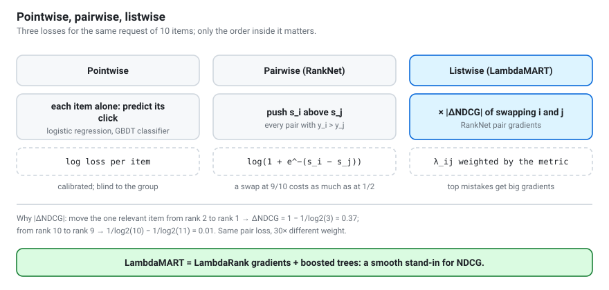

# Chapter 24 · Learning to rank

*Part II · Prerequisites: Chapters 7, 21 and 23 · Estimated time: reading ~55 min, lab ~90 min · Compute: CPU*

 · [Lab: notebook.ipynb](notebook.ipynb) · [Solutions](solutions.md)

## Learning objectives

After this chapter you should be able to:

1. formulate ranking as learning over groups of items, and say what plays the role of the query in a feed;
2. build point-in-time (user, item) features from logs and test them for leakage by recomputation on a truncated log;
3. define NDCG@$k$, MRR and pairwise accuracy, and compute them by hand;
4. explain pointwise, pairwise (RankNet) and listwise (LambdaRank, LambdaMART) objectives, and what each optimises;
5. train LightGBM's `LGBMRanker` with correct group sizes on a request-grouped time split;
6. evaluate rankers on clicks and on true relevance, interpret feature importance, and decide how to treat position as a feature.

## 24.1 Introduction

A ranker is not simply a classifier whose outputs are sorted. Three properties
distinguish ranking from classification. Only the *order within a group*
matters, so scores are never compared across groups. The data arrive in groups
(the items shown together in one request), and the training and evaluation
procedures must respect them. And the evaluation metrics weight the top of the
list far more heavily than the bottom, because users examine the top far more
often (Chapter 23).

This chapter builds the standard industrial approach to feature-based ranking,
point-in-time features with a LambdaMART model trained by LightGBM, and
evaluates it in the way Chapter 23 established: on clicks, and against the
hidden true relevance of ShopStream. Section 24.2 defines the problem and the
metrics. Section 24.3 builds and tests features. Section 24.4 presents the
three families of objectives. Section 24.5 covers the mechanics of groups in
LightGBM and the train/validation split. Section 24.6 compares five rankers,
and Section 24.7 discusses feature importance and the treatment of position.

## 24.2 The ranking problem and its metrics

### 24.2.1 Groups

In web search, the group is a **query**: the documents to rank for "red shoes".
In a feed there is no typed query; the group is the **request**, one user at one
moment with one candidate set. Learning to rank (LTR) learns a scoring function
$s(u, i)$ such that, *within each group*, more relevant items receive higher
scores. Because scores are never compared across groups, a model can be badly
calibrated and still rank perfectly; any transformation of the scores that is
monotone within each group leaves the ranking unchanged. Calibration matters
again when scores are compared across groups or combined with other quantities,
as in an advertising auction or a decision threshold.

An analogy is a judge at a swimming competition who places swimmers only within
their heat. Whether heat 3 was faster than heat 7 does not matter, so a score of
0.9 in one request and 0.2 in another can both mean "first place".

Each logged ShopStream request has exactly 10 items and binary click labels.
About 24% of requests have no click, about 76,000 have one and about 53,000 have
two. A request with no click, or with every item clicked, contributes nothing
to a pairwise or listwise loss, because there is no pair to order; such
requests can be dropped from training without loss of information. They still
matter for pointwise calibration and must stay in any metric such as "share of
requests with a click".

### 24.2.2 Metrics

**Discounted cumulative gain.** For a ranked list with relevance labels
$\text{rel}_1, \text{rel}_2, \dots$ at ranks $1, 2, \dots$,

$$
\operatorname{DCG@}k = \sum_{i=1}^{k} \frac{2^{\,\text{rel}_i} - 1}{\log_2(i + 1)},
\qquad
\operatorname{NDCG@}k = \frac{\operatorname{DCG@}k}{\operatorname{IDCG@}k}
\tag{24.1}
$$

where IDCG@$k$ is the DCG of the ideal ordering of the same items, so that
NDCG lies between 0 and 1. The numerator $2^{\text{rel}} - 1$ is the *gain*; for
binary labels it equals the label. The denominator is the *discount*: an item at
rank 2 counts $1/\log_2 3 = 0.63$, an item at rank 10 counts $1/\log_2 11 = 0.29$.
Example: clicks at ranks 2 and 5 give $\text{DCG} = 0.631 + 0.387 = 1.018$; the
ideal order (ranks 1 and 2) gives $1 + 0.631 = 1.631$; hence NDCG $= 0.624$.

**Mean reciprocal rank.** Over a set of groups $Q$,

$$
\operatorname{MRR} = \frac{1}{\lvert Q \rvert} \sum_{q \in Q} \frac{1}{\text{rank}_q}
\tag{24.2}
$$

where $\text{rank}_q$ is the rank of the first relevant item in group $q$. First
clicks at ranks 1, 2 and 4 give $(1 + 0.5 + 0.25)/3 = 0.583$. MRR suits tasks in
which one good result suffices.

**Pairwise accuracy.** Among all pairs of items in the same group with
different labels, the share in which the more relevant item receives the higher
score (ties counting one half):

$$
\operatorname{PA} = \frac{\sum_{g}\sum_{i,j \in g:\, y_i > y_j} \left( \mathbb{1}[s_i > s_j] + \tfrac{1}{2}\mathbb{1}[s_i = s_j] \right)}{\sum_{g} \lvert \{(i, j) \in g : y_i > y_j\} \rvert}
\tag{24.3}
$$

This is the quantity a pairwise objective optimises, and the within-group
analogue of the AUC. A constant scorer obtains 0.5.

## 24.3 Point-in-time features

The lab builds features for each (user, item) pair from logs **strictly before
the request's day**, as a daily batch job would (the point-in-time rule of
Chapter 21):

| Feature | Meaning |
|---|---|
| `u_cat_ctr`, `u_cat_imps`, `u_cat_clicks` | the user's history with the item's category: smoothed CTR, log impressions, log clicks |
| `u_ctr`, `u_imps` | the user's overall click rate and activity |
| `i_ctr`, `i_imps` | the item's smoothed CTR and log impressions (popularity) |
| `i_coec` | the item's clicks over *expected* clicks given the positions at which it was shown, a position-debiased CTR |
| `i_age` | days since the item was created |
| `log_price`, `price_vs_cat` | price, and price relative to the category median |
| `category`, `segment`, `device` | categorical attributes |

The feature `i_coec` (clicks over expected clicks) deserves a word. If item $i$
was shown at positions $p_1, \dots, p_n$ and received $C_i$ clicks, its expected
clicks under a position-only model are $\sum_j \hat\theta_{p_j}\bar c$, where
$\bar c$ is a reference click rate; the ratio of actual to expected clicks
removes the advantage an item gained from being shown at the top.

The implementation (`ltr.build_features`) computes per-(key, day) sums, takes
cumulative sums over days, and **subtracts the current day**. That one
subtraction separates a valid feature from a leak.

**Two leakage tests.** First, on day 0 no row may have any history. Second, the
features of a past day must not change when all later days are removed from the
log. The lab recomputes the features of day 30 from a log truncated at day 30
and compares them with the full computation; they are identical. The second test
is the useful one in real pipelines. While the lab was being written it caught a
genuine bug: the smoothing prior of the CTR features was the click rate of *all*
rows passed in, future days included. The prior is now a fixed constant.

## 24.4 Three families of objectives

*Figure 24.1 — Pointwise, pairwise and listwise objectives differ in what is compared: one item, a pair, or a pair weighted by the change in the list metric. The same ordering mistake costs about 30 times more at the top of the list than at the bottom.*

### 24.4.1 Pointwise

A pointwise method predicts each item's label independently, for example with
logistic regression or a gradient-boosted classifier under the log loss. It is
simple and produces calibrated probabilities, but it ignores the groups: part of
its capacity is spent distinguishing requests with many clicks from requests
with few, which ranking does not require. Pointwise models are the natural
choice when calibrated probabilities are needed (advertising, where the
predicted click rate multiplies a bid) or when labels are absolute.

### 24.4.2 Pairwise: RankNet

RankNet (Burges et al., 2005) considers every pair $(i, j)$ in a group with
$y_i > y_j$ and minimises a logistic loss on the score difference:

$$
L_{ij} = \log\!\left(1 + e^{-\sigma (s_i - s_j)}\right),
\qquad
\lambda_{ij} = \frac{\partial L_{ij}}{\partial s_i} = \frac{-\sigma}{1 + e^{\sigma (s_i - s_j)}}
\tag{24.4}
$$

where $s_i$ and $s_j$ are the model scores and $\sigma$ a scale parameter (1 in
the lab). The loss is the negative log-likelihood of a model in which item $i$
is preferred to $j$ with probability $\sigma(s_i - s_j)$. Example: $s_i = 0.2$,
$s_j = 0.5$ (the wrong order) gives $L = \log(1 + e^{0.3}) = 0.854$ and
$\lambda = -0.574$, which pushes $s_i$ up. RankNet optimises pairwise accuracy
(Equation 24.3): a swap at ranks 9 and 10 costs as much as a swap at ranks 1
and 2.

### 24.4.3 Listwise: LambdaRank and LambdaMART

NDCG is piecewise constant in the scores: small changes in the scores do not
change the ordering, so its gradient is zero almost everywhere. LambdaRank
(Burges et al., 2006) sidesteps the problem by specifying the gradients
directly. It takes RankNet's pair gradient and multiplies it by the change in
NDCG that would result from swapping $i$ and $j$ in the current ranking:

$$
\lambda^{\text{LR}}_{ij} = \lambda_{ij} \cdot \left\lvert \Delta \operatorname{NDCG}_{ij} \right\rvert
\tag{24.5}
$$

The gradient of item $i$ is the sum of its $\lambda^{\text{LR}}_{ij}$ over all its
pairs. For one relevant item, a swap between ranks 1 and 2 changes NDCG by
$1 - 1/\log_2 3 = 0.369$; a swap between ranks 9 and 10 by
$1/\log_2 10 - 1/\log_2 11 = 0.012$. Mistakes at the top therefore receive large
gradients and mistakes at the bottom small ones, so the model optimises a smooth
surrogate of NDCG. These "lambdas" are not the gradient of an explicitly stated
loss; later work (the LambdaLoss framework of Wang et al., 2018) showed that
they correspond to an implicit loss that bounds the NDCG loss.

**LambdaMART** is LambdaRank with gradient-boosted regression trees (MART,
multiple additive regression trees) as the model: each boosting round fits a
tree to the current lambdas. It is the most widely used method for feature-based
ranking in industry, available in LightGBM as `objective="lambdarank"` and in
XGBoost as `rank:ndcg`.

An analogy is the grading of a ranked shortlist of job candidates. Swapping the
first and second choices changes who receives the offer; swapping the ninth and
tenth changes nothing anyone acts on. RankNet charges both swaps the same;
LambdaRank charges each by how much the metric would change. The discount of
NDCG is, however, a modelling choice: if users scroll deep (a long product grid),
the bottom of the list matters more than the metric suggests.

## 24.5 Groups in LightGBM and the split

### 24.5.1 Group sizes

`LGBMRanker.fit(X, y, group=sizes)` takes **group sizes**, not group ids:
`[10, 10, 7, ...]` means that the first 10 rows form one group, the next 10
another, and so on. The rows must therefore be contiguous by group, in the same
order as the sizes. If the rows are shuffled, or two frames are concatenated,
after the sizes are computed, LightGBM trains on meaningless groups without
raising an error. The safe procedure is to sort by group id with a **stable**
sort immediately before fitting (so the order within each group is preserved for
any per-row arrays kept alongside) and compute the sizes from the sorted frame.
Exercise 2 implements this.

### 24.5.2 A request-grouped time split

* **Training:** policy-traffic requests from days 21–41 (days 0–20 only feed the
  features) with at least one click; 40,000 requests are sampled to keep
  training under a minute on a CPU.
* **Validation:** every request of days 42–48, policy and random traffic.

A time split keeps whole requests together (a request lives on one day) and
reproduces production, where the model is trained on the past and applied to the
future. A random row-level split would place items of the same request on both
sides. The lab confirms that no request appears in both sets.

### 24.5.3 What is reported

For each model the lab reports:

* **NDCG@10 on truth** and **true expected clicks per request**, graded against
  the hidden relevance. These decide which model is better.
* **NDCG@10 and MRR on clicks, policy traffic**: what a team without the truth
  would report. Biased towards the logged order (Chapter 23).
* **NDCG@10 on clicks, random traffic**: much less biased when comparing two
  *new* rankers, but small and noisy.

For reference, the logged order has NDCG@10 on truth of about 0.81, about 1.37
true expected clicks per request, NDCG on policy clicks of about 0.76 and MRR
about 0.73. The oracle (true relevance) has 1.00 and about 1.80, but only about
0.68 and 0.60 on policy clicks, the paradox of Chapter 23. Even on
random-traffic clicks the logged order scores slightly higher than the oracle
(about 0.67 against 0.66), because the logged positions are where clicks happen
even when the positions were assigned at random. That column should be used only
to compare new rankers with each other.

## 24.6 Five rankers

The lab trains, on the same features and rows: (1) logistic regression
(pointwise, linear, with one-hot categorical features and scaled numerical
ones); (2) a pointwise GBDT (`LGBMClassifier`, log loss); (3) the same with IPS
weights on clicked rows; (4) LambdaMART (`LGBMRanker`); (5) LambdaMART trained
with the logged position as a feature and served with position 0. The results
(CPU run; differences in the third decimal are noise):

* every learned ranker reaches NDCG@10 on truth of about 0.975–0.977 and about
  1.755–1.76 true expected clicks per request, against 0.81 and 1.37 for the
  logged order: about **29% more expected clicks** from re-ranking the same items;
* logistic regression ties the pointwise GBDT (both about 0.977), and LambdaMART
  is slightly *lower* (about 0.976), as is LambdaMART with the position feature;
  IPS weighting makes no measurable difference;
* on policy clicks every learned ranker scores about 0.67–0.68 NDCG and
  0.58–0.60 MRR, below the logged order;
* each model fits and predicts in about 3–12 s on 400,000 rows.

Two conclusions follow. First, the objective matters less than the features when
labels are binary and lists are short (10 items, one or two clicks). LambdaMART's
advantage grows with long lists and graded labels (search relevance grades, or
purchase above click). Second, IPS weighting and the position feature have little
effect *here* because none of the features encodes the logged position, in
contrast with the policy score in Chapter 23. Whether a feature carries position
information should be checked before assuming that debiasing will change a
metric.

**Agreement between models.** Pairwise accuracy against the true relevance is
about 0.53 for the logged order (barely better than chance) and about 0.84–0.85
for the learned models. The Spearman correlation of LambdaMART's scores with the
pointwise GBDT is about 0.96, with logistic regression about 0.94, and with the
logged order about 0.09. (These correlations are computed over all rows and so
also reflect comparisons across requests, which ranking does not need.) The
learned rankers agree with one another far more than with production.

## 24.7 Feature importance and position

**Gain importance** is the total reduction in the training loss from splits on
each feature. It is useful for debugging ("why is `i_age` at the top?") but is
not evidence of causality, and it is biased towards high-cardinality numerical
features. For LambdaMART, the user × category history leads (`u_cat_clicks`
about 22% of the gain, `u_cat_ctr` about 13%), followed by `category` and
`i_ctr` (about 12% each) and the user activity features; price features are
small. The pointwise GBDT relies on `u_cat_ctr` instead (about 40%): correlated
features share credit arbitrarily between models, which is one reason not to
over-interpret importances. Both models rank `category` highly; this reflects the
structure of ShopStream, in which users have favourite categories, and `segment`
matters through its interaction with category. Trees find that interaction
automatically, whereas logistic regression would need crossed features.

**Position.** Position is not among the features, because at serving time it
does not exist: position is the *output* of the ranker. Two ways to use it
nonetheless are:

1. leave it out and correct with weights (IPS, Chapter 23);
2. include it at **training** time, so that the model can attribute clicks at the
   top to examination rather than to the item, and set it to a **constant**
   (position 0) at serving time. Under the PBM this recovers the relevance
   ordering *if* the model separates the two effects; with trees the position
   effect is not constrained to be multiplicative, so this is not guaranteed.

In the lab, position takes about 64% of the gain in the position-feature model:
the model uses it heavily to explain clicks. Yet serving with position 0 changes
the ranking by almost nothing, because position's effect is close to additive in
the trees' score and no other feature is correlated with it. It would matter for
calibrated click probabilities, and in the presence of features that correlate
with position. Whether it helped can only be established by an unbiased
evaluation: IPS estimates, randomised traffic, or an online experiment.

## Key terms

| Term | Definition |
|---|---|
| Group (query) | The set of items ranked together; scores are compared only within it. In a feed, one request. |
| Pointwise loss | A loss that scores each item independently, as in classification. |
| Pairwise loss | A loss that penalises each incorrectly ordered pair within a group. |
| Listwise loss | A loss defined on, or targeting, a list-level metric such as NDCG. |
| RankNet | A pairwise method with a logistic loss on the score difference of each pair. |
| LambdaRank | A method that scales RankNet's pair gradients by the change in NDCG from swapping the pair. |
| LambdaMART | LambdaRank with gradient-boosted regression trees. |
| NDCG@$k$ | Discounted cumulative gain of the top $k$ items, divided by its maximum possible value. |
| MRR | The mean, over groups, of the reciprocal rank of the first relevant item. |
| Pairwise accuracy | The share of differently labelled pairs within groups that are ordered correctly. |
| Group sizes | The counts of contiguous rows that LightGBM uses to identify groups. |
| Gain importance | The total loss reduction from splits on a feature in a tree ensemble. |
| COEC | Clicks over expected clicks: a click rate corrected for the positions at which an item was shown. |

## Summary

1. Ranking learns scores whose order within each group matches relevance; scores
   are not compared across groups, so calibration is not required for ranking.
2. NDCG discounts gains logarithmically with rank; MRR rewards the first relevant
   item; pairwise accuracy is the within-group analogue of AUC.
3. Point-in-time features must use only prior days; recomputing a past day's
   features from a truncated log is an effective leakage test.
4. RankNet optimises pairwise accuracy; LambdaRank weights each pair gradient by
   $\lvert\Delta\text{NDCG}\rvert$ and thereby optimises a surrogate of NDCG;
   LambdaMART fits these gradients with boosted trees.
5. LightGBM identifies groups by sizes of contiguous rows; sort stably by group
   immediately before fitting.
6. On ShopStream every learned ranker raised true expected clicks by about 29%
   over the logged order; the choice of objective mattered little with binary
   labels and lists of ten.
7. Position cannot be a serving feature; it can be used in training and fixed at
   serving, or handled with IPS. Its effect depends on whether other features
   encode position, and must be judged with an unbiased evaluation.

## Exercises

The exercises are in the lab, [notebook.ipynb](notebook.ipynb); worked answers
are in [solutions.md](solutions.md).

* **Exercise 1** (graded). Implement `pairwise_accuracy(scores, labels, groups)`
  following Equation (24.3), with ties counted as one half, pairs across groups
  excluded, and NaN when there are no pairs.
* **Exercise 2** (graded). Implement `make_groups(df, group_col)`, returning the
  frame sorted stably by group and the array of group sizes in the same order.
* **Exercise 3** (written). Propose a label or weighting scheme for LambdaMART
  that uses both clicks and purchases, explain how to choose its parameters, and
  how to evaluate it offline without misleading results.
* **Checkpoint questions.** Six oral questions on the choice of objective, the
  LambdaRank gradient, the group in a feed, a large gap between training and
  validation NDCG, position as a feature, and choosing between two models that
  are equal offline.

## Further reading

* C. Burges, T. Shaked, E. Renshaw, A. Lazier, M. Deeds, N. Hamilton and G. Hullender, "Learning to Rank using Gradient Descent", ICML 2005 — RankNet.
* C. J. C. Burges, "From RankNet to LambdaRank to LambdaMART: An Overview", Microsoft Research Technical Report MSR-TR-2010-82, 2010.
* K. Järvelin and J. Kekäläinen, "Cumulated Gain-Based Evaluation of IR Techniques", *ACM Transactions on Information Systems* 20(4), 2002 — NDCG.
* T.-Y. Liu, "Learning to Rank for Information Retrieval", *Foundations and Trends in Information Retrieval* 3(3), 2009.
* C. D. Manning, P. Raghavan and H. Schütze, *Introduction to Information Retrieval*, Cambridge University Press, 2008 — Chapter 8 (evaluation) and Chapter 15 (machine-learned ranking).
* G. Ke et al., "LightGBM: A Highly Efficient Gradient Boosting Decision Tree", NeurIPS 2017; and the LightGBM documentation for `LGBMRanker`.
* X. Wang, C. Li, N. Golbandi, M. Bendersky and M. Najork, "The LambdaLoss Framework for Ranking Metric Optimization", CIKM 2018.

**Next:** [Chapter 25 · Candidate generation](../ch25-candidate-generation/README.md)
