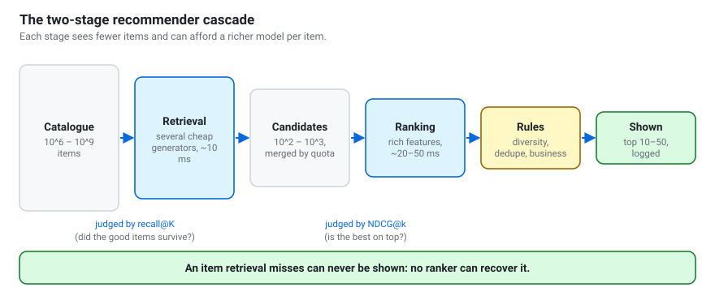
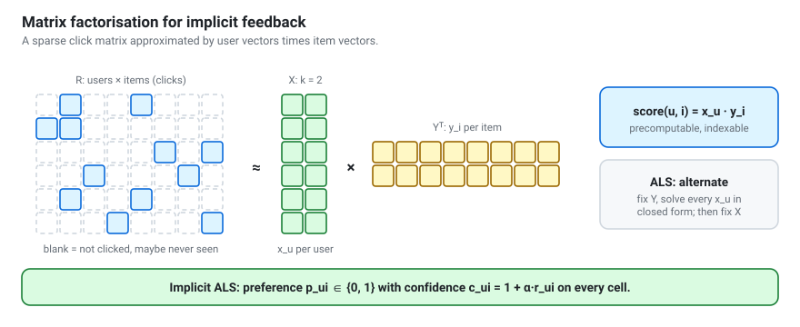

# Chapter 25 · Candidate generation

*Part II · Prerequisites: Chapters 20 and 24 · Estimated time: reading ~55 min, lab ~90 min · Compute: CPU*

 · [Lab: notebook.ipynb](notebook.ipynb) · [Solutions](solutions.md)

## Learning objectives

After this chapter you should be able to:

1. explain the two-stage (retrieve, then rank) architecture of recommender systems and why retrieval is judged by recall@$K$ rather than NDCG;
2. build four classic candidate generators: global popularity, per-category popularity, item-to-item co-visitation, and implicit-feedback matrix factorisation (ALS);
3. evaluate generators on next-week clicks and on the true most-relevant items, together with catalogue coverage and popularity bias, and explain why the two evaluations differ;
4. derive the alternating least squares update for implicit feedback and explain what makes it fast;
5. describe how each generator behaves for cold-start users and items, and what fills the gap;
6. blend generators with quotas and measure whether the blend improves recall.

## 25.1 Introduction

The ranker of Chapter 24 re-ordered ten items that another system had already
chosen. In a real recommender, *choosing* those items, a few hundred out of
millions in a few milliseconds, is a separate stage with its own models,
metrics and failure modes. If a relevant item is not retrieved, no ranker can
show it. The retrieval stage therefore bounds the quality of the whole system.

This chapter studies the classic retrieval methods on ShopStream, where, as
before, the hidden truth allows them to be graded against actual relevance and
not only against logged clicks. Section 25.2 explains the two-stage
architecture. Section 25.3 defines what counts as a hit and introduces the
evaluation metrics. Sections 25.4 to 25.7 build four generators. Section 25.8
treats cold start, and Section 25.9 blending.

## 25.2 Why two stages

*Figure 25.1 — The two-stage cascade. Each stage reduces the number of items by one or more orders of magnitude, so each can afford a more expensive model per item. Retrieval is judged by recall@$K$, because the ranker can only re-order what it receives.*

A ranker's features (Chapter 24) cost microseconds per item. Multiplied by a
million items per request, the cost far exceeds any latency budget. The first
stage therefore uses models whose scores can be **precomputed or indexed**:
popularity lists, item-to-item tables, or dot products of embeddings searched
with an index (Chapter 26). Typical figures are:

| Stage | Items in | Items out | Latency | Orientation |
|---|---|---|---|---|
| retrieval (several generators) | $10^6$–$10^9$ | $10^2$–$10^3$ | 1–10 ms | recall |
| ranking (rich features, GBDT or neural network) | $10^2$–$10^3$ | 10–50 | 10–50 ms | precision at the top |

Retrieval is judged by whether the good items survive the cut, not by their
order among the $K$ candidates, since the ranker re-orders them. ShopStream's
catalogue has 4,000 items, so retrieving 100 is a 40-fold reduction; the ratios
and the conclusions carry over to larger catalogues, while the latency problem
is the subject of Chapter 26.

An analogy is a hiring process. A recruiter screens 10,000 applications for
keywords and keeps 100 (retrieval, judged by whether the good candidates were
kept); a panel then interviews those 100 carefully and ranks them (ranking,
judged by whether the best candidate is at the top). Unlike a recruiter,
real retrieval does not examine every item exactly; it relies on precomputed
lists and approximate search.

## 25.3 What counts as a hit

### 25.3.1 Two kinds of truth

For each user active in the validation week, the lab defines two sets of
relevant items:

* **next-week clicks**: what can be measured in production. These are limited to
  items the logging policy chose to show (*exposure bias*): a generator that
  finds excellent items the old system never showed receives no credit;
* **true top-20**: the 20 eligible items with the highest true click probability
  for the user (Equation 19.1), available only in the simulation. This set shows
  whether a generator finds *relevant* items, not merely previously shown ones.

About 7,700 users have at least one validation click (median 4, mean about 5.6),
and only about 12% of next-week clicks fall in the user's true top-20. Clicks
are a noisy, exposure-limited sample of relevance; the two truths rank
generators similarly but not identically.

### 25.3.2 Metrics

**Recall@$K$.** For a user $u$ with relevant set $T_u$ and candidate list
$\text{top}_K(u)$,

$$
\operatorname{Recall@}K(u) = \frac{\lvert \text{top}_K(u) \cap T_u \rvert}{\lvert T_u \rvert}
\qquad (25.1)
$$

averaged over users with a non-empty $T_u$. With five next-week clicks, two of
which are among the 100 candidates, recall is 0.4. This is a *macro* average,
in which every user counts equally; a *micro* average (total hits over total
relevant items) weights heavy users more. A user for whom a generator returns
nothing scores 0, so a generator cannot improve its score by abstaining. When
$\lvert T_u \rvert > K$, recall cannot reach 1; some teams use
$\min(\lvert T_u\rvert, K)$ in the denominator, and a report should say which
convention is used.

**Catalogue coverage.** The share of the catalogue $\mathcal{I}$ that appears in
at least one user's list:

$$
\operatorname{Coverage} = \frac{\left\lvert \bigcup_{u} \text{top}_K(u) \right\rvert}{\lvert \mathcal{I} \rvert}
\qquad (25.2)
$$

Global popularity gives every user the same 100 items, so its coverage is
$100/4{,}000 = 0.025$. Low coverage means that most of the catalogue can never be
shown, which harms sellers of less popular items and starves new items of the
clicks they need.

**Popularity bias.** The lab also reports the mean log-popularity of the
retrieved items, a measure of each generator's tendency to return items that are
already popular.

## 25.4 Global popularity

The most-clicked items of the training period, the same list for everyone, are
the baseline every system has and the fallback when every other generator has
nothing to offer. On ShopStream its recall on clicks is about 0.12 at $K = 50$
and 0.20 at $K = 100$, and on the true top-20 about 0.19 and 0.29. This is not
negligible for a list with no personalisation: the logging policy shows popular
items often, and popularity in ShopStream is partly driven by item quality,
which all users value.

## 25.5 Per-category popularity

A small amount of personalisation: the $K$ slots are divided among the
categories the user clicked in training, in proportion to those clicks, and
each share is filled with that category's most popular items. Users without
history receive the global list. Recall on clicks rises to about 0.16 and 0.33
at $K = 50$ and 100, and on the true top-20 much more, to about 0.28 and 0.57,
with coverage about 0.46. ShopStream users have strong category preferences
(Section 19.2.2), so knowing their categories captures much of their relevance.
In a real catalogue, any coarse attribute (brand, topic, price band) can play
the role of category.

## 25.6 Item-to-item co-visitation

"Users who clicked X also clicked Y." For each pair of items, co-visitation
counts the number of **sessions** in which both were clicked:

$$
C(a, b) = \sum_{s} \mathbb{1}[a \in s]\, \mathbb{1}[b \in s], \qquad a \neq b
\qquad (25.3)
$$

where $s$ ranges over sessions, each treated as a set of items (so repeats within
a session count once). For sessions $\{1, 2, 3\}$, $\{2, 3\}$ and $\{3, 4\}$,
$C(2, 3) = 2$ and $C(1, 3) = C(3, 4) = 1$. In the lab a session is one user's
clicks on one day; real systems use time windows (for example 30 minutes or 24
hours) and often weight pairs by the time gap and the type of event. At serving
time, the user's recent clicks are looked up in the table and their neighbours
are merged. Co-visitation is the generator behind most "related items"
carousels: inexpensive, fresh (recomputed hourly) and easy to explain.

On ShopStream, about 102,000 sessions yield neighbours for about 3,700 items in
well under a second. About 34% of neighbours share the item's category, against
about 7% by chance, a useful sanity check. Recall on clicks is about 0.21 and
0.30, on the true top-20 about 0.36 and 0.50, and coverage is the highest of all
generators (about 0.75): co-visitation reaches deep into the catalogue.

**At scale.** A session of length $L$ produces $L(L-1)/2$ pairs, so the pair
table grows with the square of session length. The computation is a
map–shuffle–reduce job (Chapter 20): the map step emits pairs per session, the
shuffle routes them by item, and the reduce step sums counts and keeps the top
$N$ neighbours per item. Very popular items appear in most sessions, which
creates skew and makes every item's top neighbours the global best-sellers.
Production jobs cap session length, down-sample or down-weight very popular items
(for example by normalising counts by $\sqrt{\text{pop}_a \cdot \text{pop}_b}$,
a cosine similarity), and keep only the top $N$ neighbours per item.

An analogy is reading supermarket receipts: if crisps and salsa often appear on
the same receipt, salsa is suggested to whoever has just picked up crisps. Milk
appears on almost every receipt and so "co-occurs" with everything; that is why
popular items must be down-weighted.

## 25.7 Matrix factorisation for implicit feedback

### 25.7.1 The model

Matrix factorisation learns a vector $x_u \in \mathbb{R}^f$ for each user and
$y_i \in \mathbb{R}^f$ for each item such that $x_u^\top y_i$ is high for items
the user interacted with. With implicit feedback there are no negative labels,
only "not clicked", which may mean "never seen". Hu, Koren and Volinsky (2008)
treat every cell of the user × item matrix as a binary preference $p_{ui}$ (1 if
the user clicked the item, 0 otherwise) with a *confidence*
$c_{ui} = 1 + \alpha r_{ui}$, where $r_{ui}$ is the number of clicks and $\alpha$
a scaling constant, and minimise

$$
\min_{X, Y} \sum_{u,i} c_{ui}\,(p_{ui} - x_u^\top y_i)^2 + \lambda\Big(\sum_u \lVert x_u \rVert^2 + \sum_i \lVert y_i \rVert^2\Big)
\qquad (25.4)
$$

where $\lambda$ is a regularisation constant. With $\alpha = 20$, a cell with two
clicks has confidence 41 and an unclicked cell confidence 1. Unclicked cells are
thus treated as weak negatives rather than ignored.

*Figure 25.2 — Matrix factorisation. The blank cells of the click matrix are not known zeros; they are mostly items the user never saw. Implicit ALS still fits them, with low confidence, which turns the problem into an inexpensive weighted least-squares fit.*

### 25.7.2 Alternating least squares

Equation (25.4) is not convex in $(X, Y)$ jointly, but it is quadratic in $X$ for
fixed $Y$ and in $Y$ for fixed $X$. Alternating least squares (ALS) therefore
alternates between two closed-form steps. With $Y$ fixed, setting the gradient
with respect to $x_u$ to zero gives

$$
x_u = \left(Y^\top C_u Y + \lambda I\right)^{-1} Y^\top C_u\, p_u
\qquad (25.5)
$$

where $Y$ is the $n_\text{items} \times f$ matrix of item vectors, $C_u$ the
diagonal matrix of user $u$'s confidences, and $p_u$ the user's preference
vector. The item step is symmetric.

Computed naively, $Y^\top C_u Y$ costs $O(n_\text{items} f^2)$ per user. The key
observation is

$$
Y^\top C_u Y = Y^\top Y + Y^\top (C_u - I) Y
\qquad (25.6)
$$

$Y^\top Y$ is shared by all users and computed once per iteration, and $C_u - I$ is
non-zero only on the $n_u$ items the user clicked. One user's step therefore
costs $O(n_u f^2 + f^3)$, which makes ALS fast on sparse data. The lab's
implementation, `rt.implicit_als`, is about 25 lines of NumPy.

An analogy is fitting a lock and a key by alternation: hold the key fixed and
file the lock, then hold the lock fixed and file the key. Each step is easy;
together they converge. The analogy has a limit: the solution of Equation (25.4)
is not unique, since any rotation of the user and item vectors fits equally
well, so individual dimensions have no meaning on their own.

### 25.7.3 Results

With 32 factors and 8 iterations, ALS trains in a few seconds and is the best
single generator on both truths: recall on clicks about 0.23 and 0.34 at
$K = 50$ and 100, on the true top-20 about 0.42 and 0.59, with coverage about 0.57.
The overall order on clicks at $K = 50$ is ALS, co-visitation, category
popularity, global popularity. At $K = 100$, category popularity overtakes
co-visitation (about 0.33 against 0.30 on clicks, 0.57 against 0.50 on the true
top-20). The mean log-popularity shows each generator's popularity bias: global
popularity highest by construction, co-visitation lowest. The two truths mostly
agree on the order but not on the size of the differences, which is why recall on
logged clicks alone can mislead a comparison of generators.

### 25.7.4 A pairwise alternative

Bayesian personalised ranking (BPR; Rendle et al., 2009) samples, for each
clicked item $i$, an unclicked item $j$, and asks the model to score $i$ above
$j$:

$$
L_\text{BPR} = -\sum_{(u, i, j)} \log \sigma\!\left(x_u^\top y_i - x_u^\top y_j\right) + \lambda \lVert \Theta \rVert^2
\qquad (25.7)
$$

where $\sigma$ is the logistic function and $\Theta$ denotes all parameters. With
scores 2.0 for the clicked and 0.5 for the sampled item, the loss is
$-\log\sigma(1.5) = 0.20$; with the scores reversed it is 1.70. BPR is RankNet
(Equation 24.4) applied to (clicked, unclicked) pairs and is trained by
stochastic gradient descent. The two-tower model of Chapter 26 generalises both
ALS and BPR by replacing the free vectors with neural networks of features.

## 25.8 Cold start

Two kinds of newcomers cause difficulty:

* **cold users**, active in the validation week with no training clicks (about
  270, or 3.5% of evaluation users);
* **cold items**, launched during the validation week (about 170 items, which
  received about 1.2% of the week's clicks), which no generator trained on past
  clicks can know.

For cold users, ALS recall is about 0.02: an all-zero user vector scores every
item 0, so its "top" items are arbitrary. Co-visitation and category popularity
fall back to global popularity (about 0.18). For cold items, popularity and
co-visitation retrieve none; category popularity and ALS retrieve a fraction of
one per list, and only by accident. All four generators learn from past clicks
only.

The standard remedies are:

* **cold users:** popularity by context (country, device, time of day),
  onboarding questions, session-based generators that use the first clicks, and
  a user model that uses features other than the id, so that a new user receives
  a non-empty vector (Chapter 26);
* **cold items:** a **content-based** generator (category, text or image
  embeddings; the item tower of Chapter 26 uses category and price, so a new
  item has a usable vector from its first day) and a small **exploration quota**
  of new items in every candidate set. Without such a quota a new item never
  receives the clicks it would need to become retrievable, a self-reinforcing
  "rich get richer" loop.

The lab adds a minimal content-based generator: the newest items in the user's
three top categories. About 22 of its 30 items per list are new arrivals. (It is
allowed to see the catalogue as of the end of the validation week, as an index
refreshed daily would; item metadata, unlike clicks, is available as soon as an
item is listed.)

## 25.9 Blending generators

Production systems run several generators and merge their outputs, commonly with
**quotas** (for example 50 from the main model and 30 from co-visitation),
removing duplicates as they go. The ranker then receives a single list together
with features such as "which generators proposed this item".

On ShopStream, at a fixed total of 100 candidates, ALS alone obtains about 0.335
recall on clicks and 0.59 on the true top-20, and **no blend improves on it**.
Replacing ALS slots with co-visitation and category popularity costs up to about
0.006 recall on clicks and 0.03 on the true top-20, in exchange for higher
coverage (from about 0.57 to 0.65). A blend of 70 ALS and 30 category-popularity
candidates ties ALS on clicks. The blend with 10 new-item slots places about 7
new items in every list at a cost of about 0.01 recall on clicks. That cost is
paid deliberately: without it new items never collect clicks, and offline recall,
computed on clicks produced by the *old* system, cannot measure the benefit.

Blending pays when the generators are *complementary*: they use different signals
(social, content, location), serve different users (cold and warm), or pursue
different goals (freshness, diversity). On ShopStream, ALS already absorbs most of
what the other click-based generators know. Quotas are hyperparameters, to be tuned
on validation recall and then on the ranked outcome, since the ranker decides what
users see. Larger systems replace fixed quotas with a learned merge: a light
"pre-ranker" that scores the union of candidates with inexpensive features.

## Key terms

| Term | Definition |
|---|---|
| Candidate generation (retrieval) | The first stage of a recommender, which selects a few hundred items from the catalogue cheaply. |
| Recall@$K$ | The share of a user's relevant items found among $K$ candidates. |
| Catalogue coverage | The share of the catalogue that appears in at least one user's candidates. |
| Exposure bias | The restriction of observed interactions to items the previous system chose to show. |
| Popularity bias | A generator's tendency to return items that are already popular. |
| Co-visitation | The number of sessions in which two items were both clicked. |
| Session | A group of one user's events that are close in time. |
| Matrix factorisation | Approximation of the user × item matrix by products of user and item vectors. |
| Confidence weight | In implicit ALS, the weight $c_{ui} = 1 + \alpha r_{ui}$ of a matrix cell. |
| Alternating least squares (ALS) | Optimisation that alternately solves for user vectors with item vectors fixed, and vice versa. |
| BPR | Bayesian personalised ranking: a pairwise loss on (clicked, unclicked) item pairs. |
| Cold start | The situation of a user or item without interaction history. |
| Exploration quota | A fixed number of candidate slots reserved for new or under-exposed items. |
| Blending with quotas | Merging the outputs of several generators with a fixed number of slots each. |

## Summary

1. Retrieval selects a few hundred candidates from a large catalogue with
   precomputed or indexed scores; it bounds the quality of the whole system and is
   judged by recall@$K$.
2. Logged next-week clicks are an exposure-biased truth; on ShopStream only about
   12% of them lie in the user's true top-20. Evaluating on both truths reveals
   differences that click recall alone hides.
3. Per-category popularity gains much over global popularity because users have
   category preferences; co-visitation gives the highest coverage and captures
   session intent.
4. Implicit ALS minimises a confidence-weighted least-squares loss; each
   alternating step is a small linear solve made cheap by
   $Y^\top C_u Y = Y^\top Y + Y^\top(C_u - I)Y$. It was the best single generator
   on ShopStream.
5. Generators trained on past clicks fail for cold users and cold items;
   content-based generators, context popularity and exploration quotas fill the
   gap.
6. Blending helps when generators are complementary. On ShopStream no blend beat
   ALS on recall, but blends raised coverage and the exposure of new items at a
   small, deliberate cost.

## Exercises

The exercises are in the lab, [notebook.ipynb](notebook.ipynb); worked answers
are in [solutions.md](solutions.md). Exercise 2 is placed before Exercise 1 in
the lab, because the rest of the lab uses it.

* **Exercise 2** (graded). Implement `recall_at_k_batch(candidates, truth, k)`
  following Equation (25.1), averaged over users with a non-empty truth set, with
  missing users scoring 0.
* **Exercise 1** (graded). Implement `covisitation(pairs_df, top_n)`: count each
  pair once per session, exclude self-pairs, and sort neighbours by count with a
  deterministic tie-break.
* **Exercise 3** (written). Design the retrieval stage for a marketplace with 50
  million listings, 20% new each week, and a 15 ms budget: generators, candidate
  counts, offline evaluation and online monitoring.
* **Checkpoint questions.** Six oral questions on recall versus NDCG, implicit
  ALS, co-visitation at scale, a retrieval gain that does not appear in an A/B
  test, cold start, and the choice of quotas.

## Further reading

* Y. Hu, Y. Koren and C. Volinsky, "Collaborative Filtering for Implicit Feedback Datasets", ICDM 2008.
* Y. Koren, R. Bell and C. Volinsky, "Matrix Factorization Techniques for Recommender Systems", *IEEE Computer* 42(8), 2009.
* S. Rendle, C. Freudenthaler, Z. Gantner and L. Schmidt-Thieme, "BPR: Bayesian Personalized Ranking from Implicit Feedback", UAI 2009.
* G. Linden, B. Smith and J. York, "Amazon.com Recommendations: Item-to-Item Collaborative Filtering", *IEEE Internet Computing* 7(1), 2003.
* P. Covington, J. Adams and E. Sargin, "Deep Neural Networks for YouTube Recommendations", RecSys 2016 — the two-stage architecture.
* C. C. Aggarwal, *Recommender Systems: The Textbook*, Springer, 2016 — neighbourhood methods, latent factor models and evaluation.

**Next:** [Chapter 26 · Two-tower retrieval & ANN](../ch26-two-tower-retrieval-and-ann/README.md)
