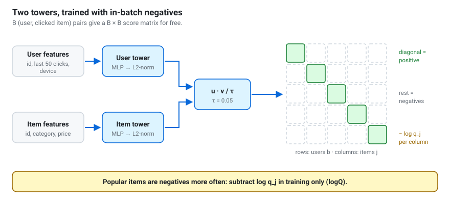
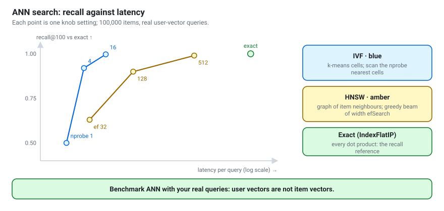

# Chapter 26 · Two-tower retrieval & ANN

*Part II · Prerequisites: Chapters 25 and 27 (or equivalent PyTorch experience) · Estimated time: reading ~55 min, lab ~90 min · Compute: CPU (training takes under a minute)*

[](https://colab.research.google.com/github/berdakh/MLBOOTCAMP/blob/main/part2-ml-at-scale/ch26-two-tower-retrieval-and-ann/notebook.ipynb) · [Lab: notebook.ipynb](notebook.ipynb) · [Solutions](solutions.md)

## Learning objectives

After this chapter you should be able to:

1. describe the two-tower architecture, explain why it permits precomputed item vectors, and state its main limitation;
2. build a two-tower model in PyTorch with id, history and categorical features;
3. train it with an in-batch softmax, derive the popularity bias that in-batch negatives introduce, and correct it with the logQ correction;
4. compare the model with the ALS baseline of Chapter 25 on recall, popularity bias and cold-start users;
5. explain exact, IVF, HNSW and product-quantised nearest-neighbour search, and read a recall–latency table for an index;
6. sketch the serving cascade around a two-tower retriever, including what is precomputed, what runs per request, and what must be versioned together.

## 26.1 Introduction

The two-tower model is the most common first-stage retriever in large
recommender and search systems; YouTube, Google Play, Pinterest, Instagram and
others have published variants. One neural network embeds the user (and the
context), another embeds the item, and the relevance score is the dot product
of the two vectors. Retrieval then becomes a nearest-neighbour search among the
item vectors. The model generalises the matrix factorisation of Chapter 25 by
computing the vectors from *features* rather than storing one free vector per
id, which is what allows it to handle new users and items.

Two difficulties must be addressed. The standard training method, the in-batch
softmax, has a popularity bias that must be corrected. And the search must
return results within about a millisecond over catalogues of hundreds of
millions of items, which makes it an approximate-search problem with its own
trade-offs.

Section 26.2 describes the model. Section 26.3 covers training with in-batch
negatives and the logQ correction. Section 26.4 compares the model with ALS.
Section 26.5 covers approximate nearest-neighbour search, and Section 26.6 the
serving cascade.

## 26.2 The two-tower model

The lab's model has the following structure.

```
 user tower                                    item tower
 user id          -> embedding (32)  ┐         item id       -> embedding (32) ┐
 last 50 clicks   -> mean of item    ├-> MLP   category      -> embedding (16) ├-> MLP -> L2-normalise -> v_i
                     embeddings (32) │   -> L2-normalise -> u price decile -> embedding (8) ┘
 segment, device, country -> embeddings ┘

                 score(u, i) = u · v_i / τ       (τ = 0.05)
```

The score is the cosine similarity of the two normalised vectors divided by a
*temperature* $\tau$:

$$
s(u, i) = \frac{\mathbf{u}^\top \mathbf{v}_i}{\tau}, \qquad \lVert \mathbf{u} \rVert = \lVert \mathbf{v}_i \rVert = 1
\tag{26.1}
$$

where $\mathbf{u}$ is the user-tower output and $\mathbf{v}_i$ the item-tower
output for item $i$. A cosine of 0.6 with $\tau = 0.05$ gives a logit of 12, and a
cosine of 0.5 a logit of 10, so the softmax prefers the first item by a factor
$e^{2} \approx 7.4$. Without the temperature, logits would be confined to
$[-1, 1]$ and the softmax over a thousand items would be nearly uniform; the
temperature sharpens it.

**The separation of the towers.** The towers never see each other's inputs and
interact only through the final dot product. Item vectors can therefore be
computed once and stored in an index; per request, only the user tower runs (one
small forward pass), followed by a nearest-neighbour search. This separation is
the purpose of the architecture and also its main limitation: the model cannot
use *user × item cross features*, such as "the user's past click rate on this
item's brand". Such features belong in the ranker, which scores only a few
hundred candidates and can afford them.

**Design choices.**

* The **history mean** averages the item-id embeddings of the user's last 50
  clicks, sharing the item embedding table between the towers. This reduces the
  number of parameters and gives a meaningful vector to a user with only a few
  clicks. When training on a click $(u, i)$, item $i$ is removed from $u$'s
  history; otherwise the model learns to retrieve what is already in the history,
  which looks excellent on the training loss and fails on validation.
* **L2 normalisation with a temperature** keeps training stable, since the
  scores are bounded, while the temperature controls the sharpness of the
  softmax.
* **Small initialisation of id embeddings** (standard deviation 0.05) means that
  an id never seen in training, a cold user or item, contributes almost nothing,
  and the feature embeddings determine the vector.

The model has about 460,000 parameters, almost all of them in the two id tables
(10,000 users and 4,001 items, each with 32 dimensions).

## 26.3 Training with in-batch negatives

### 26.3.1 The in-batch softmax

The training data are (user, clicked item) pairs. For a batch of $B$ pairs, every
user is scored against every item in the batch, giving a $B \times B$ matrix of
logits. The diagonal holds the positives; the other $B - 1$ items in each row
serve as negatives at no extra cost, since their item vectors have already been
computed. The loss is a softmax cross-entropy per row, asking each user to pick
their own item out of the batch:

$$
L = -\frac{1}{B} \sum_{b=1}^{B} \log \frac{\exp\!\big(s(u_b, i_b) - \log q_{i_b}\big)}{\sum_{j=1}^{B} \exp\!\big(s(u_b, i_j) - \log q_{i_j}\big)}
\tag{26.2}
$$

where $q_i$ is item $i$'s sampling probability, introduced below; without the
correction the $\log q$ terms are omitted. This is the InfoNCE form of
contrastive learning. A model that knows nothing assigns equal logits to all
items and has loss $\log B$; with $B = 1024$ that is 6.93.



*Figure 26.1 — The two-tower model and the in-batch softmax. Only the dot product connects the towers, so item vectors can be computed once and indexed. Every off-diagonal cell is a negative that costs nothing extra, and a popular item fills many of those cells.*

### 26.3.2 The sampling bias

The negatives are not drawn uniformly from the catalogue. An item appears in a
batch in proportion to how often it is clicked, so its probability of being
sampled is $q_i$, its share of training clicks. Popular items therefore serve as
negatives far more often than unpopular ones, and the model learns to push them
down.

The bias can be stated precisely. A softmax over a set of negatives sampled from
a distribution $q$ is a *sampled softmax*. Its loss is minimised, in expectation,
by logits that satisfy

$$
s(u, i) = \log p(i \mid u) - \log q_i + \text{const}(u)
\tag{26.3}
$$

rather than $s(u, i) = \log p(i \mid u) + \text{const}(u)$. The uncorrected model
thus learns how much more than its base rate the user likes the item, a quantity
similar to pointwise mutual information, and ranking by it buries popular items.
The **logQ correction** (Yi et al., 2019) subtracts $\log q_i$ from each item's
logit *during training*, as in Equation (26.2). The training optimum then becomes
$s(u, i) - \log q_i = \log p(i \mid u) - \log q_i + \text{const}$, that is,
$s(u, i) = \log p(i \mid u) + \text{const}$. At serving time there is no sampling
and therefore nothing to correct: the model's score $s(u, i)$ is used directly.
Subtracting $\log q_i$ again at serving would reintroduce the penalty.

A numerical illustration: if item A receives 1% of all clicks and item B 0.01%, a
batch of 1,024 clicks contains A about 10 times on average and B in about one
batch out of ten. Per training example, A is pushed down about 100 times more
often than B, whatever users think of it.

Two implementation details matter. The correction is applied per *column* of the
logit matrix (column $j$ is item $j$ acting as a candidate for every user);
applied per row, it is a constant within each row's softmax and has no effect.
And when the same popular item appears twice in a batch, its second copy should
not count as a negative for the first; these *accidental hits* are masked. The
library function `rt.in_batch_softmax_loss` does both.

An analogy is a social event at which each person must pick their partner out of
everyone present. A well-known person attends every event and is therefore "not
picked" by almost everyone, so the model concludes that well-known people are
unattractive. Subtracting $\log q_i$ tells the model that this person was present
50 times more often than average and that the rejections must be discounted
accordingly. The analogy has a limit: $q_i$ is estimated from click counts, so for
a new item it is noisy, and so is its correction.

There are alternatives to in-batch negatives: uniform random negatives from the
catalogue (unbiased in sampling but mostly easy, and they require extra
item-tower passes), mixtures of in-batch and uniform negatives, hard negatives
(items ranked high but not clicked, which speed learning but risk false
negatives), and impressed-but-not-clicked items (real negatives, but subject to
position bias).

### 26.3.3 Training

The lab trains two models for three epochs each, with and without the
correction, in about 10–40 s per model on a 2-core CPU. The plain model's loss
falls from about 6.24 to 5.92, and the corrected model's from about 6.35 to 5.93.
The two losses are on different scales, because the corrected logits include
$-\log q$, so they should not be compared with each other. A GPU is unnecessary at
this size: the main computation per step is a $1024 \times 1024$ matrix.

## 26.4 Evaluation against ALS

On the validation week of ShopStream (CPU runs; results vary by about ±0.01
between runs):

| Model | Recall@100 clicks | Recall@100 true top-20 | Recall@100 cold users | Mean log-popularity |
|---|---|---|---|---|
| ALS (Chapter 25) | about 0.335 | about 0.59 | about 0.02 | about 5.15 |
| two-tower, no correction | about 0.24 | about 0.42 | about 0.04 | about 3.6 |
| two-tower with logQ | about 0.41 | about 0.74 | about 0.26 | about 5.3 |

Three conclusions follow.

1. **Without the correction the two-tower model is worse than ALS**, and the
   popularity column shows why: it retrieves unpopular items and covers the whole
   catalogue (coverage 1.0). It over-penalises popular items, as Equation (26.3)
   predicts.
2. **With the correction it outperforms ALS by a wide margin** on both truths
   (about +0.07 recall on clicks and +0.15 on the true top-20). The features and
   the history tower add information that the click matrix alone does not contain.
3. **Cold users** receive a meaningful vector from their segment, device and
   country: recall about 0.26 against 0.02 for ALS, and above the 0.18 of global
   popularity in Chapter 25.

New items, on the other hand, remain rare in the corrected model's lists (about
0.45 per list of 100): their id embedding is untrained, and the category and
price embeddings alone do not lift them into the top 100. A content-based
generator and an exploration quota (Chapter 25) are still required; richer
content features (text, image embeddings) would help the item tower.

## 26.5 Approximate nearest-neighbour search

### 26.5.1 The problem

Serving requires the $k$ item vectors with the largest dot product with
$\mathbf{u}$. Exact search costs

$$
\text{cost} = N \cdot d \ \text{multiply-adds per query}
\tag{26.4}
$$

for $N$ items of dimension $d$. With 4,000 items this is negligible. With
$N = 10^8$ and $d = 32$ it is $3.2 \times 10^9$ operations per request, far beyond
a budget of a few milliseconds. Approximate nearest-neighbour (ANN) indexes trade
a small loss of recall for a large gain in speed. Their quality is measured by
recall against exact search:

$$
\operatorname{Recall@}k = \frac{1}{\lvert Q \rvert} \sum_{q \in Q} \frac{\lvert \text{ANN}_k(q) \cap \text{Exact}_k(q) \rvert}{k}
\tag{26.5}
$$

where $Q$ is a set of queries and $\text{ANN}_k(q)$, $\text{Exact}_k(q)$ are the
item sets returned by the approximate and exact searches. If an index returns 92
of the exact top 100, recall is 0.92 for that query.

### 26.5.2 Index types

* **Flat (exact).** Brute-force comparison with every vector (`IndexFlatIP` in
  FAISS). It is the reference for recall.
* **IVF (inverted file).** The vectors are clustered with k-means into `nlist`
  cells. At query time, only the `nprobe` cells whose centroids are closest to the
  query are scanned, a fraction of about $n_\text{probe}/n_\text{list}$ of the
  data; with 4,096 cells and $n_\text{probe} = 16$ this is about 0.4%. Recall and
  latency both increase with `nprobe`.
* **HNSW (hierarchical navigable small world).** A layered proximity graph in
  which each vector is linked to about $M$ neighbours. A query starts at an entry
  point in the sparse top layer and moves greedily towards the query, descending
  layer by layer, keeping a beam of `efSearch` candidates. Recall and latency grow
  with `efSearch`; the graph links add memory, and building is slower.
* **Product quantisation (PQ).** Each vector is split into $m$ sub-vectors, each
  replaced by the index of its nearest centroid in a small codebook, so a vector
  of 32 floats (128 bytes) can be stored in 16 bytes. Distances are approximated
  with lookup tables. IVF-PQ combines the two and is used to hold hundreds of
  millions of vectors in memory; the shortlist is then re-ranked by exact dot
  product.

An analogy for IVF is a library organised in sections: walk to the four sections
whose signs best match the topic and search only those shelves. HNSW resembles
asking for directions: take the motorway to roughly the right town, then smaller
and smaller streets. In both cases, a good book may sit in a section that was not
visited; that missing share is the recall loss.



*Figure 26.2 — Recall against latency for IVF and HNSW. Each index is a curve rather than a point: its parameter (`nprobe`, `efSearch`) moves along the curve.*

### 26.5.3 A benchmark

ShopStream's catalogue is too small for ANN to matter, so the lab builds a
synthetic index of 100,000 items (each a learned item embedding plus noise,
re-normalised, so that the structure resembles the real one) and queries it with
2,000 real user embeddings. On the lab machine:

* exact search costs about 0.4 ms per query and grows linearly with the
  catalogue;
* IVF with `nprobe = 1` is about 30 times faster but finds only about half of the
  exact top 100; recall reaches about 0.92 at `nprobe = 4` and about 0.997 at
  `nprobe = 16`, still about 15 times faster than exact search;
* HNSW needs a large `efSearch` here (recall about 0.63, 0.90 and 0.99 for 32, 128
  and 512) and is the slowest to build (a few seconds, against under half a
  second for IVF); at `efSearch = 512` it is slower than IVF at similar recall.

HNSW performs comparatively poorly here although it leads most public benchmarks.
Those benchmarks query with vectors from the *same distribution* as the indexed
vectors. Two-tower user vectors are not item vectors; they occupy a different
region of the sphere (the best user–item cosine is only about 0.6, whereas items
have neighbours at about 0.99). Greedy graph search, built on item–item
neighbourhoods, needs a wider beam to reach the right region from such queries.
With item-to-item queries ("more like this"), HNSW reaches about 0.998 recall at
`efSearch = 128`, against about 0.90 for user queries at the same setting, while
IVF reaches about 0.998 for both. The practical rule is to **benchmark an ANN index
with the real query distribution**. For user-to-item retrieval, partition-based
indexes such as IVF (or ScaNN, or graph indexes designed for out-of-distribution
queries) are often the safer choice, and `nprobe` gives a clean recall–latency
control that can be set per surface.

## 26.6 The serving cascade

| Phase | Step | Typical latency |
|---|---|---|
| offline (daily or hourly) | train the two-tower model with logQ; run the item tower over the catalogue; build the ANN index; build co-visitation tables, popularity lists and the ranker | — |
| online, per request | fetch user history and context features | about 5 ms |
| | user-tower forward pass on CPU | about 2 ms |
| | ANN search for the top 500 | about 5 ms |
| | other generators (co-visitation, fresh items, popularity) and merge | about 5 ms |
| | ranker features for 500 candidates from the feature store | about 20 ms |
| | rank 500 to the top 50 | about 20 ms |
| | business rules, diversity, advertisement blending | about 5 ms |
| | log impressions with positions and exploration flags | asynchronous |

Four principles govern the design.

* **Precompute everything that does not depend on the request**: item embeddings,
  the index, co-visitation tables, item features. New items are embedded on upload
  by the current item tower and added to the index incrementally.
* **Version together.** The user tower and the index must come from the same
  training run and the same feature preprocessing. A user vector from model
  version 7 searched in an index of version-6 item vectors produces meaningless
  results without any error. Model and index must be swapped atomically.
* **Logging closes the loop.** Positions, the source of each candidate and the
  exploration flags are what the debiasing methods of Chapter 23 will need.
* **Degrade gracefully.** If the ANN service times out, the system serves
  popularity and co-visitation candidates; it never returns an empty feed
  (Chapter 35).

## Key terms

| Term | Definition |
|---|---|
| Two-tower model | A model with separate user and item networks whose score is the dot product of their outputs. |
| Embedding | A learned vector representing an id or a categorical value. |
| Temperature $\tau$ | A divisor applied to the scores before the softmax; a small $\tau$ sharpens the distribution. |
| In-batch negatives | The other items in a training batch, used as negatives for each user. |
| Sampled softmax | A softmax computed over a sample of the candidates rather than the whole catalogue. |
| Sampling probability $q_i$ | The probability that item $i$ appears in a batch; proportional to its clicks. |
| logQ correction | Subtracting $\log q_i$ from item $i$'s logit during training to remove the sampling bias. |
| Accidental hit | A user's own positive item appearing again in the batch as a negative. |
| ANN search | Approximate nearest-neighbour search: fast, slightly incomplete retrieval of the nearest vectors. |
| IVF | An index that clusters vectors into cells and scans only the `nprobe` cells nearest to the query. |
| HNSW | An index based on a layered proximity graph searched greedily with a beam of width `efSearch`. |
| Product quantisation | Compression of vectors into short codes of codebook indexes. |
| Recall vs exact | The share of the exact top-$k$ that an approximate search returns. |

## Summary

1. A two-tower model embeds users and items separately and scores by a dot
   product; item vectors are precomputed and indexed, and cross features are left
   to the ranker.
2. The in-batch softmax obtains $B-1$ negatives per example at no extra cost, but
   samples negatives in proportion to popularity; its optimum is
   $\log p(i \mid u) - \log q_i$.
3. Subtracting $\log q_i$ during training, and not at serving, removes the bias.
   On ShopStream the correction raised recall@100 on clicks from about 0.24 to
   0.41, above ALS (about 0.335).
4. Features give cold users a useful vector (recall about 0.26 against 0.02 for
   ALS); cold items still require content features and exploration.
5. ANN indexes (IVF, HNSW, PQ) trade recall for latency and memory through
   explicit parameters; each index is a curve, not a point.
6. User-to-item queries differ in distribution from the indexed item vectors; ANN
   indexes must be benchmarked with the real queries.
7. The user tower and the index must be versioned together, logging must record
   positions and candidate sources, and retrieval must degrade gracefully.

## Exercises

The exercises are in the lab, [notebook.ipynb](notebook.ipynb); worked answers
are in [solutions.md](solutions.md).

* **Exercise 1** (graded). Implement `in_batch_softmax_loss(user_emb, item_emb,
  log_q)` following Equation (26.2), with the correction applied per column. The
  grader compares values and gradients with a reference.
* **Exercise 2** (graded). Implement `recall_vs_exact(approx_ids, exact_ids)`
  following Equation (26.5), ignoring the −1 entries that FAISS returns for
  missing results.
* **Exercise 3** (written). Explain, with a small numerical example, why in-batch
  negatives over-penalise popular items, why subtracting $\log q_i$ during training
  but not at serving corrects it, and when part of the popularity penalty might be
  kept deliberately.
* **Checkpoint questions.** Six oral questions on the architecture and cross
  features, in-batch negatives and alternatives, diagnosing a two-tower model that
  underperforms matrix factorisation, IVF/HNSW/PQ, adding new items to the index,
  and the significance of a recall loss in ANN search.

## Further reading

* X. Yi, J. Yang, L. Hong, D. Z. Cheng, L. Heldt, A. Kumthekar, Z. Zhao, L. Wei and E. Chi, "Sampling-Bias-Corrected Neural Modeling for Large Corpus Item Recommendations", RecSys 2019.
* P. Covington, J. Adams and E. Sargin, "Deep Neural Networks for YouTube Recommendations", RecSys 2016.
* A. van den Oord, Y. Li and O. Vinyals, "Representation Learning with Contrastive Predictive Coding", arXiv:1807.03748, 2018 — the InfoNCE loss.
* H. Jégou, M. Douze and C. Schmid, "Product Quantization for Nearest Neighbor Search", *IEEE TPAMI* 33(1), 2011.
* Y. A. Malkov and D. A. Yashunin, "Efficient and Robust Approximate Nearest Neighbor Search Using Hierarchical Navigable Small World Graphs", *IEEE TPAMI* 42(4), 2020.
* J. Johnson, M. Douze and H. Jégou, "Billion-Scale Similarity Search with GPUs", *IEEE Transactions on Big Data* 7(3), 2021 — the FAISS library; and the FAISS documentation.
* R. Guo, P. Sun, E. Lindgren, Q. Geng, D. Simcha, F. Chern and S. Kumar, "Accelerating Large-Scale Inference with Anisotropic Vector Quantization", ICML 2020 — ScaNN.

**Next:** [Chapter 27 · PyTorch training done right](../ch27-pytorch-training-done-right/README.md)
