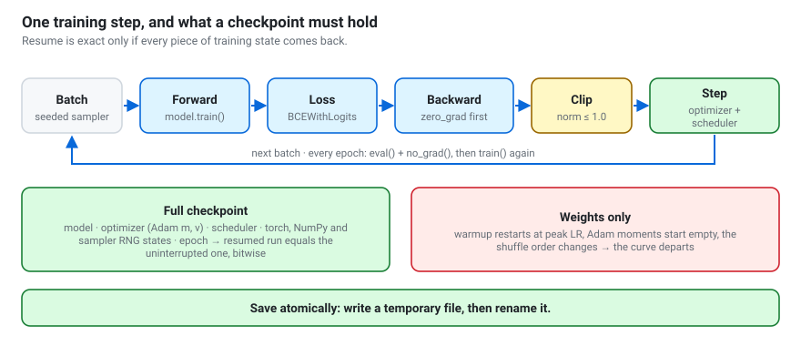
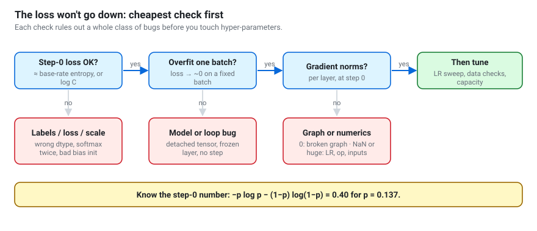

# Chapter 27 · PyTorch training done right

*Part II · Prerequisites: Chapter 19; working knowledge of PyTorch · Estimated time: reading ~55 min, lab ~90 min · Compute: CPU (a T4 GPU only speeds up the optional extension)*

[](https://colab.research.google.com/github/berdakh/MLBOOTCAMP/blob/main/part2-ml-at-scale/ch27-pytorch-training-done-right/notebook.ipynb) · [Lab: notebook.ipynb](notebook.ipynb) · [Solutions](solutions.md)

## Learning objectives

After this chapter you should be able to:

1. choose between map-style and iterable datasets, write a collate function, and reason about `num_workers` and `pin_memory` from measurements;
2. write the training loop by hand and state where `train()`/`eval()`, `no_grad()` and `zero_grad()` belong and why;
3. predict the loss at initialisation, initialise the output bias to the base rate, and use the initial loss, a one-batch overfitting test and gradient norms to debug a model that does not learn;
4. make two training runs produce bitwise-identical loss curves, and demonstrate that a resumed run equals an uninterrupted one;
5. use a warmup-plus-cosine learning-rate schedule and gradient-norm clipping, and state the AdamW update;
6. locate planted bugs in a training script from their symptoms.

## 27.1 Introduction

Most readers of this book have trained neural networks in PyTorch, often in a
research setting where a run is executed once, by its author, on one machine.
In industry, a training run must also be *trusted, repeated and resumed* by
other people: a reviewer must be able to reproduce a result, a pre-empted job
must continue where it stopped, and a regression must be traceable to a code
change rather than to random variation. These requirements are about the
engineering of the training loop rather than about the model, and they are
also what interviewers probe when they ask a candidate to "walk through a
training step".

The running example is a click model on ShopStream impressions: small enough
to train in seconds on a CPU, yet realistic enough to exhibit every failure
discussed. Section 27.2 covers datasets and data loaders. Section 27.3 writes
the training loop. Section 27.4 covers the loss at initialisation. Section 27.5
covers reproducibility, Section 27.6 learning-rate schedules and clipping,
Section 27.7 checkpointing, and Section 27.8 a systematic procedure for
debugging. Section 27.9 notes the optional mixed-precision extension.

## 27.2 Datasets and data loaders

### 27.2.1 The data

The click model predicts $P(\text{click})$ for one impression from four inputs:
the user, the item, the item's category and the position at which it was shown.
Position is a training feature so that the model can explain away position
bias (Chapter 23); at serving time it would be fixed to one value. The lab
trains on 240,000 impressions from days 28–41 and validates on 60,000 from days
42–48. The split is by time, as everywhere in Part II; Section 27.8 shows what
goes wrong otherwise. The click rate is about 0.137.

### 27.2.2 Map-style and iterable datasets

A **map-style** `Dataset` implements `__len__` and `__getitem__(i)`. The data
loader's *sampler* chooses indices (shuffled or in order), workers fetch the
corresponding samples, and a **collate function** stacks them into a batch. An
**iterable** `IterableDataset` implements only `__iter__` and decides the order
itself. It suits streams that do not fit in memory (Parquet files, a message
queue), but shuffling and sharding across workers become the programmer's
responsibility.

**Per-row versus per-batch access.** The textbook map-style dataset returns one
row per `__getitem__` call. For small tabular rows, the Python overhead of one
call plus collation per row *is* the cost of loading. A dataset whose
`__getitem__` receives a whole list of indices (one call per batch, using a
`BatchSampler` and `batch_size=None` in the loader) avoids it. In the lab, the
per-row dataset takes about 0.5–0.8 s for 50,000 rows and the per-batch dataset
about 0.03 s, 15–25 times faster. For images the balance is different: decoding
dominates, and per-row access is acceptable.

**Workers.** `num_workers` starts separate *processes* that run `__getitem__`
and collation in parallel and return batches through shared memory. Workers
help when loading is CPU-intensive (decoding images, tokenising text) and spare
cores are available. They cost process start-up at every epoch (unless
`persistent_workers=True`), memory (each worker holds a copy of the dataset
object) and inter-process transfer. A free Colab runtime has two CPU cores, so
two workers are the most that can help. In the lab, the per-row loader takes
about the same time with zero or two workers, while the per-batch loader with
no workers is faster than both. The data path should be fixed before processes
are added.

**Pinned memory.** `pin_memory=True` allocates batches in page-locked host
memory, so that `.to("cuda", non_blocking=True)` can overlap the copy to the
GPU with computation. It matters only with a GPU.

**Iterable datasets and workers.** With an `IterableDataset`, *every* worker runs
`__iter__` from the beginning. Without sharding, each row is produced once per
worker. In the lab, streaming the ShopStream Parquet files with two unsharded
workers yields about 4.9 million rows instead of about 2.45 million. Nothing
raises an error: the only symptoms are a suspiciously long epoch and a model
trained on duplicates. The remedy is to assign files to workers using
`torch.utils.data.get_worker_info()`.

## 27.3 The model and the training loop

The click model concatenates embeddings of the user, item, category and
position and passes them through a small multilayer perceptron with dropout. It
outputs a **logit** $z$, and the loss is `BCEWithLogitsLoss`, which applies the
sigmoid internally in a numerically stable form:

```math
\ell(z, y) = -\big[y \log \sigma(z) + (1-y) \log(1-\sigma(z))\big]
\qquad (27.1)
```

where $`y \in \{0, 1\}`$ is the label and $\sigma(z) = 1/(1+e^{-z})$. Computing
$\log \sigma(z)$ directly from $z$ (as $-\log(1+e^{-z})$, evaluated stably)
avoids the loss of precision that occurs when $\sigma(z)$ rounds to 0 or 1.

The loop, with the points that matter numbered, is:

```python
@torch.no_grad()                                   # (1) no autograd graph in evaluation
def predict(model, tensors):
    model.eval()                                   # (2) dropout off; BatchNorm uses running statistics
    ...

for epoch in range(n_epochs):
    model.train()                                  # (3) every epoch: evaluation left the model in eval mode
    for user, item, pos, y in train_loader:
        optimizer.zero_grad(set_to_none=True)      # (4) clear the previous step's gradients
        loss = loss_fn(model(user, item, pos), y)
        loss.backward()                            # (5) accumulate d(loss)/d(parameters) into .grad
        optimizer.step()                           # (6) update the parameters from .grad
        total += loss.item() * len(y)              # (7) a Python float, not a tensor holding the graph
```

* **(3) `model.train()` inside the epoch loop.** Evaluation switched the model to
  eval mode; without switching back, training silently continues without
  dropout (and, with BatchNorm, with frozen statistics).
* **(4) Placement of `zero_grad`.** Anywhere between the previous `step()` and
  the current `backward()` is correct. If it is omitted, gradients add up across
  steps. This is sometimes deliberate: in *gradient accumulation* the gradients
  of $n$ micro-batches (each loss divided by $n$) are summed before one step, to
  emulate a batch $n$ times larger than fits in memory. `set_to_none=True`
  releases the gradient memory instead of filling it with zeros.
* **(1) `no_grad` and (2) `eval` are independent.** `eval()` changes the
  *behaviour* of layers; `no_grad()` stops *recording* the computation graph.
  Evaluation needs both. With only `no_grad`, validation runs with dropout
  active, so the metrics are noisy and pessimistic, and BatchNorm updates its
  running statistics on validation data. With only `eval`, the numbers are
  correct but a full graph is built, which can exhaust memory on a large
  validation set.
* **(7) `loss.item()`.** Accumulating `loss` tensors keeps every step's graph
  alive, a classic slow memory leak.

An analogy: `model.eval()` is putting a car into parking mode (it changes how
the car behaves), while `torch.no_grad()` is switching off its recording camera
(nothing is recorded for later replay, that is, for back-propagation).
Validation needs the car parked and the camera off.

In the lab, three epochs reduce the training loss from about 0.357 to about
0.336, with a validation loss of about 0.335 and an AUC of about 0.76, at about a
second per epoch. The epoch-0 training loss is an average over a model that was
changing, computed with dropout active, so training and validation losses are
not directly comparable.

## 27.4 The loss at initialisation

Before the first step, a sensibly initialised model should predict roughly the
base rate for every example. For binary cross-entropy with positive rate $p$, the
best *constant* prediction is $p$ itself, and its loss is the binary entropy:

```math
\ell^{*}_\text{const} = -\big[p \log p + (1-p) \log(1-p)\big]
\qquad (27.2)
```

For $p = 0.137$ this is 0.40 nats. For $C$ balanced classes under softmax
cross-entropy,

```math
\mathrm{softmax}(\mathbf{z})_c = \frac{e^{z_c}}{\sum_{k=1}^{C} e^{z_k}},
\qquad
\ell = -\log \mathrm{softmax}(\mathbf{z})_y
\qquad (27.3)
```

the corresponding value is $\log C$ (and in general the entropy of the class
prior). For example, logits $(2, 0.5, -1)$ with true class 0 give probabilities
0.79, 0.18 and 0.04, and a loss of $-\log 0.79 = 0.24$.

A loss at step 0 far from the value of Equation (27.2) indicates a bug, such as
wrong labels, a wrong loss function or logits on the wrong scale, *before* any
training has taken place. Small random weights produce logits near zero, so
every prediction is near 50% and the initial loss is near $\log 2 = 0.69$. In the
lab the measured loss is about 0.6–0.7 without correction. Initialising the bias
of the output layer to the log-odds of the base rate,

```math
b_0 = \log\frac{p}{1-p}
\qquad (27.4)
```

which is $-1.84$ for $p = 0.137$, starts the model at the base rate; the lab then
measures about 0.40. Without this initialisation, the first hundreds of steps are
spent learning the base rate. With rare positives (an advertising CTR of 1%) the
gap is large, 0.69 against 0.056, and the resulting "hockey stick" at the start
of the loss curve obscures everything else.

## 27.5 Reproducibility

A training run draws random numbers in four places: weight initialisation, data
order, dropout masks, and any randomness in data-loading workers. To repeat a run
exactly, each source must be controlled:

| Source | Control |
|---|---|
| initialisation and dropout (PyTorch global generator) | `torch.manual_seed(seed)` before building the model |
| data order | a **dedicated** `torch.Generator` passed to the sampler |
| NumPy or `random` inside workers | `worker_init_fn` that seeds each worker, and `generator=` on the loader |
| non-deterministic kernels (mostly on GPU) | `torch.use_deterministic_algorithms(True)`, cuDNN flags, `CUBLAS_WORKSPACE_CONFIG` |

In the lab, two runs with the same seed produce identical loss curves and
identical weights, compared with `==` on floating-point values: **bitwise**
equality, not approximate agreement. A run with a different seed differs by up to
about 0.1 in per-step loss.

The dedicated generator for data order matters because unrelated code can draw
from the global generator. The lab inserts a single extra draw from the global
generator between epochs, the kind of line someone adds while debugging. The
first epoch remains identical; the second does not. The data order is unchanged,
because it comes from the dedicated generator, but the dropout masks of the
second epoch shift, because they share the global generator. Had the sampler used
the global generator, the data order would also have changed.

Exact reproducibility holds only for *the same code, library versions and
hardware*. Across GPU models or PyTorch versions, results are at best
statistically equivalent, which is why results should be reported as a mean and
spread over several seeds. Deterministic GPU kernels can be much slower; bitwise
determinism is worth its cost for debugging and regression tests, not for large
hyperparameter sweeps.

## 27.6 The optimiser, learning-rate schedules and clipping

### 27.6.1 AdamW

Adam keeps exponential moving averages of the gradient and of its elementwise
square, corrects their initial bias, and steps by their ratio. AdamW applies
weight decay separately from the gradient-based step ("decoupled" weight decay):

```math
\begin{aligned}
m_t &= \beta_1 m_{t-1} + (1-\beta_1)\, g_t, \qquad v_t = \beta_2 v_{t-1} + (1-\beta_2)\, g_t^2 \\
\hat m_t &= \frac{m_t}{1-\beta_1^t}, \qquad \hat v_t = \frac{v_t}{1-\beta_2^t} \\
\theta_t &= \theta_{t-1} - \eta \lambda\, \theta_{t-1} - \eta \frac{\hat m_t}{\sqrt{\hat v_t} + \epsilon}
\end{aligned}
\qquad (27.5)
```

where $g_t$ is the gradient at step $t$, $\theta$ the parameters, $\eta$ the
learning rate, $\lambda$ the weight decay, $\beta_1 = 0.9$ and $\beta_2 = 0.999$
the averaging constants, and $\epsilon$ a small constant for numerical stability.
At $t = 1$, $\hat m_1 = g_1$ and $\hat v_1 = g_1^2$, so every parameter moves by
about $\eta$ whatever the size of its gradient. The first steps are therefore
taken with poorly estimated statistics, which is why they are risky.

### 27.6.2 Warmup and cosine decay

A short linear **warmup** keeps early updates small while Adam's statistics
settle; a **cosine decay** afterwards reduces the step size so that the final
epochs refine the solution rather than oscillate. The schedule used in the lab is,
per optimiser step $t$,

```math
\eta_t = \eta_{\max} \cdot \begin{cases} \dfrac{t+1}{T_w} & t < T_w \\[6pt] r + (1-r)\,\dfrac{1}{2}\Big(1 + \cos\big(\pi\, \tfrac{t - T_w}{T - T_w}\big)\Big) & t \ge T_w \end{cases}
\qquad (27.6)
```

where $T_w$ is the number of warmup steps, $T$ the total number of steps, and $r$
the final learning rate as a fraction of $\eta_{\max}$ (0.05 in the lab). With
$T_w = 10$ and $T = 100$, step 4 has $`0.5\,\eta_{\max}`$ and step 55 has
$`0.525\,\eta_{\max}`$. The number of warmup steps depends on batch size and
optimiser and should be treated as a hyperparameter.

### 27.6.3 Gradient clipping

Gradient-norm clipping rescales the whole gradient vector when its Euclidean norm
exceeds a threshold $c$, without changing its direction:

```math
\mathbf{g} \leftarrow \mathbf{g} \cdot \min\!\left(1, \frac{c}{\lVert \mathbf{g} \rVert_2}\right)
\qquad (27.7)
```

For $\mathbf{g} = (3, 4)$ and $c = 1$ the norm is 5, and the clipped gradient is
$(0.6, 0.8)$. Clipping protects against rare very large gradients (an unusual
batch, a spike in a sequence model) at negligible cost. PyTorch's
`clip_grad_norm_` returns the norm *before* clipping, which is the quantity to
monitor.

In the lab, a constant learning rate and a warmup-cosine schedule with clipping
at 1.0 both reach a validation AUC of about 0.76; the schedule gave a slightly
lower validation loss in our runs (0.335 against 0.336). On a model of this size
the effect is modest, and a single run should not be over-interpreted: a claimed
gain should be compared over several seeds.

## 27.7 Checkpointing and exact resumption

Interactive sessions disconnect, pre-emptible machines are reclaimed, and long
jobs fail after many hours. A checkpoint that contains only the model weights is
**not** sufficient to continue the same run. The training state also includes:

* the model's parameters *and buffers* (for example BatchNorm statistics);
* the optimiser state (Adam's two moment estimates per parameter, and step counts);
* the scheduler state (its position in the schedule);
* the epoch or step counter;
* every random-number generator state: Python, NumPy, PyTorch CPU and CUDA, the
  sampler's dedicated generator, and the seeds of data-loader workers;
* with mixed precision, the state of the gradient scaler.



*Figure 27.1 — The training step holds state in four places: weights, optimiser moments, scheduler position and random generators. A full checkpoint saves all four; a weights-only checkpoint saves one, and its resumed curve departs from the uninterrupted one.*

The test of a checkpoint is that an interrupted and resumed run equals an
uninterrupted one, bitwise. The lab runs three variants: four uninterrupted
epochs; two epochs, a full checkpoint, a rebuild of everything with a different
seed, a reload and two more epochs; and the same with a weights-only reload. The
full resume reproduces the uninterrupted loss curve and weights exactly. The
weights-only resume departs from the third epoch on, because it restarts the
schedule (including the warmup), starts with empty Adam moments and uses a
different data order. The difference here is small, about 0.0003 in loss; on a
long run whose learning rate has decayed, restarting at the peak rate can undo
hours of training. The checkpoint is about 2.5 MB, roughly three times the
weights, because Adam stores two moments per parameter.

Two further practices are worth adopting. A checkpoint is written to a temporary
file and then **renamed**, so that a failure during saving never corrupts the
last good checkpoint. And `torch.load(..., weights_only=False)` executes pickled
code, so only checkpoints from trusted sources should be loaded in that mode.

An analogy is a saved game: restoring a game requires not only the character's
position (the weights) but also the inventory (Adam's moments), the progress log
(the scheduler) and the state of the dice (the random generators). Restoring only
the position continues *a* game, not the same one.

## 27.8 A debugging procedure

When a model does not learn, the checks should be made in order, cheapest first:

1. **Loss at step 0.** Does it equal the value of Equation (27.2)? If not, the
   fault is in the labels, the loss or the output scale.
2. **Overfit one batch.** A model with sufficient capacity must drive the loss on
   a single fixed small batch, with dropout off, close to zero. If it cannot, the
   fault is in the model or the loop (detached tensors, a wrong loss, frozen
   parameters, an optimiser that does not hold the model's parameters), not in the
   data or the hyperparameters. In the lab the loss on one batch of 256 falls from
   about 0.32 to about 0.06 by step 10 and to essentially zero by step 20.
3. **Gradient norms per layer.** A zero norm indicates a broken graph or a dead
   layer; NaN or exploding norms point to the learning rate, a numerically
   unstable operation, or bad inputs. (Embedding gradients are naturally small,
   since each row receives gradient only from the batch rows that use it.)
4. **Only then** sweep the learning rate over several orders of magnitude, check
   the data (shuffling, label noise, leakage), and consider capacity.



*Figure 27.2 — A debugging procedure for a model that does not learn. Each check takes seconds and, when it fails, points to a different part of the code. Hyperparameters come last because they cannot repair any of those faults.*

**A worked case.** The lab presents a colleague's script that runs without errors
and prints plausible numbers: a training loss of about 0.48 settling near 0.44,
and a validation AUC of about 0.61–0.63. The first check already reveals a
problem: the training loss stays *above* the base-rate entropy of about 0.40, so
a constant predictor would do better. The script contains three genuine faults
among several plausible-sounding distractors; Exercise 3 asks for them to be
identified, and the solutions report the measured effect of fixing each one.

## 27.9 Optional extension: mixed precision

On a GPU, `torch.autocast` runs matrix multiplications in 16-bit floating point,
and a `GradScaler` multiplies the loss by a large factor before back-propagation
so that small 16-bit gradients do not underflow; the gradients are unscaled
before clipping and the optimiser step. The training loop changes only slightly.
The lab includes this extension behind a flag; it was not run in the course's
verification (CPU only). For a model of 300,000 parameters, a GPU is limited by
Python overhead rather than arithmetic, so a speed-up should be expected only for
much larger models. Chapter 40 treats mixed precision in depth.

## Key terms

| Term | Definition |
|---|---|
| Map-style dataset | A dataset with `__len__` and `__getitem__`; a sampler chooses the indices. |
| Iterable dataset | A dataset with only `__iter__`; it determines the order of samples itself. |
| Collate function | The function that combines individual samples into a batch. |
| `num_workers` | The number of separate processes that load batches in parallel. |
| Pinned memory | Page-locked host memory that allows asynchronous copies to the GPU. |
| Logit | The raw score before the sigmoid or softmax. |
| `BCEWithLogitsLoss` | Binary cross-entropy computed directly from logits in a numerically stable way. |
| `train()` / `eval()` | Methods that switch layer behaviour such as dropout and batch normalisation. |
| `no_grad()` | A context in which operations are not recorded for back-propagation. |
| Gradient accumulation | Summing gradients over several micro-batches before one optimiser step. |
| Bias initialisation | Setting the output bias to the log-odds of the base rate, so the initial loss equals the label entropy. |
| AdamW | Adam with weight decay applied separately from the gradient step. |
| Warmup and cosine decay | A schedule that raises the learning rate linearly, then lowers it along a half cosine. |
| Gradient clipping | Rescaling the gradient when its norm exceeds a threshold. |
| Checkpoint | All state needed to continue a run exactly: weights, optimiser, scheduler, counters and random generators. |
| Bitwise reproducibility | The property that two runs produce identical floating-point values. |

## Summary

1. For small tabular rows, per-row dataset access is dominated by Python
   overhead; batched access was 15–25 times faster in the lab. Workers help only
   when loading is CPU-intensive, and iterable datasets must be sharded across
   workers.
2. The loop requires `model.train()` every epoch, `zero_grad` before `backward`,
   `eval()` together with `no_grad()` for evaluation, and `loss.item()` for
   logging.
3. The loss at step 0 should equal the label entropy; initialising the output bias
   to $\log\frac{p}{1-p}$ achieves this.
4. Bitwise reproducibility requires seeding before model construction, a dedicated
   generator for data order, seeded workers and deterministic kernels; it holds
   only for fixed code, libraries and hardware.
5. AdamW's first steps use poorly estimated statistics; warmup protects them,
   cosine decay refines the end of training, and clipping caps rare large
   gradients.
6. A checkpoint must contain the optimiser, scheduler, counters and all random
   states; the test is a bitwise match between a resumed and an uninterrupted run.
7. Debugging proceeds from the initial loss to overfitting one batch to gradient
   norms, and only then to hyperparameters.

## Exercises

The exercises are in the lab, [notebook.ipynb](notebook.ipynb); worked answers
are in [solutions.md](solutions.md).

* **Exercise 1** (graded). Implement `train_one_epoch(model, loader, optimizer,
  loss_fn)`, returning the mean loss per example. The grader compares the weights
  step by step with a reference loop.
* **Exercise 2** (graded). Implement `expected_initial_loss(pos_rate)` following
  Equation (27.2), including the cases of a positive rate of exactly 0 or 1.
* **Exercise 3** (graded). Identify which of eight statements describe bugs that
  are actually present in a colleague's training script. The grader stores only
  hashes of the answer and reports the number of correct findings and false
  alarms.
* **Checkpoint questions.** Six oral questions on the training step, `eval()`
  versus `no_grad()`, a loss of 0.69 with 2% positives, the contents of a
  checkpoint, sources of non-determinism on a GPU, and the first fifteen minutes
  of debugging.

## Further reading

* A. Paszke et al., "PyTorch: An Imperative Style, High-Performance Deep Learning Library", NeurIPS 2019.
* PyTorch documentation, "Reproducibility" and "torch.utils.data" — <https://pytorch.org/docs/stable/notes/randomness.html> and <https://pytorch.org/docs/stable/data.html>.
* D. P. Kingma and J. Ba, "Adam: A Method for Stochastic Optimization", ICLR 2015.
* I. Loshchilov and F. Hutter, "Decoupled Weight Decay Regularization", ICLR 2019 — AdamW.
* I. Loshchilov and F. Hutter, "SGDR: Stochastic Gradient Descent with Warm Restarts", ICLR 2017 — cosine schedules.
* I. Goodfellow, Y. Bengio and A. Courville, *Deep Learning*, MIT Press, 2016 — Chapter 8 (optimisation for training deep models) and Chapter 11 (practical methodology).
* A. Karpathy, "A Recipe for Training Neural Networks", blog post, 2019 — the overfit-one-batch and initial-loss checks.

**Next:** [Chapter 28 · Sequence models for user behaviour](../ch28-sequence-models-for-user-behavior/README.md)
