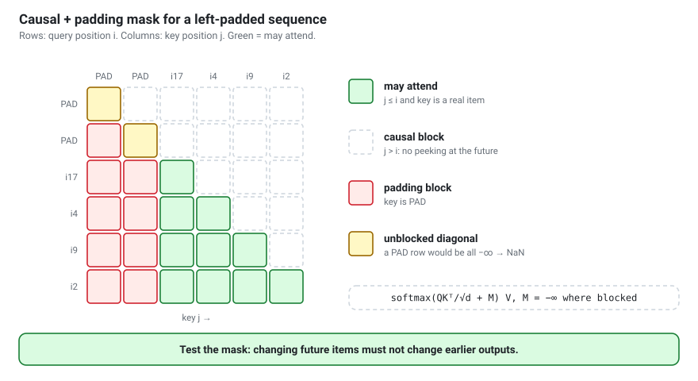

# Chapter 28 · Sequence models for user behaviour

*Part II · Prerequisites: Chapters 25, 26 and 27 · Estimated time: reading ~50 min, lab ~90 min · Compute: CPU (a GPU only speeds up optional parts)*

 · [Lab: notebook.ipynb](notebook.ipynb) · [Solutions](solutions.md)

## Learning objectives

After this chapter you should be able to:

1. formulate recommendation as next-item prediction and convert an impression log into per-user, time-ordered, left-padded click sequences;
2. build the two baselines a sequence model must beat: most-popular and last-item co-visitation;
3. write causal and padding attention masks, explain why their combination can produce NaN values, and test that a model cannot see the future;
4. describe and train a small SASRec-style causal transformer on a CPU;
5. evaluate with a time-respecting leave-last-out protocol, and explain why metrics computed against sampled negatives can mislead;
6. test whether a sequence model actually uses the order of events.

## 28.1 Introduction

Feeds, "up next" lists and session-based recommendations are often formulated
as **next-item prediction**: given the items a user has interacted with, in
order, which item will they interact with next? This differs from the retrieval
models of Chapters 25 and 26 in that the input is an ordered sequence rather
than a set or a fixed user vector, so a model can in principle exploit patterns
such as "a phone is followed by a phone case".

The model in this chapter is a small causal transformer of the kind introduced
by SASRec (Kang and McAuley, 2018). Readers who know transformers from natural
language processing will recognise the architecture: items play the role of
tokens, and the task is language modelling over item identifiers. The
engineering, however, lies in details that are easy to get wrong and that
interviewers ask about: masking, padding, and an evaluation that respects time
and does not flatter the model.

Section 28.2 builds the sequences. Section 28.3 defines the evaluation protocol
and the baselines. Section 28.4 covers attention masks. Section 28.5 describes
the model and the tests that it cannot cheat. Section 28.6 covers training.
Section 28.7 compares full-catalogue and sampled metrics, and Section 28.8 tests
whether order matters.

## 28.2 From impressions to sequences

A sequence model receives each user's events in time order. Three decisions are
implicit in that statement.

* **What counts as an event.** The lab uses clicks; a production system might
  use purchases, additions to a basket, or views weighted by dwell time.
  Impressions without a click are not part of the sequence; they could serve as
  negatives, which the lab does not use.
* **Order.** Events are ordered by event time, with ties broken
  deterministically (within a request, by position), using a stable sort.
* **Shape.** Models require a fixed-size integer array. The last $L$ events are
  kept ($L = $ `max_len`), item identifiers are shifted by +1 so that **0 can
  denote padding**, and sequences are padded on the **left**, so that the most
  recent item is always in the last column whatever the length of the history.

Left padding aligns every history at its end, like the last line of a receipt:
the most recent item is always in the same place, so "predict from the last
column" works for every user. Unlike a reader of a receipt, however, a model
will attend to the blank positions unless it is told (masked) not to.

On ShopStream there are about 244,000 training clicks from about 9,300 users and
about 44,000 validation clicks from about 7,700 users. The number of clicks per
user is heavy-tailed, with a median of about 18 and a 99th percentile in the low
hundreds. A maximum length of 30 covers the whole history of most users and the
recent history of the heaviest ones.

## 28.3 An evaluation that respects time

### 28.3.1 The protocol

The common *leave-one-out* protocol holds out each user's last event and trains
on everything else, including other users' events from *after* that moment. The
model is then tested on a period it has partly seen: trends, the popularity of
new items and co-occurrence patterns from the future leak into training. The lab
uses a time-respecting variant:

* the model is trained only on clicks from the training weeks (days 0–41);
* every user with a click in the validation week (days 42–48) contributes one
  test case: the **target** is their *last* validation click, and the
  **history** is every earlier click (training weeks and earlier validation
  clicks).

Using earlier validation clicks as *input* is legitimate, because at serving time
everything the user did before the moment of prediction is known. About 7,600
users are evaluated; about 6% of targets already appear in the user's recent
history (re-clicks). Whether already-clicked items may be recommended is a
product decision; the lab keeps them and states so.

### 28.3.2 Metrics

For each test user, all 4,000 items are ranked and the rank $r_u$ of the target is
found (0 = top). With one relevant item per user, the ideal DCG is 1, and

$$
\operatorname{HR@}10 = \frac{1}{\lvert U \rvert} \sum_{u \in U} \mathbb{1}[r_u < 10],
\qquad
\operatorname{NDCG@}10 = \frac{1}{\lvert U \rvert} \sum_{u \in U} \frac{\mathbb{1}[r_u < 10]}{\log_2(r_u + 2)}
\tag{28.1}
$$

where $U$ is the set of test users. Three users with target ranks 0, 3 and 12
give HR@10 $= 2/3$ and NDCG@10 $= (1 + 0.431 + 0)/3 = 0.477$. Ties in score are
counted against the target, so that a constant scorer obtains no hits by chance.

### 28.3.3 Baselines

* **Most popular.** The most-clicked items of the training weeks, the same list
  for every user. Full-catalogue HR@10 is about 0.027.
* **Last-item co-visitation.** Count, over all training sequences, how often item
  $b$ is clicked immediately after item $a$, and score items by the row of the
  user's *last* item, breaking ties by popularity. This "users who clicked this
  next clicked…" rule underlies many production "related items" lists. HR@10 is
  about 0.037, a relative gain of 30–40% from a single step of personalisation.

Absolute values are small because there are 4,000 candidates and only one target
per user.

## 28.4 Attention masks

### 28.4.1 Causal and padding masks

A next-item model is trained on all positions of a sequence at once: the output at
position $t$ predicts the item at position $t + 1$ ("teacher forcing"). This is
valid only if position $t$ cannot see positions after $t$, which a **causal mask**
enforces. Padding positions must not be attended to as if they were items, which
a **padding mask** enforces. With masks, scaled dot-product attention is

$$
\operatorname{Attention}(Q, K, V) = \operatorname{softmax}\!\left(\frac{Q K^\top}{\sqrt{d}} + M\right) V,
\qquad
M_{ij} = \begin{cases} 0 & \text{allowed} \\ -\infty & \text{blocked } (j > i \text{ or key } j \text{ is padding}) \end{cases}
\tag{28.2}
$$

where $Q$, $K$ and $V$ are the $n \times d$ query, key and value matrices of one
attention head, $d$ is the head dimension, and $M$ is the mask. A blocked pair
receives weight zero after the softmax. For example, a query with scores
$(1, 2, 5)$ over keys 0–2 and key 3 blocked receives weights $(0.02, 0.05, 0.94, 0)$.
The causal mask lets one forward pass do the work of a separate model for each
prefix; without it, position $t$ attends to the item at $t + 1$, which is its own
target, and the training loss collapses towards zero while the model is useless
at inference.

The lab follows PyTorch's convention for boolean attention masks, in which `True`
means *blocked*. Some functions (including the boolean mask of
`scaled_dot_product_attention`) use the opposite convention, and confusing the two
produces a model that sees *only* the future. Tests such as those in Section 28.5
catch this immediately.

### 28.4.2 The NaN trap

Combining the two masks has a trap. With left padding, a padding *query* at
position 0 may only attend to key 0 (causal mask), and key 0 is padding (padding
mask), so its entire row is blocked. A softmax over a row of $-\infty$ evaluates
to $0/0$, which is NaN, and NaN values propagate: one NaN entering a matrix
multiplication contaminates every output of the layer above. The remedy used in
the lab is to unblock the diagonal, so that each padding position attends to
itself. The outputs at padding positions are never used in the loss or the
prediction, so this changes nothing else. Right padding avoids this particular
problem, at the price of the last real item lying in a different column for each
user.

*Figure 28.1 — The combined causal and padding mask for a left-padded sequence. The green triangle is what each real position may attend to (itself and the past). The amber diagonal in the padding rows avoids rows that are entirely blocked, whose softmax would be NaN.*

An analogy for the causal mask is reading a mystery novel with a card held under
the current line: each prediction may use everything above the card and nothing
below. Training moves the card down every line at once.

## 28.5 A small SASRec and tests that it cannot cheat

The lab's model (`sr.SASRec`) consists of an item embedding plus a learned
positional embedding, two pre-LayerNorm transformer blocks using the combined
mask, and a final LayerNorm. The score of item $j$ after position $t$ is the dot
product of the hidden state $\mathbf{h}_t$ with item $j$'s embedding
$\mathbf{e}_j$; the input and output item embeddings are **tied** (the same
table). With dimension 48, two heads and two layers, the model has about 230,000
parameters, most of them in the $4{,}001 \times 48$ item embedding. The attention
is written out by hand in [`src/shoprank/seqrec.py`](../../src/shoprank/seqrec.py).

Before training, three tests check for the usual masking errors:

1. **Causality.** Changing the *last* item of every sequence must not change the
   output at any earlier position, and must change the output at the last one.
2. **Padding.** Replacing the padding slots with arbitrary items must not change
   the output at any real position.
3. **No NaN values**, including for a user with a single click.

All three pass in the lab. Tests of this kind should accompany any attention
model: a model that can see the future reaches an excellent training loss and is
useless in production, and only a test such as the first reveals this before an
online experiment does.

## 28.6 Training

The training inputs are the training-week sequences of length $L + 1$: positions
$0, \dots, L-1$ are the inputs and positions $1, \dots, L$ the targets. The loss is a
**full softmax** over all $N$ items at every non-padding target position:

$$
L = -\frac{1}{\lvert \mathcal{T} \rvert} \sum_{t \in \mathcal{T}} \log \frac{\exp(\mathbf{h}_t^\top \mathbf{e}_{y_{t+1}})}{\sum_{j=1}^{N} \exp(\mathbf{h}_t^\top \mathbf{e}_j)}
\tag{28.3}
$$

where $\mathcal{T}$ is the set of non-padding positions and $y_{t+1}$ the next
item. A model that guesses uniformly has loss $\log N = \log 4000 = 8.29$, which is
the value to expect at initialisation (Chapter 27). With 4,000 items the full
softmax is affordable; with millions of items, a sampled softmax with in-batch
negatives and the logQ correction of Chapter 26 would be used. The training loop is
that of Chapter 27, with warmup, cosine decay and gradient clipping.

In the lab, eight epochs take 60–150 s on a 2-core CPU. The training loss falls
from about 8.0 in the first epoch to about 6.8, and the full-catalogue HR@10
reaches about 0.07, roughly twice that of co-visitation and 2.5 times that of
popularity. The loss remains high in absolute terms because predicting the next
click among 4,000 items is genuinely uncertain; it should be compared with the
baselines on the metric, not with zero.

## 28.7 Full-catalogue and sampled metrics

Many papers and internal dashboards rank the target against **100 randomly
sampled negatives** instead of the whole catalogue, because it is cheaper. The lab
computes both versions with the same 100 uniform negatives for every model, and
adds one more model: SASRec with a mild popularity prior added to its scores.
Two effects appear.

* **Compression.** Co-visitation beats popularity by 30–40% on full-catalogue
  HR@10 but by only about 1% on sampled HR@10 (both about 0.42). Uniform negatives
  are mostly obscure items that any reasonable model ranks below the target, so
  sampled metrics are high and close together.
* **Disagreement.** In our runs, the popularity prior left full-catalogue HR@10
  unchanged or slightly better (0.070 to 0.070 in one run, 0.069 to 0.072 in
  another) while *lowering* sampled HR@10 by about 0.01 in both. The
  full-catalogue differences are tiny, so this is an illustration rather than a
  finding, but the mechanism is clear: a popularity prior helps against the
  popular items that compete for a real top 10, and those are rarely among 100
  uniform negatives, so the sampled metric registers only the cost.

This is a general result. Krichene and Rendle (2020) showed that sampled hit rate
and NDCG need not preserve the ordering of models under the full-catalogue metric.
The practical rule is to report full-catalogue metrics whenever they are
affordable (scoring 4,000 or even a million items with one matrix multiplication
is inexpensive offline). If sampling is unavoidable, it should be stated, the same
negatives should be used for every model, and sampled numbers should not be
compared across studies.

An analogy is a race run against 100 people chosen at random from the street
rather than against the actual competitors: almost any trained runner wins, so
every runner looks good and the differences between runners shrink.

## 28.8 Does the order matter?

A sequence model justifies its complexity only if the order of events carries
information. The lab tests this directly by shuffling each test user's history
(keeping the same items and the padding in place) and evaluating the same trained
model. Shuffling costs very little: HR@10 falls from 0.0700 to 0.0687 in our run,
and almost all of the gain over popularity survives.

This reflects ShopStream, not a weakness of the method. ShopStream users have
fixed tastes (Section 19.2.2), so a history is mostly a set of evidence about
*who the user is*. The model acts as a user-taste model built from recent clicks,
which is useful in itself: it needs no per-user parameters and adapts as soon as a
new click arrives. On real data with sessions, intents that change within minutes,
and sequential dependencies, order matters much more. The shuffling test, or a
comparison with a bag-of-items model of the same capacity, should be run before
claiming that a sequence model "understands sequences".

## Key terms

| Term | Definition |
|---|---|
| Next-item prediction | Predicting a user's next event from their past events in order. |
| Left padding | Filling short sequences with a padding symbol at the start, so the latest item is in the last column. |
| Padding token | The identifier that denotes "no item"; here 0, with item identifiers shifted by +1. |
| Causal mask | A mask that prevents position $i$ from attending to any later position $j > i$. |
| Padding mask | A mask that prevents attention to padding positions. |
| Self-attention | An operation in which each position's output is a weighted mixture of the values at the positions it may attend to. |
| SASRec | A causal transformer over item identifiers for next-item recommendation (Kang and McAuley, 2018). |
| Teacher forcing | Training every position of a sequence at once, each predicting the next item. |
| Tied embeddings | Use of the same item table to embed inputs and to score outputs. |
| Leave-last-out | Holding out each user's last event as the test target; here only within the validation week. |
| HR@10 | The share of users whose target is ranked in the top 10. |
| Sampled metric | A metric computed by ranking the target against a sample of negatives rather than the whole catalogue. |

## Summary

1. Next-item prediction treats a user's clicks as a time-ordered, left-padded
   sequence of item identifiers, with 0 reserved for padding.
2. A time-respecting evaluation trains only on the past and predicts each user's
   last validation click from all earlier clicks; standard leave-one-out lets
   other users' future behaviour leak into training.
3. Popularity and last-item co-visitation are the baselines; co-visitation gained
   30–40% over popularity on full-catalogue HR@10.
4. Causal and padding masks are both required; with left padding their combination
   blocks entire rows and produces NaN unless the diagonal is unblocked. Tests for
   causality, padding invariance and NaN values should precede training.
5. A two-layer SASRec trained on a CPU in under three minutes roughly doubled
   co-visitation's HR@10 on ShopStream.
6. Metrics against 100 sampled negatives compress differences between models and
   can reorder them; full-catalogue metrics should be reported when affordable.
7. Shuffling the history barely changed the result on ShopStream, whose users have
   fixed tastes; whether order matters must be tested, not assumed.

## Exercises

The exercises are in the lab, [notebook.ipynb](notebook.ipynb); worked answers are
in [solutions.md](solutions.md).

* **Exercise 1** (graded). Implement `build_sequences(df, max_len)`: the last
  `max_len` items of each user in time order, shifted by +1 and left-padded, with a
  stable sort for ties.
* **Exercise 2** (graded). Implement `causal_mask(n)` with `True` meaning blocked.
* **Exercise 3** (graded). Implement `padding_mask(lengths, n)` for left-padded
  sequences.
* **Exercise 4** (written). A new sequence model improves *sampled* HR@10 from
  0.58 to 0.63. Name three checks to request before approving an A/B test, and for
  each, what result would change the decision.
* **Checkpoint questions.** Six oral questions on the causal mask, left versus right
  padding, leakage in leave-one-out evaluation, sampled versus full metrics, scaling
  to ten million items, and testing whether a model uses order.

## Further reading

* W.-C. Kang and J. McAuley, "Self-Attentive Sequential Recommendation", ICDM 2018 — SASRec.
* A. Vaswani et al., "Attention Is All You Need", NeurIPS 2017.
* W. Krichene and S. Rendle, "On Sampled Metrics for Item Recommendation", KDD 2020.
* F. Sun et al., "BERT4Rec: Sequential Recommendation with Bidirectional Encoder Representations from Transformer", CIKM 2019.
* B. Hidasi, A. Karatzoglou, L. Baltrunas and D. Tikk, "Session-based Recommendations with Recurrent Neural Networks", ICLR 2016 — GRU4Rec.
* PyTorch documentation, `torch.nn.functional.scaled_dot_product_attention` — mask conventions.

**Next:** [Chapter 29 · A/B testing fundamentals](../ch29-ab-testing-fundamentals/README.md)
