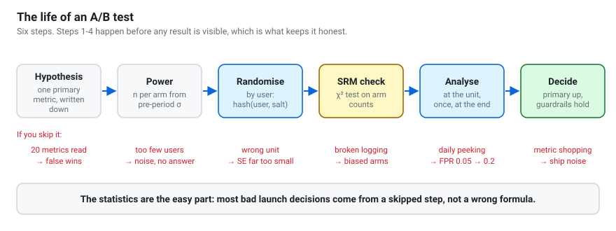
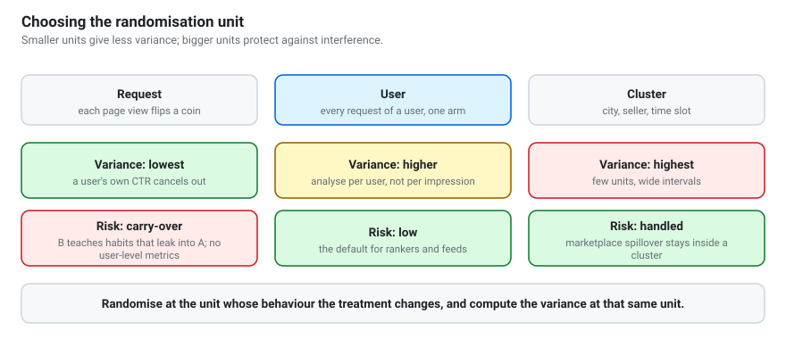
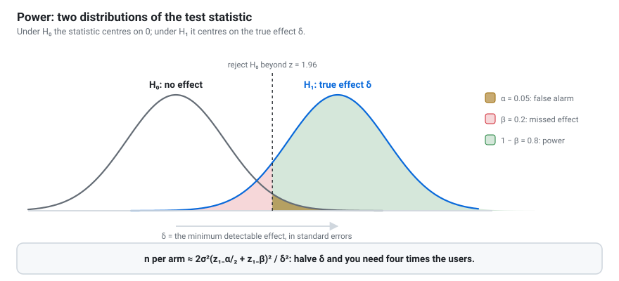
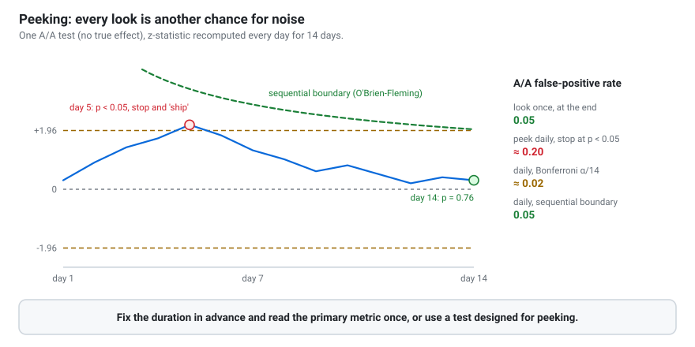

# Chapter 29 · A/B testing fundamentals

*Part II · Prerequisites: Chapters 19, 23 and 24, and an introductory course in hypothesis testing · Estimated time: reading ~50 min, lab ~90 min · Compute: CPU*

[](https://colab.research.google.com/github/berdakh/MLBOOTCAMP/blob/main/part2-ml-at-scale/ch29-ab-testing-fundamentals/notebook.ipynb) · [Lab: notebook.ipynb](notebook.ipynb) · [Solutions](solutions.md)

## Learning objectives

After this chapter you should be able to:

1. Explain why the randomisation unit determines the variance of an estimate, and use an A/A test to measure the false-positive rate of a test procedure.
2. Distinguish the pooled and the per-user click-through rate, and state which population quantity each one estimates.
3. Derive and compute the sample size per arm for a given minimum detectable effect, significance level and power, and check the result by simulation.
4. Choose between a t-test and a bootstrap confidence interval, and state the assumptions of each.
5. Detect a sample-ratio mismatch with a chi-square test and explain why it invalidates the comparison.
6. Quantify how repeated looks (peeking) and many metrics inflate the false-positive rate, and apply Bonferroni and Benjamini–Hochberg corrections.

## 29.1 Introduction

Chapters 23–28 built rankers and evaluated them offline, on logged data. An offline metric such as NDCG on the validation week can only *propose* a candidate. Whether the new ranker actually changes user behaviour is decided by a randomised controlled experiment on live traffic, which industry calls an **A/B test**: a random half of users (arm A, the *control*) keep the current ranker, the other half (arm B, the *treatment*) receive the new one, and a pre-chosen metric is compared between the arms.

The statistics of a two-sample comparison are standard and will be familiar from any introductory course. In practice, wrong launch decisions rarely come from the formulae themselves. They come from the design and the bookkeeping around them:

- the variance is computed for the wrong unit (impressions instead of users);
- the test is too small to detect the effect it was meant to detect;
- the assignment or the logging is broken, so the arms are no longer comparable;
- the result is checked every day and the test is stopped at the first significant reading;
- twenty metrics are read at once and the significant ones are reported.

This chapter treats each of these in turn. Because the lab uses a simulator, the *true* effect is known in every simulated experiment, so we can measure a test's false-positive rate and its power directly rather than take them on trust. The lab's simulator is [`src/shoprank/experiments.py`](../../src/shoprank/experiments.py); Chapter 30 reuses it.



*Figure 29.1 — The six steps of an A/B test and the failure that follows from skipping each. Steps 1–4 take place before any metric is visible.*

## 29.2 The experimental setting

### 29.2.1 Hypotheses and errors

Let $\mu_A$ and $\mu_B$ be the population means of the chosen metric under control and treatment, and let $\Delta = \mu_B - \mu_A$ be the **treatment effect**. A two-sided test of

```math
H_0 : \Delta = 0 \qquad \text{against} \qquad H_1 : \Delta \neq 0
```

can make two kinds of error. A **type I error** (false positive) rejects $H_0$ when it is true; its probability is the **significance level** $\alpha$, conventionally 0.05. A **type II error** (false negative) fails to reject $H_0$ when the true effect is some $\delta \neq 0$; its probability is $\beta$, and $1-\beta$ is the **power** of the test against $\delta$. The **minimum detectable effect** (MDE) is the smallest effect $\delta$ for which the test is designed to have the target power, usually 80%.

It is important to keep two things apart. $\alpha$ is a property of a *procedure*: if the procedure were repeated on many experiments with no true effect, it would reject in a fraction $\alpha$ of them. A procedure that looks at the data several times, or tests several metrics, has a different (larger) error rate than any one test inside it. Sections 29.6 and 29.7 measure how much larger.

### 29.2.2 The simulator

The lab simulates users of the ShopStream marketplace introduced in Chapter 19. Each user has an *activity* (how many feed requests they make, heavy-tailed with mean about 1.4) and a *baseline click-through rate* (mean about 0.14, ranging from 0.04 to 0.3). An experiment draws users, simulates a two-week pre-period without treatment and a two-week experiment period, assigns each user at random to control or treatment, and multiplies a treated user's CTR by $1 + \text{lift}$. The lab's "new ranker" has a lift of 2% relative (0.140 → 0.143), which is a realistic size for a useful ranking change and a hard one to detect.

About 5% of assigned users make no request during the two weeks. They never reach the tested surface and carry no information about the treatment. Standard practice is to analyse only **exposed** (or *triggered*) users, with two safeguards: assignment happens before any outcome, and the exposure condition must be the same in both arms, so that the filter itself cannot depend on the treatment.

## 29.3 Choosing the metric: pooled versus per-user CTR

Two click-through rates can be computed for an arm with users $u = 1, \dots, n$, where user $u$ has $c_u$ clicks and $m_u$ impressions:

```math
\text{CTR}_{\text{pooled}} = \frac{\sum_u c_u}{\sum_u m_u}, \qquad
\text{CTR}_{\text{per-user}} = \frac{1}{n} \sum_u \frac{c_u}{m_u}. \qquad (29.1)
```

The pooled CTR weights each user by their number of impressions; it answers "what fraction of impressions is clicked?". The per-user CTR weights every user equally; it answers "how does a typical user respond?". They estimate different population quantities (different **estimands**), and when heavy users click differently from light users they can move in different directions. In the lab's simulator activity and CTR are independent, so both are about 0.145 per arm. Either can be the right metric, but the choice is made before the experiment and written down.

The two metrics also need different variance calculations. The per-user CTR is an ordinary mean of independent per-user values, so its standard error follows from the sample variance of those values. The pooled CTR is a *ratio of two sums*, and its numerator and denominator are both random; its standard error needs the delta method, which Chapter 30 derives.

A single experiment of 40,000 users gives a noisy estimate of the lift. In the lab's run the measured lifts were +3.1% (pooled) and +3.3% (per-user) although the true lift was exactly 2%. One experiment is one draw from a sampling distribution, and the next section is about the width of that distribution.

## 29.4 The randomisation unit determines the variance

### 29.4.1 Why impressions are not independent

Suppose users are randomised, but the pooled CTR is tested with the two-proportion z-test that treats each impression as an independent Bernoulli trial. Clicks from the same user are positively correlated: a user with a high CTR clicks often on every request. The variance of a sum of correlated trials is larger than the binomial variance. If user $u$ contributes $m$ impressions with intra-user correlation $\rho$, the variance of their click total is inflated by the **design effect**

```math
\text{DEFF} = 1 + (m - 1)\,\rho. \qquad (29.2)
```

Even a small $\rho$ multiplied by tens of impressions per user gives a large factor. A test that ignores it uses a standard error that is too small, so its confidence intervals are too narrow and it rejects $H_0$ too often.

### 29.4.2 Measuring the error with A/A tests

The tool for measuring a procedure's false-positive rate is the **A/A test**: both arms receive the same ranker, so any significant result is a false positive. A valid test at $\alpha = 0.05$ rejects in about 5% of A/A experiments. The lab runs 400 A/A experiments of 20,000 users each and compares three procedures. The results, from the course's simulator on a CPU run, are:

| Procedure | Rejection rate in A/A tests |
|---|---|
| user randomisation, impression-level z-test on pooled CTR | about 50% |
| user randomisation, user-level t-test on per-user CTR | about 4–5% |
| request randomisation, impression-level z-test on pooled CTR | about 9% |

For the first procedure the naive standard error was about 0.0006 while the actual spread of the estimate across experiments was about 0.0017, a factor of about 2.8. With 400 simulated experiments the rates themselves carry about ±2 percentage points of simulation noise.

### 29.4.3 Choosing the unit

Request-level randomisation makes the estimate far less variable (true SD about 0.0007 in the lab), because each user appears in both arms and their personal CTR largely cancels out of the difference. It is still not perfectly valid with a binomial standard error, because heavy users' requests split unevenly by chance. More importantly, the unit must match what the treatment changes and what is measured:

- A user who sees ranker A in the morning and B at noon has an inconsistent experience, and *carry-over* effects (B teaches the user to scroll further) contaminate A's requests. This is **interference** between units, a violation of the assumption that one unit's outcome does not depend on another unit's assignment (in the causal-inference literature, SUTVA, the stable unit treatment value assumption).
- User-level outcomes such as retention, sessions per week or purchases over a month do not exist at the request level.
- In marketplaces users interfere with each other: two rankers compete for the same limited inventory or advertising budget. Such settings need **cluster** randomisation (by city or seller) or **switchback** designs (alternating treatment over time slots).

The rule is: randomise the unit whose behaviour the treatment changes (usually the user), and compute the variance at that unit, either with a per-user metric and a t-test or with a pooled ratio and the delta method.



*Figure 29.2 — Request, user and cluster randomisation. Moving to coarser units trades lower variance for protection against interference; the unit of analysis must move with the unit of randomisation.*

> **Intuition.** Treating 1,000 impressions from 50 users as 1,000 independent observations is like polling 50 people 20 times each and reporting 1,000 opinions. A person's repeated answers are largely the same, so the honest sample size is much closer to 50. *Where the analogy breaks down:* repeated impressions are not exact copies, so the effective sample size lies between the number of users and the number of impressions. Equation (29.2) and the delta method in Chapter 30 locate it.

## 29.5 Power and sample size

### 29.5.1 Derivation

Consider a per-unit metric with variance $\sigma^2$ in each arm and $n$ units per arm. The difference of sample means $\hat\Delta = \bar y_B - \bar y_A$ has standard error

```math
\mathrm{SE}(\hat\Delta) = \sqrt{\frac{\sigma_A^2}{n_A} + \frac{\sigma_B^2}{n_B}} = \sigma \sqrt{\frac{2}{n}} \quad \text{(equal variances and arm sizes)}. \qquad (29.3)
```

The two-sided test rejects when $\lvert\hat\Delta\rvert / \mathrm{SE} > z_{1-\alpha/2}$. If the true effect is $\delta > 0$, the statistic is approximately normal with mean $\delta / \mathrm{SE}$ and unit variance. Power $1-\beta$ requires the mean to lie $z_{1-\beta}$ standard deviations above the critical value:

```math
\frac{\delta}{\mathrm{SE}} = z_{1-\alpha/2} + z_{1-\beta}
\quad\Longrightarrow\quad
n = \frac{2\,\sigma^2\,(z_{1-\alpha/2} + z_{1-\beta})^2}{\delta^2}. \qquad (29.4)
```

Here $z_q$ is the $q$-quantile of the standard normal distribution: $z_{0.975} = 1.96$ and $z_{0.80} = 0.84$, so $(z_{1-\alpha/2} + z_{1-\beta})^2 \approx 7.85$ for the conventional $\alpha = 0.05$ and 80% power. (The small contribution of the opposite rejection region is ignored.)

For a **proportion** (did the user convert?) the per-unit variance is $p(1-p)$, and it differs slightly between arms. Using each arm's own variance gives the form used in the lab's Exercise 1:

```math
n = \frac{(z_{1-\alpha/2} + z_{1-\beta})^2 \,\big(p_0(1-p_0) + p_1(1-p_1)\big)}{\delta^2}, \qquad p_1 = p_0 + \delta. \qquad (29.5)
```

Three consequences of Equation (29.4) are worth stating explicitly:

1. $n \propto 1/\delta^2$: halving the effect **quadruples** the required sample.
2. $n \propto \sigma^2$: any method that lowers the per-unit variance (CUPED, Chapter 30) lowers the required sample in the same proportion.
3. For proportions the variance term $p(1-p)$ is largest at $p = 0.5$, so rare events need fewer units for the same *absolute* effect but far more for the same *relative* effect.

### 29.5.2 Worked example

Baseline conversion $p_0 = 0.10$, MDE $\delta = 0.01$ (10% → 11%), $\alpha = 0.05$, power 80%. Equation (29.5) gives

```math
n = \frac{7.85 \times (0.09 + 0.0979)}{0.0001} \approx 14{,}749 \text{ users per arm.}
```

The simplified version with a common $p(1-p) = 0.09$ gives 14,128. The lab simulates 2,000 experiments of this size and measures a power of about 0.80; half the effect needs about four times the users.



*Figure 29.3 — Sampling distributions of the test statistic under $H_0$ and under the true effect. Power is the area of the right-hand curve beyond the critical value; it grows when $\delta$ separates the curves or when more units make both curves narrower.*

### 29.5.3 Continuous metrics and the pre-period

For a continuous per-user metric such as per-user CTR, $\sigma$ in Equation (29.4) must be estimated *before* the experiment, from pre-period data on comparable users, never from the experiment itself. In the lab the pre-period SD of per-user CTR is about 0.097, and a 2% relative lift requires about 17,500 exposed users per arm; 200 simulated experiments of that size reach a power of about 0.78–0.80. Two practical cautions apply. First, the pre-period SD is often slightly smaller than the SD during the experiment (novelty effects, seasonality, new users), so planned tests tend to be slightly under-powered; planning for 85–90% power is a common safeguard. Second, users who are assigned but never exposed must be accounted for: the lab assigns $n / 0.95$ users to obtain $n$ exposed ones.

> **Intuition.** Detecting a lift is like hearing a whisper in a noisy room. The whisper is $\delta$; the noise is the standard error, which falls only as $1/\sqrt n$. A whisper half as loud needs four times as many listeners. *Where the analogy breaks down:* the noise also depends on the metric's variance $\sigma^2$, which can be reduced without adding listeners (Chapter 30).

## 29.6 The t-test and the bootstrap

The **Welch t-test** compares two means using each arm's own variance (Equation 29.3) and does not assume equal variances. It relies on the central limit theorem: the *mean* of many independent per-user values is approximately normal even when the values themselves are skewed, as per-user CTRs are. With tens of thousands of users per arm the approximation is very good.

The **bootstrap** estimates the sampling distribution of a statistic by resampling the observed data with replacement. For a difference between arms: draw $n_A$ users with replacement from arm A and $n_B$ from arm B, compute the statistic, repeat $B$ times (the lab uses $B = 1{,}000$), and take the 2.5% and 97.5% quantiles of the $B$ values as a 95% **percentile interval**. The bootstrap assumes only that the sample is representative of the population. It works for any statistic, including medians, percentiles and ratios of sums, at a computational cost of $B$ recomputations.

In the lab, with about 28,000 users per arm, the two 95% intervals for a difference of about +0.003 agree to within about 0.0001, and both exclude zero. The guidance is therefore:

- for means of per-unit metrics in large samples, use the t-test; it is cheaper and gives the same answer;
- use the bootstrap when the statistic has no simple standard error (a median, a percentile, a ratio of sums), when samples are small and skewed, or to check a hand-derived variance (Chapter 30 checks the delta method this way);
- always resample the **randomisation unit** (users), never impressions; resampling impressions reproduces the error of Section 29.4.

## 29.7 Sample-ratio mismatch

An experiment designed with a 50/50 split should produce arms whose sizes differ only by binomial noise. A **sample-ratio mismatch** (SRM) is an imbalance too large to be chance. It indicates that something between assignment and logging treats the arms differently, and because the lost (or added) users are rarely a random subset, any comparison of metrics between the arms is biased.

The test is a chi-square goodness-of-fit test of observed arm counts $O_j$ against expected counts $E_j = N \pi_j$, where $N$ is the total and $\pi_j$ the planned share of arm $j$:

```math
\chi^2 = \sum_{j} \frac{(O_j - E_j)^2}{E_j}, \qquad (29.6)
```

which for two arms has one degree of freedom under $H_0$. *Worked example:* 50,600 versus 49,400 users on a 50/50 split gives $\chi^2 = 2 \times 600^2 / 50{,}000 = 14.4$ and $p \approx 1.5 \times 10^{-4}$.

The lab plants a realistic bug in an A/A test: the treatment's client code logs the exposure event lazily, on the user's first interaction, so users who never click are logged only half the time in treatment. With 200,000 assigned users the treatment arm loses about 2% of its users (share in control about 0.505), and the per-user CTR shows a "lift" of about +2% with $p$ around $10^{-10}$, as large as the real ranker's effect, although the two arms receive identical rankers. The bias arises because the lost users are exactly those with the lowest CTR. The SRM test on the same data gives $p$ of about $10^{-6}$.

Three points follow:

1. The SRM check is run *before* reading any metric. Many teams alert at $p < 0.001$, because the check runs on every experiment and false alarms have a cost.
2. A small mismatch can hide a large bias. With 40,000 users the same bug gave an SRM p-value of only about 0.02 in the lab, while the biased metric was already significant. Any SRM is therefore a reason to investigate.
3. When an SRM is found, reweighting the arms and reading the result anyway is not a valid repair, because reweighting cannot restore the missing users' outcomes. The procedure is to find the cause (logging, bot filtering, redirects, crashes in one arm, a client version that fails to log), fix it, and restart the experiment.

> **Intuition.** An SRM is like a survey in which, in one arm only, dissatisfied customers hang up before answering. The recorded answers look more positive, and no analysis of those answers can reveal the problem. *Where the analogy breaks down:* a mismatch can also be harmless, for example a bot filter applied evenly but noisily. This is known only after the cause has been found, which is why an SRM is investigated, not corrected.

## 29.8 Peeking and sequential testing

A dashboard updates daily, and an analyst stops the experiment on the first day the primary metric is significant. Each look is another opportunity for noise to cross the threshold, so the false-positive rate of the *procedure* exceeds $\alpha$. The lab simulates 4,000 A/A experiments with 14 daily looks (conversion rate 10%, 1,000 new users per arm per day) and finds:

| Procedure | A/A false-positive rate |
|---|---|
| one test at day 14 | about 0.05 |
| test daily, stop at the first $p < 0.05$ | about 0.2 |
| test daily at $\alpha / 14$ (Bonferroni) | about 0.02 |

The inflation is smaller than the $1 - 0.95^{14} \approx 0.51$ one would compute for 14 independent tests, because successive looks share most of their data: the cumulative z-statistic behaves like a random walk, and day 6 contains day 5. It nevertheless grows without limit: with infinitely many looks a random walk eventually crosses any fixed boundary.



*Figure 29.4 — An A/A z-statistic as a random walk. It crosses 1.96 on day 5 by chance and ends near zero. A sequential boundary demands stronger evidence at early looks and would not have stopped.*

If the data must be examined before the planned end, the appropriate tools are designed for repeated looks:

- **Group-sequential designs** fix the number of looks in advance and distribute ("spend") $\alpha$ across them with an *alpha-spending function*. The O'Brien–Fleming boundary spends very little $\alpha$ at early looks, so early stopping requires overwhelming evidence and the final look is almost at the nominal level.
- **Always-valid inference** (for example the mixture sequential probability ratio test, mSPRT, and confidence sequences) produces p-values that remain valid under continuous monitoring, at the price of somewhat lower power at a fixed sample size.

Without such a design, the safe practice is to fix the duration from the power calculation, monitor only *guardrails* (crashes, latency) for safety, and read the primary metric once.

## 29.9 Multiple metrics

A launch review that shows $m$ metrics gives $m$ opportunities for a false positive. For $m$ independent null metrics the probability of at least one false positive, the **family-wise error rate** (FWER), is

```math
\text{FWER} = 1 - (1 - \alpha)^m, \qquad (29.7)
```

which is 0.58 for $m = 17$. Two standard corrections are:

- **Bonferroni**: reject $H_i$ if $p_i \le \alpha / m$. By the union bound, $P(\text{any false rejection}) \le \sum_i \alpha/m = \alpha$, for any dependence between the tests. It controls the FWER but loses power as $m$ grows.
- **Benjamini–Hochberg** (BH): sort the p-values $p_{(1)} \le \dots \le p_{(m)}$, find the largest $k$ with $p_{(k)} \le k q / m$, and reject the $k$ smallest. This controls the **false discovery rate** (FDR), the expected proportion of false rejections among all rejections, at level $q$ (exactly for independent tests and under positive dependence).

```math
k = \max\Big\{ i : p_{(i)} \le \frac{i}{m}\, q \Big\}. \qquad (29.8)
```

*Worked example:* p-values (0.001, 0.008, 0.012, 0.041, 0.30) with $\alpha = q = 0.05$. Bonferroni's threshold is 0.01 and rejects two. BH's thresholds are (0.01, 0.02, 0.03, 0.04, 0.05); the largest $i$ with $p_{(i)}$ below its threshold is $i = 3$, so BH rejects three.

The lab simulates 2,000 experiments with 20 metrics (pairwise correlation 0.3), three with a true effect of three standard errors and 17 with none. Without correction about half the experiments show at least one false "improvement" (about 0.49, below 0.58 because the metrics are correlated) and about 19% of significant metrics are false. Bonferroni reduces the chance of any false positive to about 0.03 but lowers power from 0.86 to 0.50; BH keeps the false-discovery proportion near 3% with power of about 0.59.

Corrections help, but the most effective protection is a design decision taken before the experiment:

- **one pre-registered primary metric** decides the launch;
- a small set of **guardrail metrics** (latency, crash rate, revenue) can only block a launch, never justify one;
- every other metric is exploratory, reported as such, and a surprising result becomes a hypothesis for a follow-up experiment.

Chapter 30 turns these rules into written launch criteria.

## Key terms

| Term | Definition |
|---|---|
| A/B test | A randomised controlled experiment comparing a control (A) and a treatment (B) on live traffic. |
| Randomisation unit | The entity to which one random assignment is made (request, user, cluster); all of its traffic receives the same arm. |
| A/A test | An experiment in which both arms receive identical treatment; every rejection is a false positive, so it measures a procedure's type I error rate. |
| Exposed (triggered) user | An assigned user who actually reached the tested surface during the experiment. |
| Estimand | The population quantity an analysis is meant to estimate, e.g. the pooled or the per-user CTR. |
| Significance level $\alpha$ | The probability of rejecting $H_0$ when it is true. |
| Power $1-\beta$ | The probability of rejecting $H_0$ when the true effect equals a stated value. |
| Minimum detectable effect (MDE) | The smallest effect the experiment is designed to detect with the target power. |
| Design effect | The factor by which correlation within clusters inflates the variance relative to independent sampling. |
| Interference | Dependence of one unit's outcome on another unit's assignment; violates SUTVA. |
| Bootstrap | Estimating a sampling distribution by recomputing a statistic on samples drawn with replacement from the data. |
| Sample-ratio mismatch (SRM) | An imbalance between arm sizes too large to be explained by chance, indicating broken assignment or logging. |
| Peeking | Repeatedly testing accumulating data and stopping at the first significant result. |
| Alpha spending | Allocating the overall type I error across planned interim looks in a sequential design. |
| FWER / FDR | The probability of at least one false rejection / the expected proportion of false rejections among all rejections. |
| Guardrail metric | A metric that may block a launch if it degrades but cannot justify one. |

## Summary

1. An A/B test is a randomised experiment; its error rates are properties of the whole procedure, including how often the data are examined and how many metrics are read.
2. Pooled and per-user CTR are different estimands; the choice is made before the experiment.
3. Variance must be computed at the randomisation unit. Treating impressions as independent under user randomisation gave a false-positive rate of about 50% instead of 5% in the lab.
4. Required sample size grows as $\sigma^2 / \delta^2$ (Equation 29.4): halving the MDE quadruples it, and variance reduction lowers it proportionally. $\sigma$ is estimated from pre-period data.
5. The t-test suffices for means in large samples; the bootstrap is for statistics without a simple standard error and must resample the randomisation unit.
6. A sample-ratio mismatch invalidates the comparison. It is checked first, investigated, fixed, and followed by a restart, not by reweighting.
7. Daily peeking with early stopping raised the false-positive rate from 0.05 to about 0.2 over 14 looks. Sequential designs allow valid early looks.
8. With many metrics, Bonferroni controls the FWER and Benjamini–Hochberg controls the FDR; a single pre-registered primary metric plus guardrails is the stronger protection.

## Exercises

The exercises are in the lab, [notebook.ipynb](notebook.ipynb); worked answers are in [solutions.md](solutions.md).

1. **Exercise 1 · `sample_size_per_arm`.** Implement Equation (29.5) with `scipy.stats.norm.ppf`, rounding up. The lab then checks the formula against 2,000 simulated experiments.
2. **Exercise 2 · `srm_pvalue`.** Implement the chi-square goodness-of-fit test of Equation (29.6) for an arbitrary planned split.
3. **Exercise 3 · `aa_false_positive_rate`.** Simulate A/A tests with a given number of interim looks and return the fraction of experiments in which any look is significant.

Checkpoint questions at the end of the lab ask you to explain, without notes: the direction of the error when impressions are treated as independent; when to randomise by request, user or cluster; a rough sample size for a 5% baseline and a +0.25 point MDE; what to do with a 50.4% / 49.6% split of 2 million users; how to respond to a request for daily peeking; and how to judge a launch in which 3 of 25 metrics are significant.

## Further reading

- Kohavi, R., Tang, D. and Xu, Y. (2020). *Trustworthy Online Controlled Experiments: A Practical Guide to A/B Testing*. Cambridge University Press. Chapters on randomisation units, sample-ratio mismatch and the analysis of ratio metrics.
- Benjamini, Y. and Hochberg, Y. (1995). Controlling the false discovery rate: a practical and powerful approach to multiple testing. *Journal of the Royal Statistical Society, Series B*, 57(1), 289–300.
- O'Brien, P. C. and Fleming, T. R. (1979). A multiple testing procedure for clinical trials. *Biometrics*, 35(3), 549–556.
- Johari, R., Koomen, P., Pekelis, L. and Walsh, D. (2017). Peeking at A/B tests: why it matters, and what to do about it. *Proceedings of KDD 2017*.
- Efron, B. and Tibshirani, R. J. (1993). *An Introduction to the Bootstrap*. Chapman & Hall.
- SciPy documentation: [`scipy.stats.chisquare`](https://docs.scipy.org/doc/scipy/reference/generated/scipy.stats.chisquare.html) and [`scipy.stats.ttest_ind`](https://docs.scipy.org/doc/scipy/reference/generated/scipy.stats.ttest_ind.html).

**Next:** [Chapter 30 · Advanced experimentation](../ch30-advanced-experimentation/README.md)
