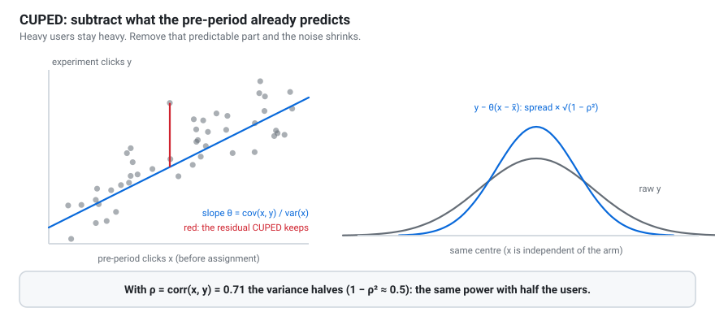
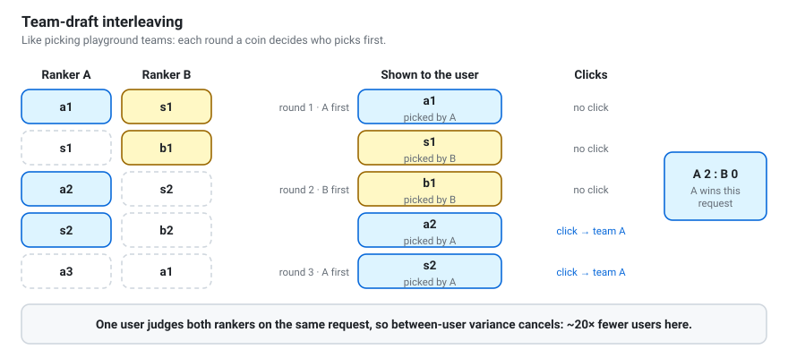
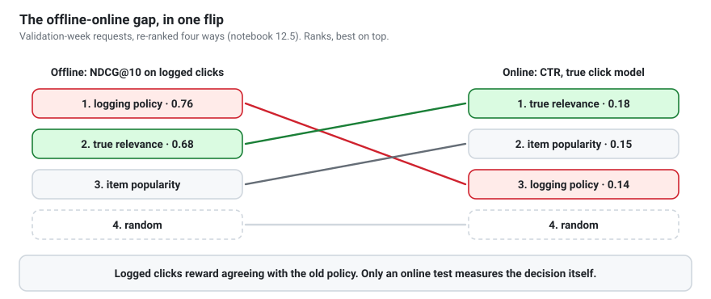

# Chapter 30 · Advanced experimentation

*Part II · Prerequisites: Chapters 23, 24 and 29 · Estimated time: reading ~50 min, lab ~90 min · Compute: CPU*

 · [Lab: notebook.ipynb](notebook.ipynb) · [Solutions](solutions.md)

## Learning objectives

After this chapter you should be able to:

1. Derive the CUPED estimator, show that it is unbiased, and predict its variance reduction from a single correlation coefficient.
2. Derive the delta-method variance of a ratio metric and validate it with a bootstrap and with A/A tests.
3. Explain why post-hoc segment analyses produce apparent heterogeneous effects, and state the safeguards.
4. Implement team-draft interleaving and explain why it needs far fewer users than an A/B test, and what it cannot measure.
5. Explain how offline evaluation on logged clicks can order rankers incorrectly, and list the defences in order of cost.
6. Write launch criteria with one primary metric, validity checks, guardrails and decision rules.

## 30.1 Introduction

Chapter 29 was concerned with the *validity* of an experiment: the right randomisation unit, enough power, a balanced assignment, one look and one primary metric. This chapter is concerned with its *efficiency* and its *interpretation*. Traffic is a limited resource; a team that can test a ranker with half the users can run twice as many experiments. Three techniques make experiments cheaper or more precise:

- **CUPED** removes the part of a metric's variance that is predictable from data collected before the experiment;
- the **delta method** gives the correct standard error for ratio metrics such as pooled CTR, without the cost of a bootstrap;
- **interleaving** compares two rankers within the same user and request, which removes between-user variance altogether.

Two further topics concern interpretation. Segment analyses performed after the experiment produce apparent effects that are noise, and offline metrics computed on logged clicks can prefer the wrong ranker. The chapter ends with the written launch criteria that turn an experiment into a decision. The lab uses the same simulator as Chapter 29 ([`src/shoprank/experiments.py`](../../src/shoprank/experiments.py)) and the ShopStream logs.

## 30.2 CUPED: variance reduction with pre-period data

### 30.2.1 The estimator

Much of the variance of a per-user metric such as clicks per user is *between-user* variance: heavy users click a lot in any period. That part is predictable from the same user's behaviour before the experiment. Let $y_i$ be user $i$'s metric during the experiment and $x_i$ a **covariate** measured before assignment, typically the same metric in a pre-period of the same length. CUPED (Controlled-experiment Using Pre-Experiment Data; Deng, Xu, Kohavi and Walker, 2013) replaces $y_i$ with

$$
y^{cv}_i = y_i - \theta\,(x_i - \bar x). \qquad (30.1)
$$

**Unbiasedness.** Because $x$ is measured before randomisation, its distribution is the same in both arms, so $E[\bar x_B - \bar x_A] = 0$. The difference in adjusted means is $(\bar y_B - \bar y_A) - \theta(\bar x_B - \bar x_A)$, whose expectation equals that of the raw difference for *any* fixed $\theta$. Subtracting $\bar x$ also keeps the adjusted metric in the original units.

**Optimal $\theta$.** The variance of the adjusted metric is

$$
\operatorname{Var}(y - \theta x) = \operatorname{Var}(y) - 2\theta \operatorname{cov}(x, y) + \theta^2 \operatorname{Var}(x),
$$

a quadratic in $\theta$ minimised at

$$
\theta^* = \frac{\operatorname{cov}(x, y)}{\operatorname{Var}(x)}, \qquad
\operatorname{Var}(y^{cv}) = \operatorname{Var}(y)\,(1 - \rho^2), \qquad (30.2)
$$

where $\rho = \operatorname{corr}(x, y)$. $\theta^*$ is the ordinary least-squares slope of $y$ on $x$; CUPED is regression adjustment with one pre-treatment covariate. Since the required sample size is proportional to the variance (Equation 29.4), the factor $1 - \rho^2$ applies directly to the number of users or the duration of the test. In practice $\theta$ is estimated on both arms pooled; with a large sample the estimation error in $\theta$ is negligible.

*Worked example:* $x = (1, 2, 3, 4)$, $y = (2, 3, 5, 6)$. Then $\operatorname{cov}(x,y) = 2.33$, $\operatorname{Var}(x) = 1.67$, $\theta = 1.4$, and $y^{cv} = (4.1, 3.7, 4.3, 3.9)$. The variance falls from 3.33 to 0.067, which is $3.33 \times (1 - 0.98)$ with $\rho^2 = 0.98$.

*Figure 30.1 — CUPED keeps only the vertical distance from each point to the regression line of the experiment metric on the pre-period metric. The adjusted metric has the same centre and a narrower spread.*

### 30.2.2 What the lab measures

The lab runs 300 simulated experiments of 20,000 users with a true lift of 2%, using clicks per exposed user as the metric and the same user's pre-period clicks as the covariate. On the course's synthetic data the correlation is about 0.71, both estimators are centred on the true effect (about 0.21 clicks per user on a mean of about 10.4), and the variance of the CUPED estimate is about half that of the raw estimate (measured 0.50 against the predicted $1 - \rho^2 = 0.49$). At the same sample size, power rises from about 0.2 to about 0.35.

### 30.2.3 Limitations

- **The gain depends on $\rho$.** For per-user CTR, a bounded and noisier metric, the pre/post correlation in the simulator is only about 0.35, giving a reduction of about 12%. Rare binary outcomes such as purchases also have weak covariates.
- **New users have no pre-period.** A common treatment is to set their covariate to 0 and add an indicator variable for "no history", or to use other covariates known before assignment (country, device, sign-up channel).
- **The covariate must be unaffected by treatment.** Pre-period data are safe by construction. A covariate measured during the experiment, such as clicks on another surface, may itself be changed by the treatment, and adjusting for it biases the estimate.

> **Intuition.** Judging a diet by weight after two weeks is hopeless when participants differ by 30 kg; judging it by each person's *change* from their starting weight removes that spread. CUPED generalises the change score: it subtracts $\theta$ times the starting value, with $\theta$ chosen to minimise the variance ($\theta = 1$ is the plain change score). *Where the analogy breaks down:* for users without history, or for a metric that the past does not predict ($\rho \approx 0$), there is nothing to subtract.

## 30.3 Ratio metrics and the delta method

### 30.3.1 The problem

The pooled CTR of an arm with $N$ users is

$$
\hat R = \frac{\sum_i c_i}{\sum_i n_i} = \frac{\bar c}{\bar n},
$$

where $c_i$ and $n_i$ are user $i$'s clicks and impressions. The randomisation unit is the user, but $\hat R$ is not a mean of independent per-user values, so the t-test does not apply directly. Chapter 29 showed that the binomial standard error, which treats impressions as independent, is far too small. Other common ratio metrics are revenue per session, clicks per query and time per page view.

### 30.3.2 Derivation

The **delta method** approximates a smooth function of sample means by its first-order Taylor expansion around the population means. Let $f(a, b) = a / b$, $\mu_c = E[c]$, $\mu_n = E[n]$. Then

$$
\hat R = f(\bar c, \bar n) \approx f(\mu_c, \mu_n) + \nabla f^\top \begin{pmatrix} \bar c - \mu_c \\ \bar n - \mu_n \end{pmatrix},
\qquad \nabla f = \begin{pmatrix} 1/\mu_n \\ -\mu_c/\mu_n^2 \end{pmatrix}.
$$

The covariance matrix of $(\bar c, \bar n)$ is $\Sigma / N$, where $\Sigma$ holds the per-user variances $\sigma_c^2$, $\sigma_n^2$ and covariance $\sigma_{cn}$. The variance of a linear function is $\nabla f^\top (\Sigma/N) \nabla f$, which expands to

$$
\operatorname{Var}(\hat R) \approx \frac{1}{N}\left( \frac{\sigma_c^2}{\mu_n^2} - \frac{2\,\mu_c\,\sigma_{cn}}{\mu_n^3} + \frac{\mu_c^2\,\sigma_n^2}{\mu_n^4} \right). \qquad (30.3)
$$

The middle term matters: users with more impressions also have more clicks ($\sigma_{cn} > 0$), and the numerator and denominator move together, partly cancelling. An equivalent form is often easier to compute and to combine with CUPED: define the **linearised** per-user values

$$
\ell_i = \frac{c_i - R\, n_i}{\mu_n}, \qquad \operatorname{Var}(\hat R) \approx \frac{\operatorname{Var}(\ell)}{N}. \qquad (30.4)
$$

Because $\ell_i$ is an ordinary per-user value, a t-test on $\ell$ or a CUPED regression of $\ell$ on a pre-period covariate can be applied without further derivation.

*Worked example:* $\mu_c = 1.4$, $\mu_n = 10$, $\sigma_c^2 = 4$, $\sigma_n^2 = 36$, $\sigma_{cn} = 9$, $N = 10{,}000$. The three terms are $0.04 - 0.0252 + 0.0071$, so $\operatorname{Var}(\hat R) \approx 2.19 \times 10^{-6}$ and the standard error is about 0.0015.

### 30.3.3 Validation

A derived variance should be checked. In the lab the delta-method standard error (0.00168) and a user-level bootstrap standard error (0.00170) both match the true standard deviation across 400 simulated A/A experiments (0.00169) within a few percent, while the naive binomial standard error (0.00061) is about 2.8 times too small. A z-test using the delta-method standard error rejects in about 4–5% of A/A experiments, and the naive one in about 50%.

The delta method costs one pass over the data; the bootstrap costs hundreds. Experimentation platforms compute thousands of metric × experiment × day results every night, so they use the delta method for ratio metrics and the bootstrap to validate it.

> **Intuition.** For small fluctuations, a ratio of two averages behaves like a linear function of them: a 1% rise in mean clicks raises CTR by about 1%, a 1% rise in mean impressions lowers it by about 1%. The variance of a linear combination is a standard formula, and that is the delta method. *Where the analogy breaks down:* with few users or very heavy tails the fluctuations are not small, the linear approximation is poor, and a bootstrap is needed.

## 30.4 Heterogeneous effects and post-hoc segments

After an experiment it is natural to ask whether the treatment worked better in some segment, for example iOS users in Germany. A real **heterogeneous treatment effect** is possible, but the segment estimates are noisy, and with many segments some will be extreme by chance.

The lab demonstrates this with one large experiment in which the true lift is exactly +2% for every user, sliced into 15 country × device segments. The overall lift is close to +2% and highly significant. The segment estimates in the lab's run range from +0.1% to +5.4%; about half are "significant" and half are not; and the most extreme estimates come from the smallest segments. A reader of this table would conclude that the ranker works for iOS users in some countries but not for web users in others. Every difference between segments is noise.

The statistical reasons are those of Chapter 29: each segment is a separate test (multiple comparisons), and small segments have large standard errors, so the most extreme estimates are drawn disproportionately from them. The safeguards are:

1. pre-register a small number of segments, each with a hypothesis about why the effect should differ;
2. correct for multiple comparisons across segments;
3. shrink small-segment estimates towards the overall effect (for example with a hierarchical model), since extreme values from small samples tend to regress towards the mean;
4. treat a surprising segment result as a hypothesis for a *new* experiment targeted at that segment, never as a finding to launch on.

## 30.5 Interleaving

### 30.5.1 Why between-user variance dominates

An A/B test compares *different* users under two rankers. Per-user clicks vary enormously between users (activity alone varies about 100-fold in ShopStream), and this between-user variance dominates the standard error of the difference. **Interleaving** removes it: each user is shown one list that merges the results of both rankers, each click is credited to the ranker that contributed the clicked item, and the comparison is made within a user and a request.

### 30.5.2 Team-draft interleaving

**Team-draft interleaving** (Radlinski, Kurup and Joachims, 2008) works like two captains choosing teams. In each round a fair coin decides which ranker picks first; each ranker then adds its highest-ranked item not yet in the merged list, and that item is credited to its team. More precisely, for two rankings of equal length $k$:

1. the team with fewer picks so far picks next; on a tie, a coin flip decides;
2. the picking team adds its highest-ranked item not already shown;
3. stop when the merged list has $k$ items.

Each shown item belongs to exactly one team, the teams' sizes differ by at most one, and the coin flips ensure neither ranker systematically occupies the top position. If the two rankings are identical, the merged list equals them and credit is split at random, so the expected credit difference is zero.

*Figure 30.2 — Team-draft interleaving. Each shown item is credited to the team that picked it; a coin flip per round decides which team picks first.*

### 30.5.3 The test statistic

For each user $u$, let $\text{clicks}_{A,u}$ and $\text{clicks}_{B,u}$ be the clicks credited to each ranker. The per-user difference has mean

$$
\Delta = \frac{1}{U}\sum_{u=1}^{U} \left(\text{clicks}_{A,u} - \text{clicks}_{B,u}\right), \qquad t = \frac{\Delta}{s_\Delta / \sqrt{U}}, \qquad (30.5)
$$

a one-sample t-test of whether the mean difference is zero, where $U$ is the number of users and $s_\Delta$ the standard deviation of the per-user differences. A sign test on per-user preferences is an alternative. *Worked example:* 400 users with mean difference 0.05 and SD 0.8 give $t = 0.05 / (0.8/20) = 1.25$, not significant; 1,600 users with the same values give $t = 2.5$.

### 30.5.4 Measured sensitivity and limits

In the lab, ranker A (relevance plus noise with SD 2.0) has a true CTR about 4–5% higher than ranker B (noise SD 2.2): 0.156 against 0.149. For 80% power the A/B test needs roughly 15,000–20,000 users and interleaving roughly 700–1,000, about 20 times fewer in the lab's runs. Each power estimate comes from 100 simulations (±0.05), so the ratio is more reliable than the individual values.

This sensitivity is why search and recommendation teams use interleaving to **screen** many candidate rankers quickly and then confirm the best one with an A/B test. Interleaving measures *preference between two lists*. It cannot measure whole-session or long-term outcomes (revenue, retention), system properties (latency), properties of the final page (diversity), or effects that arise from the interaction of items from the two rankers.

> **Intuition.** An A/B test gives each of two groups one cola to taste; interleaving lets every person taste both side by side. Differences between tasters cancel within the person. *Where the analogy breaks down:* a taste test cannot show whether people will buy more cola over a month, and interleaving cannot measure user-level outcomes.

## 30.6 The offline–online gap

Before any experiment, a ranker is selected offline, usually by NDCG on logged clicks. The lab shows how this selection can be wrong. It takes logged validation-week requests (served by the logging policy), re-ranks each request's 10 shown items with four rankers, and evaluates each ranking in two ways: **offline**, by NDCG@10 with the logged clicks as labels; and **online**, by the expected CTR if that order were served to the same users, computed from the simulator's true click model.

The orderings disagree. Offline, the logging policy scores highest (NDCG about 0.76) and a ranking by true relevance clearly lower (about 0.68). Online, true relevance has by far the highest CTR (about 0.18), and the logging policy (about 0.14) falls below even a popularity ranker (about 0.15).

The mechanism is position bias (Chapter 23). Logged clicks occurred mostly at the top positions, where the logging policy placed its preferred items. A ranker that reproduces the logging policy's order places those clicked items at the top again and is rewarded, whether or not they are the most relevant. Offline NDCG on logged clicks therefore partly measures *agreement with the logging policy*. A second mechanism is selection: logged data contain only items that the old policy showed, so a new ranker that surfaces unseen items receives neither credit nor blame for them.

*Figure 30.3 — The logging policy ranks first offline and third online. Logged clicks measured agreement with the old policy, not ranking quality.*

The defences, in increasing order of cost, are:

1. debiased offline metrics, such as inverse propensity weighting with propensities estimated from exploration traffic (Chapter 23);
2. validation of the offline metric against the history of past A/B results ("does offline NDCG predict which ranker won online?");
3. interleaving as an inexpensive online filter;
4. the A/B test, which is the only method that measures the quantity the launch decision depends on.

## 30.7 Guardrails and launch criteria

A launch decision should follow rules written **before** the experiment starts, so that the observed result cannot influence the rule. Once the data are visible, there are many defensible-looking analyses to choose from (which metric, which segment, which time window); choosing among them after seeing the data inflates the false-positive rate in the same way as peeking. Gelman and Loken call this the "garden of forking paths". Written criteria also make stakeholders agree on trade-offs, such as how much latency a CTR gain may cost, before anyone knows which side of the trade-off they will be on.

Launch criteria contain:

- **one primary decision metric**, with its MDE, power, planned duration and analysis method (for example CUPED and the delta method);
- **validity checks**, such as the SRM test and A/A health of the platform; any failure voids the result;
- **guardrails** with explicit thresholds or **non-inferiority margins**: for example, p95 latency may not rise by more than 5%, and the lower confidence bound for purchases per user must lie above −1%;
- **decision rules** for every combination of outcomes (primary significant and guardrails passed: launch; primary significant and a guardrail violated: do not launch, fix and rerun; and so on);
- **treatment of secondary metrics and segments**: exploratory, corrected for multiple comparisons, and never sufficient for a launch.

A non-inferiority margin turns "no significant harm" into a testable claim. A non-significant decrease is not evidence of no harm; the criterion is that the confidence interval excludes harm larger than the margin. The lab writes a launch-criteria document filled with its own measured numbers, and Exercise 4 applies such criteria to a scenario in which the primary metric improves but a guardrail is violated.

## Key terms

| Term | Definition |
|---|---|
| Covariate | A quantity measured before assignment that predicts the outcome, such as the same metric in a pre-period. |
| CUPED | Variance reduction by subtracting $\theta(x - \bar x)$ from the metric, with $\theta$ the regression slope of the metric on a pre-period covariate. |
| Regression adjustment | Estimating the treatment effect in a regression that includes pre-treatment covariates; CUPED is its one-covariate form. |
| Ratio metric | A metric defined as a ratio of two sums that both vary per unit, such as pooled CTR. |
| Delta method | A first-order Taylor approximation that gives the variance of a smooth function of sample means. |
| Linearisation | Replacing a ratio metric by per-unit values $\ell_i$ whose mean has the same first-order variance. |
| Heterogeneous treatment effect | A treatment effect that differs between subpopulations. |
| Shrinkage | Pulling noisy subgroup estimates towards an overall estimate to reduce their error. |
| Interleaving | An online comparison in which one merged list is shown and clicks are credited to the ranker that contributed each item. |
| Team-draft interleaving | An interleaving method in which rankers alternately pick their best unused item, with a coin flip deciding the first pick of each round. |
| Offline–online gap | Disagreement between offline evaluation on logged data and online experimental results. |
| Non-inferiority margin | The largest degradation of a metric that is accepted; non-inferiority is shown when the confidence interval excludes it. |
| Launch criteria | The decision rule for an experiment, written before it starts. |

## Summary

1. CUPED subtracts the predictable part of a metric using a pre-treatment covariate. It is unbiased for any $\theta$, and the optimal $\theta$ (the regression slope) multiplies the variance by $1 - \rho^2$ (Equation 30.2).
2. In the lab, $\rho \approx 0.71$ halved the variance of clicks per user, which is equivalent to halving the number of users needed; per-user CTR, with $\rho \approx 0.35$, gained only about 12%.
3. Pooled CTR is a ratio of random sums; its variance comes from the delta method (Equation 30.3), which matched a user-level bootstrap and the true spread within a few percent.
4. Post-hoc segment estimates spread widely even when the true effect is identical everywhere; segments are pre-registered, corrected and shrunk, and surprising ones are retested.
5. Team-draft interleaving compares rankers within a user and request, and needed about 20 times fewer users than an A/B test in the lab, but it cannot measure session-level or long-term outcomes.
6. Offline NDCG on logged clicks preferred the logging policy, which was third online. Debiased metrics, validation against past experiments and interleaving reduce the risk; only an A/B test measures the decision.
7. Launch criteria — primary metric, validity checks, guardrails with margins, decision rules — are written before the experiment.

## Exercises

The exercises are in the lab, [notebook.ipynb](notebook.ipynb); worked answers are in [solutions.md](solutions.md).

1. **Exercise 1 · `cuped_adjust`.** Implement Equation (30.1) with $\theta$ estimated from the data, handling a constant covariate. The lab then measures the variance reduction over 300 simulated experiments.
2. **Exercise 2 · `delta_method_ratio_var`.** Implement Equation (30.3); the grader compares it with the formula and with a bootstrap.
3. **Exercise 3 · `team_draft_interleave`.** Implement team-draft interleaving for two rankings of equal length, returning the merged list and the team of each position.
4. **Exercise 4 · Launch memo (written).** Apply the lab's launch criteria to a scenario with a positive primary metric, an uncertain purchases metric, a latency increase and a post-hoc segment result.

Checkpoint questions ask you to explain CUPED to a non-specialist and state when it fails; to explain why pooled CTR cannot go into a t-test and how the delta method is validated; to respond to a +11% effect in one of 30 segments; to describe team-draft credit assignment and its limits; to give two mechanisms for an offline improvement that loses online; and to say what launch criteria contain and why they are written in advance.

## Further reading

- Deng, A., Xu, Y., Kohavi, R. and Walker, T. (2013). Improving the sensitivity of online controlled experiments by utilizing pre-experiment data. *Proceedings of WSDM 2013*.
- Kohavi, R., Tang, D. and Xu, Y. (2020). *Trustworthy Online Controlled Experiments*. Cambridge University Press. Chapters on variance estimation, ratio metrics and guardrail metrics.
- Radlinski, F., Kurup, M. and Joachims, T. (2008). How does clickthrough data reflect retrieval quality? *Proceedings of CIKM 2008*.
- Chapelle, O., Joachims, T., Radlinski, F. and Yue, Y. (2012). Large-scale validation and analysis of interleaved search evaluation. *ACM Transactions on Information Systems*, 30(1).
- Casella, G. and Berger, R. L. (2002). *Statistical Inference*, 2nd ed. Duxbury. Section on the delta method.
- Gelman, A. and Loken, E. (2014). The statistical crisis in science. *American Scientist*, 102(6), 460–465.

**Next:** [Chapter 31 · ML from scratch I](../ch31-ml-from-scratch-1/README.md)
