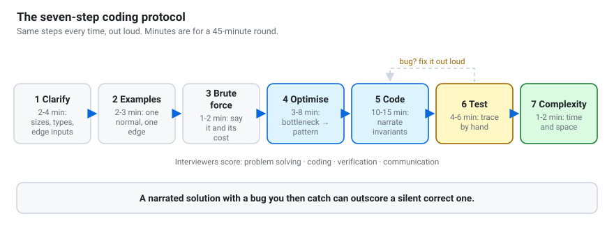
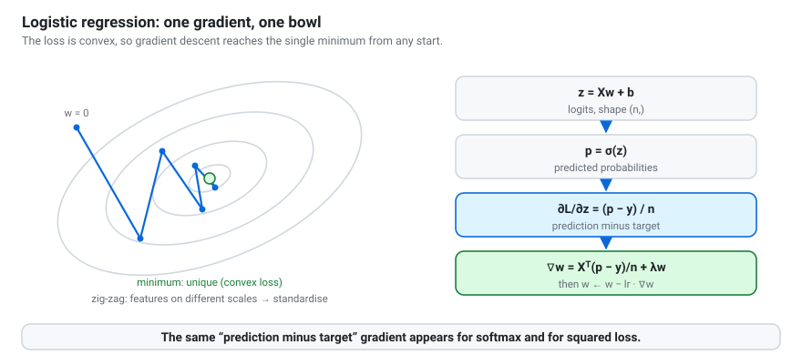
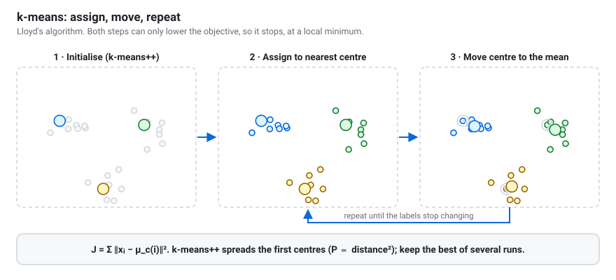

# Chapter 31 · ML from scratch I

*Part II · Prerequisites: Chapters 8 and 24, linear algebra and calculus at undergraduate level, NumPy · Estimated time: reading ~60 min, lab ~90 min · Compute: CPU*

[](https://colab.research.google.com/github/berdakh/MLBOOTCAMP/blob/main/part2-ml-at-scale/ch31-ml-from-scratch-1/notebook.ipynb) · [Lab: notebook.ipynb](notebook.ipynb) · [Solutions](solutions.md)

## Learning objectives

After this chapter you should be able to:

1. Describe how an ML coding interview round is usually assessed, and plan a 45-minute answer.
2. Vectorise pairwise computations with broadcasting and the distance expansion, and state their time and memory cost.
3. Compute softmax, sigmoid and cross-entropy without overflow, using the log-sum-exp identity.
4. Verify any analytic gradient with central differences and interpret the relative error.
5. Derive and implement logistic and softmax regression trained by gradient descent, and explain why their losses are convex.
6. Implement k-means with k-means++ initialisation, prove that Lloyd's algorithm terminates, and explain why initialisation matters.
7. Implement a vectorised k-nearest-neighbour classifier, ROC-AUC with ties in $O(n \log n)$, and NDCG@k, and state the conventions each depends on.

## 31.1 Introduction

Many interview processes for machine learning engineers include an **ML coding** round: implement logistic regression, write k-means, compute AUC without a library — in 30 to 45 minutes, in NumPy, while explaining the work aloud. The methods are standard, and a reader with a research background will know most of them. The round does not test whether the method is known. It tests whether the implementation is correct at the edges, numerically stable, vectorised and verified, and whether the candidate can explain the choices.

This chapter treats those four properties as engineering skills with their own techniques. Sections 31.2–31.5 cover the techniques: how the round is assessed, vectorisation, numerical stability and gradient checking. Sections 31.6–31.10 then work through six standard algorithms — logistic regression, softmax regression, k-means, k-nearest neighbours, ROC-AUC and NDCG — giving for each the mathematics, an implementation plan, the complexity and the edge cases. Chapter 32 continues with trees, boosting, backpropagation, attention and normalisation layers.

The lab implements all six algorithms against graders that compare with scikit-learn or with the course's reference code, including hidden edge cases and a performance budget.

## 31.2 How the round is assessed

Formats vary between companies, so the following describes a common shape rather than any company's rubric: one or two problems, 30–60 minutes, a shared editor or notebook, NumPy allowed and scikit-learn or PyTorch usually not. Assessors tend to look at the same six dimensions:

| Dimension | Strong evidence | Weak evidence |
|---|---|---|
| Problem framing | states the loss, shapes and conventions before writing code | starts typing immediately |
| Correctness | correct mathematics and shapes; edge cases named and handled | works only on the typical input |
| Numerical care | stable softmax and sigmoid, no `log(0)`, float64 for checks | NaN on the second test input |
| Efficiency | vectorised; time and memory complexity stated | nested Python loops; cost unknown |
| Verification | a three-line test or a gradient check, unprompted | "I think it works" |
| Communication | explains trade-offs, asks before assuming | long silences |

A workable plan for a 45-minute "implement X" problem is:

1. **Minutes 0–5.** Restate the problem. Write the loss and the update rule as mathematics. Fix the shapes, for example $X \in \mathbb{R}^{n \times d}$, $y \in \mathbb{R}^n$, $W \in \mathbb{R}^{d \times C}$. Ask about regularisation, the intercept and the stopping rule.
2. **Minutes 5–25.** Write the core, vectorised, explaining what each line computes.
3. **Minutes 25–35.** Test on a small case that can be checked by hand, on an edge case, and with a gradient check or a library comparison.
4. **Minutes 35–45.** State the complexity, the stability measures and what would change at scale (mini-batches, sparse inputs, early stopping, approximate search).



*Figure 31.1 — The seven-step protocol for a coding round, shared by ML coding and the algorithmic round of Chapters 33–34. Most of the assessed evidence is produced before and after the code is written.*

## 31.3 Vectorisation

### 31.3.1 Pairwise squared distances

Pairwise squared distances between the rows of $A \in \mathbb{R}^{m \times d}$ and $B \in \mathbb{R}^{n \times d}$ appear in kNN, k-means, kernel methods and retrieval. There are three standard implementations:

1. **Nested loops** over $i$ and $j$: $O(mnd)$ arithmetic, executed by the Python interpreter one element at a time.
2. **Broadcasting**: `((A[:, None, :] - B[None, :, :])**2).sum(-1)`. The same $O(mnd)$ arithmetic runs in compiled code, but NumPy materialises an intermediate array of shape $(m, n, d)$, which needs $8mnd$ bytes in float64: 31 MB for $300 \times 400 \times 32$, and 102 GB for $10^4 \times 10^4 \times 128$.
3. **The expansion**

```math
\lVert a - b \rVert^2 = \lVert a \rVert^2 - 2\,a^\top b + \lVert b \rVert^2, \qquad (31.1)
```

computed as `(A**2).sum(1)[:, None] - 2 * A @ B.T + (B**2).sum(1)[None, :]`. The dominant cost is one matrix product, $O(mnd)$, executed by an optimised, multi-threaded BLAS routine; memory is $O(mn)$ for the result only.

In the lab the three versions took roughly 170–310 ms, 10–13 ms and 0.4–0.6 ms respectively, and agree to about $6 \times 10^{-14}$. Timings depend on the machine; the ordering does not. A benchmark should report the best of several runs and note what else was running.

One numerical detail matters. Equation (31.1) subtracts large, nearly equal numbers when $a \approx b$, and rounding (catastrophic cancellation) can produce a small negative value such as $-10^{-15}$ where the true distance is zero. Its square root is NaN, so the result is clipped with `np.maximum(d2, 0)`.

> **Intuition.** A Python loop is a cashier who scans one item, pauses, then scans the next; a BLAS matrix product is a conveyor belt that moves the whole basket through hardware built for it. The expansion turns "distance between every pair" into exactly one such basket. *Where the analogy breaks down:* vectorising by broadcasting can build an intermediate array far larger than memory; the fastest code is the one that never materialises it.

### 31.3.2 Measuring complexity

A complexity claim can be checked empirically. If $`t(n) \approx c\, n^k`$, then $\log t = \log c + k \log n$, so the slope of $\log t$ against $\log n$ estimates the exponent $k$. The course's `growth_table` (in [`src/shoprank/drills.py`](../../src/shoprank/drills.py)) times a function at doubling sizes and fits this slope by least squares. In the lab, nested loops give a fitted exponent of about 2 and `np.sort` about 1.1 (the $\log n$ factor and constant overheads raise it slightly above 1). Single ratios between neighbouring sizes are noisy, so the fitted trend is read rather than one ratio. Every grader in Chapters 31–34 that has a performance part applies the same idea with a 2-second budget per run.

## 31.4 Numerical stability

### 31.4.1 The log-sum-exp identity

In float64, `exp(x)` overflows for $x > 709.8$ (the largest representable number is about $1.8 \times 10^{308}$). Logits of several hundred are common: an unnormalised feature, a large learning rate, a temperature of 0.01. For any constant $m$,

```math
\log \sum_j e^{z_j} = m + \log \sum_j e^{z_j - m}, \qquad (31.2)
```

because $\sum_j e^{z_j} = e^m \sum_j e^{z_j - m}$. Choosing $m = \max_j z_j$ makes every exponent non-positive and the largest term exactly 1, so the sum lies in $[1, J]$ for $J$ terms and neither overflows nor underflows to zero. Softmax is invariant to the same shift, $\mathrm{softmax}(z) = \mathrm{softmax}(z - m)$, since the factor $e^{-m}$ cancels between numerator and denominator.

*Worked example:* $z = (1000, 1001, 999)$. The naive computation returns NaN. With $m = 1001$: $1001 + \log(e^{-1} + 1 + e^{-2}) = 1001.408$, and the softmax is $(0.2447, 0.6652, 0.0900)$, identical to the softmax of $(1, 2, 0)$.

> **Intuition.** Subtracting the maximum is quoting every price relative to the most expensive item: softmax depends only on ratios, which are unchanged, but no number is astronomically large any more. *Where the analogy breaks down:* very negative entries still underflow to exactly 0 after `exp`; this is harmless inside softmax but fatal if their logarithm is taken next, which is why log-probabilities are computed directly.

### 31.4.2 Rules

1. Compute **log-probabilities**, not probabilities, whenever a logarithm follows.
2. Cross-entropy from logits is $\mathrm{logsumexp}(z) - z_y$; never `log(softmax(z))`.
3. The binary log loss is $\log(1 + e^{z}) - y z$, computed as `np.logaddexp(0, z) - y * z`. `np.logaddexp(0, z)` is the softplus function; `np.log1p(x)` is accurate for small $x$.
4. The sigmoid $1/(1 + e^{-z})$ overflows inside `exp` for very negative $z$. Use $e^{z}/(1 + e^{z})$ for $z < 0$, or `scipy.special.expit`.

## 31.5 Gradient checking

A gradient derived by hand should be checked numerically before it is trusted. The **central difference**

```math
\frac{\partial f}{\partial w_i} \approx \frac{f(w + \varepsilon e_i) - f(w - \varepsilon e_i)}{2\varepsilon} \qquad (31.3)
```

has truncation error $O(\varepsilon^2)$: in the Taylor expansions of $f(w \pm \varepsilon e_i)$ the even-order terms cancel, leaving $\varepsilon^2 f'''/6$ as the leading error. (The one-sided difference has error $O(\varepsilon)$.) Here $e_i$ is the $i$-th unit vector. Rounding error grows as $\varepsilon$ shrinks, roughly as $\epsilon_{\text{mach}} / \varepsilon$, so $\varepsilon \approx 10^{-5}$ is a good compromise in float64.

The analytic gradient $g$ and the numerical one $g_{\text{num}}$ are compared by the **relative error**

```math
\frac{\lVert g - g_{\text{num}} \rVert}{\lVert g \rVert + \lVert g_{\text{num}} \rVert}. \qquad (31.4)
```

Below about $10^{-7}$ the gradient is correct; $10^{-4}$ or above indicates a bug. Typical bugs give much larger values: a missing factor of 2 gives exactly $\lvert g/2 - g \rvert / (\lvert g/2 \rvert + \lvert g \rvert) = 1/3$, which is what the lab measures (about $10^{-11}$ for the correct gradient).

Practical points: check in float64, because float32 rounding swamps $\varepsilon$; use a small problem, because the check costs two function evaluations per parameter; avoid points where the function has a kink (ReLU at 0, `max`, `abs`), where no single derivative exists; and fix any randomness inside the loss (dropout masks) between the two evaluations.

> **Intuition.** A gradient check measures a slope with a ruler: nudge one weight slightly up and down and observe how much the loss changes. If the formula and the ruler disagree, the formula is wrong. *Where the analogy breaks down:* at a kink there is no single slope, and in float32 the nudge is lost in rounding.

## 31.6 Logistic regression

### 31.6.1 Model and loss

Binary logistic regression models $P(y = 1 \mid x) = \sigma(z)$ with logit $z = x^\top w + b$ and sigmoid $\sigma(z) = 1/(1 + e^{-z})$. The negative log-likelihood of one example, written in terms of the logit, simplifies because $\log \sigma(z) = -\log(1 + e^{-z})$ and $\log(1 - \sigma(z)) = -\log(1 + e^{z})$:

```math
\ell(z, y) = -y \log\sigma(z) - (1-y)\log(1-\sigma(z)) = \log(1 + e^{z}) - y z.
```

With L2 regularisation of strength $\lambda$ on the weights only, the training objective is

```math
L(w, b) = \frac{1}{n}\sum_{i=1}^n \big[\log(1 + e^{z_i}) - y_i z_i\big] + \frac{\lambda}{2}\lVert w\rVert^2. \qquad (31.5)
```

### 31.6.2 Gradient

Since $\frac{d}{dz}\log(1 + e^z) = \sigma(z)$, the derivative of the per-example loss with respect to the logit is $\sigma(z) - y = p - y$, "prediction minus target". The chain rule through $z_i = x_i^\top w + b$ gives

```math
\nabla_w L = \frac{1}{n} X^\top (p - y) + \lambda w, \qquad \frac{\partial L}{\partial b} = \frac{1}{n}\sum_i (p_i - y_i). \qquad (31.6)
```

The same "mean minus observation" form appears for softmax regression and for linear regression with squared loss. All three are generalised linear models with the **canonical link**, for which the gradient of the negative log-likelihood with respect to the natural parameter is always the mean minus the observation.

*Worked example:* one point $x = 2$, $y = 1$, starting from $w = b = 0$: $p = 0.5$, the loss is $\log 2 = 0.693$, and $\partial L/\partial w = 2 \times (0.5 - 1) = -1$, so gradient descent increases $w$.

### 31.6.3 Convexity and training

The Hessian of the data term is $\frac{1}{n} X^\top S X$ with $S = \mathrm{diag}(p_i(1-p_i))$, which is positive semi-definite, so the loss is convex; adding $\lambda \lVert w \rVert^2/2$ with $\lambda > 0$ makes it strictly convex in $w$. Any local minimum is therefore global and the initialisation affects only the speed of convergence. Full-batch gradient descent repeats $w \leftarrow w - \eta \nabla_w L$, $`b \leftarrow b - \eta\, \partial L/\partial b`$ for a learning rate $\eta$. Each epoch costs $O(nd)$ time; memory is $O(n + d)$ beyond the data.

The lab's grader compares the result with scikit-learn's `LogisticRegression`, whose objective is $C \sum_i \ell_i + \frac12 \lVert w\rVert^2$. Dividing by $Cn$ gives Equation (31.5) with $C = 1/(n\lambda)$.

**Edge cases.** On linearly separable data without regularisation the loss decreases towards zero only as $\lVert w \rVert \to \infty$, so the weights grow without bound; L2 or early stopping fixes this. Unscaled features force a small learning rate, because the largest curvature direction limits the stable step size; standardising the features first is the usual remedy. The intercept is not penalised, so that the model's predictions do not depend on the origin of $y$'s coding.



*Figure 31.2 — Gradient descent on the convex logistic loss reaches the unique minimum. Once the per-logit gradient $(p - y)/n$ is known, the rest of the implementation is bookkeeping of shapes.*

## 31.7 Softmax regression

For $C$ classes, softmax (multinomial logistic) regression computes logits $Z = XW \in \mathbb{R}^{n \times C}$ and probabilities $P_{ik} = e^{Z_{ik}} / \sum_j e^{Z_{ij}}$. With one-hot targets $Y$ the mean cross-entropy is $L = -\frac1n\sum_i \log P_{i, y_i}$.

**Gradient derivation.** For one example with logits $z$ and true class $y$, $L = -z_y + \log \sum_j e^{z_j}$. Differentiating, $\partial L/\partial z_k = -\mathbb{1}[k = y] + e^{z_k} / \sum_j e^{z_j} = p_k - \mathbb{1}[k = y]$. In matrix form, $\partial L/\partial Z = (P - Y)/n$, and the chain rule through $Z = XW$ gives

```math
\nabla_W L = \frac{1}{n} X^\top (P - Y). \qquad (31.7)
```

A confidently wrong prediction produces a large gradient; a confidently correct one, almost none. *Worked example:* $z = (2, 1, 0)$, $y = 0$: $p = (0.665, 0.245, 0.090)$ and the gradient with respect to $z$ is $(-0.335, 0.245, 0.090)$.

Implementation notes: build $Y$ by indexing (`Y[np.arange(n), y] = 1`), not with a loop; compute the loss as the mean of $\mathrm{logsumexp}(Z_i) - Z_{i,y_i}$ (Equation 31.2). Cost: $O(ndC)$ time and $O(nC)$ memory. When $C$ is very large (a vocabulary or an item catalogue), the full softmax becomes the bottleneck, and sampled softmax or negative sampling approximates it with a subset of classes.

## 31.8 k-means and k-means++

### 31.8.1 Objective and Lloyd's algorithm

k-means partitions $n$ points into $k$ clusters by minimising the **inertia** (within-cluster sum of squares)

```math
J(c, \mu) = \sum_{i=1}^n \lVert x_i - \mu_{c(i)} \rVert^2, \qquad (31.8)
```

where $`c(i) \in \{1, \dots, k\}`$ is the cluster of point $i$ and $\mu_1, \dots, \mu_k$ are the centres. Lloyd's algorithm alternates two steps:

1. **Assignment:** $c(i) \leftarrow \arg\min_j \lVert x_i - \mu_j \rVert^2$ for every point;
2. **Update:** $\mu_j \leftarrow$ the mean of the points assigned to cluster $j$.

**Termination (proof sketch).** The assignment step minimises $J$ over $c$ for fixed $\mu$, since each term is minimised separately. The update step minimises $J$ over $\mu$ for fixed $c$, since the mean minimises the sum of squared distances to a set of points (set the gradient $\sum_{i: c(i) = j} 2(\mu_j - x_i)$ to zero). Neither step increases $J$. There are finitely many assignments (at most $k^n$), and $J$ is non-increasing, so if ties are broken consistently the algorithm cannot revisit an assignment and must stop after finitely many iterations.

It stops at a **local** minimum. $J$ is not convex in the centres: permuting the centres alone gives $k!$ equivalent minima, and there are poor local minima in which two centres share one true cluster while another centre covers two. The result therefore depends on initialisation.

*Worked example:* points 1, 2, 10 and 12 with centres 1.5 and 11 give $J = 0.25 + 0.25 + 1 + 1 = 2.5$.

### 31.8.2 k-means++ initialisation

k-means++ (Arthur and Vassilvitskii, 2007) chooses the first centre uniformly at random from the data, and each subsequent centre from the data with probability proportional to $D(x)^2$, the squared distance from $x$ to the nearest centre already chosen. Points far from all current centres are likely to be chosen, so the initial centres spread across the data. The authors prove that the expected inertia of the k-means++ initialisation alone is within a factor $O(\log k)$ of the optimum; uniform initialisation has no such bound. Libraries additionally run several initialisations (`n_init` in scikit-learn) and keep the solution with the lowest inertia. In the lab, uniform initialisation followed by Lloyd iterations gave a median inertia of about 9,100 on five separated blobs, against about 790 with k-means++.



*Figure 31.3 — k-means++ initialisation, assignment and update. Both Lloyd steps lower the objective, so the loop terminates; where it terminates depends on the initial centres.*

### 31.8.3 Implementation and edge cases

Each iteration computes the $(n, k)$ distance matrix with Equation (31.1) and takes `argmin` along axis 1: $O(nkd)$ time and $O(nk)$ memory. Initialisation also costs $O(nkd)$. Edge cases: an **empty cluster** (its mean is undefined; keep the old centre or re-seed it at the farthest point); identical points (all $D(x)^2 = 0$, so sampling must fall back to uniform); $k$ larger than the number of distinct points; and features on different scales, which should be standardised. For very large $n$, mini-batch k-means updates centres from random subsets.

## 31.9 k-nearest neighbours

The k-nearest-neighbour classifier predicts the majority label among the $k$ training points closest to a test point. It has no training phase; all cost is at prediction. A vectorised implementation for $m$ test and $n$ training points proceeds in four steps:

1. compute the $(m, n)$ squared-distance matrix with Equation (31.1): $O(mnd)$;
2. select the $k$ smallest per row with `np.argpartition(d2, k-1, axis=1)[:, :k]`, which runs in $O(n)$ per row (a selection algorithm) rather than $O(n \log n)$ for a full sort;
3. map labels to integers $0, \dots, C-1$ with `np.unique(..., return_inverse=True)`, which also handles string labels;
4. count votes with `np.add.at` into an $(m, C)$ array and take `argmax`, which returns the smallest label index on a tie.

Memory is $O(mn)$ for the distance matrix; if it does not fit, the test set is processed in chunks. Exact kNN does not scale to catalogues of millions of items under a latency budget of milliseconds: a brute-force query over $5 \times 10^7$ items of dimension 128 touches about 25 GB. Approximate nearest-neighbour indexes (inverted files, HNSW graphs, product quantisation; Chapter 26) trade a small loss of recall for orders of magnitude in latency.

## 31.10 Ranking metrics from scratch

### 31.10.1 ROC-AUC as a rank statistic

The area under the ROC curve has a probabilistic interpretation: it equals the probability that a randomly chosen positive receives a higher score than a randomly chosen negative, with ties counted as one half:

```math
\text{AUC} = \frac{1}{n_+ n_-}\sum_{i \in \text{pos}}\sum_{j \in \text{neg}} \Big(\mathbb{1}[s_i > s_j] + \tfrac12 \mathbb{1}[s_i = s_j]\Big).
```

Evaluated directly this costs $O(n_+ n_-)$. Sorting gives an $O(n \log n)$ algorithm. Let $r_i$ be the 1-based rank of score $i$ among all $n$ scores, with tied scores sharing their average rank. Then

```math
\text{AUC} = \frac{\sum_{i \in \text{pos}} r_i - n_+(n_+ + 1)/2}{n_+\, n_-}. \qquad (31.9)
```

**Why this holds (sketch, no ties).** The rank $r_i$ of a positive equals one plus the number of scores below it, which is (number of negatives below it) + (number of positives below it) + 1. Summing over positives, the positives-below-positives counts plus the ones add up to $1 + 2 + \dots + n_+ = n_+(n_+ + 1)/2$. What remains, $\sum r_i - n_+(n_+ + 1)/2$, is the number of (positive, negative) pairs correctly ordered: the Mann–Whitney $U$ statistic. Dividing by the number of pairs gives AUC. Average ranks for tie groups contribute exactly one half per tied pair.

*Worked example:* positives scored 0.9 and 0.4, negatives 0.5 and 0.1. The ranks of the positives are 4 and 2, so AUC $= (6 - 3)/4 = 0.75$: three of the four pairs are correctly ordered.

Average ranks are computed by sorting once, finding the boundaries of runs of equal scores with `np.diff`, and assigning each run the mean of its positions. Using ordinal ranks without tie handling gives a slightly wrong value whenever scores tie (0.7761 against 0.7765 in the lab's tied test). AUC is undefined with only one class present; the implementation should raise an error and say so. AUC is also insensitive to class balance and calibration: with 0.5% positives a model can have high AUC and very low precision at every useful threshold, which is why precision–recall measures are reported for rare positives (Chapter 8).

### 31.10.2 NDCG@k

For one query, rank items by score (descending, with a stable sort so that ties keep their input order) and compute

```math
\text{DCG@}k = \sum_{i=1}^{\min(k, n)} \frac{2^{\text{rel}_i} - 1}{\log_2(i + 1)}, \qquad \text{NDCG@}k = \frac{\text{DCG@}k}{\text{IDCG@}k}, \qquad (31.10)
```

where $\text{rel}_i$ is the graded relevance of the item at position $i$ and IDCG@$k$ is the DCG of the ideal ordering (labels sorted descending). If no item is relevant, IDCG is zero and NDCG is defined as 0 by convention (some evaluations skip such queries instead).

*Worked example:* relevance in ranked order $(1, 0, 1)$ gives DCG $= 1 + 0 + 1/\log_2 4 = 1.5$; the ideal order $(1, 1, 0)$ gives $1 + 1/\log_2 3 = 1.631$; NDCG@3 $= 0.920$.

Several conventions change the number and should be stated before coding: exponential gain $2^{\text{rel}} - 1$ or linear gain $\text{rel}$; the tie-breaking rule; the value for queries without relevant items; and whether IDCG is computed over all candidates or only the shown list. The cost is $O(n \log n)$, or $O(n + k \log k)$ with `argpartition`. The difficult part is usually not the formula but the labels: Chapter 23 showed that NDCG on logged clicks rewards the logging policy's own order.

## Key terms

| Term | Definition |
|---|---|
| Vectorisation | Replacing interpreted loops by whole-array operations executed in compiled code. |
| Broadcasting | NumPy's rule for combining arrays of different shapes by stretching size-1 axes without copying. |
| Catastrophic cancellation | Loss of relative precision when subtracting nearly equal floating-point numbers. |
| Logit | The unnormalised score before a sigmoid or softmax converts it into a probability. |
| Log-sum-exp trick | Computing $\log\sum_j e^{z_j}$ after subtracting $\max_j z_j$, so that no exponential overflows. |
| Cross-entropy | The negative log-probability assigned to the true class. |
| Canonical link | The link function of a generalised linear model for which the score gradient is "mean minus observation". |
| Gradient check | Comparing an analytic gradient with a finite-difference estimate. |
| Central difference | The symmetric finite difference $(f(w+\varepsilon) - f(w-\varepsilon))/2\varepsilon$, with error $O(\varepsilon^2)$. |
| Inertia | The k-means objective: the sum of squared distances from points to their assigned centres. |
| Lloyd's algorithm | Alternating nearest-centre assignment and mean update for k-means. |
| k-means++ | Initialisation that samples each new centre with probability proportional to squared distance to the nearest chosen centre. |
| Selection (argpartition) | Finding the $k$ smallest elements in linear time without fully sorting. |
| Mann–Whitney U | The number of correctly ordered (positive, negative) pairs; AUC is $U/(n_+ n_-)$. |
| NDCG@k | Discounted cumulative gain of the top $k$ positions, normalised by its ideal value. |

## Summary

1. The ML coding round assesses framing, correctness, numerical care, efficiency, verification and communication; a fixed 45-minute plan allocates time to each.
2. The distance expansion (Equation 31.1) turns pairwise distances into one matrix product with $O(mn)$ memory; broadcasting needs $O(mnd)$ memory. Negative rounding errors are clipped at zero.
3. Subtracting the maximum before exponentiating (Equation 31.2) prevents overflow; cross-entropy is computed from logits, never from probabilities.
4. Central differences with relative error below about $10^{-7}$ (float64, $\varepsilon \approx 10^{-5}$) confirm a gradient; values near 0.1–1 indicate a bug.
5. Logistic and softmax regression share the gradient "prediction minus target" pushed back through the features (Equations 31.6 and 31.7); their losses are convex.
6. Lloyd's algorithm never increases the k-means objective and terminates at a local minimum; k-means++ gives an $O(\log k)$ approximation guarantee in expectation.
7. kNN is a distance matrix, a linear-time selection and a vote; at catalogue scale it is replaced by approximate nearest-neighbour search.
8. AUC is the normalised Mann–Whitney statistic and is computed in $O(n \log n)$ from average ranks; NDCG@k depends on stated conventions for gain, ties and empty queries.

## Exercises

The exercises are in the lab, [notebook.ipynb](notebook.ipynb); worked answers are in [solutions.md](solutions.md). Each exercise has a target time and is graded against a reference, including hidden edge cases.

1. **Exercise 1 · `fit_logreg`** (15 min). Logistic regression by full-batch gradient descent with L2 on the weights only (Equations 31.5–31.6), compared with scikit-learn.
2. **Exercise 2 · `softmax_grad`** (15 min). The mean cross-entropy and its gradient (Equation 31.7), checked by a numerical gradient and with logits in the thousands.
3. **Exercise 3 · `kmeans`** (20 min). k-means++ initialisation and Lloyd iterations, compared with scikit-learn's inertia; empty clusters must not produce NaN.
4. **Exercise 4 · `knn_predict`** (12 min). A vectorised kNN classifier with smallest-label tie-breaking and string labels, under a performance budget.
5. **Exercise 5 · `roc_auc`** (15 min). AUC via Equation (31.9) with average ranks for ties, in $O(n \log n)$.
6. **Exercise 6 · `ndcg_at_k`** (10 min). NDCG@k for one query with a stable sort, compared with the course's `shoprank.metrics.ndcg_at_k`.

Checkpoint questions ask you to derive the logistic gradient and explain why the same form recurs; to diagnose NaN in a softmax; to contrast the convexity of logistic regression and k-means; to explain a high AUC with useless precision; to scale kNN from 50 thousand to 50 million items; and to describe a gradient check and its failure cases.

## Further reading

- Hastie, T., Tibshirani, R. and Friedman, J. (2009). *The Elements of Statistical Learning*, 2nd ed. Springer. Chapter 4 (logistic regression), Chapter 13 (nearest neighbours) and Chapter 14 (k-means).
- Bishop, C. M. (2006). *Pattern Recognition and Machine Learning*. Springer. Sections 4.3 (logistic and softmax regression) and 9.1 (k-means).
- Arthur, D. and Vassilvitskii, S. (2007). k-means++: the advantages of careful seeding. *Proceedings of SODA 2007*.
- Fawcett, T. (2006). An introduction to ROC analysis. *Pattern Recognition Letters*, 27(8), 861–874.
- Järvelin, K. and Kekäläinen, J. (2002). Cumulated gain-based evaluation of IR techniques. *ACM Transactions on Information Systems*, 20(4), 422–446.
- Goodfellow, I., Bengio, Y. and Courville, A. (2016). *Deep Learning*. MIT Press. Section 4.1 (overflow, underflow and softmax stability).
- NumPy documentation: [broadcasting](https://numpy.org/doc/stable/user/basics.broadcasting.html).

**Next:** [Chapter 32 · ML from scratch II](../ch32-ml-from-scratch-2/README.md)
