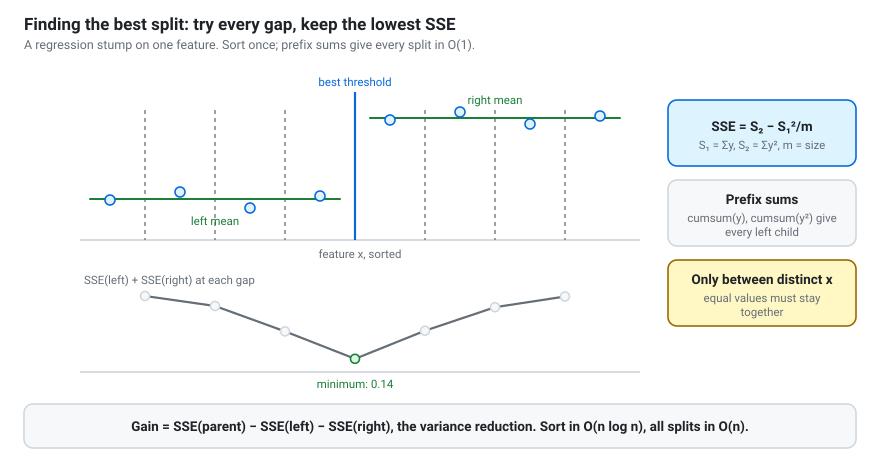
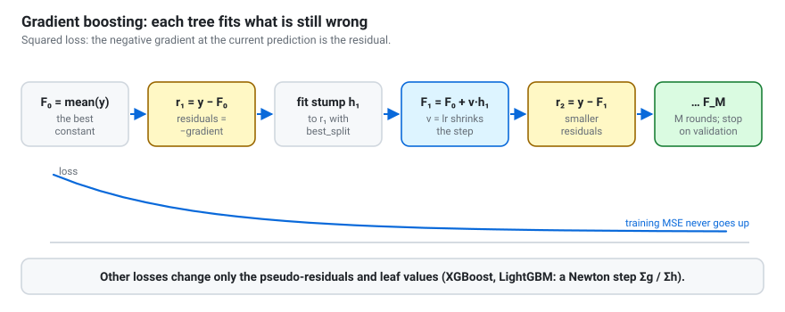
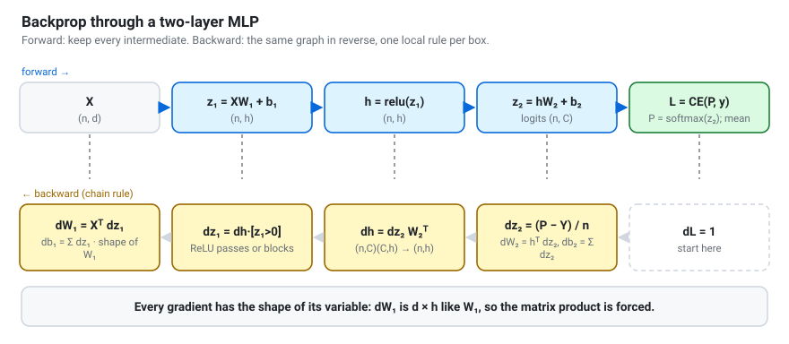
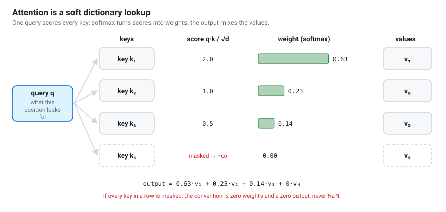
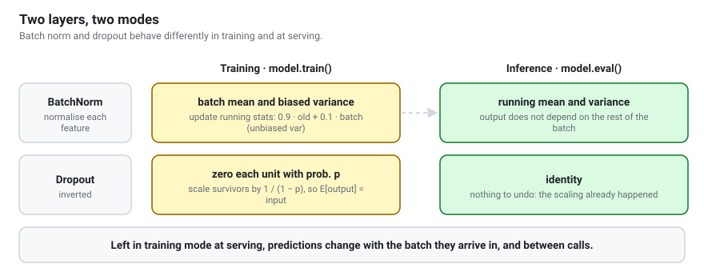

# Chapter 32 · ML from scratch II

*Part II · Prerequisites: Chapters 24, 27, 28 and 31 · Estimated time: reading ~60 min, lab ~90 min · Compute: CPU*

 · [Lab: notebook.ipynb](notebook.ipynb) · [Solutions](solutions.md)

## Learning objectives

After this chapter you should be able to:

1. Find the best regression-tree split on one feature in $O(n \log n)$ using sorting and prefix sums, and explain the duplicate-value and cancellation pitfalls.
2. Derive gradient boosting as gradient descent in function space, implement it with stumps for squared loss, and state what changes for other losses.
3. Derive backpropagation for a two-layer MLP using the shape rule, and verify it with a gradient check.
4. Explain the $1/\sqrt{d}$ scaling in attention, implement masked attention, and define the output for a fully masked query.
5. Implement batch normalisation in training and inference modes and inverted dropout, and explain the train/serve failures they cause.
6. Derive the softmax cross-entropy gradient at a whiteboard and relate it to label smoothing and distillation.

## 32.1 Introduction

Chapter 31 covered linear models, clustering, nearest neighbours and ranking metrics. This chapter covers the components of the models that are normally used through a library: tree splits and gradient boosting (the basis of the LightGBM rankers in Chapter 24), backpropagation, attention, batch normalisation and dropout. Interviewers ask for these because a short NumPy implementation shows whether a candidate knows what the library computes, including the details that cause production failures: train and inference modes, masking and numerical overflow.

The order of the chapter follows the dependence between ideas. Section 32.2 introduces prefix sums and uses them for tree splits; Section 32.3 builds gradient boosting from those splits; Section 32.4 develops backpropagation; Sections 32.5 and 32.6 apply it to attention and to the two layers with separate training and inference behaviour. Section 32.7 collects the softmax cross-entropy derivation, which the lab's Exercise 7 asks you to give orally.

## 32.2 Regression-tree splits with prefix sums

### 32.2.1 The split criterion

A regression tree partitions the data by thresholds on features and predicts the mean target in each leaf. At a node, the split on feature $x$ with threshold $t$ sends points with $x \le t$ to the left child and the rest to the right. For squared loss the best split minimises the **sum of squared errors** (SSE) of the two children, or equivalently maximises the **gain**

$$
\text{gain} = \text{SSE}_{\text{parent}} - \text{SSE}_{\text{left}} - \text{SSE}_{\text{right}}, \qquad (32.1)
$$

which is the reduction in within-node variance (times the node size).

### 32.2.2 SSE from sums

For a set of $m$ values with sum $S_1 = \sum y$ and sum of squares $S_2 = \sum y^2$, expanding the square gives

$$
\text{SSE} = \sum (y - \bar y)^2 = \sum y^2 - 2\bar y \sum y + m \bar y^2 = S_2 - \frac{S_1^2}{m}. \qquad (32.2)
$$

A set's spread therefore depends only on its count, sum and sum of squares.

### 32.2.3 The algorithm

After sorting the points by $x$, every candidate left child is a **prefix** of the sorted order and every right child the complementary suffix. The cumulative sums `np.cumsum(y)` and `np.cumsum(y**2)` give $S_1$ and $S_2$ for all $n - 1$ prefixes at once; the suffix sums are the totals minus the prefix sums. Equation (32.2) then gives both children's SSE for every split in $O(1)$ each.

- **Cost.** Sorting is $O(n \log n)$; everything after it is $O(n)$. The naive method recomputes both children's means for each of the $n - 1$ thresholds, $O(n)$ each, $O(n^2)$ in total. Across $d$ features the cost per node is $O(d\, n \log n)$.
- **Duplicates.** A threshold cannot separate equal feature values, because all copies fall on the same side. Only positions $i$ with $x_{(i)} < x_{(i+1)}$ in sorted order are valid, and the threshold is conventionally the midpoint $(x_{(i)} + x_{(i+1)})/2$. Ignoring this produces splits that the model cannot apply.
- **Cancellation.** $S_2 - S_1^2/m$ subtracts two large, nearly equal numbers when the targets are large and their spread small, and loses precision. Libraries centre $y$ first or use Welford-style running updates.

*Worked example:* $y = (1.0, 1.2, 0.8, 1.1, 3.0, 3.2, 2.9, 3.1)$, already sorted by $x$. The parent has $S_1 = 16.3$, $S_2 = 41.55$, so its SSE is $41.55 - 16.3^2/8 = 8.34$. Splitting after the fourth point gives children with SSE 0.0875 and 0.05, total 0.1375, and a gain of 8.20.

*Figure 32.1 — Candidate thresholds between sorted points, and the summed child SSE at each. The minimum separates the low group from the high group; prefix sums make each point on the curve one subtraction.*

> **Intuition.** Prefix sums work like a car's odometer: the distance between two towns is the difference of two readings, not a new drive. Sorting once and reading the odometer at every gap prices all $n - 1$ splits at once. *Where the analogy breaks down:* readings that are large and close together lose digits when subtracted; centring $y$ first avoids this.

**Histogram methods.** LightGBM and XGBoost's `hist` mode go further: each feature is bucketed once into at most 255 bins, and a node's split search accumulates gradient sums per bin in $O(n)$ and scans the bins, with no sort per node. The histogram of one child can be obtained as the parent's minus the sibling's. The cost is that only bin edges are candidate thresholds, which rarely matters in practice.

## 32.3 Gradient boosting

### 32.3.1 Boosting as gradient descent in function space

Gradient boosting (Friedman, 2001) builds an additive model $F_M(x) = F_0 + \nu \sum_{m=1}^M h_m(x)$ from small trees $h_m$. Consider the training loss $\sum_i L(y_i, F(x_i))$ as a function of the $n$ prediction values $F(x_i)$. Gradient descent on these values would move each one in the direction of the negative gradient

$$
r_i^{(m)} = -\frac{\partial L(y_i, F)}{\partial F}\Big|_{F = F_{m-1}(x_i)}, \qquad (32.3)
$$

called the **pseudo-residuals**. A model must generalise to new $x$, so instead of moving the values directly, boosting fits a tree $h_m$ to the pseudo-residuals by least squares and takes a step along it:

$$
F_m(x) = F_{m-1}(x) + \nu\, h_m(x), \qquad F_0 = \arg\min_c \sum_i L(y_i, c). \qquad (32.4)
$$

The **learning rate** or **shrinkage** $\nu \in (0, 1]$ limits how much any one tree corrects. Smaller $\nu$ requires more trees but generalises better; the number of trees is chosen by early stopping on a validation set.

### 32.3.2 Squared loss

For $L = \frac12 (y - F)^2$, the negative gradient is $y - F$: the pseudo-residuals are the ordinary residuals, and $F_0$ is the mean of $y$ (the constant minimising squared loss). With stumps (depth-1 trees), each round finds, over all features, the split of Section 32.2 that best fits the current residuals, and sets each leaf value to the mean residual on its side. Because the stump is the least-squares fit to the residuals and the zero function is one of the candidates (for any split, predicting the means can only reduce SSE), adding $\nu h_m$ with $0 < \nu \le 1$ cannot increase the training MSE.

*Worked example:* $y = (1, 3)$, $F_0 = 2$, residuals $(-1, 1)$. A stump that fits them exactly, with $\nu = 0.1$, gives $F_1 = (1.9, 2.1)$; the residuals shrink by a factor 0.9 per round, to $(-0.729, 0.729)$ after three rounds.

### 32.3.3 Other losses

Other losses change the pseudo-residuals and the leaf values. For log loss with $p = \sigma(F)$, the pseudo-residuals are $y - p$ and $F_0$ is the log-odds of the base rate. XGBoost and LightGBM set leaf values by a **Newton step**, $-\sum g_i / \sum h_i$ over the leaf's points, where $g_i$ and $h_i$ are the first and second derivatives of the loss; for log loss this is $\sum (y_i - p_i) / \sum p_i(1-p_i)$. LambdaMART (Chapter 24) replaces the pseudo-residuals by "lambdas": pairwise RankNet gradients within a query, each weighted by the change in NDCG that swapping the pair would produce.

**Cost.** Training $M$ rounds with re-sorting costs $O(M d n \log n)$; sorting each feature once in advance reduces this to $O(M d n)$. Prediction is $O(M)$ per row for stumps.

*Figure 32.2 — Gradient boosting for squared loss. Each stump sees only what is still wrong (the residuals), and the learning rate $\nu$ keeps any one stump from correcting too much at once.*

> **Intuition.** Boosting resembles golf: each stroke aims from where the ball is now, not from the tee, and shrinkage is choosing to putt gently. *Where the analogy breaks down:* a golfer stops at the hole; boosting keeps fitting noise in the training residuals unless it is stopped on a validation set.

## 32.4 Backpropagation

### 32.4.1 The chain rule on a computation graph

Backpropagation is the chain rule applied to a computation graph in reverse topological order. For each node, the backward pass receives the **upstream gradient** $\partial L / \partial \text{out}$ and multiplies it by the node's **local gradient** to obtain $\partial L / \partial \text{in}$ for each of its inputs. Each node needs only its own forward inputs (stored during the forward pass) and the gradient arriving from its consumers; gradients from several consumers of the same value are summed.

One rule removes most implementation errors: **the gradient of a quantity has the shape of that quantity.** If $W$ is $d \times h$, so is $dW$, and there is usually only one way to multiply the available arrays to obtain that shape. The local rules for common layers, with `dout` the upstream gradient, are:

| Forward | Backward |
|---|---|
| `out = X @ W + b` | `dX = dout @ W.T`, `dW = X.T @ dout`, `db = dout.sum(0)` |
| `out = relu(z)` | `dz = dout * (z > 0)` |
| `out = sigmoid(z)` | `dz = dout * out * (1 - out)` |
| `L = mean CE(softmax(z), y)` | `dz = (softmax(z) - onehot(y)) / n` |
| `out = x * mask / (1-p)` (dropout) | `dx = dout * mask / (1-p)` |

### 32.4.2 A two-layer MLP

Consider $X \in \mathbb{R}^{n\times d} \to$ linear $(W_1, b_1)$ $\to$ ReLU $\to$ linear $(W_2, b_2)$ $\to$ softmax cross-entropy, with forward intermediates $Z_1 = XW_1 + b_1$, $H = \max(Z_1, 0)$, $Z_2 = HW_2 + b_2$, $P = \operatorname{softmax}(Z_2)$. Applying the table from the loss backwards:

$$
\begin{aligned}
dZ_2 &= (P - Y)/n, & dW_2 &= H^\top dZ_2, & db_2 &= \textstyle\sum_i (dZ_2)_i, \\
dH &= dZ_2 W_2^\top, & dZ_1 &= dH \odot \mathbb{1}[Z_1 > 0], & dW_1 &= X^\top dZ_1, \quad db_1 = \textstyle\sum_i (dZ_1)_i.
\end{aligned} \qquad (32.5)
$$

*Shape check:* with $X$ of shape (5, 4), $W_1$ (4, 6) and $W_2$ (6, 3): $dZ_2$ is (5, 3); $dW_2 = H^\top dZ_2$ is (6, 5)(5, 3) = (6, 3); $dH$ is (5, 3)(3, 6) = (5, 6); $dW_1$ is (4, 5)(5, 6) = (4, 6). Every gradient has its variable's shape.

**Cost.** The forward pass costs $O(n(dh + hC))$. The backward pass performs about two matrix products per linear layer (one for the weight gradient, one for the input gradient), so it costs about twice the forward pass. Memory is $O(nh)$ for stored activations, which is why activation checkpointing (recomputing activations instead of storing them; Chapter 40) exists for large models.

**Verification.** The gradient check of Chapter 31 applies directly; points with $Z_1 \approx 0$ should be avoided because of the ReLU kink. Typical errors are applying the ReLU mask to the wrong tensor, using $W_2$ instead of $W_2^\top$, and dividing by $n$ twice or not at all.

*Figure 32.3 — Forward and backward passes of a two-layer MLP. Each backward box needs only its forward input and the gradient arriving from the right; this locality is why the backward pass costs about twice the forward.*

## 32.5 Scaled dot-product attention

### 32.5.1 Definition and the scaling factor

Given queries $Q \in \mathbb{R}^{L_q \times d}$, keys $K \in \mathbb{R}^{L_k \times d}$ and values $V \in \mathbb{R}^{L_k \times d_v}$,

$$
\operatorname{Attention}(Q, K, V) = \operatorname{softmax}\!\left(\frac{QK^\top}{\sqrt{d}}\right) V, \qquad (32.6)
$$

with the softmax taken over the key axis (Vaswani et al., 2017). Each output row is a weighted average of the value rows, with weights determined by how well the query matches each key.

**Why $\sqrt d$.** If the components of $q$ and $k$ are independent with mean 0 and variance 1, then $q^\top k = \sum_{j=1}^d q_j k_j$ is a sum of $d$ independent terms of variance 1, so its variance is $d$. Without scaling, scores grow with $d$, the softmax saturates (one weight near 1, the rest near 0), and its gradients vanish. Dividing by $\sqrt d$ restores unit variance.

> **Intuition.** A dictionary returns the one value whose key matches exactly; attention returns a *blend* of all values, weighted by how well each key matches the query. *Where the analogy breaks down:* the weights sum to 1 even when no key matches well, so attention always returns something; a fully masked row has nothing to blend.

### 32.5.2 Masking

A **mask** specifies which keys each query may use. A *causal* mask hides future positions in a decoder; a *padding* mask hides pad tokens in a batch of variable-length sequences (Chapter 28 used both). Masking is applied to the scores **before** the softmax, by setting disallowed scores to $-\infty$ (or a large negative number), so that their weights are zero and the remaining weights still sum to 1. Zeroing weights after the softmax without renormalising is an error.

A frequent production bug is a query whose keys are **all** masked: a left-padded batch, a user with an empty history (a cold-start user in Chapter 28), or some cross-attention layouts. With $-\infty$ fills, the stable softmax computes $\exp(-\infty - (-\infty)) = \exp(\text{NaN})$, and the NaN propagates into every gradient. With a $-10^9$ fill there is no NaN, but the row becomes uniform, so the query silently attends to keys it should ignore. The lab's convention is explicit: a fully masked row has all-zero weights and a zero output. In practice, the row maximum is replaced by 0 where it is $-\infty$, and division happens only where the row sum is positive. Library behaviour differs between versions and backends (the lab found zeros from PyTorch 2.8's CPU kernel; earlier releases returned NaN), so the deployed configuration should be tested.

*Figure 32.4 — One query against four keys, one of them masked. The weights sum to 1 over the allowed keys, so a row with no allowed key has no defined output.*

### 32.5.3 Cost

Attention costs $O(L_q L_k d)$ time and $O(L_q L_k)$ memory per head for the score matrix, which is quadratic in sequence length. Two families of methods reduce this: IO-aware exact kernels such as FlashAttention (Dao et al., 2022) compute the result in tiles without materialising the score matrix (memory linear in length, time still quadratic); and sparse, local or low-rank approximations (sliding windows, block-sparse patterns, kernelised linear attention) reduce the time as well. Multi-head attention reshapes $(B, L, H d_h)$ to $(B, H, L, d_h)$, applies Equation (32.6) per head, and reshapes back before an output projection.

## 32.6 Batch normalisation and dropout

Both layers behave differently during training and inference, and this makes them a common source of disagreement between offline metrics and serving.

### 32.6.1 Batch normalisation

During training, batch normalisation (Ioffe and Szegedy, 2015) standardises each feature using the statistics of the current mini-batch $B$ of size $n$, then applies a learned scale $\gamma$ and shift $\beta$:

$$
\hat x = \frac{x - \mu_B}{\sqrt{\sigma_B^2 + \epsilon}}, \qquad y = \gamma \hat x + \beta, \qquad (32.7)
$$

where $\mu_B$ and $\sigma_B^2$ are the batch mean and the **biased** batch variance (divided by $n$), and $\epsilon$ prevents division by zero. It also maintains **running statistics** for inference,

$$
\text{running} \leftarrow (1 - m)\cdot \text{running} + m \cdot \text{batch statistic}, \qquad (32.8)
$$

where, in PyTorch's convention, the momentum $m = 0.1$ weights the new batch and the running variance uses the **unbiased** batch variance (divided by $n - 1$). Keras uses the opposite parameterisation (momentum 0.99 weights the old value), so the convention should be stated. At inference the running statistics replace the batch statistics, and the output for a row no longer depends on the rest of the batch.

The biased and unbiased variances serve different purposes: the forward pass normalises the batch it actually has, whereas the running variance estimates a population variance. A batch of size 1 has zero variance, every output equals $\beta$, and the update is undefined; PyTorch raises an error in that case.

*Worked example:* $x = (1, 2, 4)$ gives $\mu_B = 2.33$, $\sigma_B^2 = 1.56$ and $\hat x = (-1.07, -0.27, 1.34)$. With momentum 0.1, starting from running mean 0 and variance 1, the running mean becomes 0.233 and the running variance $0.9 + 0.1 \times 2.33 = 1.133$, using the unbiased variance 2.33.

### 32.6.2 Inverted dropout

Dropout (Srivastava et al., 2014) sets each unit to zero with probability $p$ during training. In the **inverted** form the survivors are scaled by $1/(1-p)$:

$$
y = \frac{x \odot m}{1 - p}, \qquad m_j \sim \operatorname{Bernoulli}(1 - p), \qquad \mathbb{E}[y] = x. \qquad (32.9)
$$

Because the expectation is preserved during training, inference is the identity and needs no rescaling. (The original paper scaled the weights at test time instead.) The edge cases $p = 0$ (identity) and $p = 1$ (all zeros, avoiding division by zero) must be handled. *Example:* with $p = 0.5$ and $x = 2$, the output is 0 or 4 with equal probability, mean 2.

### 32.6.3 Train/serve failures

A model left in training mode at serving time produces predictions that depend on the other rows of the batch and differ between calls; the lab shows the same input row mapped to two different outputs. In PyTorch, `model.eval()` switches both layers to inference behaviour (Chapter 27). Other failures are running statistics that do not match serving inputs (computed on differently preprocessed data, or frozen by an export), very small training batches that make the statistics noisy (layer or group normalisation are alternatives), and dropout left active at inference.

*Figure 32.5 — Batch norm and dropout in training and inference modes. Everything in the training column depends on randomness or on the rest of the batch; the inference column is deterministic, which serving requires.*

> **Intuition.** Training-mode batch norm grades on a curve: a student's score depends on who else sat the exam that day. Inference mode grades against a fixed scale learned over the whole term. *Where the analogy breaks down:* the fixed scale becomes stale if serving traffic drifts away from training traffic.

## 32.7 The softmax cross-entropy gradient

Exercise 7 asks for this derivation as it would be given at a whiteboard. For logits $z \in \mathbb{R}^C$ and true class $y$:

1. **Softmax:** $p_k = e^{z_k} / \sum_j e^{z_j}$, with Jacobian $\partial p_k / \partial z_j = p_k(\delta_{kj} - p_j)$.
2. **Loss:** $L = -\log p_y = -z_y + \log\sum_j e^{z_j}$. Differentiating directly (simpler than using the Jacobian),

$$
\frac{\partial L}{\partial z_k} = p_k - \delta_{ky}, \qquad \nabla_z L = p - \operatorname{onehot}(y). \qquad (32.10)
$$

   Each component lies in $(-1, 1)$ and the components sum to 0.
3. **Batch and $Z = XW$:** with the mean over $n$ examples, $dZ = (P - Y)/n$, so $dW = X^\top dZ$ (shape $d \times C$) and $dX = dZ\, W^\top$.
4. **Stability:** $\log p_y$ is computed with log-sum-exp (Chapter 31); the gradient $p - y$ is bounded once $p$ is computed stably.
5. **Behaviour:** when the model is confidently wrong ($p_y \approx 0$, another $p_k \approx 1$) the gradient has its largest magnitude, so learning is fast — unlike squared error on a sigmoid output, whose gradient vanishes when the sigmoid saturates. When the model is confidently right the gradient is near zero.

Because the gradient needs only a target distribution, soft targets require no new derivation: with a target distribution $q$, $\nabla_z L = p - q$. Label smoothing uses $q = (1-\varepsilon)\,\operatorname{onehot}(y) + \varepsilon/C$, and knowledge distillation uses the teacher's softmax at a temperature $T$ (Chapter 36).

## Key terms

| Term | Definition |
|---|---|
| Sum of squared errors (SSE) | $\sum (y - \bar y)^2$; equal to $S_2 - S_1^2/m$. |
| Prefix sum | A running total; the sum of any contiguous range is a difference of two prefix sums. |
| Regression stump | A depth-1 regression tree: one threshold and two leaf values. |
| Split gain | The reduction in SSE (or another impurity) achieved by a split. |
| Pseudo-residual | The negative gradient of the loss with respect to the current prediction; the residual for squared loss. |
| Shrinkage (learning rate) | The factor $\nu$ by which each new tree's prediction is multiplied before being added. |
| Newton leaf value | $-\sum g / \sum h$ over a leaf, used by second-order boosting libraries. |
| Histogram GBDT | Gradient boosting that bins features once and searches splits over bin edges. |
| Upstream gradient | The gradient of the loss with respect to a node's output, received during the backward pass. |
| Local gradient | The derivative of a node's output with respect to its input. |
| Scaled dot-product attention | $\operatorname{softmax}(QK^\top/\sqrt d)V$. |
| Causal / padding mask | A mask hiding future positions / pad tokens from attention. |
| Running statistics | Moving averages of mean and variance used by batch norm at inference. |
| Inverted dropout | Dropout that rescales survivors by $1/(1-p)$ during training, so inference is the identity. |
| Label smoothing | Training against a mixture of the one-hot target and the uniform distribution. |

## Summary

1. The SSE of a set follows from its count, sum and sum of squares (Equation 32.2); after one sort, prefix sums price all splits in $O(n)$, so the best split costs $O(n \log n)$. Thresholds lie only between distinct values.
2. Gradient boosting fits each new tree to the negative gradient of the loss at the current predictions (Equations 32.3–32.4); for squared loss these are the residuals and the initial prediction is the mean.
3. Other losses change the pseudo-residuals and, in second-order libraries, use Newton leaf values; LambdaMART substitutes ranking gradients.
4. Backpropagation applies local gradient rules in reverse; every gradient has the shape of its variable, and the backward pass costs about twice the forward.
5. Attention scales scores by $1/\sqrt d$ to keep their variance near 1; masks are applied before the softmax, and a fully masked row needs an explicitly defined output to avoid NaN.
6. Batch norm uses batch statistics in training and running statistics at inference; inverted dropout preserves expectations so inference is the identity. Forgetting inference mode makes predictions depend on the batch.
7. The softmax cross-entropy gradient is $p - y$; replacing $y$ by any target distribution gives label smoothing and distillation directly.

## Exercises

The exercises are in the lab, [notebook.ipynb](notebook.ipynb); worked answers are in [solutions.md](solutions.md).

1. **Exercise 1 · `best_split`** (15 min). The best stump threshold on one feature in $O(n \log n)$, with midpoint thresholds and duplicate handling.
2. **Exercise 2 · `gbm_fit` / `gbm_predict`** (20 min). Gradient boosting with stumps for squared loss, compared with scikit-learn's `GradientBoostingRegressor(max_depth=1)`.
3. **Exercise 3 · `mlp_grads`** (20 min). Forward and backward passes of a two-layer MLP (Equation 32.5), checked numerically.
4. **Exercise 4 · `attention`** (15 min). Masked scaled dot-product attention with arbitrary batch dimensions and zero output for fully masked rows.
5. **Exercise 5 · `batchnorm_forward`** (12 min). Batch norm in training and inference modes with PyTorch's conventions.
6. **Exercise 6 · `inverted_dropout`** (5 min). Inverted dropout, including $p = 0$ and $p = 1$.
7. **Exercise 7 · Softmax cross-entropy gradient** (written, 10 min). The derivation of Section 32.7.

Checkpoint questions ask you to explain GBDT training for squared, logistic and ranking losses; why histogram GBDTs are faster; how to diagnose NaN outputs from masking; why a batch-norm model degrades when requests are scored one at a time; why attention is quadratic and how that cost is reduced; and why soft targets need no new derivation.

## Further reading

- Friedman, J. H. (2001). Greedy function approximation: a gradient boosting machine. *Annals of Statistics*, 29(5), 1189–1232.
- Hastie, T., Tibshirani, R. and Friedman, J. (2009). *The Elements of Statistical Learning*, 2nd ed. Springer. Chapters 9 (trees) and 10 (boosting).
- Ke, G. et al. (2017). LightGBM: a highly efficient gradient boosting decision tree. *Advances in Neural Information Processing Systems 30*.
- Goodfellow, I., Bengio, Y. and Courville, A. (2016). *Deep Learning*. MIT Press. Section 6.5 (back-propagation) and Section 7.12 (dropout).
- Vaswani, A. et al. (2017). Attention is all you need. *Advances in Neural Information Processing Systems 30*.
- Ioffe, S. and Szegedy, C. (2015). Batch normalization: accelerating deep network training by reducing internal covariate shift. *Proceedings of ICML 2015*.
- Srivastava, N., Hinton, G., Krizhevsky, A., Sutskever, I. and Salakhutdinov, R. (2014). Dropout: a simple way to prevent neural networks from overfitting. *Journal of Machine Learning Research*, 15, 1929–1958.
- Dao, T., Fu, D. Y., Ermon, S., Rudra, A. and Ré, C. (2022). FlashAttention: fast and memory-efficient exact attention with IO-awareness. *Advances in Neural Information Processing Systems 35*.

**Next:** [Chapter 33 · Coding patterns I](../ch33-coding-patterns-1/README.md)
