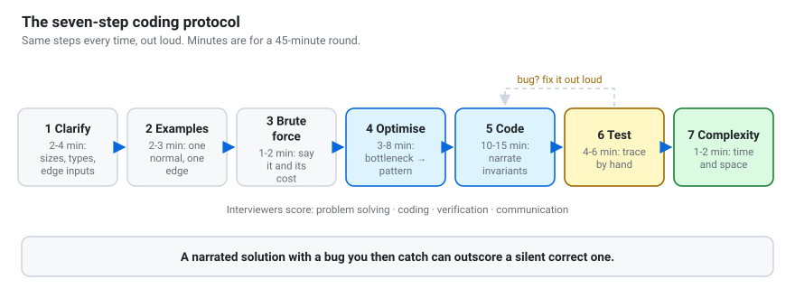
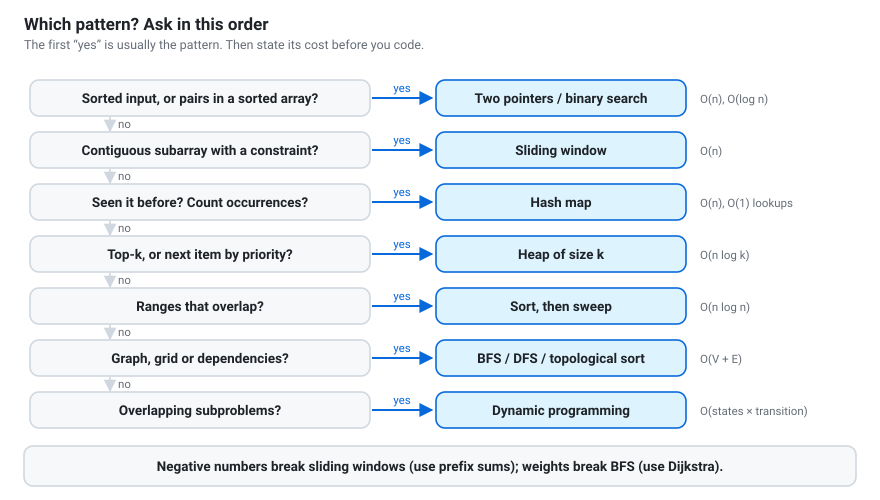

# Chapter 33 · Coding patterns I

*Part II · Prerequisites: Chapter 17 and Chapter 31 (Section 31.2), fluency in Python · Estimated time: reading ~60 min, lab ~90 min · Compute: CPU*

 · [Lab: notebook.ipynb](notebook.ipynb) · [Solutions](solutions.md)

## Learning objectives

After this chapter you should be able to:

1. Apply a seven-step protocol to any coding problem, from clarifying questions to a complexity statement.
2. State the cost of common Python operations, explain amortised and average-case bounds, and detect hidden quadratic behaviour by measurement.
3. Recognise from the shape of a problem which of six patterns applies: hash maps, two pointers and sliding windows, heaps, interval sweeps, stacks, and prefix sums or products.
4. Argue the correctness and complexity of each pattern, including amortised arguments for two-pointer methods and output-sensitive bounds.
5. Solve the lab's seven problems within their target times, stating edge cases and complexity.
6. Score your own attempts with a fixed rubric and plan spaced practice.

## 33.1 Introduction

Most interview processes for ML engineers at large technology companies include one or two classic coding rounds on data structures and algorithms, assessed much like those for software engineers. A reader trained in research programming may have written a great deal of numerical code and still find these rounds unfamiliar, because they reward a specific skill: recognising which standard technique removes the bottleneck of an obvious solution, and explaining that reasoning while coding.

The number of techniques needed is small. Most interview problems are variations on about a dozen **patterns**, and each pattern has a recognisable signal in the problem statement. This chapter covers six of them; Chapter 34 covers graphs, binary search, dynamic programming, tries and union-find. For each pattern the chapter gives the signal, the idea, a worked example, the correctness argument and the complexity. Sections 33.2 and 33.3 first set out the protocol for an answer and the cost model of Python's built-in operations, since a complexity claim is only as good as the cost model behind it.

## 33.2 The communication protocol

Interviewers usually assess four things: **problem solving** (was a good approach found, and how much help was needed), **coding** (correct, clean, idiomatic code), **verification** (did the candidate test the code and find their own bugs) and **communication** (could the interviewer follow the reasoning). Because verification and communication are assessed explicitly, a silent correct solution can score lower than a narrated one with a small bug that the candidate then finds.

A fixed sequence of steps makes this evidence visible. For a 45-minute round:

| Step | Minutes | Content |
|---|---|---|
| 1. Clarify | 2–4 | Restate the problem. Ask about input size, types and ranges (negatives, duplicates, empty input), return format, and whether in-place modification is allowed. Record the answers as a comment. |
| 2. Examples | 2–3 | Work one typical and one edge example by hand. This often reveals the pattern. |
| 3. Brute force | 1–2 | State the obvious solution and its cost, e.g. "checking every pair is $O(n^2)$". It need not be coded. |
| 4. Optimise | 3–8 | Name the bottleneck and the pattern that removes it. Agree the plan before coding. |
| 5. Code | 10–15 | Clear names, small helpers, and the loop invariant stated aloud. |
| 6. Test | 4–6 | Trace the code by hand on the example, then on the edge cases from step 1. |
| 7. Complexity | 1–2 | Time and extra space, with their sources; what would change for larger inputs. |

Steps 1–4 take up to a third of the time and involve no code. When stuck, it helps to say what is being considered: an interviewer can only give hints to a candidate whose reasoning they can follow.

*Figure 33.1 — The seven-step protocol with suggested minutes. The dashed loop from testing back to coding is where verification is demonstrated.*

A useful tool in step 2 is the **loop invariant**: a statement that is true before and after every iteration of a loop, such as "`s[left:right+1]` contains no repeated character". If the invariant holds initially, is preserved by each iteration, and together with the exit condition implies the desired result, the loop is correct. Stating the invariant aloud is also the clearest way to explain the code.

## 33.3 The cost model

### 33.3.1 Costs of Python operations

| Operation | Cost | Note |
|---|---|---|
| `x in list`, `list.index`, `list.remove`, `list.pop(0)`, `list.insert(0, x)` | $O(n)$ | the usual hidden quadratic |
| `x in set`, `x in dict`, `d[k] = v`, `set.add` | $O(1)$ average | hashing |
| `list.append`, `list.pop()` | $O(1)$ amortised | occasional resize |
| `deque.appendleft`, `deque.popleft` | $O(1)$ | queues (BFS) |
| `heapq.heappush`, `heapq.heappop` | $O(\log n)$ | min-heap |
| `sorted`, `list.sort` | $O(n \log n)$ | stable (Timsort) |
| slicing `s[a:b]`, concatenation `s + t` | $O(\text{length})$ | copies |
| `bisect.bisect_left` | $O(\log n)$ | on a sorted list |

### 33.3.2 Amortised and average-case bounds

Two of these bounds are not worst-case bounds, and the distinction is often asked about.

**Amortised $O(1)$ append.** A Python list stores its elements in an array with spare capacity. When the array is full, `append` allocates a larger array (growing by a constant factor) and copies all elements: a single append can cost $O(n)$. Over $n$ appends, however, the copies happen at sizes that grow geometrically, so their total cost is bounded by a geometric series. With doubling, the copies cost at most $1 + 2 + 4 + \dots + n < 2n$ element moves, so the **average cost per operation over any sequence** is $O(1)$. That is the meaning of *amortised*.

**Average $O(1)$ hashing.** A hash table maps a key to a bucket through a hash function. If the hash function spreads keys uniformly and the table is resized to keep the load factor bounded, the expected number of keys examined per lookup is $O(1)$. In the worst case, when many keys collide, a lookup degrades to $O(n)$. This can be triggered deliberately by adversarial inputs, which is why Python randomises string hashing per process; it can also arise from a poor custom `__hash__`.

### 33.3.3 Measuring

A complexity claim can be checked by timing at doubling sizes. If $t(n) \propto n^k$, the local exponent is

$$
k \approx \frac{\log(t_2/t_1)}{\log(n_2/n_1)}, \qquad (33.1)
$$

so a time ratio of 4 for doubled input indicates $O(n^2)$ and a ratio of 2 indicates $O(n)$. The lab applies this to a queue built on a list: `list.pop(0)` shifts every remaining element, so draining $n$ items costs about $n^2/2$ moves. In the lab's run it took about 0.8 s at $n = 100{,}000$ with a fitted exponent of 2.0–2.2, while `deque.popleft` took about 4 ms. A breadth-first search over a graph of $10^5$ nodes with a list as its queue is therefore about 200 times slower than necessary.

A rough rule connects input size and the required complexity, assuming pure Python executes about $10^7$ simple steps per second:

$$
n \le 20 \Rightarrow O(2^n), \qquad n \le 10^3\text{–}10^4 \Rightarrow O(n^2), \qquad n \approx 10^5\text{–}10^6 \Rightarrow O(n \log n) \text{ or } O(n). \qquad (33.2)
$$

For example, $n = 200{,}000$ makes $n^2 = 4 \times 10^{10}$ steps (over an hour), while $n \log_2 n \approx 3.5 \times 10^6$ steps take a fraction of a second. The lab's graders enforce this with a 2-second budget per run.

## 33.4 Choosing a pattern

A problem rarely states which pattern it needs. The following questions, asked in order, usually identify it. Each concerns the *shape* of the input or of the question, never the story in which the problem is wrapped.

*Figure 33.2 — A decision ladder for choosing a pattern. The graph and dynamic-programming rows are the subject of Chapter 34.*

## 33.5 Hash maps: complements and counts

**Signal:** "find a pair or element with property X", "have we seen this before?", "count occurrences". **Idea:** a dictionary replaces an $O(n)$ inner search by an $O(1)$ average lookup.

*Worked example (grouping anagrams).* Two words are anagrams if they have the same multiset of letters, so `"".join(sorted(word))` is a canonical key. One pass that appends each word to `groups[key]` groups them in $O(n \cdot m \log m)$ for $n$ words of length at most $m$; counting letters instead of sorting gives $O(nm)$.

*Two-sum, all pairs (Exercise 1).* Given `nums` and `target`, list every index pair $i < j$ with `nums[i] + nums[j] == target`. Scan $j$ from left to right while maintaining a dictionary from value to the list of earlier indices with that value. At each $j$, the partners are exactly the stored indices of `target - nums[j]`; add $j$ to the dictionary *after* the lookup so that an element cannot pair with itself. The scan is $O(n)$, and emitting the pairs costs $O(p)$ for $p$ pairs, so the time is $O(n + p)$ and the space $O(n)$.

The $p$ term matters. For `[0] * n` with target 0, there are $p = n(n-1)/2$ pairs. *Any* algorithm that lists them takes $\Omega(n^2)$ time, so quadratic time is unavoidable on that input. A bound of the form $O(n + p)$ that depends on the size of the output is called **output-sensitive**. Variants: if only the count is needed, store counts rather than index lists for $O(n)$; if the input is sorted, two pointers (Section 33.6) need only $O(1)$ extra space.

## 33.6 Two pointers and sliding windows

**Signal:** a contiguous subarray or substring with a constraint ("longest", "shortest", "at most $k$ distinct"), or pairs in a **sorted** array. **Idea:** maintain a window $[\ell, r]$ and move both ends only forward.

**Complexity argument.** The right end advances $n$ times. The left end also only advances and cannot pass the right end, so it advances at most $n$ times in total over the whole run. Counting pointer moves rather than loop nesting,

$$
\text{total steps} \le n + n = 2n, \qquad (33.3)
$$

so a `while` loop inside a `for` loop is $O(n)$ here. This is another amortised argument: a single iteration of the outer loop may move the left end many times, but the total is bounded.

*Worked example (shortest subarray with sum at least $T$, positive numbers).* Extend $r$ and add `nums[r]` to the window sum; while the sum is at least $T$, record the window length and remove `nums[ℓ]`, advancing $\ell$. Advancing $\ell$ is safe because, with positive numbers, the sum grows with $r$: the first $r$ at which the window from $\ell$ reaches $T$ gives the shortest valid window starting at $\ell$, and no later $r$ can give a shorter one, so $\ell$ never needs to be revisited. With **negative** numbers this monotonicity fails: removing an element can increase the sum, and the sliding window gives wrong answers. That is the signal to use prefix sums (Section 33.10).

*Longest substring without repeating characters (Exercise 2).* Maintain the invariant "`s[ℓ:r+1]` has no repeated character" and a dictionary `last[ch]` of the most recent index of each character. On reading `s[r]`, if its last occurrence lies *inside* the window ($\text{last}[s_r] \ge \ell$), set $\ell = \text{last}[s_r] + 1$. The guard matters: on `"abba"`, at the final `a` its last index 0 lies before $\ell = 2$, and moving $\ell$ back to 1 would break the invariant. Writing $\ell = \max(\ell, \text{last}[s_r] + 1)$ expresses the same rule. Time $O(n)$; space $O(\min(n, \lvert\Sigma\rvert))$ for alphabet $\Sigma$.

> **Intuition.** A sliding window is a caterpillar: the head moves forward to take in more, the tail moves forward to let go, and neither ever moves back, so every element is taken in once and released once. *Where the analogy breaks down:* the tail may only move when letting go cannot make the window valid again, which fails with negative numbers.

## 33.7 Heaps: top-k, merging and scheduling

**Signal:** "the $k$ largest, smallest or most frequent", "merge $k$ sorted lists", "the next event by time". **Idea:** a binary heap keeps the minimum at the root with $O(\log n)$ insertion and removal. Python's `heapq` implements a min-heap on a list; a max-heap is obtained by negating keys.

**Top-$k$ with a size-$k$ min-heap.** To keep the $k$ largest of a stream, maintain a min-heap of at most $k$ items. Each new item is compared with the root, the smallest of the kept items; if it is larger, it replaces the root (`heapq.heapreplace`). *Correctness:* after each step the heap holds the $k$ largest items seen so far, because an item is discarded only when at least $k$ kept items are larger than or equal to it. *Cost:* $O(n \log k)$ time and $O(k)$ memory, compared with $O(n \log n)$ time and $O(n)$ memory for sorting. For $n = 10^6$ and $k = 10$ that is $\log_2 10 \approx 3.3$ against $\log_2 10^6 \approx 20$ comparisons per item, and, more importantly at scale, it works on a stream that does not fit in memory. The heap is not sorted internally, so the final $k$ items are sorted before being returned.

*Worked example (merging $k$ sorted lists).* Push the first element of each list as a tuple (value, list index, position). Repeatedly pop the smallest, append it to the output, and push the next element from the same list. Each of the $N$ total elements is pushed and popped once on a heap of size at most $k$, giving $O(N \log k)$. A ranking service merges candidate lists from several retrievers by score in this way (Chapter 35).

*Top-$k$ frequent (Exercise 3).* Count with `collections.Counter` in $O(n)$, then select the $k$ best of the $u$ distinct items with a size-$k$ heap in $O(u \log k)$; the tie-break (smaller item first) is encoded in the heap key. Alternatives are sorting in $O(u \log u)$ and bucket sort by count in $O(n)$. When the stream is too large to count exactly, a Count-Min sketch with a heap gives approximate heavy hitters (Chapter 20).

> **Intuition.** A size-$k$ min-heap is a door attendant at a venue with $k$ places who compares each newcomer only with the *weakest* person inside. *Where the analogy breaks down:* the attendant knows only who is weakest; the people inside are not ordered.

## 33.8 Intervals: sort, then sweep

**Signal:** ranges, bookings, sessions, "overlapping". **Idea:** sort by start, then make one pass, or sweep over start and end events.

**Merging (Exercise 4).** Sort intervals by start. Keep an output list; for each interval, if its start is at most the end of the last output interval, extend that end to the maximum of the two ends; otherwise append it. *Correctness:* after sorting, an interval can overlap a previously merged block only through the most recent block, because every earlier block ends before the most recent one starts. The `max` handles nested intervals such as `[1, 10]` and `[2, 3]`. Time $O(n \log n)$ for the sort.

**Inserting into a sorted, disjoint list in $O(n)$.** Three phases without sorting: copy the intervals that end before the new one starts; absorb every interval that starts at or before the new one's end, growing the new interval; copy the rest.

**Conventions.** Closed intervals $[1, 4]$ and $[4, 5]$ *touch* and are merged; half-open intervals $[1, 4)$ and $[4, 5)$ do not overlap. The lab's worked example on meeting rooms uses half-open intervals (a meeting ending at 10 frees the room for one starting at 10), and Exercise 4 uses closed ones. The convention changes `<` into `<=` at the boundaries and should be asked about in step 1.

*Worked example (minimum number of meeting rooms).* Create events (start, +1) and (end, −1), sort them with ends before starts at equal times (half-open convention), and sweep while tracking the running sum; its maximum is the number of rooms needed, equivalently the peak number of concurrent sessions. Time $O(n \log n)$.

## 33.9 Stacks: matching, recency and monotonic stacks

**Signal:** nesting and matching (brackets, tags, function calls), "the most recent unmatched…", "the next greater element". **Idea:** a stack gives last-in, first-out access to the most recent unresolved item.

*Worked example (valid brackets).* Push each opening bracket; on a closing bracket, the stack must be non-empty and its top must be the matching opener, which is then popped. The string is valid if the stack is empty at the end. The two easily missed edge cases are a closing bracket on an empty stack (`"]"`) and leftover openers (`"(("`). Time and space $O(n)$.

*Min-stack (Exercise 5).* A stack with $O(1)$ `push`, `pop`, `top` and `get_min`. Computing `min(items)` in `get_min` is $O(n)$. The key observation is that the minimum of a stack changes only at a push or a pop, and the minimum below any element never changes while the element is on the stack. A parallel stack with `mins[i] = min(items[0..i])` therefore answers `get_min` from its top. A space optimisation pushes onto `mins` only when $x \le$ `mins[-1]` and pops from it when the popped value equals `mins[-1]`; the `<=` (not `<`) is what keeps duplicate minima correct.

A **monotonic stack** keeps its elements in sorted order by popping elements that violate the order before pushing. It answers "next greater element" for all positions in $O(n)$ total: each element is pushed once and popped at most once (the same amortised argument as Equation 33.3), and when an element is popped, the element causing the pop is its next greater element.

## 33.10 Prefix sums and prefix products

**Signal:** many range-sum queries; "a subarray with sum $k$" when values may be negative; "the product of everything except…". **Idea:** precompute running totals once, so that a range is a difference.

With $P_0 = 0$ and $P_{j+1} = P_j + x_j$,

$$
\sum_{t=i}^{j} x_t = P_{j+1} - P_i. \qquad (33.4)
$$

After $O(n)$ preprocessing, every range-sum query costs $O(1)$. *Example:* for `nums = [3, -1, 4, 1, -5, 9]`, $P = (0, 3, 2, 6, 7, 2, 11)$ and `sum(nums[1:4])` $= P_4 - P_1 = 7 - 3 = 4$. Chapter 32's tree-split search used the same idea.

*Subarray sum equals $k$ (Exercise 7).* A subarray $i..j$ has sum $k$ exactly when $P_i = P_{j+1} - k$. Walk once through the array, maintaining a dictionary `count[v]` of how many earlier prefixes equal $v$, and at each step add `count[P - k]` to the answer before recording the current prefix:

$$
\#\{\text{subarrays with sum } k\} = \sum_{j} \#\{\, i \le j : P_i = P_{j+1} - k \,\}. \qquad (33.5)
$$

The dictionary must start as `{0: 1}`, representing the empty prefix $P_0$; without it, subarrays starting at index 0 are missed. *Example:* `nums = [1, 1, 1]`, $k = 2$: $P = (0, 1, 2, 3)$, and the prefix pairs differing by 2 are $(P_0, P_2)$ and $(P_1, P_3)$, so the answer is 2. Time and space $O(n)$. For "the longest subarray with sum $k$", store the *first* index of each prefix value instead of a count.

*Product of array except self (Exercise 6).* $\text{out}_i = \prod_{t < i} x_t \cdot \prod_{t > i} x_t$: write the prefix products into the output in one left-to-right pass, then multiply in a running suffix product in one right-to-left pass. This uses $O(n)$ time and $O(1)$ extra space beyond the output, and avoids division, which fails with zeros (and may be unavailable, for example in modular arithmetic). Test cases: one zero, two zeros, length 0 and 1.

## 33.11 Practice and self-assessment

Skill at these problems comes from retrieval practice: solving a problem again from a blank cell after a delay, not rereading a solution. The lab ends with a self-scoring sheet of seven criteria, each scored 0 (no), 1 (partly) or 2 (yes): clarified the problem, stated a brute force, found the target complexity without help, code correct on the first or second run, tested by hand, stated the complexity, finished within the target time. A total of 12–14 means the pattern is secure; 8–11 means repeating it in two or three days; below 8 means repeating it the next day and again a week later. Chapter 34 ends with a four-week plan that schedules these repetitions.

## Key terms

| Term | Definition |
|---|---|
| Brute force | The obvious correct solution, usually too slow, stated first as a baseline. |
| Time / space complexity | The growth of running time and extra memory with input size. |
| Amortised cost | The average cost per operation over any sequence of operations, even if single operations are occasionally expensive. |
| Average-case cost | The expected cost under an assumption about inputs or randomness, such as uniform hashing. |
| Loop invariant | A statement true before and after every iteration of a loop, used to argue correctness. |
| Hash map | A dictionary with average $O(1)$ lookup, insertion and deletion by key. |
| Two pointers / sliding window | Two indices that move only forward over a sequence, giving $O(n)$ total work. |
| Heap | A tree kept partially ordered so that the minimum (or maximum) is at the root. |
| Sweep | Sorting events by position and processing them in one pass. |
| Monotonic stack | A stack kept in sorted order, used for next-greater or most-recent-smaller queries. |
| Prefix sum | A running total from which any range sum is one subtraction. |
| Output-sensitive bound | A complexity bound that depends on the size of the output as well as the input. |
| Retrieval practice | Recalling a solution from memory, as opposed to rereading it. |

## Summary

1. A seven-step protocol — clarify, examples, brute force, optimise, code, test, complexity — makes problem solving, verification and communication visible.
2. Complexity claims rest on a cost model: `list.pop(0)` and `x in list` are $O(n)$; appends are amortised $O(1)$ by a geometric-series argument; hashing is $O(1)$ on average and $O(n)$ in the worst case.
3. Timing at doubling sizes (Equation 33.1) checks a claimed exponent; input size indicates the complexity required (Equation 33.2).
4. Hash maps replace inner searches by lookups; output-sensitive bounds such as $O(n + p)$ acknowledge unavoidable output costs.
5. Sliding windows are $O(n)$ because each pointer moves at most $n$ times; they require monotonicity, which negative numbers break.
6. A size-$k$ heap selects the top $k$ in $O(n \log k)$ time and $O(k)$ memory, also on streams; merging $k$ sorted lists costs $O(N \log k)$.
7. Interval problems are solved by sorting and sweeping; the closed or half-open convention must be fixed in advance.
8. Stacks handle matching and recency; a min-stack stores the minimum below each element.
9. Prefix sums turn range queries into subtractions and, with a hash map of prefix counts initialised to `{0: 1}`, count subarrays with a given sum in $O(n)$.

## Exercises

The exercises are in the lab, [notebook.ipynb](notebook.ipynb); worked answers are in [solutions.md](solutions.md). Each grader runs visible and hidden edge cases, about 200 random inputs against a brute-force reference, and a timing check.

1. **Exercise 1 · `two_sum_pairs`** (12 min). All index pairs summing to a target in $O(n + p)$.
2. **Exercise 2 · `longest_unique`** (15 min). The longest substring without repeated characters in $O(n)$.
3. **Exercise 3 · `top_k_frequent`** (12 min). The $k$ most frequent items with a size-$k$ heap and a tie-break.
4. **Exercise 4 · `merge_intervals`** (18 min). Merge closed intervals in $O(n \log n)$, or insert into a sorted disjoint list in $O(n)$.
5. **Exercise 5 · `MinStack`** (10 min). A stack with $O(1)$ minimum, correct with duplicate minima.
6. **Exercise 6 · `product_except_self`** (10 min). Prefix and suffix products without division.
7. **Exercise 7 · `subarray_sum_count`** (15 min). Count subarrays with sum $k$, with negative numbers, in $O(n)$.

The lab also contains the self-scoring sheet. Checkpoint questions ask you to apply the protocol to a new problem, explain why a sliding window is linear and when it fails, find the most frequent queries in a log that does not fit in memory, discuss the worst case of hashing, justify sorting over hashing, and reduce the extra space of one exercise to $O(1)$.

## Further reading

- Cormen, T. H., Leiserson, C. E., Rivest, R. L. and Stein, C. (2022). *Introduction to Algorithms*, 4th ed. MIT Press. Chapters on hash tables, heaps, amortised analysis and loop invariants.
- Sedgewick, R. and Wayne, K. (2011). *Algorithms*, 4th ed. Addison-Wesley. Chapters on stacks and queues, priority queues and symbol tables.
- Skiena, S. S. (2020). *The Algorithm Design Manual*, 3rd ed. Springer.
- Cormode, G. and Muthukrishnan, S. (2005). An improved data stream summary: the count-min sketch and its applications. *Journal of Algorithms*, 55(1), 58–75.
- Python documentation: [time complexity of built-in operations](https://wiki.python.org/moin/TimeComplexity), [`heapq`](https://docs.python.org/3/library/heapq.html) and [`collections.deque`](https://docs.python.org/3/library/collections.html#collections.deque).

**Next:** [Chapter 34 · Coding patterns II](../ch34-coding-patterns-2/README.md)
