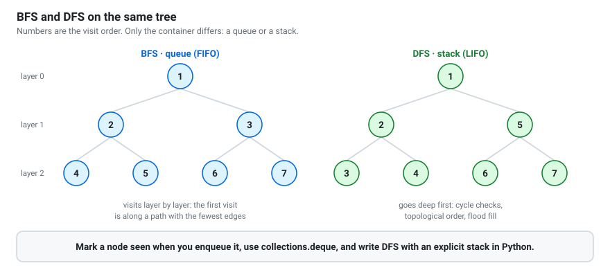
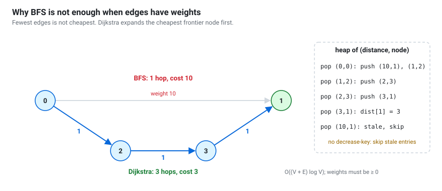
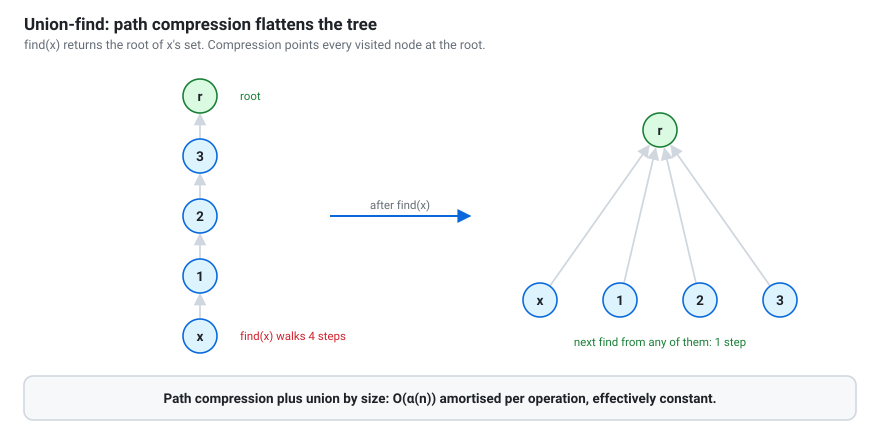

# Chapter 34 · Coding patterns II

*Part II · Prerequisites: Chapter 33 · Estimated time: reading ~70 min, lab ~90 min · Compute: CPU*

[](https://colab.research.google.com/github/berdakh/MLBOOTCAMP/blob/main/part2-ml-at-scale/ch34-coding-patterns-2/notebook.ipynb) · [Lab: notebook.ipynb](notebook.ipynb) · [Solutions](solutions.md)

## Learning objectives

After this chapter you should be able to:

1. Represent graphs as adjacency lists, edge lists or implicit grids, and write iterative BFS and DFS that do not depend on Python's recursion limit.
2. Compute a topological order, detect cycles, and argue the correctness of Kahn's algorithm.
3. Implement Dijkstra's algorithm with a binary heap and lazy deletion, explain why it requires non-negative weights, and name the alternatives.
4. Write binary search with an explicit invariant, and recognise and solve "binary search on the answer" problems.
5. Set up a dynamic programme by stating its state, transition, base cases and evaluation order, and improve the longest increasing subsequence from $O(n^2)$ to $O(n \log n)$.
6. Implement a trie and a union-find structure with path compression and union by size, and state their costs.
7. Plan four weeks of spaced practice after the course.

## 34.1 Introduction

Chapter 33 covered the patterns that operate on sequences: hash maps, windows, heaps, intervals, stacks and prefix sums. This chapter covers the second half of the standard set: graph traversal and shortest paths, binary search, dynamic programming, tries and union-find. These structures also occur in ML systems work: a training pipeline is a dependency graph that must be executed in topological order; query autocomplete is a prefix search; deduplicating near-identical items is a connectivity problem; and fuzzy matching of product titles uses edit distance.

As in Chapter 33, each pattern is presented with its signal, the idea, a worked example, the correctness argument and the complexity. The chapter ends with a four-week practice plan, because these patterns become usable under time pressure only through repeated, spaced practice.

## 34.2 Graphs and breadth-first search

### 34.2.1 Representations

A graph with $V$ nodes and $E$ edges arrives in an interview in one of three forms: an **adjacency list** (`graph[u] = [v, ...]`), which supports iterating over a node's neighbours in time proportional to their number; an **edge list**, which is converted to an adjacency list in $O(V + E)$; or an **implicit** graph such as a grid, in which the neighbours of a cell are the four adjacent cells. An adjacency matrix ($V \times V$) is appropriate only for dense graphs, since it costs $O(V^2)$ memory.

### 34.2.2 Breadth-first search

BFS explores the graph in layers using a first-in, first-out queue: first the source, then all nodes one edge away, then all nodes two edges away, and so on.

**Correctness (sketch).** By induction on the distance $k$: all nodes at distance $k$ are dequeued before any node at distance $k + 1$, because nodes at distance $k+1$ are enqueued only while processing nodes at distance $k$, which happens after every node at distance $k$ has been enqueued. Hence the first time BFS reaches a node is along a path with the fewest edges, and in an unweighted graph BFS computes shortest paths.

**Implementation.** Use `collections.deque` (Chapter 33 showed that `list.pop(0)` makes BFS quadratic), and mark a node as seen **when it is enqueued**, not when it is dequeued; otherwise a node can be enqueued once per incoming edge. Each node is enqueued once and each edge examined once (twice for undirected graphs), so

```math
T_{\text{BFS}} = T_{\text{DFS}} = O(V + E). \qquad (34.1)
```

A grid of $R \times C$ cells has $V = RC$ and $E \le 4RC$; a $500 \times 500$ grid has 250,000 cells and about a million edge checks, which takes a fraction of a second in Python.



*Figure 34.1 — The same tree traversed by BFS and by DFS. BFS visits layer by layer, so its first visit to a node is along a fewest-edges path; DFS completes a whole branch before starting the next.*

### 34.2.3 Depth-first search and the recursion limit

DFS follows one path as deep as possible before backtracking, using a last-in, first-out stack. It visits every reachable node, like BFS, but the first path it finds is not necessarily the shortest. DFS is the natural tool for flood fill, cycle detection and topological ordering.

CPython's default recursion limit is 1,000 frames. A recursive flood fill over a $120 \times 120$ grid of land can require 14,400 nested calls and fails; raising the limit with `sys.setrecursionlimit` defers the problem and can crash the interpreter. In Python, DFS should be written with an explicit stack. To reproduce the visit order of a recursive DFS exactly, keep on the stack one iterator over the neighbours per frame.

*Number of islands (Exercise 1).* Scan every cell; on unvisited land, increment the count and flood-fill the island with BFS or iterative DFS, marking cells in a separate `seen` structure (modifying the input grid destroys the caller's data). Time and space $O(RC)$.

> **Intuition.** BFS is a ripple in a pond: everything one step away is reached before anything two steps away. DFS is a maze walker with one hand on the wall, going deep first and backing up only at dead ends. *Where the analogy breaks down:* ripples measure *steps*, not distance; with unequal edge lengths the first ripple to arrive may have taken the long way (Section 34.4).

## 34.3 Topological order and cycle detection

A **topological order** of a directed graph lists every node after all its predecessors, so that for every edge $u \to v$, $u$ comes before $v$. A topological order exists if and only if the graph is a **directed acyclic graph** (DAG): a cycle has no first node, and conversely every DAG has a node with no incoming edges, which can be placed first and removed, leaving a smaller DAG.

**Kahn's algorithm** turns that argument into code. Compute every node's **in-degree** (number of incoming edges); put all nodes with in-degree 0 into a queue; repeatedly remove a node, append it to the output, and decrement the in-degree of each of its successors, enqueuing any that reach 0. If the output contains fewer than $V$ nodes, the remaining nodes all have positive in-degree among themselves, so they contain a cycle. Time and space $O(V + E)$.

**DFS alternative.** Colour nodes white (unvisited), grey (on the current DFS path) and black (finished). An edge to a grey node is a **back edge** and closes a cycle. If there is no back edge, the reverse of the order in which nodes finish is a topological order.

*Course schedule (Exercise 2).* Given pairs `[course, prereq]`, build edges `prereq → course` and run Kahn's algorithm. The edge direction must be stated aloud; reversing it yields a reversed order. Self-loops and duplicate edges must be handled (a duplicate edge must be counted consistently in both the in-degree and the adjacency list). A pipeline orchestrator executes tasks in exactly this order, and nodes that are in the queue at the same time can run in parallel.

## 34.4 Weighted shortest paths

BFS minimises the number of edges; with weights, a path with fewer edges can cost more. **Dijkstra's algorithm** generalises BFS by replacing the queue with a priority queue keyed by tentative distance $d$, and always expanding the unfinished node with the smallest $d$. Expanding $u$ **relaxes** each edge $u \to v$:

```math
d(v) \leftarrow \min\big(d(v),\ d(u) + w(u, v)\big). \qquad (34.2)
```

**Correctness (sketch).** Suppose node $u$ is popped with distance $d(u)$ but a shorter path $P$ to $u$ exists. $P$ leaves the set of finished nodes at some edge $x \to y$ with $y$ unfinished. Because $x$ was finished, $d(y) \le d(x) + w(x, y)$, which is at most the length of $P$ up to $y$. Because all weights are non-negative, the rest of $P$ cannot decrease its length, so $d(y) \le \text{len}(P) < d(u)$, and $y$ would have been popped before $u$. This contradiction shows that every node is final when popped. The argument fails if any weight is negative; then the Bellman–Ford algorithm, $O(VE)$, is required (and it also detects negative cycles).

**Implementation.** Python's `heapq` has no decrease-key operation. Instead, when a shorter distance to $v$ is found, push a new entry `(d, v)` and leave the old one in the heap; when an entry is popped whose distance exceeds the recorded $d(v)$, skip it. This is **lazy deletion**. The heap holds at most $O(E)$ entries, so the running time is

```math
T = O\big((V + E) \log V\big) \qquad (34.3)
```

with a binary heap ($\log E \le 2 \log V$). An array scan for the minimum gives $O(V^2)$, which is preferable only for dense graphs with $E \approx V^2$. Parallel edges must be kept as separate entries in adjacency *lists*; a dictionary `{v: w}` silently overwrites them.

*Worked example:* in the lab's four-node graph, BFS reaches node 1 by one edge of weight 10, while a three-edge path costs 3. Dijkstra pops node 3 at distance 2 and relaxes $d(1) = \min(10, 2 + 1) = 3$; the stale entry $(10, 1)$ is popped last and skipped.



*Figure 34.2 — BFS and Dijkstra on a weighted graph, with the heap trace. The entry (10, 1) is pushed first and popped last as a stale entry; correctness depends on popping in order of distance, which requires non-negative weights.*

Follow-up questions often concern the path itself (store `parent[v]` during relaxation), a single target (stop when it is popped), A* search (add an admissible heuristic to the priority), or many queries on a road-network-sized graph (precomputation methods such as contraction hierarchies).

## 34.5 Binary search

### 34.5.1 The invariant form

Binary search does not require a sorted array; it requires a **monotone predicate** $p$ on an integer range: $p$ is False up to some point and True from then on. The task is to find the first value for which $p$ is True. Written with an explicit invariant, it has no off-by-one ambiguity:

- *Invariant:* the answer lies in $[\text{lo}, \text{hi}]$.
- *Step:* with `mid = (lo + hi) // 2`, if $p(\text{mid})$ is True, the answer is at most mid, so set `hi = mid`; otherwise set `lo = mid + 1`.
- *Termination:* the loop runs while `lo < hi`; the interval shrinks strictly at every step because `mid < hi`, and at the end `lo == hi` is the answer.

The number of iterations is

```math
\lceil \log_2(\text{hi} - \text{lo} + 1) \rceil. \qquad (34.4)
```

Mixing conventions, such as `hi = mid - 1` with a `lo < hi` loop or `lo = mid`, causes skipped answers or infinite loops.

### 34.5.2 Binary search on the answer

When the answer is a number in a known range and *checking* a candidate is easier than *finding* the answer, binary search over candidate answers applies. Typical signals are "the minimum capacity, speed or time such that…" and "the maximum distance such that…".

*Ship within $D$ days (Exercise 4).* Packages must be shipped in order, and each day the ship takes consecutive packages up to its capacity. Three observations make this a binary search: a capacity below $\max(w)$ can never work; $\sum w$ always works (one day); and if capacity $c$ works, so does $c + 1$ (monotonicity). For a fixed capacity, a greedy scan that fills each day as much as possible gives the minimum number of days, because loading a package today never makes a later day worse off. Binary search over $[\max w, \sum w]$ then costs $O(n \log \sum w)$. For the lab's first example the range 10–55 contains 46 candidates, so six feasibility checks suffice.

> **Intuition.** Binary search on the answer is the "guess my number" game in which the only reply is "enough" or "not enough": each guess halves the range, so a range of a billion needs 30 guesses. *Where the analogy breaks down:* the reply must be monotone; if capacity 15 works but 16 does not, halving can skip the answer.

An ML-systems example is choosing the smallest number of serving replicas, or the largest batch size, that keeps p99 latency under a budget, when latency is monotone in the parameter.

## 34.6 Dynamic programming

### 34.6.1 When it applies, and the four steps

Dynamic programming (DP) applies when a problem has **optimal substructure** — an optimal answer is composed of optimal answers to subproblems — and **overlapping subproblems** — the same subproblem recurs many times, so storing its answer pays. Before writing code, state four things:

1. **State:** what `dp[i]` (or `dp[i][j]`) means, in one sentence;
2. **Transition:** how a state is computed from smaller states;
3. **Base cases;**
4. **Order:** an evaluation order in which every state's dependencies are already computed (or memoised recursion, which computes them on demand).

The cost is (number of states) × (cost per transition). Without overlapping subproblems, as in merge sort, storing answers wastes memory.

*Worked example (fewest coins).* With unlimited coins of denominations $C$, let $\text{coins}(a)$ be the fewest coins summing to $a$:

```math
\text{coins}(0) = 0, \qquad \text{coins}(a) = 1 + \min_{c \in C,\ c \le a} \text{coins}(a - c), \qquad (34.5)
```

evaluated for $a = 1, 2, \dots$; unreachable amounts have value $\infty$. For coins $`\{1, 3, 4\}`$ and amount 6, $\text{coins}(6) = 1 + \min(\text{coins}(5), \text{coins}(3), \text{coins}(2)) = 1 + \min(2, 1, 2) = 2$ (3 + 3), whereas the greedy choice of the largest coin gives 3 (4 + 1 + 1). Time $O(A \lvert C \rvert)$ for amount $A$.

> **Intuition.** DP is solving a problem with sticky notes: each time a subproblem is solved its answer is written down, and no subproblem is solved twice. The state definition is what is written on the note. *Where the analogy breaks down:* the notes help only if subproblems repeat.

### 34.6.2 Longest increasing subsequence

The longest strictly increasing subsequence (not necessarily contiguous) has a direct $O(n^2)$ DP: let $\text{dp}[i]$ be the length of the longest increasing subsequence *ending at* $i$; then $`\text{dp}[i] = 1 + \max\{\text{dp}[j] : j < i,\ x_j < x_i\}`$ (or 1 if no such $j$), and the answer is $\max_i \text{dp}[i]$.

The $O(n \log n)$ algorithm (Exercise 5) maintains an array `tails`, where `tails[L]` is the **smallest possible last element** of an increasing subsequence of length $L + 1$ among the elements processed so far.

- *`tails` is strictly increasing.* If an increasing subsequence of length $L + 2$ ends in $t$, its first $L + 1$ elements form a subsequence of length $L + 1$ ending in something smaller than $t$, so `tails[L] < tails[L+1]`.
- *Update.* For a new element $x$, find the first position $i$ with `tails[i] >= x` (`bisect_left`). If there is none, $x$ extends the longest subsequence, and is appended. Otherwise $x$ can end a subsequence of length $i + 1$ with a smaller (or equal) last element than `tails[i]`, so `tails[i] = x`. Sortedness is preserved.
- *Answer.* The length of `tails`.

Each update is a binary search, so the total time is $O(n \log n)$ and space $O(n)$. `tails` is **not** itself a longest subsequence; it records only the best possible endings, and reconstructing an actual subsequence requires parent pointers. For non-decreasing subsequences, `bisect_right` replaces `bisect_left`.

*Example:* for $(10, 9, 2, 5, 3, 7, 101, 18)$, `tails` evolves as $[10] \to [9] \to [2] \to [2, 5] \to [2, 3] \to [2, 3, 7] \to [2, 3, 7, 101] \to [2, 3, 7, 18]$, giving length 4.

### 34.6.3 Edit distance

The Levenshtein distance between strings $a$ and $b$ is the minimum number of single-character insertions, deletions and substitutions turning $a$ into $b$ (Exercise 6). With $D(i, j)$ the distance between the prefixes $a_{1..i}$ and $b_{1..j}$:

```math
D(i, j) = \min\big(D(i-1, j) + 1,\ D(i, j-1) + 1,\ D(i-1, j-1) + \mathbb{1}[a_i \ne b_j]\big), \qquad D(i, 0) = i,\ D(0, j) = j. \qquad (34.6)
```

The three terms correspond to deleting $a_i$, inserting $b_j$, and substituting (or matching) the last characters. The table is filled row by row in $O(mn)$ time; since each row depends only on the previous one, keeping two rows reduces memory to $O(\min(m, n))$. Plain recursion without memoisation recomputes subproblems and takes exponential time. *Example:* "kitten" → "sitting" has distance 3. The same recurrence over words instead of characters gives the word error rate used in speech recognition, and weighted variants underlie sequence alignment.

## 34.7 Tries and union-find

### 34.7.1 Tries

A **trie** (prefix tree) stores a set of strings so that strings with a common prefix share nodes. Each node maps characters to children and records whether a word ends there. Inserting, searching for a word and testing a prefix each cost $O(L)$ for a query of length $L$, independent of the number of stored words; memory is $O(\text{total characters})$ in the worst case. For a small fixed alphabet, children can be an array of 26 entries; for Unicode, a dictionary. Query autocomplete stores, at each node, a small cached list of the most frequent completions, so that a prefix query returns suggestions without traversing the subtree.

The alternatives are a hash set, which answers exact lookups in $O(L)$ on average but cannot answer prefix queries without scanning, and a sorted array with binary search, which finds the range of words with a given prefix in $O(L \log n)$ with compact memory but costs $O(n)$ per insertion. Compressed tries (radix trees) merge chains of single-child nodes to save memory.

### 34.7.2 Union-find

A **union-find** (disjoint-set) structure maintains a partition of $`\{0, \dots, n-1\}`$ under two operations: `union(a, b)` merges the sets containing $a$ and $b$, and `find(x)` returns a representative (root) of the set containing $x$. Each set is a tree of parent pointers whose root is the representative. Two optimisations make it fast:

- **Union by size (or rank):** attach the root of the smaller tree under the root of the larger. A node's depth increases only when its tree at least doubles in size, so depths are at most $\log_2 n$.
- **Path compression:** during `find`, point every node on the path directly at the root, flattening the tree for future queries.

With both, a sequence of $m$ operations on $n$ elements costs

```math
O\big(m\, \alpha(n)\big), \qquad (34.7)
```

where $\alpha$ is the inverse Ackermann function, which is at most 4 for any practical $n$ (Tarjan, 1975). With either optimisation alone the bound is $O(\log n)$ per operation. Without both, a chain of $n$ nodes makes each `find` $O(n)$: in the lab, 4,000 nodes took about 410 ms without compression (fitted exponent about 2), while 100,000 nodes took about 34 ms with it (exponent about 1). Path compression should be written iteratively, since a recursive `find` on a long chain exceeds the recursion limit.



*Figure 34.3 — Path compression flattens a chain of parent pointers. The extra pass during one `find` shortens every later `find` from any node on that path.*

Union-find is preferable to BFS when edges arrive over time and connectivity must be answered between insertions: Kruskal's minimum spanning tree, merging user identities across devices, or clustering near-duplicate items from a stream of candidate pairs. In the last case, merging is **transitive**: if A resembles B and B resembles C, A and C end up in one cluster even if they are dissimilar, so a few false-positive pairs can chain unrelated items into very large clusters. Thresholds on pair confidence and limits on cluster size or diameter are the usual safeguards.

## 34.8 A four-week practice plan

Two days introduce the patterns; fluency comes from short, daily, spaced practice. The lab's plan assumes 45–60 minutes a day, five or six days a week, and reuses the exercises of Chapters 31–34 by solving them again from a **blank cell** (the solution deleted, the grader kept), together with new problems of the same pattern from any practice platform. Week 1 covers the sequence patterns of Chapter 33; week 2 graphs, binary search and ML coding; week 3 dynamic programming, tries, union-find and the remaining ML coding; week 4 mixed problems and mock interviews in the format of Chapter 38.

**Spaced repetition.** Re-attempt every solved problem 1, 3, 7 and 21 days after first solving it, against the target time. A problem leaves the rotation after two consecutive scores of 12 or more on the Chapter 33 self-scoring sheet; a score below 8 resets its schedule. A spreadsheet with columns *problem, pattern, date, score, next review* suffices.

**Practice platforms.** Platforms with automatic judges are useful for volume. Select problems by pattern rather than by lists that claim to reproduce a particular company's questions (question banks change, and memorised answers are exposed by a single follow-up question). Work 20–25 minutes before consulting hints; after reading a solution, re-implement it from memory the next day. State complexity and edge cases aloud even when practising alone, because the judge checks only the output while an interviewer assesses the process. Runtime percentiles are noisy and reward micro-optimisations that interviews do not value. Most interview problems are of medium difficulty. The [study plan](../../appendices/study-plan.md) gives a longer schedule for the whole course.

## Key terms

| Term | Definition |
|---|---|
| Adjacency list | For each node, the list of its neighbours. |
| BFS | Breadth-first search: visiting nodes in layers of increasing edge distance with a FIFO queue. |
| DFS | Depth-first search: following one path as deep as possible before backtracking, with a LIFO stack. |
| Back edge | In DFS, an edge to a node still on the current path; it closes a cycle. |
| Topological order | A node order in which every edge goes from an earlier to a later node; it exists exactly for DAGs. |
| In-degree | The number of edges entering a node. |
| Relaxation | Updating a tentative distance with $d(v) \leftarrow \min(d(v), d(u) + w(u,v))$. |
| Lazy deletion | Leaving outdated heap entries in place and skipping them when popped. |
| Monotone predicate | A yes/no test that changes from False to True exactly once as its argument grows. |
| Optimal substructure | The property that an optimal solution is composed of optimal solutions to subproblems. |
| Overlapping subproblems | The property that the same subproblem recurs, so storing its solution saves work. |
| Memoisation | Caching the results of a recursive function by its arguments. |
| Trie | A tree of characters in which strings with a common prefix share nodes. |
| Union-find | A structure maintaining disjoint sets under union and find. |
| Path compression | Pointing every node visited by `find` directly at the root. |
| Inverse Ackermann function $\alpha(n)$ | An extremely slowly growing function, at most 4 for practical $n$, that bounds union-find's amortised cost. |
| Spaced repetition | Reviewing material at increasing intervals to consolidate it in memory. |

## Summary

1. BFS and DFS cost $O(V + E)$ (Equation 34.1); BFS gives fewest-edge paths. In Python, both are written iteratively with a `deque` or an explicit stack, and nodes are marked when enqueued.
2. A topological order exists exactly when the graph is acyclic; Kahn's algorithm produces one and detects cycles when fewer than $V$ nodes are output.
3. Dijkstra's algorithm relaxes edges from the closest unfinished node (Equation 34.2), runs in $O((V + E)\log V)$ with a heap and lazy deletion, and is correct only for non-negative weights; Bellman–Ford handles negative weights.
4. Binary search needs a monotone predicate, not a sorted array; with the invariant "the answer lies in $[\text{lo}, \text{hi}]$" it is free of off-by-one errors. Binary search on the answer combines it with a cheap feasibility check.
5. A dynamic programme is specified by state, transition, base cases and order; coin change and edit distance (Equations 34.5–34.6) follow this template.
6. The $O(n \log n)$ LIS algorithm maintains the smallest tail for each length; `tails` stays sorted but is not itself a subsequence.
7. Tries answer prefix queries in time proportional to the query length; union-find with union by size and path compression costs $O(\alpha(n))$ amortised per operation (Equation 34.7).
8. Fluency comes from spaced re-solving from a blank cell, scored with a fixed rubric.

## Exercises

The exercises are in the lab, [notebook.ipynb](notebook.ipynb); worked answers are in [solutions.md](solutions.md). Each grader includes hidden edge cases, randomised checks against a reference and a timing check.

1. **Exercise 1 · `num_islands`** (12 min). Count 4-connected islands without modifying the grid or recursing deeply.
2. **Exercise 2 · `course_order`** (15 min). A topological order of courses, or `[]` if there is a cycle.
3. **Exercise 3 · `dijkstra`** (15 min). Single-source shortest distances with non-negative weights, parallel edges and self-loops.
4. **Exercise 4 · `min_capacity`** (15 min). Binary search on the answer with a greedy feasibility check.
5. **Exercise 5 · `lis_length`** (15 min). The longest strictly increasing subsequence in $O(n \log n)$.
6. **Exercise 6 · `edit_distance`** (18 min). Levenshtein distance by bottom-up DP.
7. **Exercise 7 · `Trie`** (12 min). Insert, search and prefix test, including the empty word.
8. **Exercise 8 · `UnionFind`** (12 min). Find with iterative path compression, union by size and a component count.

The lab also builds a personal review schedule. Checkpoint questions ask when BFS, Dijkstra or another algorithm is required; how to order, check and parallelise pipeline tasks; what makes a problem suitable for binary search on the answer; why `tails` stays sorted; how a trie, a hash set and a sorted array compare for autocomplete; and how to cluster near-duplicate listings from a stream of candidate pairs.

## Further reading

- Cormen, T. H., Leiserson, C. E., Rivest, R. L. and Stein, C. (2022). *Introduction to Algorithms*, 4th ed. MIT Press. Chapters on elementary graph algorithms, single-source shortest paths, dynamic programming and disjoint sets.
- Kleinberg, J. and Tardos, É. (2005). *Algorithm Design*. Addison-Wesley. Chapter 6 (dynamic programming).
- Dijkstra, E. W. (1959). A note on two problems in connexion with graphs. *Numerische Mathematik*, 1, 269–271.
- Kahn, A. B. (1962). Topological sorting of large networks. *Communications of the ACM*, 5(11), 558–562.
- Tarjan, R. E. (1975). Efficiency of a good but not linear set union algorithm. *Journal of the ACM*, 22(2), 215–225.
- Wagner, R. A. and Fischer, M. J. (1974). The string-to-string correction problem. *Journal of the ACM*, 21(1), 168–173.
- Python documentation: [`bisect`](https://docs.python.org/3/library/bisect.html) and [`functools.lru_cache`](https://docs.python.org/3/library/functools.html#functools.lru_cache).

**Next:** [Chapter 35 · Serving a ranking cascade](../ch35-serving-a-ranking-cascade/README.md)
