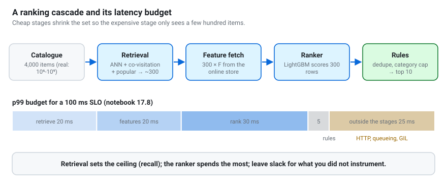
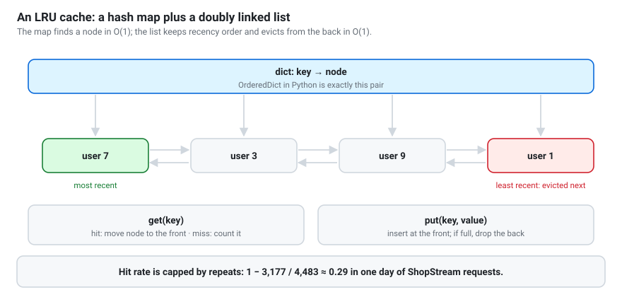
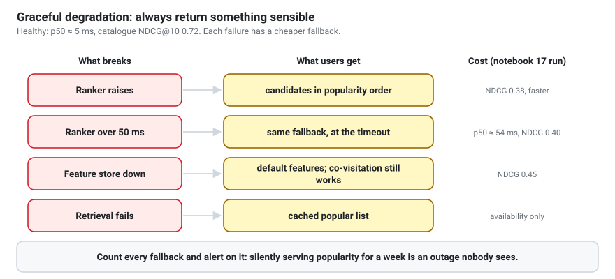

# Chapter 35 · Serving a ranking cascade

*Part II · Prerequisites: Chapters 10–14, 21, 24, 25 and 26 · Estimated time: reading ~55 min, lab ~90 min · Compute: CPU*

 · [Lab: notebook.ipynb](notebook.ipynb) · [Solutions](solutions.md)

## Learning objectives

After this chapter you should be able to:

1. Describe a retrieval → feature fetch → ranking → rules cascade, the size of the candidate set at each stage, and how the latency budget is typically divided.
2. Build the serving state point-in-time, so that the service uses only data from before the day it serves.
3. Decompose the quality of a cascade into retrieval loss and ranking loss using an oracle over the candidates.
4. Implement an $O(1)$ LRU cache, bound its hit rate from the request stream, and reason about staleness and time-to-live.
5. Order business rules correctly and measure their cost to a relevance metric.
6. Design graceful degradation with timeouts and fallbacks, and make every fallback observable.
7. Load-test a service, interpret the results with Little's law and a simple queueing model, and write a per-stage latency budget.

## 35.1 Introduction

Chapters 24–26 trained candidate generators and rankers offline. A user, however, never sees a model; they see the response of a service that must return a ranked list within a latency limit of tens of milliseconds, under load, while its dependencies occasionally fail. This chapter assembles the models of the previous chapters into such a service and measures it.

Large-scale recommenders and search engines are almost always built as a **cascade**: a cheap stage narrows a catalogue of millions of items to a few hundred candidates, a more expensive model orders the candidates, and business rules shape the final list. The cascade exists because the cost of scoring grows with the number of items scored, and the most accurate models are too expensive to apply to the whole catalogue within the budget.

The chapter follows the lab. Section 35.2 describes the stages and the point-in-time construction of the serving state. Section 35.3 measures quality and separates its sources. Sections 35.4–35.6 add caching, business rules and graceful degradation. Section 35.7 serves the cascade over HTTP and load-tests it, and Section 35.8 turns the measurements into a latency budget. The lab's code is in [`src/shoprank/serving.py`](../../src/shoprank/serving.py).

## 35.2 The cascade and its serving state

### 35.2.1 Stages

| Stage | Input → output | Typical method | Typical share of the latency budget |
|---|---|---|---|
| Retrieval | catalogue ($10^6$–$10^9$ items; 4,000 in ShopStream) → about 300 | approximate nearest neighbours over embeddings, co-visitation, popularity | 15–25% |
| Feature fetch | 300 ids → a $300 \times F$ feature matrix | online feature-store lookups over the network | 20–30% |
| Ranking | 300 rows → 300 scores | a GBDT or a neural network | 30–40% |
| Rules | 300 → 10 | eligibility filters, deduplication, diversity, boosts | under 5% |

Each stage is cheaper per item than the next and shrinks the set passed to it. Retrieval combines several **sources** because each has different strengths: embedding nearest neighbours capture long-term taste, co-visitation captures what is related to recent clicks, and popularity covers new users and fills gaps. In the lab, a request receives about 350 candidates (200 from the ANN index, up to 100 from co-visitation and 100 popular items, minus overlaps).

*Figure 35.1 — A ranking cascade and a p99 budget of 100 ms. A quarter of the budget is reserved for work outside the four stages; Section 35.7 shows why.*

> **Intuition.** A cascade is a hiring funnel: a seconds-long CV screen for everyone, phone interviews for a few hundred, full interviews for ten. *Where the analogy breaks down:* a funnel never recovers a candidate rejected at the first screen, and neither does a ranker: retrieval sets the ceiling for every later stage.

### 35.2.2 Point-in-time serving state

Everything the service uses must be computed from data available **before** the moment it serves; otherwise offline measurements of the service are optimistic, for the same reason as the leakage discussed in Chapters 5 and 21. The lab constructs state twice, as a production pipeline would:

- **Ranker training:** features from days 0–34 and click labels from days 35–41. Position is a training feature (it explains part of every click) and is set to a constant 0 at serving time, a standard correction for position bias (Chapter 23).
- **Serving state:** features, embeddings and co-visitation recomputed from all training days 0–41, used to serve the validation week, days 42–48.

A subtle requirement is that features have the same scale in both constructions. A count accumulated over 42 days is not comparable to one accumulated over 35 days, so the lab normalises counts per day. Failing to do so is a form of **training–serving skew**: the ranker receives inputs from a different distribution from the one it learned.

The online feature store in the lab simulates a 1 ms round trip per call, a realistic cost for an in-memory key–value store in the same data centre. Without that delay every lookup would appear free and the measured budget would be misleading. The ANN index is exact inner-product search (`faiss.IndexFlatIP`), which is well under a millisecond for 4,000 items; at millions of items one would use an IVF or HNSW index (Chapter 26), trading a little recall for a large reduction in latency.

## 35.3 Measuring the quality of a cascade

### 35.3.1 Catalogue NDCG

Because ShopStream is a simulator, the true click probability of every (user, item) pair is known. For each request the lab computes **catalogue NDCG@10**: the shown top 10 is scored against the user's true best 10 launched items in the whole catalogue. Unlike NDCG on logged clicks, this metric is free of position bias, and it penalises the cascade for relevant items that retrieval never found.

### 35.3.2 Decomposing the loss

The lab scores several orderings on the same 1,000 validation requests. The key comparison is with an **oracle over the candidates**: the candidates sorted by true click probability. No ranker can do better with those candidates, so

$$
\underbrace{1 - \text{NDCG}_{\text{cascade}}}_{\text{total loss}}
= \underbrace{\big(1 - \text{NDCG}_{\text{oracle}}\big)}_{\text{retrieval loss}}
+ \underbrace{\big(\text{NDCG}_{\text{oracle}} - \text{NDCG}_{\text{cascade}}\big)}_{\text{ranking loss}}. \tag{35.1}
$$

The retrieval stage is also measured directly by **recall@K**, the share of the user's truly best items that appear among the candidates:

$$
\text{recall@}K = \frac{\lvert \text{relevant} \cap \text{top-}K \text{ candidates} \rvert}{\lvert \text{relevant} \rvert}. \tag{35.2}
$$

In the lab (course synthetic data, CPU run) recall of the true top 10 is about 0.85 with about 320 candidates. Without a category cap, the catalogue NDCG@10 values are: popularity 0.39, the logged policy 0.41, ANN only 0.79, the LightGBM cascade 0.875, and the oracle over candidates 0.99. Three conclusions follow:

1. **Retrieval sets the ceiling.** Here the retrieval loss is about 0.01 and the ranking loss about 0.11, so improvements should go to the ranker. In another system the decomposition may point the other way; without the oracle row, effort may be spent on the wrong stage.
2. **The ranker justifies its latency** only if it clearly beats the cheaper alternatives (ANN order, popularity order). Here it does.
3. **Business rules have a cost** (Section 35.5), which the decomposition should report separately.

When the true relevance is unknown, as in production, the same decomposition can be approximated with human relevance judgements on a sample of requests, or with an expensive offline model as a proxy oracle.

## 35.4 Caching

### 35.4.1 The LRU cache

User features change slowly and cost a network round trip to fetch. A **least-recently-used (LRU) cache** in the service process keeps the most recently used entries up to a fixed capacity and evicts the least recently used entry when full. Both `get` and `put` must be $O(1)$. The standard construction combines a hash map from key to node with a **doubly linked list** ordered by recency: a lookup finds the node through the hash map, moves it to the most-recent end by relinking two neighbours, and eviction removes the node at the least-recent end. Python's `collections.OrderedDict` provides exactly this structure (`move_to_end`, `popitem(last=False)`). A list used for the recency order makes every access $O(n)$ because of `list.remove`. In a multi-threaded server the cache needs a lock, since interleaved updates can corrupt the order.

*Figure 35.2 — An LRU cache as a hash map into a doubly linked list. Each operation touches one dictionary entry and the two ends of the list, so each is $O(1)$.*

### 35.4.2 Hit rate

The value of a cache depends on its **hit rate** $h$, the share of lookups answered without a round trip. Even an unbounded cache misses the first request for every key, so for a stream of $R$ requests over $U$ distinct keys

$$
h \le 1 - \frac{U}{R}, \qquad \mathbb{E}[t] = h\, t_{\text{hit}} + (1 - h)\, t_{\text{miss}}. \tag{35.3}
$$

In the lab one validation day has 4,483 requests from 3,177 distinct users, so $h \le 1 - 3{,}177/4{,}483 = 0.29$. Replaying the day in time order, the measured hit rate rises from 0.015 with 100 entries to 0.29 once the cache can hold every user of the day. With $t_{\text{hit}} \approx 0$ and $t_{\text{miss}} = 1$ ms, the expected feature-fetch time falls only from 1 ms to 0.71 ms. A curve of hit rate against capacity is a capacity-planning tool: memory per entry times capacity, against round trips saved.

### 35.4.3 Staleness

A cached value is as old as the moment it was stored. Production caches therefore attach a **time to live** (TTL) matched to how quickly the feature changes: seconds for "items viewed in this session", hours or days for "favourite categories". Caching session-level features with a long TTL makes the recommendations ignore what the user has just done.

> **Intuition.** A cache is like keeping today's tools on the desk instead of in the shed: the desk is small, so the tool unused for longest goes back. *Where the analogy breaks down:* a hammer on the desk is still a hammer, but a cached feature can be stale; the TTL is how long it is trusted.

## 35.5 Business rules

Rules run last, on the ranked list. Their order matters:

1. **Correctness first:** remove duplicates (keeping the first occurrence) and ineligible items (unknown, not launched, unavailable, blocked). An ineligible item must never be shown, whatever its score.
2. **Product rules second:** diversity constraints such as "at most 3 items per category", boosts and quotas.
3. **Truncation last:** take the top $k$. If a constraint leaves fewer than $k$ items, **backfill** with the highest-ranked items that were skipped *only* because of that constraint, never with ineligible ones.

The lab measures the cost of a category cap. As the cap tightens from 10 (no cap) to 2, catalogue NDCG falls from 0.875 to 0.65, while the number of distinct categories in a top 10 rises from 1.3 to 5.6; with a cap of 3 the cascade's NDCG is 0.71. Without a cap most users see a single category, because ShopStream users concentrate on two or three favourite categories.

The cap is a product decision motivated by quantities that a short-term relevance metric does not measure: diversity, fairness to sellers and long-term engagement. The appropriate procedure is to report the cost in the offline metric and to decide with an online experiment that measures long-term outcomes (Chapters 29–30), rather than allowing the offline metric to veto the rule.

## 35.6 Graceful degradation

A ranking service should always return a sensible response, even when a dependency fails. The usual design is a ladder of fallbacks, each with a known quality cost:

| Failure | Fallback | Quality cost |
|---|---|---|
| Ranker raises or exceeds its timeout | candidates in popularity order | relevance |
| User features missing (new user, store down) | default features; popularity and co-visitation retrieval | personalisation |
| Retrieval fails | a cached popular list | everything except availability |

The mechanism is a call with a **timeout** and a **fallback**: run the primary function; if it raises, return the fallback's result; if it has not finished within the timeout, return the fallback's result without waiting. In Python this is done with `concurrent.futures`, submitting the primary call to a thread pool and waiting on the future with a timeout.

The lab breaks each dependency deliberately (150 requests, category cap 3):

| Condition | Ranker status | p50 | Catalogue NDCG@10 |
|---|---|---|---|
| healthy | ok | about 5 ms | 0.72 |
| ranker raises | error | faster (no model) | 0.38 |
| ranker takes 200 ms | timeout | about 54 ms (the 50 ms timeout) | 0.40 |
| feature store down | ok, default features | — | 0.45 |

With the store down, quality is lower than healthy but higher than popularity, because co-visitation from recent clicks still works.

*Figure 35.3 — Fallbacks for four failures. Each keeps the service available at a measured quality cost, and each must be counted.*

Two limitations deserve attention. First, a timed-out call **keeps running** in its thread: the request is protected, but the CPU is not. Under real overload, timeouts and retries can increase the load, which is why services also **shed load** (reject requests early) and reduce candidate-set sizes. Second, every fallback must be **counted and alerted on**. A service that silently serves popularity for a week has an outage that no availability metric shows; the lab exposes counters on a `/metrics` endpoint and a response header with the ranker status.

## 35.7 The service under load

### 35.7.1 Serving and instrumentation

The lab serves the cascade with FastAPI in the style of Part I's [`src/churnlab/api.py`](../../src/churnlab/api.py): `POST /recommend` returns the items with per-stage timings, also sent in a W3C `Server-Timing` header; invalid input is rejected with status 422 by Pydantic validation; and `GET /metrics` reports per-stage percentiles, fallback counters and cache hit rates.

### 35.7.2 Load testing

A load test replays validation requests from several concurrent client threads and records client-side latency. Results from the lab (4 shared CPU cores, client and server in one process):

| Concurrency | Throughput | Client p50 | Client p99 |
|---|---|---|---|
| 1 | about 140 requests/s | about 6.5 ms | about 13 ms |
| 4 | about 235 requests/s | — | 26–31 ms |
| 16 | about 210–215 requests/s | 60–66 ms | 100–125 ms |

From concurrency 1 to 4 throughput rises, because the simulated 1 ms store waits of different requests overlap. At 16 the service is **saturated**: throughput falls and latency rises sharply; even the server-side stage percentiles inflate three- to fourfold because the stages compete for the CPU.

These numbers are relative, not capacities. Client and server share one Python process and one global interpreter lock, so the clients take CPU from the server; a real load test runs the load generator on other machines (tools such as `locust`, `k6` or `wrk`).

### 35.7.3 Two results from queueing theory

**Little's law.** In any stable system, the average number of requests in the system $L$, the throughput $\lambda$ and the mean time in the system $W$ satisfy

$$
L = \lambda\, W, \tag{35.4}
$$

without any assumption about distributions. With 16 clients each waiting for its response, $L = 16$; at about 210 requests/s, $W = 16/210 \approx 76$ ms, between the measured p50 and p99. At concurrency 1 and 140 requests/s, $W \approx 7$ ms against a p50 of 6.5 ms. Little's law is a consistency check on any load-test result.

**Latency near saturation.** For a single server with random (Poisson) arrivals and exponential service times (the M/M/1 queue), with service time $S$ and utilisation $\rho = \lambda S < 1$, the mean time in the system is

$$
W = \frac{S}{1 - \rho}. \tag{35.5}
$$

With $S = 5$ ms, $W$ is 10 ms at $\rho = 0.5$, 50 ms at $\rho = 0.9$ and 500 ms at $\rho = 0.99$. Real services are not M/M/1 queues, but the qualitative conclusion holds generally: waiting time grows without bound as utilisation approaches 1. This is why capacity plans target utilisations of about 50–70%, and why the remedy for the saturated row above is more replicas or processes and load shedding, not a faster model.

### 35.7.4 Time outside the stages

The gap between client p99 and the server's own `total` p99 is time spent outside the instrumented stages: queueing in the server's thread pool, HTTP parsing, JSON encoding and contention for the interpreter lock. In the saturated lab run this was 45–65 ms, the largest single item. A budget that accounts only for the model stages will be exceeded.

## 35.8 The latency budget

A **service-level objective** (SLO) such as "p99 ≤ 100 ms measured at the client" is divided among the stages *before* the service is built, with explicit slack for work that is not instrumented. For the lab's service: retrieval 20 ms, features 20 ms, ranking 30 ms, rules 5 ms and 25 ms outside the stages, totalling 100 ms. The lab fills in measured values next to the budget; the service is within budget at concurrency 1 and 4 and exceeds it at 16.

Three rules apply when budgeting:

1. **Percentiles do not add.** Because the slowest requests of different stages rarely coincide,

$$
p_{99}\Big(\sum_s t_s\Big) \le \sum_s p_{99}(t_s) \tag{35.6}
$$

   in typical systems (it is not a theorem for arbitrary dependent latencies, but holds when stage delays are not strongly positively correlated). Per-stage p99 budgets that sum to the SLO are therefore conservative.

2. **Fan-out amplifies tails.** A request that waits for $N$ parallel calls is as slow as the slowest. If each call is slow with probability $q$, independently,

$$
P(\text{the request waits for a slow call}) = 1 - (1 - q)^N. \tag{35.7}
$$

   With 10 shards and $q = 0.01$ (each shard's p99), about 10% of requests experience some shard's p99. Per-shard timeouts and **hedged requests** (sending a duplicate request to another replica when the first is slow) are the standard remedies (Dean and Barroso, 2013). Shard delays are often correlated through shared networks or load, which can make the tail better or much worse than Equation (35.7) suggests.

3. **Spend the budget where it improves quality**, usually on the ranker. Retrieval and feature fetch should be predictable and fast.

> **Intuition.** Fan-out is like waiting for ten friends before dinner starts: dinner is as late as the latest friend, and with ten friends someone is usually late. *Where the analogy breaks down:* the friends' delays are independent; shard delays often are not.

## Key terms

| Term | Definition |
|---|---|
| Cascade | A sequence of stages, each more expensive per item than the last, that narrows the candidate set. |
| Retrieval (candidate generation) | Selecting a few hundred plausible items from the whole catalogue cheaply. |
| Point-in-time state | Serving state computed only from data before the moment being served. |
| Training–serving skew | A difference between the inputs a model was trained on and those it receives in serving. |
| Online feature store | A low-latency key–value service that returns features at request time. |
| Catalogue NDCG@10 | NDCG of the shown top 10 against the user's true best 10 items in the whole catalogue. |
| Oracle over candidates | The candidates sorted by true relevance; the best any ranker could achieve with them. |
| Recall@K | The share of relevant items present among the top $K$ candidates. |
| LRU cache | A fixed-capacity cache that evicts the least recently used entry. |
| Hit rate | The share of lookups answered from the cache. |
| TTL | Time to live: how long a cached value may be served before it must be refreshed. |
| Graceful degradation | Returning a lower-quality but valid response when a dependency fails. |
| Load shedding | Rejecting some requests early to keep the rest within their latency objective. |
| p50 / p99 | The latency below which 50% / 99% of requests complete. |
| SLO | Service-level objective: the target a service commits to, such as p99 ≤ 100 ms. |
| Little's law | $L = \lambda W$: requests in the system equal throughput times mean time in the system. |
| Hedged request | A duplicate request sent to another replica when the first has not answered within a short delay. |

## Summary

1. Ranking services are cascades: retrieval (about 300 of millions), feature fetch, ranking and rules, each stage cheaper per item than the next.
2. Serving state is built point-in-time with consistent feature scales; otherwise offline measurements of the service are optimistic or the ranker sees skewed inputs.
3. An oracle over the candidates separates retrieval loss from ranking loss (Equation 35.1); in the lab, recall was about 0.85 and the oracle reached 0.99 against the cascade's 0.875.
4. An LRU cache is a hash map into a doubly linked list with $O(1)$ operations; its hit rate is bounded by $1 - U/R$ (0.29 in the lab), and TTLs limit staleness.
5. Rules run in the order correctness, product constraints, truncation; a category cap of 3 reduced catalogue NDCG from 0.875 to 0.71 and should be judged by an online experiment.
6. Every dependency has a fallback with a known quality cost, called through a timeout; every fallback is counted and alerted on.
7. Load tests are interpreted with Little's law (Equation 35.4) and the saturation behaviour of queues (Equation 35.5); near saturation, more capacity and load shedding help more than a faster model.
8. A latency budget divides the SLO among stages with explicit slack; percentiles do not add, and fan-out amplifies tails (Equation 35.7).

## Exercises

The exercises are in the lab, [notebook.ipynb](notebook.ipynb); worked answers are in [solutions.md](solutions.md).

1. **Exercise 1 · `LRUCache`.** An LRU cache with $O(1)$ `get` and `put`, hit and miss counters and a hit-rate property; the grader times it at two sizes.
2. **Exercise 2 · `apply_business_rules`.** Deduplication, eligibility, a per-category cap and backfill, preserving rank order.
3. **Exercise 3 · `with_fallback`.** A wrapper that returns the primary result, or the fallback on an exception or a timeout, without waiting for a slow primary call.
4. **Exercise 4 · Latency budget (written).** A per-stage p99 budget for a 200 ms home-feed SLO with a GPU ranker, a remote feature store and sharded retrieval, with justifications and fallbacks.

Checkpoint questions ask you to walk through a home-feed cascade at large scale, use the oracle row to find the bottleneck stage, design graceful degradation and its monitoring, decide where to cache and what can go wrong, diagnose a p99 regression with unchanged p50, and evaluate a per-category cap.

## Further reading

- Covington, P., Adams, J. and Sargin, E. (2016). Deep neural networks for YouTube recommendations. *Proceedings of RecSys 2016*.
- Dean, J. and Barroso, L. A. (2013). The tail at scale. *Communications of the ACM*, 56(2), 74–80.
- Huyen, C. (2022). *Designing Machine Learning Systems*. O'Reilly. Chapters on deployment and model serving.
- Kleppmann, M. (2017). *Designing Data-Intensive Applications*. O'Reilly. Chapter 1 (describing load and performance, percentiles).
- Beyer, B., Jones, C., Petoff, J. and Murphy, N. R. (eds.) (2016). *Site Reliability Engineering*. O'Reilly. Chapters on service-level objectives and handling overload.
- Little, J. D. C. (1961). A proof for the queuing formula $L = \lambda W$. *Operations Research*, 9(3), 383–387.
- FastAPI documentation: [https://fastapi.tiangolo.com](https://fastapi.tiangolo.com).

**Next:** [Chapter 36 · Model optimisation for inference](../ch36-model-optimization-for-inference/README.md)
