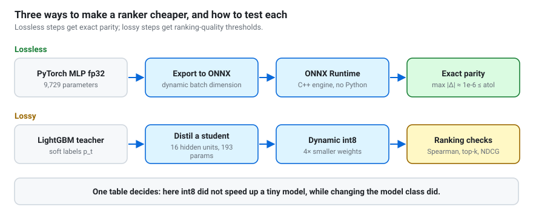
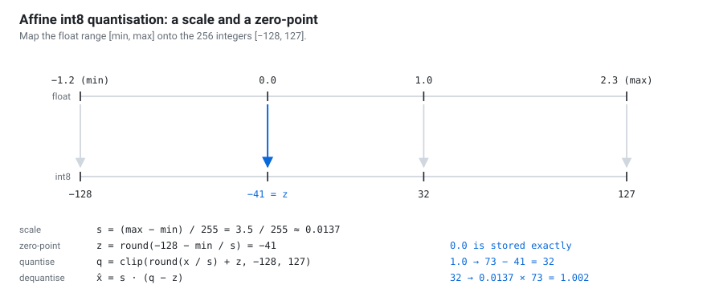

# Chapter 36 · Model optimisation for inference

*Part II · Prerequisites: Chapters 27, 31, 32 and 35 · Estimated time: reading ~50 min, lab ~90 min · Compute: CPU (an optional section notes GPU behaviour)*

 · [Lab: notebook.ipynb](notebook.ipynb) · [Solutions](solutions.md)

## Learning objectives

After this chapter you should be able to:

1. Explain where inference time goes for small and large models, and why per-call overhead dominates small batches.
2. Export a PyTorch model to ONNX with a dynamic batch dimension, run it with ONNX Runtime, and test numerical parity.
3. Distinguish lossless from lossy optimisations and choose the right acceptance test for each.
4. Derive the affine int8 quantisation scheme, explain dynamic versus static quantisation, and predict when quantisation reduces latency.
5. Derive and implement a temperature-scaled distillation loss, and explain the $T^2$ factor.
6. Build a size, latency and quality table, use Amdahl's law to judge whether an optimisation is worth it, and plan a safe rollout.

## 36.1 Introduction

A ranker scores hundreds of candidates per request, for millions of requests a day. Its cost per scored row is therefore multiplied by a very large number, and a model that is ten times cheaper per row is often more valuable than one that is one percent more accurate: the saved time can be spent scoring more candidates, or the saved machines can be removed. Chapter 35 measured the stages of a cascade; this chapter makes the ranking stage cheaper.

The lab applies three techniques to the ranker of Chapter 35: a portable compiled runtime (ONNX Runtime), lower numerical precision (int8 quantisation), and a smaller model trained to imitate a larger one (distillation). Each step is measured on two axes at once, milliseconds and ranking quality, against the simulator's hidden truth on the validation week. The chapter's central methodological point is that the two kinds of optimisation — those that should not change the outputs and those that are allowed to — need different tests.

*Figure 36.1 — The lossless path (export to a runtime) is tested by exact parity; the lossy path (distillation, quantisation) is tested by ranking agreement and the offline metric.*

## 36.2 Quality measures and the starting point

Two quality measures are used throughout, both computed against the true click probabilities of the simulator rather than against logged clicks:

- **Cascade NDCG@10:** for 1,000 validation requests, score the roughly 300 retrieval candidates from Chapter 35's cascade and compare the top 10 with the user's true best 10 items in the catalogue. This is what the ranker is for, and it has a wide range (popularity about 0.39, perfect 1).
- **Re-rank NDCG@10:** re-order the 10 items actually shown in 20,000 logged requests. Its range is narrower (random order about 0.79) but it needs no retrieval.

The LightGBM ranker of Chapter 35 scores 0.875 and 0.966. The lab's model to be optimised is a small PyTorch MLP over the same ten features, with 9,729 parameters, which reaches about 0.86 and 0.961. One design choice in that model matters for everything that follows: **input standardisation is a layer** of the network (means and standard deviations stored as buffers), so the exported model contains its own preprocessing. A scaler re-implemented in the serving code is a classic source of training–serving skew (Chapter 11); placing it inside the model removes that possibility.

## 36.3 Compiled runtimes: ONNX and ONNX Runtime

### 36.3.1 Where the time goes

PyTorch's default **eager mode** executes a model one operation at a time, dispatching each operation from Python through several layers of framework code. For a large model on a large batch, that per-operation overhead is negligible compared with the arithmetic. For a small model on a small batch, the overhead *is* the latency. A useful decomposition is

$$
t_{\text{call}} \approx t_{\text{fixed}} + n \cdot t_{\text{row}}, \qquad (36.1)
$$

where $t_{\text{fixed}}$ is the per-call overhead (Python dispatch, memory allocation, thread start-up), $n$ the batch size and $t_{\text{row}}$ the marginal cost per row. Optimisations act on different terms: a compiled runtime reduces $t_{\text{fixed}}$; quantisation and smaller models reduce $t_{\text{row}}$.

### 36.3.2 ONNX

**ONNX** (Open Neural Network Exchange) is a file format for computation graphs. **ONNX Runtime** (ORT) is a C++ engine that loads such a graph, applies graph optimisations such as operator fusion, plans memory once, and executes it without Python in the loop. Three reasons to use it are reduced overhead (Equation 36.1), portability (a serving stack in C++, Java or Go needs neither Python nor PyTorch, and the model file is self-contained), and access to hardware-specific execution providers (CUDA, TensorRT, OpenVINO, CoreML) behind one API.

Export works by **tracing**: the model is run once on an example input and the operations executed are recorded. Two consequences follow. The batch dimension must be declared **dynamic**, otherwise the graph is fixed to the example's batch size; the lab exports with input `features` of shape `['batch', 10]` and output `logit` of shape `['batch']`. And Python control flow that depends on the data (an `if` on a tensor value) is frozen into whichever branch the example took.

> **Intuition.** PyTorch eager mode is a cook reading the recipe aloud at every step: negligible for a banquet (batch 1,024), most of the time for one sandwich (batch 1). ONNX export prints the recipe on a card that any kitchen can follow without the narration. *Where the analogy breaks down:* the card records only the path taken during tracing; data-dependent branches are frozen at export time.

### 36.3.3 Parity testing for lossless steps

An export should not change the function computed, but it changes the order of floating-point operations, so outputs differ by rounding. A **parity check** compares outputs element by element:

$$
\max_i \lvert a_i - b_i \rvert \le \text{atol}, \qquad (36.2)
$$

or, in NumPy's `allclose`, $\lvert a_i - b_i \rvert \le \text{atol} + \text{rtol}\,\lvert b_i \rvert$. In the lab the exported model differs from PyTorch by at most about $1.2 \times 10^{-6}$, float32 rounding rather than a bug, so a tolerance of about $10^{-5}$ is appropriate. The check belongs in the deployment pipeline as a test that blocks a release. A robust implementation (Exercise 1) refuses to compare arrays of different shapes rather than broadcasting them — an output of shape $(n,)$ compared with $(n, 1)$ silently broadcasts to $(n, n)$, a classic export bug — and counts any NaN as a failure. It is also worth checking probabilities as well as logits, since a sigmoid can hide or amplify differences.

## 36.4 Quantisation

### 36.4.1 The affine scheme

**Quantisation** represents real values with low-precision integers. The common **affine** (asymmetric) scheme maps a float range $[x_{\min}, x_{\max}]$ onto the 256 values of int8 with a **scale** $s$ and an integer **zero-point** $z$:

$$
s = \frac{x_{\max} - x_{\min}}{255}, \qquad z = \operatorname{round}\!\left(-128 - \frac{x_{\min}}{s}\right), \qquad (36.3)
$$

$$
q = \operatorname{clip}\big(\operatorname{round}(x/s) + z,\ -128,\ 127\big), \qquad \hat x = s\,(q - z). \qquad (36.4)
$$

The scale converts float units into integer steps; the zero-point shifts the grid so that 0.0 is represented exactly by an integer (important because zeros are common, from padding and ReLU). Within the range, the reconstruction error is at most $s/2$. *Worked example:* for the range $[-1.2, 2.3]$, $s = 3.5/255 = 0.0137$ and $z = -41$; the value 1.0 maps to $q = 73 - 41 = 32$ and is reconstructed as $0.0137 \times 73 = 1.002$. A **symmetric** scheme fixes $z = 0$, which simplifies integer arithmetic at the cost of wasting part of the range when the distribution is skewed.

*Figure 36.2 — Affine int8 quantisation of the range [−1.2, 2.3]. Zero maps exactly to an integer, and every other value moves by at most half a step ($s/2 \approx 0.007$).*

**Outliers.** A single large value stretches the range and therefore the step size, so ordinary values crowd onto a few levels. Per-channel scales (one $s$ per output row of a weight matrix) and outlier handling address this.

### 36.4.2 Dynamic and static quantisation

- **Dynamic quantisation** stores the weights of linear layers as int8 ahead of time and quantises the activations on the fly, computing their scale per batch at run time. It needs no calibration data, which makes it the first technique to try. In PyTorch, `torch.ao.quantization.quantize_dynamic` replaces `Linear` layers by `DynamicQuantizedLinear`; ORT offers an equivalent.
- **Static quantisation** additionally fixes activation scales in advance from a **calibration** set of representative inputs, so the whole computation can stay in integer arithmetic with fused quantise and dequantise operations. It is faster but needs calibration data and careful accuracy checks. On GPUs, float16 or bfloat16 inference is the usual first step instead.

### 36.4.3 What quantisation buys, and the right test

Int8 weights are four times smaller than float32, but only the weights shrink: biases, buffers and graph metadata do not. In the lab the fp32 model file is about 40 KB and the int8 file about 15 KB. Model size follows from

$$
\text{bytes} \approx \text{parameters} \times \text{bytes per parameter}, \qquad (36.5)
$$

so 9,729 parameters in float32 occupy 38.9 KB.

Quantisation did **not** reduce latency for this model; PyTorch int8 was slower than fp32 (about 0.42–0.49 ms against 0.24–0.34 ms at batch 1,024). With ten inputs and about ten thousand weights the matrix products are trivial, and quantising and dequantising activations costs as much as it saves. Quantisation reduces latency when the model is **memory-bandwidth bound**, that is, when moving weights dominates the time: large embedding tables, wide layers and transformers.

The outputs changed noticeably: maximum logit differences against fp32 of about 0.47 (ORT) and 0.94 (PyTorch), so the parity check of Equation (36.2) fails at any sensible tolerance. Yet the Spearman rank correlations with the fp32 scores were 0.997 and 0.992, top-1000 overlaps about 0.94 and 0.88, re-rank NDCG unchanged at 0.961, and cascade NDCG lower by only 0.003–0.007. For a **lossy** optimisation, exact parity is the wrong test. The model is accepted or rejected on what it is used for — ranking agreement and the offline metric — against thresholds agreed in advance. The **Spearman rank correlation** between two score vectors without ties is

$$
\rho_s = 1 - \frac{6 \sum_i d_i^2}{n(n^2 - 1)}, \qquad (36.6)
$$

where $d_i$ is the difference between item $i$'s ranks under the two models. For ranks $(1, 2, 3, 4)$ and $(1, 3, 2, 4)$, $\sum d_i^2 = 2$ and $\rho_s = 1 - 12/60 = 0.8$. Exact parity remains the right test for the lossless steps, such as the export itself; ranking checks are too weak to detect a broken export.

> **Intuition.** Quantisation is measuring every weight with a ruler that has 256 marks instead of an almost continuous one: individual readings move, but which item is longer than which mostly does not. *Where the analogy breaks down:* one very large value stretches the ruler, so ordinary values crowd onto a few marks.

## 36.5 Knowledge distillation

### 36.5.1 Soft labels

The LightGBM ranker is accurate but costs milliseconds per thousand rows. A tiny MLP with one hidden layer of 16 units (193 parameters) costs almost nothing, but trained on clicks alone it learns from noisy binary labels. **Knowledge distillation** (Hinton, Vinyals and Dean, 2015) trains the small **student** on the large **teacher**'s probabilities as well as on the labels. These **soft labels** carry graded information ("this item is a 0.3, that one a 0.05") that a click or non-click does not, and they average out some of the noise in individual clicks.

### 36.5.2 The loss and the temperature

For a binary task with student logits $z_s$, teacher logits $z_t = \operatorname{logit}(p_t)$, labels $y$, mixing weight $\alpha \in [0, 1]$ and temperature $T > 0$, the lab uses the sigmoid form of Hinton's loss:

$$
\mathcal{L} = \alpha\, T^2\, \operatorname{BCE}\big(\sigma(z_s/T),\ \sigma(z_t/T)\big) + (1 - \alpha)\, \operatorname{BCE}\big(\sigma(z_s),\ y\big), \qquad (36.7)
$$

where $\operatorname{BCE}(p, q) = -q\log p - (1-q)\log(1-p)$ with the target $q$ as the second argument. The **temperature** divides both logits before the sigmoid. For $T > 1$ the probabilities move towards 0.5, so differences between low-probability items become larger in probability space and contribute more gradient; the student learns the teacher's ordering among items it would otherwise treat alike.

**Why $T^2$.** The gradient of the soft term with respect to $z_s$ is

$$
\frac{\partial}{\partial z_s} \operatorname{BCE}\big(\sigma(z_s/T), \sigma(z_t/T)\big) = \frac{1}{T}\big(\sigma(z_s/T) - \sigma(z_t/T)\big).
$$

For large $T$, $\sigma(u/T) \approx \frac12 + \frac{u}{4T}$, so the difference in brackets is about $(z_s - z_t)/(4T)$ and the whole gradient is about $(z_s - z_t)/(4T^2)$. Multiplying the soft term by $T^2$ makes its gradient approximately independent of the temperature, so that $\alpha$ keeps the same meaning when $T$ is tuned. *Worked example:* with $z_s = 1$ and $z_t = 2$, the soft-term gradient is −0.150, −0.054 and −0.015 at $T = 1, 2, 4$; multiplied by $T^2$ it is −0.150, −0.217 and −0.241, approaching $\sigma'(0)(z_s - z_t) = -0.25$.

The implementation (Exercise 2) uses `binary_cross_entropy_with_logits` for numerical stability and clamps the teacher probabilities away from 0 and 1 before taking the logit.

> **Intuition.** A teacher who marks only right or wrong teaches less than one who says "this answer is 70% right, and that wrong one was a reasonable guess". Soft labels are the second teacher; the temperature makes the teacher say more about the near-misses. *Where the analogy breaks down:* the student can learn only what its own inputs can express.

### 36.5.3 What it achieved

With the same seed and number of epochs, the 16-unit student reached cascade NDCG@10 of 0.843 trained on clicks and 0.858 distilled from LightGBM, against 0.875 for the teacher: distillation recovered almost half of the gap. Re-running seeds 0, 1 and 2 outside the lab, the distilled student was ahead by 0.015–0.021 every time. A single seed would not have supported the claim.

The gain was limited because the student sees the same ten dense features as the teacher, and 300,000 rows are ample for 193 parameters: the student is limited mainly by its capacity. Distillation helps most when the teacher sees information the student cannot use at serving time (more features, long histories, a cross-encoder in search), when the student's own labels are scarce or noisy, or when the size ratio is very large.

## 36.6 The table that decides

The lab ends with a table of size on disk, median single-threaded latency at batch sizes 1, 64 and 1,024, and quality, for every variant. Batch 64 is representative of a ranker that scores a few hundred candidates in chunks; batch 1 exposes fixed overhead. On the lab's CPU (other machines differ in milliseconds but not in ordering):

| Model | Size | Latency, batch 1,024 | Latency, batch 1 | Cascade NDCG@10 |
|---|---|---|---|---|
| LightGBM (teacher) | about 517 KB | 5–6.5 ms | similar to PyTorch | 0.875 |
| MLP, PyTorch fp32 | about 40 KB | 0.24–0.34 ms | 0.025–0.034 ms | about 0.86 |
| MLP, ONNX Runtime fp32 | about 40 KB | about 0.18 ms | about 0.006 ms | about 0.86 |
| MLP, int8 | about 15 KB | not faster (PyTorch int8 0.42–0.49 ms) | — | within 0.007 of fp32 |
| Distilled student | 1.6–3.5 KB | 0.035–0.055 ms | — | 0.858 |

Two findings stand out. First, int8 did not speed up this model, for the reason given in Section 36.4.3. Second, the largest gain for the least effort came from **changing the model class**: replacing 150 trees by the MLP reduced batch-1,024 latency 20–35 times, and the distilled student about 100 times, for a loss of 0.014–0.017 cascade NDCG, part of which distillation recovered. Whether that trade is worthwhile is a product question: what 0.017 NDCG is worth against 5 ms of the latency budget. ONNX Runtime was 4–6 times faster than PyTorch at batch 1, the regime where fixed overhead dominates; LightGBM is as fast as PyTorch at batch 1 because tree cost grows with rows rather than with a fixed dispatch overhead.

## 36.7 When optimisation is worth it

### 36.7.1 Amdahl's law

An optimisation of one stage improves the whole request only in proportion to that stage's share of the time. If a fraction $f$ of the latency is spent in a stage that becomes $k$ times faster, the overall speed-up is

$$
\text{speed-up} = \frac{1}{(1 - f) + f/k}. \qquad (36.8)
$$

If the ranker is 30% of a 60 ms p99 and becomes twice as fast, the overall speed-up is $1/(0.7 + 0.15) = 1.18$, saving 9 ms; even an infinitely fast ranker gives at most $1/0.7 = 1.43$. If the ranker is 2% of the latency, a tenfold speed-up is invisible to users. Optimisation therefore starts with profiling (Chapter 35's stage timings) and targets the dominant stage. Saved time can buy quality (scoring twice the candidates in the same budget) or cost (fewer machines).

### 36.7.2 Techniques compared

| Technique | Typical gain | Typical cost | Worth it when |
|---|---|---|---|
| ONNX or another compiled runtime | 1.2–5× on small models | an export step and parity tests | Python overhead dominates; non-Python serving stack |
| Dynamic int8 | 2–4× smaller; 1–3× faster on large linear layers | small accuracy loss; operator support | memory-bound models (embeddings, transformers) |
| Static int8 / fp16 on GPU | 2–4× throughput | calibration data, hardware support | large batches, GPU serving |
| Distillation | 10–100× fewer operations | a training pipeline for the student; maintaining the teacher | the teacher is too slow for the budget |
| Pruning features or layers | varies | feature-pipeline work | feature fetch dominates cost |
| Caching scores | very large for hits | staleness | the same (user, item) pairs recur |

### 36.7.3 GPUs

The lab's optional GPU section is not run by default, so the following are expectations rather than measurements. A model this small is typically *slower* per request on a GPU than on a CPU, because kernel-launch and host-to-device copy overheads dominate below batch sizes of a few thousand. GPUs are faster for large batches and large models, especially with half precision or a specialised engine such as TensorRT.

### 36.7.4 Safe rollout

An optimised model is deployed in stages: offline gates (parity for lossless steps; ranking agreement and the offline metric with confidence intervals for lossy ones; latency at production batch sizes), then **shadow traffic** (scoring live requests with both models without serving the new one, and comparing score distributions, latency and error rates), then a canary A/B test on a small share of users with guardrails (Chapters 29–30). Guardrail breaches in latency or errors trigger an immediate rollback; a significant drop in the primary metric triggers one at the end of the test.

## Key terms

| Term | Definition |
|---|---|
| Eager mode | Executing a model one operation at a time from Python, as PyTorch does by default. |
| Per-call overhead | The fixed cost of a model call independent of batch size; dominant for small inputs. |
| ONNX | A portable file format for computation graphs. |
| ONNX Runtime (ORT) | A C++ engine that optimises and executes ONNX graphs. |
| Tracing | Exporting a graph by recording the operations executed on an example input. |
| Dynamic axis | A dimension, usually the batch, left variable in an exported graph. |
| Parity check | Element-wise comparison of two implementations' outputs within a tolerance. |
| Lossless / lossy optimisation | An optimisation that should not / may change the computed function. |
| Affine quantisation | Mapping floats to integers with a scale and a zero-point. |
| Scale and zero-point | The step size and the integer representing 0.0 in a quantised representation. |
| Dynamic quantisation | Int8 weights stored in advance; activation scales computed per batch at run time. |
| Static quantisation | Activation scales fixed in advance from calibration data. |
| Calibration | Running representative inputs through a model to estimate activation ranges. |
| Spearman rank correlation | The correlation between the rank orders produced by two scorings. |
| Knowledge distillation | Training a small student model to match a large teacher's outputs. |
| Temperature | A divisor applied to logits that softens probabilities. |
| Amdahl's law | The overall speed-up from accelerating a fraction $f$ of the work by a factor $k$. |
| Shadow traffic | Scoring live requests with a candidate model without serving its results. |

## Summary

1. Ranker cost per row is multiplied by candidates and requests, so cheaper models are often worth more than slightly better ones.
2. Call latency has a fixed and a per-row part (Equation 36.1); compiled runtimes such as ONNX Runtime reduce the fixed part, which dominates small batches (4–6× faster than PyTorch at batch 1 in the lab).
3. Lossless steps are tested by exact parity with a small tolerance (about $10^{-5}$); the lab's export differed by $1.2 \times 10^{-6}$.
4. Affine int8 quantisation (Equations 36.3–36.4) shrinks weights fourfold and has error at most $s/2$ per value; it reduces latency only for memory-bound models, and did not for the lab's small MLP.
5. Lossy steps are tested by ranking agreement and the offline metric against agreed thresholds; the int8 model failed parity but kept Spearman 0.997 and nearly unchanged NDCG.
6. Distillation trains a student on a teacher's tempered probabilities (Equation 36.7); the $T^2$ factor keeps the soft term's gradient scale independent of $T$. In the lab it recovered almost half of the student–teacher gap, consistently across seeds.
7. Changing the model class gave the largest gain (20–100× at batch 1,024 for 0.014–0.017 NDCG).
8. Amdahl's law (Equation 36.8) limits the end-to-end benefit; profile first, optimise the dominant stage, and roll out through offline gates, shadow traffic and an A/B test.

## Exercises

The exercises are in the lab, [notebook.ipynb](notebook.ipynb); worked answers are in [solutions.md](solutions.md).

1. **Exercise 1 · `parity`.** A parity check returning the maximum absolute difference, the number of elements over tolerance (NaN counted as over) and a pass flag, refusing mismatched shapes.
2. **Exercise 2 · `distillation_loss`.** The temperature-scaled distillation loss of Equation (36.7), numerically stable.
3. **Exercise 3 · Optimisation plan (written).** A staged plan, with checks and stopping criteria, for a transformer ranker that uses 45 ms of a 100 ms budget when the product team wants 200 more candidates.

Checkpoint questions ask when ONNX Runtime outperforms PyTorch, what dynamic and static quantisation do and why int8 did not help here, whether to deploy a model with a $3 \times 10^{-6}$ or a 0.5-logit difference, what distillation transfers, how to reduce a ranker that takes 45% of the budget, and how to roll out an optimised model safely.

## Further reading

- Hinton, G., Vinyals, O. and Dean, J. (2015). Distilling the knowledge in a neural network. *NIPS 2014 Deep Learning Workshop*; arXiv:1503.02531.
- Jacob, B. et al. (2018). Quantization and training of neural networks for efficient integer-arithmetic-only inference. *Proceedings of CVPR 2018*.
- Gholami, A., Kim, S., Dong, Z., Yao, Z., Mahoney, M. W. and Keutzer, K. (2021). A survey of quantization methods for efficient neural network inference. arXiv:2103.13630.
- Hennessy, J. L. and Patterson, D. A. (2017). *Computer Architecture: A Quantitative Approach*, 6th ed. Morgan Kaufmann. Chapter 1 (Amdahl's law).
- ONNX Runtime documentation: [https://onnxruntime.ai/docs/](https://onnxruntime.ai/docs/), including the quantisation guide.
- PyTorch documentation: [`torch.onnx`](https://pytorch.org/docs/stable/onnx.html) and quantisation.

**Next:** [Chapter 37 · Recommendation & search system design](../ch37-recsys-and-search-system-design/README.md)
